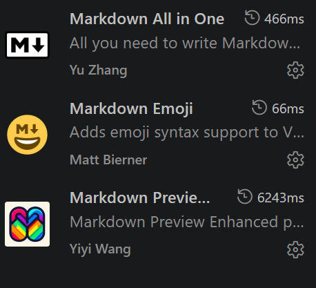
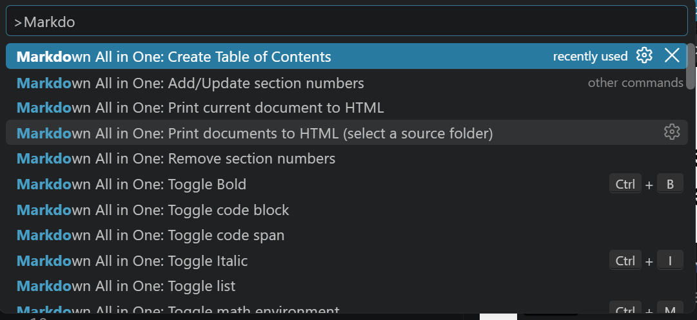
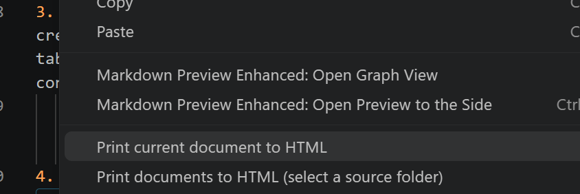

# Guía básica de Markdown

> **Antes de empezar.** Todos los manuales y entregables del módulo se escriben en Markdown, empezando por el de la
> [instalación de Linux Mint](../02-instalar-mint-virtualbox/1-explicacion.md).

## Índice

- [Guía básica de Markdown](#guía-básica-de-markdown)
  - [Índice](#índice)
  - [Qué vas a conseguir](#qué-vas-a-conseguir)
  - [1. Qué es Markdown y por qué lo usamos](#1-qué-es-markdown-y-por-qué-lo-usamos)
  - [2. Preparar Visual Studio Code](#2-preparar-visual-studio-code)
    - [2.1 Extensiones de Visual Studio Code](#21-extensiones-de-visual-studio-code)
    - [2.2 Vista previa](#22-vista-previa)
    - [2.3 Organiza la carpeta del documento](#23-organiza-la-carpeta-del-documento)
  - [3. Sintaxis básica](#3-sintaxis-básica)
    - [3.1 Párrafos y saltos de línea](#31-párrafos-y-saltos-de-línea)
    - [3.2 Encabezados](#32-encabezados)
    - [3.3 Negrita, cursiva y tachado](#33-negrita-cursiva-y-tachado)
    - [3.4 Listas](#34-listas)
    - [3.5 Enlaces](#35-enlaces)
    - [3.6 Imágenes](#36-imágenes)
    - [3.7 Código](#37-código)
    - [3.8 Citas y avisos](#38-citas-y-avisos)
    - [3.9 Tablas](#39-tablas)
    - [3.10 Separadores, comentarios y HTML](#310-separadores-comentarios-y-html)
    - [3.11 Escapar caracteres especiales](#311-escapar-caracteres-especiales)
  - [4. Capturas de pantalla sin sufrir](#4-capturas-de-pantalla-sin-sufrir)
  - [5. Índice automático](#5-índice-automático)
  - [6. Atajos que ahorran tiempo](#6-atajos-que-ahorran-tiempo)
  - [7. Cómo transformar documentos a HTML y a PDF](#7-cómo-transformar-documentos-a-html-y-a-pdf)
    - [7.1 De Markdown a HTML](#71-de-markdown-a-html)
    - [7.2 De HTML a PDF: imprimir en el navegador](#72-de-html-a-pdf-imprimir-en-el-navegador)
    - [7.3 Si vas a enviar el HTML: imágenes incrustadas](#73-si-vas-a-enviar-el-html-imágenes-incrustadas)
    - [7.4 Saltos de página](#74-saltos-de-página)
    - [7.5 Alternativa: Markdown Preview Enhanced](#75-alternativa-markdown-preview-enhanced)
  - [8. Plantilla para tus manuales técnicos](#8-plantilla-para-tus-manuales-técnicos)
  - [Lo que despista](#lo-que-despista)
  - [Problemas frecuentes](#problemas-frecuentes)

---

## Qué vas a conseguir

Al terminar sabrás:

- escribir un documento técnico en Markdown con títulos, listas, tablas, código y capturas;
- pegar capturas de pantalla sin pelearte con las rutas;
- generar el índice del documento de forma automática;
- convertir el documento a **HTML** y a **PDF** para entregarlo en Moodle.

> **Analogía.** Un fichero Markdown es una **receta** y el HTML o el PDF es el **plato
> emplatado**. En la receta escribes «esto va en negrita» poniendo dos asteriscos; al cocinarla
> (vista previa o exportación) aparece la negrita. En Word cocinas y emplatas a la vez: ves el
> resultado, pero no los ingredientes, y cuando algo se descoloca no hay manera de saber por qué.
> En Markdown la receta está siempre a la vista.

Seguramente ya lo has usado sin saberlo: cuando en WhatsApp escribes `*hola*` y sale en negrita,
estás usando un primo de Markdown. Primo, no hermano: hay una diferencia que confunde a todo el
mundo y está en [lo que despista](#lo-que-despista).

## 1. Qué es Markdown y por qué lo usamos

Markdown es un **lenguaje de marcas ligero** creado por John Gruber en 2004. Un fichero Markdown
tiene extensión `.md` y es **texto plano**: lo puedes abrir con el Bloc de notas de Windows, con
`nano` en Linux Mint o con `vim` en Arch. Las «marcas» son símbolos normales del teclado
(`#`, `*`, `-`, `>`) que indican cómo debe verse cada parte.

| Ventaja | Qué significa para ti en este módulo |
|---|---|
| Es texto plano | No depende de ningún programa ni sistema operativo. Un `.md` de hoy se abrirá igual dentro de veinte años |
| Los comandos se copian tal cual | Word cambia las comillas `"` por “ ” y los dos guiones `--` por una raya: el comando deja de funcionar. En un bloque de código de Markdown eso no pasa |
| Pesa muy poco | Un manual entero ocupa unos pocos KB; las capturas van aparte |
| Se convierte a lo que haga falta | HTML, PDF, diapositivas, páginas web |
| Es el estándar técnico | Los `README.md` de GitHub, las wikis, Obsidian y la documentación de casi cualquier proyecto de software |

**Lo que no hace bien** (conviene saberlo desde el principio): la maquetación fina. Columnas,
márgenes a medida o portadas vistosas no son su terreno. Y hay varios «sabores» de Markdown, así
que algo que se ve bien en un sitio puede verse distinto en otro. En esta guía usamos el sabor de
**GitHub** (*GitHub Flavored Markdown*), que es el que entiende Visual Studio Code.

## 2. Preparar Visual Studio Code

Visual Studio Code (VS Code) entiende Markdown sin instalar nada: colorea la sintaxis y tiene
vista previa. Las extensiones añaden atajos, índice automático y exportación a HTML.

### 2.1 Extensiones de Visual Studio Code

Abre la barra de extensiones con `Ctrl+Shift+X`, busca cada una por su nombre y **comprueba el
autor** antes de pulsar *Install*:



| Extensión | Autor | Para qué la usamos | ¿Hace falta? |
|---|---|---|---|
| **Markdown All in One** | Yu Zhang | Atajos de teclado, índice automático, numerar apartados y **exportar a HTML** | **Sí** |
| **Markdown Preview Enhanced** | Yiyi Wang | Vista previa más completa y exportación directa a PDF | Recomendada |
| **markdownlint** | David Anson | Subraya los errores de formato (títulos sin espacio, falta de líneas en blanco…) y explica cada uno | Recomendada |
| **Markdown Emoji** | Matt Bierner | Escribir emojis con códigos como `:warning:` | Opcional |

> **Por qué importa el autor.** En el *marketplace* hay extensiones con nombres casi idénticos. Si
> instalas otra, los menús y atajos de esta guía no coincidirán con lo que ves.

Los milisegundos que aparecen junto a cada extensión en la captura son lo que tarda en arrancar.
No hay que hacer nada con ellos.

### 2.2 Vista previa

| Atajo | Qué hace |
|---|---|
| `Ctrl+Shift+V` | Abre la vista previa en una pestaña nueva |
| `Ctrl+K` y después `V` | Abre la vista previa **al lado**: escribes a la izquierda y ves el resultado a la derecha |

Trabaja siempre con la vista previa al lado. Es la manera más rápida de aprender: escribes, miras,
corriges. Si tienes Markdown Preview Enhanced, el mismo atajo puede abrir su vista previa en lugar
de la de VS Code; las dos sirven.

### 2.3 Organiza la carpeta del documento

Cada documento que entregues vive en **su propia carpeta**, con las capturas en una subcarpeta:

```text
manual-instalacion-mint/
├── manual-instalacion-mint.md
├── manual-instalacion-mint.html      ← aparece al exportar
└── images/
    ├── 01-nueva-maquina-virtual.png
    ├── 02-particiones.png
    └── 03-escritorio.png
```

Tres normas que te ahorrarán problemas:

1. **Abre la carpeta, no el fichero suelto**: *Archivo → Abrir carpeta*. Así VS Code sabe dónde
   guardar las capturas que pegues y te sugiere rutas cuando escribes un enlace.
2. **Nombres en minúsculas, sin espacios ni tildes, con guiones**: `02-particiones.png`, no
   `Captura de pantalla (2).PNG`. Los espacios rompen los enlaces, y cuando más adelante uses la
   terminal de Linux lo agradecerás todavía más.
3. **Haz que las capturas vayan solas a `images/`** en lugar de quedarse sueltas junto al `.md`.
   Se configura una vez en VS Code; cómo, en el [apartado 4](#4-capturas-de-pantalla-sin-sufrir).

## 3. Sintaxis básica

En cada apartado verás **lo que escribes** en un bloque gris y justo debajo **cómo se ve**. Lo
mejor es que lo vayas copiando en un fichero de pruebas con la vista previa abierta.

### 3.1 Párrafos y saltos de línea

La regla más importante de Markdown: **una línea en blanco separa párrafos**. Pulsar Enter una
sola vez **no** crea un salto de línea: las dos líneas aparecen pegadas.

```markdown
Esta es la primera frase.
Esta sale pegada a la anterior, en el mismo párrafo.

Esto ya es otro párrafo, porque hay una línea en blanco encima.
```

Se ve así:

Esta es la primera frase.
Esta sale pegada a la anterior, en el mismo párrafo.

Esto ya es otro párrafo, porque hay una línea en blanco encima.

Si de verdad necesitas cambiar de línea sin empezar párrafo (una dirección, los datos de una
portada), termina la línea con una barra invertida `\`. También valen dos espacios al final, pero
son invisibles y es fácil perderlos.

### 3.2 Encabezados

Se escriben con almohadillas al principio de la línea. Cuantas más almohadillas, menor nivel:

```markdown
# Título del documento
## 1. Apartado
### 1.1 Subapartado
#### Nivel 4 (casi nunca hace falta)
```

Cuatro reglas:

1. **Espacio después de la almohadilla**: `# Título`. Sin espacio (`#Título`) no es un título, es
   texto normal.
2. **Un solo `#` por documento**: es el título. Los apartados empiezan en `##`.
3. **No te saltes niveles**: de `##` se pasa a `###`, no a `####`.
4. **Línea en blanco antes y después** de cada encabezado.

Los encabezados son el esqueleto del documento: con ellos se construye el
[índice automático](#5-índice-automático) y los enlaces a cada apartado. Un documento sin
encabezados es un armario sin cajones.

### 3.3 Negrita, cursiva y tachado

| Escribes | Se ve |
|---|---|
| `**negrita**` | **negrita** |
| `*cursiva*` o `_cursiva_` | *cursiva* |
| `***negrita y cursiva***` | ***negrita y cursiva*** |
| `~~tachado~~` | ~~tachado~~ |
| `` `lsblk -f` `` | `lsblk -f` |

**Cuándo usar cada una** en un documento técnico:

- **Negrita** para lo que no se puede pasar por alto: un aviso, un valor que hay que escribir
  exactamente, el nombre de un botón que hay que pulsar.
- *Cursiva* para términos nuevos o en inglés: *swap*, *live*, *hypervisor*.
- `Código` para todo lo que se escribe en un teclado o aparece tal cual en una pantalla: comandos,
  rutas, nombres de fichero, valores de configuración.

Si todo va en negrita, nada destaca.

### 3.4 Listas

**Lista sin orden.** Vale guion, asterisco o signo más; usa siempre el guion para ser coherente:

```markdown
- VirtualBox
- Linux Mint 22.3 Xfce
  - ISO de unos 2,8 GB
  - Soporte hasta 2029
- Visual Studio Code
```

- VirtualBox
- Linux Mint 22.3 Xfce
  - ISO de unos 2,8 GB
  - Soporte hasta 2029
- Visual Studio Code

Para anidar un elemento, sangra la línea con **dos espacios**, o pulsa `Tab` con el cursor en el
elemento y Markdown All in One pone la sangría correcta.

**Lista numerada**:

```markdown
1. Crea la máquina virtual.
2. Monta la ISO.
3. Arranca el instalador.
```

1. Crea la máquina virtual.
2. Monta la ISO.
3. Arranca el instalador.

**Pasos con código o capturas dentro.** Es lo que más se usa en un manual y lo que más se rompe.
Todo lo que pertenezca a un paso (un bloque de código, una imagen, un párrafo extra) tiene que ir
**sangrado tres espacios**, alineado con el texto del paso, y separado por líneas en blanco. Si no,
la lista se corta y el paso siguiente vuelve a empezar por el 1.

````markdown
1. Abre una terminal.
2. Actualiza la lista de paquetes:

   ```bash
   sudo apt update
   ```

3. Reinicia la máquina.
````

1. Abre una terminal.
2. Actualiza la lista de paquetes:

   ```bash
   sudo apt update
   ```

3. Reinicia la máquina.

**Lista de tareas**, muy útil para repasar un entregable antes de subirlo:

```markdown
- [x] Crear la máquina virtual
- [x] Instalar el sistema
- [ ] Instalar las Guest Additions
```

- [x] Crear la máquina virtual
- [x] Instalar el sistema
- [ ] Instalar las Guest Additions

Con el cursor en la línea, `Alt+C` marca o desmarca la casilla.

### 3.5 Enlaces

```markdown
[Notas de publicación de Linux Mint 22.3](https://linuxmint.com/rel_zena.php)

[Guía de instalación de Mint](../02-instalar-mint-virtualbox/1-explicacion.md)

[Ir al apartado de tablas](#39-tablas)

<https://www.virtualbox.org>
```

[Notas de publicación de Linux Mint 22.3](https://linuxmint.com/rel_zena.php)

[Guía de instalación de Mint](../02-instalar-mint-virtualbox/1-explicacion.md)

[Ir al apartado de tablas](#39-tablas)

<https://www.virtualbox.org>

Entre corchetes va el texto que se ve y entre paréntesis el destino. El destino puede ser:

| Destino | Ejemplo | Cuándo |
|---|---|---|
| Una web | `https://linuxmint.com` | Fuentes, descargas, documentación oficial |
| Otro fichero | `s02-instalacion-mint-virtualbox.md` | Remitir a otra guía o a un anexo. La ruta es **relativa** a la carpeta de tu `.md` |
| Un apartado del mismo documento | `#39-tablas` | Índices y referencias internas |

**Cómo se forma el ancla de un apartado** (`#39-tablas`): el título en minúsculas, cada espacio
cambiado por un guion y sin signos de puntuación; las tildes se mantienen. Así,
`## 3.9 Tablas` → `#39-tablas`. No hace falta calcularlo: escribe `(#` y VS Code te sugiere los
apartados del documento.

**Truco:** copia una URL, selecciona un texto en el editor y pulsa `Ctrl+V`. Markdown All in One
convierte el texto seleccionado en un enlace a esa URL.

### 3.6 Imágenes

Una imagen es un enlace con una exclamación delante:

```markdown

```

- **Entre corchetes va el texto alternativo** (*alt text*): lo que aparece si la imagen no carga y
  lo que lee en voz alta un lector de pantalla. Describe **qué muestra** la imagen; «captura»,
  «imagen» o «alt text» no dicen nada.
- **Entre paréntesis va la ruta**, relativa al `.md` y siempre con barra normal `/`, nunca con
  `\`, aunque estés en Windows.

**Pie de figura.** Markdown no tiene pies de figura. En los manuales usamos esta convención: una
línea en cursiva justo debajo de la imagen, con número.

```markdown


*Figura 2. Tabla de particiones antes de pulsar «Instalar ahora».*
```

**Tamaño.** Markdown no permite cambiar el tamaño de una imagen. Si una captura sale enorme, usa
HTML, que Markdown acepta dentro del texto:

```markdown

```

Cómo hacer y pegar las capturas sin escribir rutas a mano está en el
[apartado 4](#4-capturas-de-pantalla-sin-sufrir).

### 3.7 Código

**Código en línea**: entre acentos graves, dentro de una frase. Para comandos, rutas, nombres de
fichero y valores. Por ejemplo: la salida de `lsblk -f` muestra el UUID de `/dev/sda2`.

**Bloque de código**: tres acentos graves en una línea, el código, y otros tres para cerrar. Justo
después de los tres primeros se escribe el **lenguaje**, para que se coloree bien:

````markdown
```bash
sudo apt update && sudo apt upgrade
```
````

```bash
sudo apt update && sudo apt upgrade
```

| Lenguaje | Para qué |
|---|---|
| `bash` | Comandos de Linux y scripts |
| `powershell` | PowerShell de Windows |
| `bat` | CMD y ficheros `.bat` de Windows |
| `text` | **Salidas de comandos** y cualquier cosa que no deba colorearse |
| `ini`, `json`, `yaml` | Ficheros de configuración con ese formato |
| `markdown` | Ejemplos de Markdown, como los de esta guía |

**Las salidas de los comandos van en texto, no en captura.** Es un requisito de los entregables del
módulo y tiene motivo: el texto se puede buscar, copiar y comprobar. Una captura de una terminal es
como entregar la foto de un apunte en lugar del apunte.

````markdown
```bash
free -h
```

```text
               total       usado       libre  compartido   búf/caché  disponible
Mem:           3,8Gi       1,1Gi       1,6Gi        45Mi       1,3Gi       2,5Gi
Inter:         2,0Gi          0B       2,0Gi
```
````

Separa siempre el **comando** (bloque `bash`) de su **salida** (bloque `text`): así quien lea el
manual puede copiar el comando sin arrastrar la salida.

> **Cómo sacar la salida de la máquina virtual.** En la terminal de Mint se copia con
> `Ctrl+Shift+C`. Para pegarla en Windows necesitas el portapapeles compartido (*Dispositivos →
> Portapapeles compartido → Bidireccional*, con las Guest Additions instaladas). Si no funciona,
> guarda la salida en la carpeta compartida y ábrela desde Windows:
> `lsblk -f > /media/sf_compartida/lsblk.txt`

### 3.8 Citas y avisos

Una línea que empieza por `>` se muestra como un bloque destacado. En los manuales lo usamos para
**avisos**:

```markdown
> **Aviso.** Desmarca «Proceed with Unattended Installation» antes de pulsar *Finish*.
> Si no, el instalador arranca solo y no podrás hacer el particionado manual.
```

> **Aviso.** Desmarca «Proceed with Unattended Installation» antes de pulsar *Finish*.
> Si no, el instalador arranca solo y no podrás hacer el particionado manual.

GitHub tiene además avisos con icono (`> [!NOTE]`, `> [!WARNING]`), pero no todos los visores los
muestran. Usa la forma simple y funcionará en todas partes.

### 3.9 Tablas

```markdown
| Partición | Tamaño   | Formato | Punto de montaje |
|-----------|---------:|---------|------------------|
| 1         |   512 MB | FAT32   | `/boot/efi`      |
| 2         | 15000 MB | ext4    | `/`              |
| 3         |  2048 MB | swap    | —                |
| 4         |  9284 MB | ext4    | `/home`          |
```

| Partición | Tamaño   | Formato | Punto de montaje |
|-----------|---------:|---------|------------------|
| 1         |   512 MB | FAT32   | `/boot/efi`      |
| 2         | 15000 MB | ext4    | `/`              |
| 3         |  2048 MB | swap    | —                |
| 4         |  9284 MB | ext4    | `/home`          |

- La **primera fila** es la cabecera y la **segunda**, la de guiones, es obligatoria: sin ella no
  hay tabla.
- Los **dos puntos** de la fila de guiones alinean la columna: `:---` a la izquierda, `---:` a la
  derecha (buena idea para números) y `:---:` centrado.
- **No hace falta alinear las barras a mano.** Escribe la tabla como salga y pulsa `Shift+Alt+F`:
  Markdown All in One la ordena.
- **Límites:** no se pueden combinar celdas ni escribir varias líneas en una celda. Si necesitas un
  salto dentro de una celda, usa `<br>`.

### 3.10 Separadores, comentarios y HTML

**Línea horizontal**: tres guiones solos en una línea, **con una línea en blanco encima**.

```markdown
Fin del apartado.

---

## Siguiente apartado
```

**Comentarios**: no se ven en la vista previa ni en el PDF. Útiles para notas de trabajo.

```markdown
<!-- Pendiente: repetir la captura 4, sale cortada -->
```

Ojo: el comentario **sí** está dentro del `.md`. Si entregas el fichero fuente, quien lo abra lo
leerá.

**HTML**: Markdown acepta etiquetas HTML sueltas. Las tres que más se usan en un manual:

| HTML | Para qué |
|---|---|
| `<kbd>Ctrl</kbd>+<kbd>Alt</kbd>+<kbd>T</kbd>` | Dibujar teclas: <kbd>Ctrl</kbd>+<kbd>Alt</kbd>+<kbd>T</kbd> |
| `<br>` | Salto de línea dentro de una celda de tabla |
| `` | Imagen con un tamaño concreto |

### 3.11 Escapar caracteres especiales

Si quieres que un símbolo de Markdown aparezca tal cual, ponle delante una barra invertida: `\*`
muestra un asterisco y `\#` una almohadilla.

En documentos técnicos casi nunca hace falta, porque **todo lo técnico va en código** y dentro del
código los símbolos no se interpretan. Escribe `` `*.txt` `` y no `*.txt` suelto, que abre una
cursiva que no se cierra nunca.

## 4. Capturas de pantalla sin sufrir

VS Code sabe pegar imágenes en un fichero Markdown: guarda la imagen como fichero y escribe el
enlace por ti. El flujo de trabajo es este:

1. **Haz la captura.** En Windows, `Win+Shift+S` abre Recortes: selecciona la zona y la captura
   queda en el portapapeles. Captura **la ventana o la zona que importa**, no la pantalla entera
   con la barra de tareas.
2. **Pégala en VS Code.** Coloca el cursor en una línea vacía del `.md` y pulsa `Ctrl+V`. VS Code
   crea un fichero (`image.png`, `image-1.png`, `image-2.png`…) y escribe el enlace:

   ```markdown
   
   ```

   Según la versión de VS Code, los corchetes pueden aparecer vacíos en lugar de con `alt text`.

3. **Cambia `alt text` por una descripción** de lo que muestra la captura.
4. **Añade el pie de figura** debajo, en cursiva y numerado.

También puedes **arrastrar** una imagen desde el Explorador de Windows: mantén pulsado `Mayús`
mientras la sueltas sobre el texto.

**Que las capturas vayan solas a `images/`.** Por defecto VS Code las deja junto al `.md`, y con
veinte capturas la carpeta se vuelve ilegible. Abre la paleta de comandos (`Ctrl+Shift+P`), busca
*Preferencias: Abrir configuración de usuario (JSON)* y añade dentro de las llaves:

```json
"markdown.copyFiles.destination": {
    "**/*.md": "images/"
},
"markdown.updateLinksOnFileMove.enabled": "prompt"
```

- La primera línea guarda las capturas pegadas en la subcarpeta `images/` del documento.
- **Si en una misma carpeta guardas varios documentos**, usa `"images/${documentBaseName}/"` en
  lugar de `"images/"`: cada documento tendrá su propia subcarpeta de capturas
  (`images/manual-mint/`, `images/manual-windows/`…) y no se pisarán los `image-1.png` de uno y
  otro. Es como están organizadas estas mismas guías.
- La segunda hace que, si renombras o mueves una imagen desde el explorador de VS Code, te
  pregunte si quieres **actualizar los enlaces**. Sin ella, renombrar `image-1.png` a
  `01-nueva-maquina-virtual.png` rompe la imagen en el documento.

> **Si la captura viene del programa Recortes guardada como fichero**, su nombre será algo como
> `Captura de pantalla 2026-09-15 101112.png`. Renómbrala antes de enlazarla: los espacios hacen
> que el enlace no funcione o se llene de `%20`.

## 5. Índice automático

Markdown All in One genera el índice a partir de los encabezados, con enlaces a cada apartado:

1. Coloca el cursor donde quieras el índice, normalmente debajo del título.
2. Abre la paleta de comandos con `Ctrl+Shift+P` y escribe `Markdown`.
3. Elige **Markdown All in One: Create Table of Contents**.



Lo mejor: **el índice se actualiza solo cada vez que guardas** (`Ctrl+S`). Si cambias el nombre de
un apartado, guarda y el enlace del índice se corrige.

En la misma paleta hay otros dos comandos útiles:

| Comando | Qué hace |
|---|---|
| **Add/Update section numbers** | Numera todos los apartados (1, 1.1, 1.2, 2…) y los renumera si insertas uno en medio |
| **Remove section numbers** | Quita la numeración que puso el comando anterior |

Dos ajustes finos:

- Para que el propio título «Índice» no salga dentro del índice, añade `<!-- omit from toc -->` al
  final de su línea: `## Índice <!-- omit from toc -->`.
- Si solo quieres los niveles `##` y `###`, busca en la configuración de VS Code
  `markdown.extension.toc.levels` y pon `2..3`.

## 6. Atajos que ahorran tiempo

| Atajo | Qué hace | Lo aporta |
|---|---|---|
| `Ctrl+B` | Negrita al texto seleccionado (o la quita) | Markdown All in One |
| `Ctrl+I` | Cursiva | Markdown All in One |
| `Alt+S` | Tachado | Markdown All in One |
| `Ctrl+Shift+]` / `Ctrl+Shift+[` | Sube o baja el nivel del encabezado de la línea | Markdown All in One |
| `Alt+C` | Marca o desmarca una casilla de tarea | Markdown All in One |
| `Enter` dentro de una lista | Crea el siguiente elemento con su guion o su número | Markdown All in One |
| `Tab` / `Shift+Tab` en una lista | Sangra o desangra el elemento | Markdown All in One |
| `Shift+Alt+F` | Ordena y alinea las tablas | Markdown All in One |
| `Ctrl+V` con una URL copiada y texto seleccionado | Convierte el texto en enlace | Markdown All in One |
| `Ctrl+Shift+V` | Vista previa | VS Code |
| `Ctrl+K` y después `V` | Vista previa al lado | VS Code |
| `Ctrl+Shift+P` | Paleta de comandos: desde aquí se llega a todo | VS Code |

Los atajos que llevan corchetes (`Ctrl+Shift+]`) están pensados para el teclado inglés y en el
español pueden no responder. No pasa nada: añadir o quitar una `#` a mano es igual de rápido.

**Símbolos en el teclado español.** Los que más cuesta encontrar la primera vez:

| Símbolo | Para qué | Cómo se escribe |
|---|---|---|
| `#` | Encabezados | `AltGr+3` |
| `` ` `` (acento grave) | Código | Tecla a la derecha de la P y después **espacio** |
| `~` | Tachado | `AltGr+4` (si no aparece, pulsa espacio después) |
| barra vertical \| | Tablas | `AltGr+1` |
| `[` y `]` | Enlaces e imágenes | `AltGr` + las dos teclas a la derecha de la P |
| `\` | Escapar símbolos | `AltGr` + tecla `º`, a la izquierda del 1 |
| `*` | Énfasis | `Mayús` + tecla `+` |

## 7. Cómo transformar documentos a HTML y a PDF

Moodle recibe los manuales en **PDF**. El camino que usamos tiene dos pasos:

```text
documento.md  ──(Markdown All in One)──►  documento.html  ──(navegador: Imprimir)──►  documento.pdf
```

¿Por qué pasar por HTML en lugar de ir directo a PDF? Porque el navegador es la mejor «impresora»
que tienes instalada: genera un PDF con el texto seleccionable, los enlaces funcionando y las
imágenes con buena calidad, y no hace falta instalar nada más.

### 7.1 De Markdown a HTML

1. Guarda el `.md` (`Ctrl+S`).
2. Haz **clic derecho dentro del editor**, sobre el texto (no sobre la vista previa) y elige
   **Print current document to HTML**. También está en la paleta de comandos como
   *Markdown All in One: Print current document to HTML*.

   

3. Aparece un fichero con el **mismo nombre y extensión `.html`** en la misma carpeta que el `.md`.

La opción de debajo, **Print documents to HTML (select a source folder)**, convierte de golpe
todos los `.md` de una carpeta.

**Título de la pestaña y del PDF.** Si en la primera línea del documento escribes
`<!-- title: Manual de instalación de Linux Mint -->`, el HTML usará ese título.

### 7.2 De HTML a PDF: imprimir en el navegador

1. Haz doble clic en el `.html`: se abre en tu navegador.
2. Pulsa `Ctrl+P`.
3. En **Destino**, elige **Guardar como PDF** (así se llama en Chrome y Edge; en Firefox el nombre
   cambia ligeramente). No elijas *Microsoft Print to PDF*: también genera un PDF, pero los enlaces
   dejan de funcionar.
4. Despliega **Más ajustes** y revisa tres cosas (los nombres son los de Chrome y Edge):
   - **Encabezados y pies de página: desmarcado.** Si no, cada página lleva la fecha y la ruta del
     fichero (`file:///C:/Users/tu-usuario/...`).
   - **Gráficos de fondo: marcado.** Si no, los bloques de código y las cabeceras de las tablas
     salen sin fondo y cuestan de leer.
   - **Márgenes: predeterminados.**
5. Pulsa **Guardar**.
6. **Abre el PDF y repásalo entero antes de subirlo**: tablas cortadas, capturas partidas entre dos
   páginas, imágenes que no aparecen. Lo que se evalúa es el PDF, no lo que veías en VS Code.

### 7.3 Si vas a enviar el HTML: imágenes incrustadas

Por defecto, el HTML exportado **no contiene las imágenes**: apunta a ellas con la ruta completa
de tu ordenador (`C:\Users\...\images\02-particiones.png`). En tu equipo se ve perfecto; si subes
el HTML a Moodle o se lo mandas a alguien, las imágenes desaparecen.

> **Analogía.** Es como mandar una carta que dice «la foto está en el cajón de mi escritorio».
> Tú la encuentras; el que recibe la carta, no. Incrustar las imágenes es meter la foto dentro del
> sobre.

Para el PDF no importa (las imágenes ya van dentro del PDF). Pero si necesitas entregar el HTML,
activa este ajuste en la configuración de VS Code y vuelve a exportar:

```json
"markdown.extension.print.imgToBase64": true
```

El HTML pesará más, pero será **un único fichero** con todo dentro.

### 7.4 Saltos de página

El navegador corta las páginas donde le cabe el texto. Si quieres forzar un salto (después de la
portada, antes de un apartado largo, para que una captura no quede partida), escribe esta línea
donde quieras que empiece la página nueva:

```markdown
<div style="page-break-after: always;"></div>
```

En la vista previa no se ve nada; el salto solo aparece al imprimir.

### 7.5 Alternativa: Markdown Preview Enhanced

Markdown Preview Enhanced puede exportar a PDF sin pasar por el navegador:

1. Clic derecho en el editor → **Markdown Preview Enhanced: Open Preview to the Side**.
2. Clic derecho **sobre esa vista previa** → *Export* → **Chrome (Puppeteer)** → **PDF**.

Necesita tener Google Chrome instalado en el equipo. Si falla, no pierdas tiempo: usa el camino de
los apartados [7.1](#71-de-markdown-a-html) y [7.2](#72-de-html-a-pdf-imprimir-en-el-navegador),
que funciona siempre.

## 8. Plantilla para tus manuales técnicos

Copia este esqueleto en un `.md` nuevo cada vez que empieces un manual. Está pensado para que
cumpla lo que se pide en los entregables del módulo: ficha de la máquina, pasos con capturas
numeradas, verificación con salidas en texto e incidencias.

````markdown
<!-- title: Manual de instalación de Linux Mint · Nombre Apellido -->

# Manual de instalación de Linux Mint en VirtualBox

**Autor:** Nombre Apellido · **Grupo:** 1MS2A · **Fecha:** AAAA-MM-DD

## Índice

<!-- Ctrl+Shift+P → Markdown All in One: Create Table of Contents -->

## 1. Objetivo

Qué se instala, sobre qué y para qué, en dos o tres líneas.

## 2. Ficha de la máquina virtual

| Parámetro | Valor |
|---|---|
| Nombre | `Mint-SMR` |
| Memoria RAM | 4096 MB |
| Procesadores | 2 |
| Disco | 25 GB, VDI, reserva dinámica |
| EFI | Habilitado |
| Controlador gráfico | VMSVGA |
| Red | NAT |

## 3. Procedimiento

### 3.1 Crear la máquina virtual

1. Abre VirtualBox y pulsa **Nueva**.
2. Escribe el nombre `Mint-SMR` y selecciona la ISO.

   

   *Figura 1. Nombre, carpeta e imagen ISO de la máquina.*

3. Siguiente paso…

## 4. Verificación

```bash
lsblk -f
```

```text
(pega aquí la salida del comando)
```

## 5. Incidencias

| Problema | Causa | Solución |
|---|---|---|
| … | … | … |

## 6. Conclusiones

Qué has aprendido y qué harías distinto la próxima vez.
````

## Lo que despista

- **WhatsApp no es Markdown.** En WhatsApp, `*texto*` es negrita; en Markdown, `*texto*` es
  **cursiva**. La negrita de Markdown lleva dos asteriscos: `**texto**`.
- **`#Título` sin espacio no es un título.** Se queda como texto normal con una almohadilla
  delante. Siempre `# Título`.
- **Un Enter no es un salto de línea.** Dos líneas seguidas sin línea en blanco en medio salen
  pegadas en el mismo párrafo.
- **La numeración vuelve a empezar por 1** cuando metes un bloque de código o una imagen dentro de
  una lista sin sangrarlos tres espacios.
- **Tres guiones justo debajo de una línea de texto la convierten en título.** `---` solo es una
  línea horizontal si tiene una línea en blanco encima.
- **Mayúsculas en los nombres de fichero.** Windows no distingue `Image.png` de `image.png`, pero
  Linux y GitHub sí. Un enlace mal escrito funciona en tu PC y se rompe en cuanto el documento sale
  de él. Es la primera vez que te cruzas con esta diferencia entre sistemas operativos; no será la
  última.
- **Comillas «inteligentes».** Si copias un comando de Word o de una web y lo pegas fuera de un
  bloque de código, las comillas `"` pueden haberse convertido en “ ”. La terminal no las entiende.
- **La vista previa no es la entrega.** Lo que se evalúa es el PDF. Algo que se ve bien en VS Code
  puede salir cortado o sin imágenes al imprimir: ábrelo siempre antes de subirlo.
- **Los emojis con código** (`:warning:`) solo se ven donde está instalada Markdown Emoji. Un emoji
  de verdad, insertado con `Win+.`, se ve en todas partes.

## Problemas frecuentes

| Síntoma | Causa habitual | Solución |
|---|---|---|
| No aparece *Print current document to HTML* | Markdown All in One no está instalada, o has hecho clic derecho en la vista previa | Instálala y haz clic derecho sobre el texto del editor |
| Los atajos de Markdown no hacen nada | VS Code no reconoce el fichero como Markdown | Comprueba que la extensión es `.md` y que abajo a la derecha pone *Markdown* |
| La imagen no aparece en la vista previa | Ruta mal escrita, espacios en el nombre, `\` en lugar de `/` o mayúsculas distintas | Renombra sin espacios, usa `/` y copia el nombre exacto |
| Las imágenes se ven en tu PC pero no en el HTML subido a Moodle | El HTML apunta a las imágenes con la ruta de tu disco | Activa `markdown.extension.print.imgToBase64` y exporta de nuevo |
| El PDF lleva la fecha y `file:///C:/...` arriba y abajo | Encabezados y pies de página activados | Desmárcalos en *Más ajustes* al imprimir |
| Los bloques de código salen sin fondo en el PDF | Gráficos de fondo desactivados | Márcalos en *Más ajustes* al imprimir |
| Un enlace del índice no lleva a ningún sitio | Cambiaste el nombre del apartado y el índice no se ha actualizado | Guarda con `Ctrl+S` o vuelve a ejecutar *Create Table of Contents* |
| La tabla se ve como texto con barras | Falta la fila de guiones o la línea en blanco antes de la tabla | Añádelas y pulsa `Shift+Alt+F` |
| Los pasos de una lista vuelven a empezar por 1 | Código o imagen dentro de la lista sin sangrar | Sangra tres espacios todo lo que pertenece al paso |
| A partir de un punto todo sale en cursiva | Un `*` o un `_` suelto sin cerrar, por ejemplo `*.txt` fuera de código | Pon el texto técnico entre acentos graves |
| No puedo copiar la salida de la terminal de la máquina virtual | Portapapeles compartido desactivado o sin Guest Additions | *Dispositivos → Portapapeles compartido → Bidireccional*, o redirige la salida a la carpeta compartida |
| Las capturas pegadas se llaman `image-1.png`, `image-2.png`… | Es el nombre que pone VS Code | Renómbralas desde el explorador de VS Code con el ajuste de actualizar enlaces activado |
