# Instalación de GNU/Linux (Linux Mint) en máquina virtual

## Índice

- [Instalación de GNU/Linux (Linux Mint) en máquina virtual](#instalación-de-gnulinux-linux-mint-en-máquina-virtual)
  - [Índice](#índice)
  - [Qué vas a conseguir](#qué-vas-a-conseguir)
  - [1. Descargar la imagen ISO](#1-descargar-la-imagen-iso)
  - [2. Crear la máquina virtual](#2-crear-la-máquina-virtual)
    - [2.1 Nombre y sistema operativo](#21-nombre-y-sistema-operativo)
    - [2.2 Hardware](#22-hardware)
    - [UEFI + GPT vs BIOS + MBR](#uefi--gpt-vs-bios--mbr)
    - [2.3 Disco duro](#23-disco-duro)
    - [2.4 Pantalla, aceleración y red](#24-pantalla-aceleración-y-red)
  - [3. Arrancar el instalador](#3-arrancar-el-instalador)
  - [4. Particionado manual](#4-particionado-manual)
    - [4.1 Por qué los números no cuadran](#41-por-qué-los-números-no-cuadran)
    - [4.2 Crear las cuatro particiones](#42-crear-las-cuatro-particiones)
    - [4.3 Lo que despista de esta pantalla](#43-lo-que-despista-de-esta-pantalla)
    - [4.4 Dispositivo donde instalar el cargador de arranque](#44-dispositivo-donde-instalar-el-cargador-de-arranque)
  - [5. Zona horaria y usuario](#5-zona-horaria-y-usuario)
  - [6. Primer arranque y verificación](#6-primer-arranque-y-verificación)
  - [7. Guest Additions](#7-guest-additions)
  - [8. Carpeta compartida con el anfitrión](#8-carpeta-compartida-con-el-anfitrión)
  - [Problemas frecuentes](#problemas-frecuentes)

---

## Qué vas a conseguir

Al terminar tendrás una máquina virtual con **Linux Mint 22.3 «Zena» Xfce** instalado **con
particionado manual**, es decir, habiendo decidido tú mismo cuánto espacio va a cada parte del
sistema en lugar de dejar que el instalador lo haga por ti.

> **Analogía.** El particionado automático es como comprar un armario ya montado: funciona,
> pero no sabes por qué los cajones están donde están. El particionado manual es montarlo tú:
> decides cuántos cajones hay, de qué tamaño y qué guardas en cada uno. En esta asignatura
> montamos el armario, porque el día que un cajón se llene tendrás que saber cuál es.

Sobre un disco virtual de **25 GB** crearás cuatro particiones:

| Partición | Tamaño en el instalador | Formato | Punto de montaje | Para qué sirve |
|---|---|---|---|---|
| 1 | `512` MB | FAT32 (EFI) | `/boot/efi` | El firmware UEFI busca aquí el gestor de arranque |
| 2 | `15000` MB | ext4 | `/` (raíz) | El sistema operativo y los programas |
| 3 | `2048` MB | swap | — | Memoria de intercambio (extensión de la RAM en disco) |
| 4 | `9284` MB (el resto) | ext4 | `/home` | Tus datos personales |

Suma: **26 844 MB**, que es el disco entero. Si al final te sobran unos pocos MB de espacio
libre, no pasa nada: es la alineación del disco, no un error tuyo.

**Por qué esos tamaños** (esto te lo van a preguntar en el entregable):

- **EFI 512 MB**: es lo estándar. Sólo guarda el arranque; con 100 MB bastaría, pero 512 MB
  deja sitio para varios sistemas operativos y evita problemas en el futuro.
- **Raíz 15 GB**: Mint recién instalado ocupa unos 8 GB. 15 GB te deja margen para instalar
  programas durante todo el curso sin quedarte sin sitio.
- **Swap 2048 MB**: la mitad de la RAM que le hemos dado a la máquina (4 GB). Como una máquina
  virtual no hiberna nunca, no necesitas que la swap sea tan grande como la RAM.
- **`/home` el resto**: los datos crecen hasta llenar lo que haya.

**Por qué `/home` va aparte:** si algún día reinstalas el sistema, formateas `/` y dejas `/home`
intacto. Tus documentos y tu configuración sobreviven a la reinstalación. Es el equivalente a
tener `C:` para Windows y `D:` para tus datos, pero en Linux es la práctica habitual.

## 1. Descargar la imagen ISO

Descarga **Linux Mint 22.3 «Zena» — Xfce Edition (64 bits)** de la web oficial:

- https://linuxmint.com/download.php → botón **Download** de la columna **Xfce**

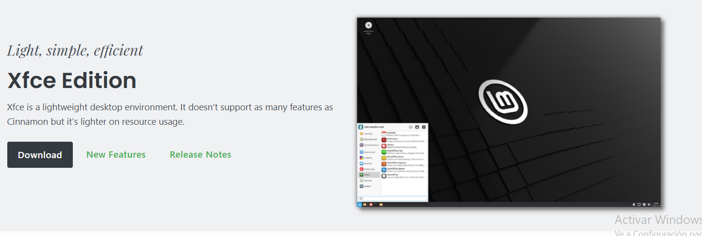

Elige un espejo de descarga cercano (España) y guarda el archivo
**`linuxmint-22.3-xfce-64bit.iso`** (unos **2,8 GB**) en una carpeta que recuerdes, por ejemplo
`C:\ISOs\`.

> **Por qué Mint Xfce y no otra cosa.** Mint 22.3 está construido sobre **Ubuntu 24.04 LTS** y
> tiene soporte **hasta abril de 2029**: todo lo que aprendas aquí (`apt`, permisos, rutas) vale
> igual en Ubuntu. **Xfce** es el escritorio ligero de los tres que ofrece Mint (Cinnamon, Xfce
> y MATE): consume bastante menos RAM, que es justo lo que nos interesa cuando el sistema corre
> dentro de otro sistema.

> **Buena costumbre profesional.** En la misma página hay un enlace a `sha256sum.txt`. Ese
> archivo contiene la «huella dactilar» de la ISO. Si descargas la ISO de un espejo y la huella
> coincide, tienes la certeza de que el archivo no está corrupto ni manipulado. En Windows:
> `certutil -hashfile linuxmint-22.3-xfce-64bit.iso SHA256`.

## 2. Crear la máquina virtual

En VirtualBox, pulsa **Nueva**.

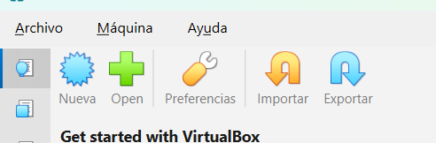

### 2.1 Nombre y sistema operativo

| Campo | Valor |
|---|---|
| Nombre (*VM Name*) | `Mint-SMR` |
| Carpeta | la que uses para las MV del curso |
| Imagen ISO | el `.iso` que acabas de descargar |
| Tipo (*OS*) | Linux |
| Distribución / Versión | Ubuntu (64-bit) — si tu VirtualBox ofrece «Linux Mint», elígelo |

> ⚠️ **Muy importante: nada de instalación desatendida.** VirtualBox detecta la ISO y se ofrece
> a instalar el sistema él solo. Si le dejas, te saltas justo lo que vamos a evaluar: el
> particionado manual.
>
> - En VirtualBox 7.2: **desmarca** la casilla **«Proceed with Unattended Installation»**
>   (*Continuar con la instalación desatendida*).
> - En versiones anteriores la casilla es la contraria, **«Skip Unattended Installation»**
>   (*Omitir instalación desatendida*), y hay que **marcarla**.
>
> Lee la casilla antes de pulsar: cambia de nombre según la versión, pero el objetivo es
> siempre el mismo, que VirtualBox **no** instale nada por su cuenta.

Así debe quedar la pantalla: la casilla de abajo **sin marcar**.

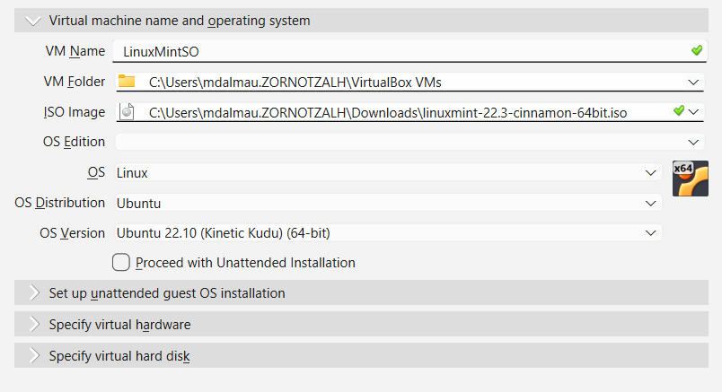

> **No te preocupes si «OS Version» detecta algo raro** (por ejemplo «Ubuntu 22.10»). VirtualBox
> sólo usa ese dato para elegir valores por defecto; no cambia en nada lo que se instala. Lo que
> importa es que **OS** ponga `Linux` y que la ISO sea la correcta.

### 2.2 Hardware

Utiliza los desplegables para configurar los requisitos de hardware de la máquina.

| Recurso | Valor | Por qué |
|---|---|---|
| Memoria base | **4096 MB** (mínimo 2048) | El instalador gráfico necesita bastante RAM |
| Procesadores | **2** | Acelera la instalación notablemente |
| Habilitar EFI (*Use EFI*) | **Sí** | Usamos UEFI + GPT |

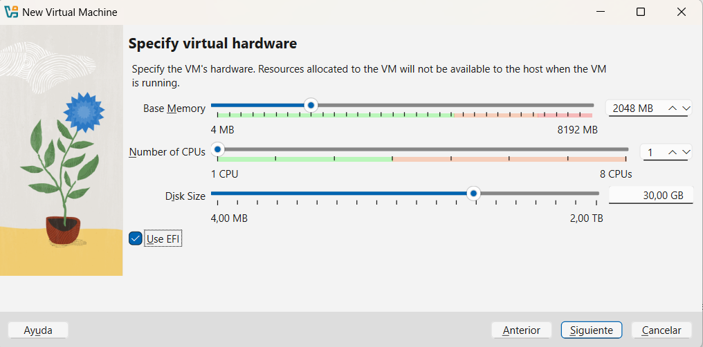

### UEFI + GPT vs BIOS + MBR

> 💡 Piensa en tu ordenador como una persona que acaba de despertarse. Antes de poder empezar a
> trabajar (cargar Windows, macOS o Linux) necesita que alguien le dé los buenos días, compruebe
> que todos sus componentes funcionan y le diga dónde buscar el sistema operativo. Ése es el
> trabajo de la **BIOS** o la **UEFI**. Una vez que encuentra el disco duro, necesita un índice
> o «mapa» para saber cómo están organizados los datos dentro. Ese mapa es el **MBR** o la
> **GPT**.

**El despertador del PC: BIOS vs. UEFI**

- **BIOS** (*Basic Input/Output System*): el sistema antiguo. Imagina un móvil de los años 90:
  pantalla azul o negra, letras pixeladas, sólo se maneja con las flechas del teclado y es lento.
- **UEFI** (*Unified Extensible Firmware Interface*): la evolución moderna. El smartphone actual.
  Interfaz gráfica, ratón, arranque en un par de segundos y seguridad avanzada antes incluso de
  que cargue el sistema. Casi cualquier PC de los últimos 10 años usa UEFI.

**El mapa del disco duro: MBR vs. GPT**

- **MBR** (*Master Boot Record*): la organización vieja. No sabe leer discos de más de **2 TB** y
  sólo permite **4 particiones primarias**.
- **GPT** (*GUID Partition Table*): el estándar moderno. Maneja discos gigantescos y permite
  **hasta 128 particiones**. Si tienes UEFI y discos rápidos (SSD M.2), siempre GPT.

En esta asignatura instalamos **siempre** en UEFI + GPT, igual que se hace hoy en una empresa.

### 2.3 Disco duro

| Campo | Valor |
|---|---|
| Tamaño | **25 GB** |
| Reservar tamaño completo | **No** (reserva dinámica) |

> **Reserva dinámica** significa que el archivo `.vdi` empieza ocupando poco y crece según se
> va llenando. Ocupa menos en tu disco real a cambio de ser algo más lento. Para clase compensa.

### 2.4 Pantalla, aceleración y red

Antes de arrancar, entra en **Configuración**. Estos ajustes no son un capricho: son los que
**las propias notas de publicación de Linux Mint 22.3 recomiendan** para máquinas virtuales.

| Dónde | Ajuste | Por qué |
|---|---|---|
| Pantalla → Pantalla | Controlador gráfico **VMSVGA** | Con otro controlador la pantalla se queda en negro |
| Pantalla → Pantalla | Memoria de vídeo **128 MB** | Con menos, el escritorio va a tirones |
| Pantalla → Pantalla | Aceleración 3D **desactivada** | Provoca fallos de dibujado en aplicaciones GTK4/Webkit |
| Sistema → Aceleración | **Paginación anidada** activada | Evita que la sesión *live* se vea con la pantalla rota |
| Red → Adaptador 1 | **NAT** | Suficiente para tener internet durante la instalación |

## 3. Arrancar el instalador

Arranca la máquina. Verás un menú de arranque; elige **Start Linux Mint 22.3 Xfce 64-bit**.

Mint **no instala directamente**: primero entra en una **sesión *live***, un sistema completo
funcionando desde la ISO, sin tocar el disco.

> **Qué es una sesión *live*.** Es un sistema operativo que arranca desde el CD/USB y funciona
> en RAM. Sirve para probar el sistema antes de instalarlo y, sobre todo, para **rescatar un
> equipo averiado**: puedes entrar, leer el disco y sacar los datos aunque el sistema instalado
> no arranque. En la sesión *live* el usuario es `mint` y la contraseña está **vacía**.

Cuando tengas el escritorio, haz doble clic en el icono **Install Linux Mint**.

El instalador te va guiando:

1. **Idioma:** Español.
2. **Distribución del teclado:** Spanish / Español. **Pruébalo en el cuadro de texto** escribiendo
   `ñ` y `@`: es el error más frecuente y el más molesto después, cuando escribas contraseñas.
3. **Códecs multimedia:** deja la casilla **sin marcar**.

> ⚠️ **Por qué no instalamos los códecs aquí.** Los códecs de Mint arrastran el paquete
> `gstreamer1.0-vaapi`, que necesita aceleración 3D para reproducir vídeo. Como en la máquina
> virtual hemos **desactivado** la aceleración 3D (apartado 2.4), reproducir un vídeo tumbaría
> el servidor gráfico y te cerraría la sesión. Es un problema conocido y documentado por Mint.
> Si algún día los necesitas en la MV: `sudo apt install mint-meta-codecs` y después
> `sudo apt remove gstreamer1.0-vaapi`.

4. **Tipo de instalación:** **NO** elijas «Borrar disco e instalar Linux Mint». Elige
   **«Más opciones»** (en algunas versiones, «Algo más» o *Something else*). Es la única que te
   deja hacer las particiones a mano.

## 4. Particionado manual

Verás el disco `/dev/sda` entero como **espacio libre**, sin ninguna partición.

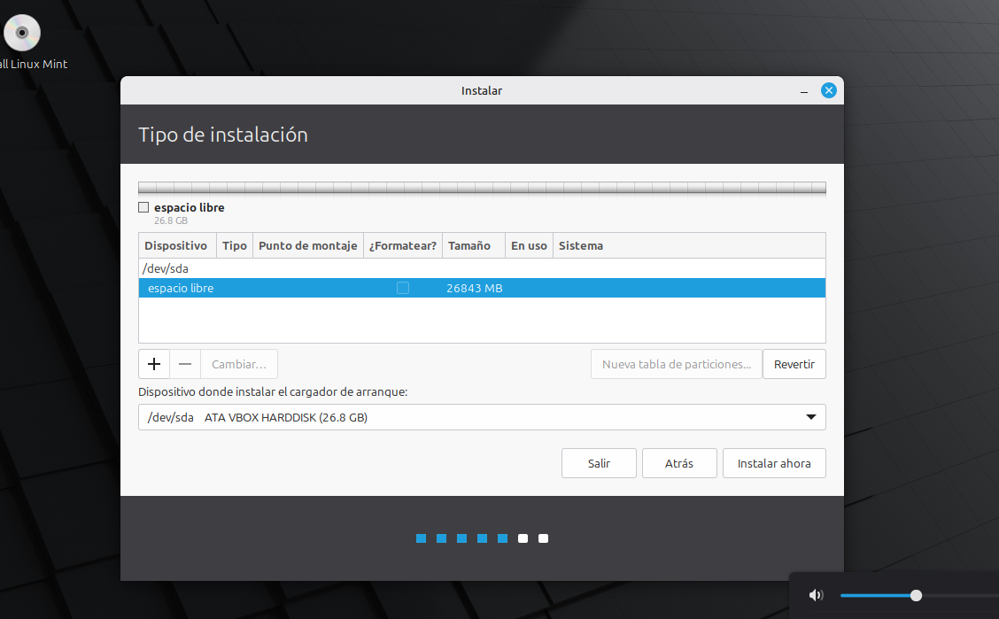

Si el botón **Nueva tabla de particiones…** está disponible, púlsalo: creará una tabla **GPT**,
que es la que corresponde a un sistema UEFI. Si aparece en gris es porque el instalador ya ha
creado la tabla por ti al detectar que la máquina arranca en modo UEFI.

### 4.1 Por qué los números no cuadran

Creaste el disco de **25 GB** y el instalador te dice que hay **26 843 MB** libres. No te has
equivocado: **es el mismo disco medido con dos reglas distintas**.

| Dónde lo lees | Cómo cuenta | El mismo disco |
|---|---|---|
| VirtualBox | 1 GB = 1024 MB (**binario**, lo correcto sería GiB) | `25,00 GB` |
| Instalador de Mint | 1 MB = 1 000 000 bytes (**decimal**) | `26 843 MB` ≈ 26,8 GB |
| `lsblk` / `df -h`, ya instalado | 1 G = 1024 M (**binario**) | `25G` |

> **Analogía.** Es la misma botella medida en litros y en pintas. El líquido no cambia; cambia
> la regla. Los fabricantes de discos usan la regla decimal porque el número sale más grande
> (por eso tu disco «de 1 TB» aparece en Windows como 931 GB).

Consecuencia práctica: escribe en el instalador los tamaños de la tabla **tal cual** (512,
15000, 2048) y no te sorprendas cuando, ya instalado, `lsblk` te diga que la raíz mide `14G` en
lugar de 15. Es lo mismo.

### 4.2 Crear las cuatro particiones

Selecciona el **espacio libre** y pulsa **+** para cada partición. Créalas **en este orden**:

**Partición 1 — EFI**

| Campo | Valor |
|---|---|
| Tamaño | `512` MB |
| Tipo de la nueva partición | Primaria |
| Ubicación | Al principio de este espacio |
| Utilizar como | **Partición del sistema «EFI»** |

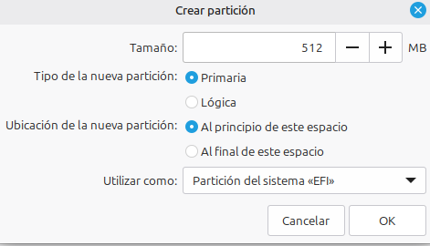

> ⚠️ **No elijas «sistema de ficheros FAT32».** En la lista de «Utilizar como» hay dos opciones
> que parecen lo mismo y no lo son:
>
> - **«Partición del sistema «EFI»»** ← es la que queremos. Al elegirla **desaparece el campo
>   «Punto de montaje»**, y está bien que desaparezca: el instalador ya sabe que esa partición se
>   monta en `/boot/efi`.
> - **«sistema de ficheros FAT32»** es una partición de datos normal para intercambiar ficheros
>   con Windows. Por eso, si la eliges, el punto de montaje sólo te ofrece `/dos` y `/windows`.
>
> Por dentro las dos son FAT32; lo que cambia es la **etiqueta de tipo** que se escribe en la
> tabla GPT. Sólo la primera lleva el identificador que el firmware UEFI busca al arrancar. Si
> te equivocas, el instalador avisará de que no has definido una partición del sistema EFI y,
> si sigues adelante, la máquina no arrancará.
>
> **Analogía:** las dos son la misma caja de cartón. «Partición del sistema EFI» es pegarle la
> etiqueta «ARRANQUE — ÁBRAME PRIMERO» que la UEFI busca a ciegas al encender. «FAT32» es la
> misma caja sin etiqueta: útil, pero el firmware pasa de largo.

**Partición 2 — raíz**

| Campo | Valor |
|---|---|
| Tamaño | `15000` MB |
| Utilizar como | Sistema de ficheros **ext4** transaccional |
| Punto de montaje | `/` |

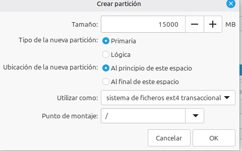

**Partición 3 — swap**

| Campo | Valor |
|---|---|
| Tamaño | `2048` MB |
| Utilizar como | **Área de intercambio** |
| Punto de montaje | — (la swap no se monta en ninguna carpeta) |

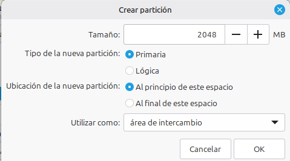

**Partición 4 — home**

| Campo | Valor |
|---|---|
| Tamaño | `9284` MB (todo el espacio restante) |
| Utilizar como | Sistema de ficheros **ext4** transaccional |
| Punto de montaje | `/home` |

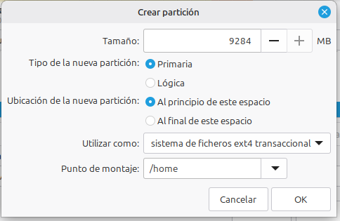

Al terminar, tu tabla debe quedar así:

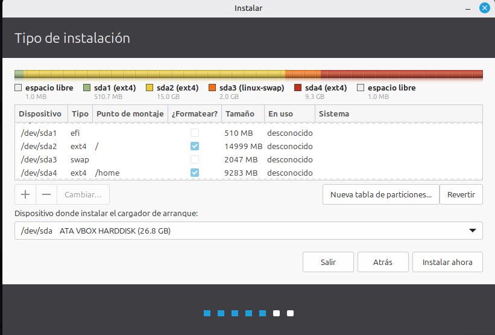

| Dispositivo | Tipo | Punto de montaje | ¿Formatear? | Tamaño |
|---|---|---|---|---|
| `/dev/sda1` | efi | — | — | 510 MB |
| `/dev/sda2` | ext4 | `/` | ✔ | 15000 MB |
| `/dev/sda3` | swap | — | — | 2048 MB |
| `/dev/sda4` | ext4 | `/home` | ✔ | 9283 MB |

### 4.3 Lo que despista de esta pantalla

Cuatro cosas que parecen errores y no lo son. Míralas antes de llamar al profesor:

1. **«Primaria / Lógica»** en el diálogo de crear partición. Eso es herencia del **MBR**, donde
   sólo cabían 4 primarias y había que inventarse las lógicas. En **GPT no existe la
   distinción**: todas las particiones son iguales y caben 128. El instalador mantiene el
   desplegable por compatibilidad. Deja «Primaria» y sigue.
2. **La casilla «¿Formatear?» está vacía en la EFI y en la swap.** Es correcto. La partición EFI
   la formatea el instalador a FAT32 en cuanto la marcas como «Partición del sistema EFI», y la
   swap se inicializa siempre. La casilla sólo se marca en las **ext4**.
3. **Sobra 1,0 MB de espacio libre al principio y al final.** Es la **alineación**: el disco se
   organiza en bloques y el primer megabyte se reserva. Normal, no lo toques.
4. **La barra de colores de arriba etiqueta `sda1` como «(ext4)».** Es cosmético: la barra no
   refresca el tipo hasta que la partición se formatea de verdad. Lo que manda es la columna
   **Tipo**, que pone `efi`. Lo comprobarás en el apartado 6 con `lsblk -f`.

### 4.4 Dispositivo donde instalar el cargador de arranque

Abajo hay un desplegable: **Dispositivo donde instalar el cargador de arranque**.
Debe apuntar al **disco entero** (`/dev/sda`), **no** a una partición concreta.

> ⚠️ Éste es el fallo clásico. Si eliges `/dev/sda2` la instalación terminará «bien» pero la
> máquina no arrancará: el firmware no encontrará nada que ejecutar.

Antes de pulsar **Instalar ahora**, compara tu tabla con la del apartado
[Qué vas a conseguir](#qué-vas-a-conseguir). El instalador te pedirá confirmación porque va a
escribir los cambios en disco: a partir de aquí no hay marcha atrás.

## 5. Zona horaria y usuario

- **Zona horaria:** Madrid.
- **Cuenta de usuario:**

| Campo | Valor |
|---|---|
| Tu nombre | tu nombre real |
| Nombre del equipo | `mint-smr` |
| Nombre de usuario | `alumno` |
| Contraseña | una que **recuerdes** |

> A lo largo del curso, donde ponga `alumno` sustituye por el nombre de usuario que hayas
> elegido tú. Anótalo: en Linux la contraseña no se puede «recuperar» pulsando un botón.

Marca **Solicitar mi contraseña para iniciar sesión** (no el inicio automático). En un puesto
de trabajo real el inicio automático es una mala práctica de seguridad, y ya que estamos, que
sea así desde el principio.

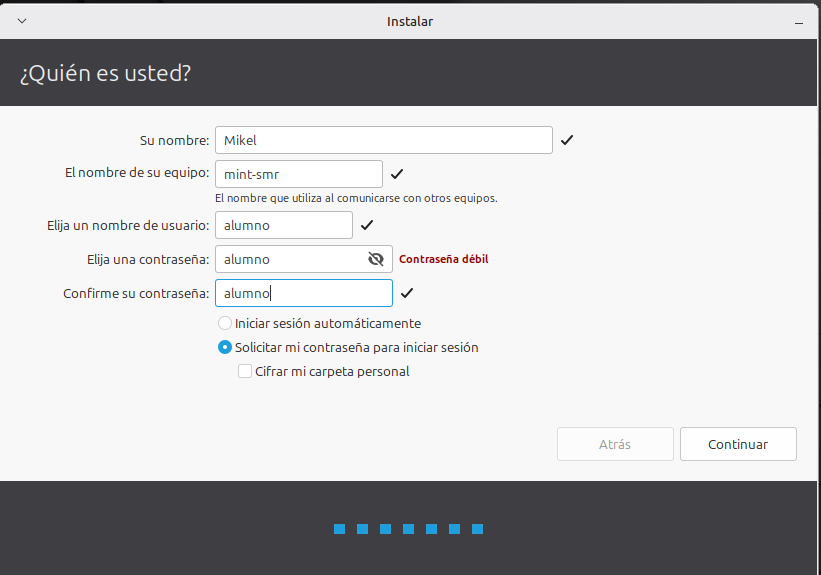

La instalación tarda entre 10 y 20 minutos. Cuando termine, **reinicia**. VirtualBox debería
expulsar la ISO solo; si te vuelve a arrancar el instalador, apaga la máquina y quita la imagen
en **Configuración → Almacenamiento**.

## 6. Primer arranque y verificación

Instalar no es lo mismo que comprobar que está bien instalado. Abre un terminal
(`Ctrl` + `Alt` + `T`) y ejecuta:

```bash
lsblk -f
```

Debe mostrarte las cuatro particiones con su sistema de ficheros y su punto de montaje:

```
NAME   FSTYPE FSVER LABEL UUID          FSAVAIL FSUSE% MOUNTPOINTS
sda
├─sda1 vfat   FAT32       XXXX-XXXX       481M     1%  /boot/efi
├─sda2 ext4   1.0         xxxxxxxx-...    4,9G    58%  /
├─sda3 swap   1           xxxxxxxx-...                 [SWAP]
└─sda4 ext4   1.0         xxxxxxxx-...    8,2G     1%  /home
```

Las dos comprobaciones que de verdad importan aquí:

- `sda1` debe salir **vfat / FAT32** montada en **`/boot/efi`**. Si sale como ext4, la partición
  EFI no se creó bien y hay que repetir la instalación.
- Los tamaños salen **más pequeños** que los que escribiste. Ya sabes por qué:
  [apartado 4.1](#41-por-qué-los-números-no-cuadran).

Y ahora las comprobaciones una a una:

```bash
df -h            # Espacio libre por sistema de ficheros montado
free -h          # Memoria RAM y swap
swapon --show    # Confirma que la swap está activa
cat /etc/fstab   # El fichero que monta todo esto en cada arranque
uname -a         # Versión del núcleo
```

> **Qué es `/etc/fstab`.** Es la lista de la compra del arranque: dice qué partición se monta
> en qué carpeta. Fíjate en que las particiones se identifican por **UUID** y no por `/dev/sda2`.
> Es a propósito: si mañana cambias los discos de sitio, `/dev/sda2` puede pasar a ser otra cosa,
> pero el UUID viaja con la partición. Este fichero volverá a aparecer en la instalación de Arch
> Linux, donde lo generarás tú a mano con `genfstab`.

Actualiza el sistema:

```bash
sudo apt update
sudo apt upgrade
```

> **`sudo`** ejecuta un comando como administrador. En Mint, el usuario que creas durante la
> instalación entra automáticamente en el grupo `sudo`. En Arch tendrás que hacerlo tú, y más
> adelante verás exactamente cómo funciona el fichero `/etc/sudoers`.
>
> Mint trae además el **Gestor de actualizaciones** en modo gráfico. Hace lo mismo que los dos
> comandos de arriba; nosotros usamos el terminal porque es lo que vas a encontrarte en un
> servidor sin escritorio.

## 7. Guest Additions

Sin las *Guest Additions* la ventana no se redimensiona, no hay portapapeles compartido y no
funcionan las carpetas compartidas. Son los controladores de la máquina virtual.

Primero, las herramientas para compilarlas:

```bash
sudo apt install build-essential dkms linux-headers-$(uname -r)
```

> `$(uname -r)` se sustituye por la versión del núcleo que tienes en ese momento. Es la primera
> vez que ves una **sustitución de comandos**: el resultado de `uname -r` se inserta ahí dentro.
> Más adelante, escribiendo scripts, harás esto constantemente.

Después, en el menú de VirtualBox: **Dispositivos → Insertar imagen de CD de las Guest
Additions**. Si VirtualBox pregunta si quiere descargar la imagen, dile que **sí**.

Mint puede intentar ejecutarla solo, pero en la edición Xfce lo normal es que no lo consiga y
te diga que la ejecutes **a mano** (*run manually*). No es un error tuyo: se hace desde el
terminal en dos pasos.

**1. Comprueba si el CD está montado:**

```bash
ls /media/$USER/
```

**2a. Si aparece una carpeta `VBox_GAs_...`**, ejecuta el instalador desde ella:

```bash
sudo sh /media/$USER/VBox_GAs_*/VBoxLinuxAdditions.run
```

**2b. Si no aparece nada**, el CD está insertado pero no montado. Móntalo tú y ejecútalo:

```bash
sudo mkdir -p /mnt/cdrom
sudo mount /dev/cdrom /mnt/cdrom
sudo sh /mnt/cdrom/VBoxLinuxAdditions.run
```

> **Por qué `sudo sh` y no `sudo ./`.** El CD se monta **sin permiso de ejecución** (`noexec`).
> Con `./` le pides a Linux que *ejecute* el fichero, y en ese disco no está permitido: te dará
> «Permiso denegado» aunque uses `sudo`. Con `sh` le pides al intérprete de órdenes que *lea* el
> fichero y haga lo que pone, y eso sí se puede.
>
> **Analogía:** el CD es una sala donde está prohibido cocinar. `./` es intentar encender el
> fogón dentro de la sala; `sh` es llevarte la receta a tu cocina y cocinarla allí.

El instalador tarda un par de minutos compilando. Si termina avisando de que no encuentra las
cabeceras del núcleo (*kernel headers*), te has saltado el `apt install` de arriba: ejecútalo y
repite.

**Plan B, sin CD ni compilación.** Si lo anterior se atasca, las Guest Additions también están
en los repositorios de Mint. Son una versión algo más antigua que tu VirtualBox, pero el ajuste
de pantalla, el portapapeles y las carpetas compartidas funcionan igual:

```bash
sudo apt install virtualbox-guest-utils virtualbox-guest-x11
```

> ⚠️ **Usa un método o el otro, nunca los dos.** Si mezclas las Guest Additions del CD con las
> de los repositorios, se pisan entre ellas y acabas sin ninguna funcionando.

Reinicia. Comprueba que ahora la ventana **se adapta al redimensionarla**.

Activa además en el menú **Dispositivos → Portapapeles compartido → Bidireccional**.

## 8. Carpeta compartida con el anfitrión

Esto lo usarás toda la asignatura para sacar capturas y scripts de la máquina virtual.

1. En Windows, crea una carpeta, por ejemplo `C:\SMR\compartida`.
2. Máquina apagada → **Configuración → Carpetas compartidas → +**
   - Ruta: `C:\SMR\compartida`
   - Nombre: `compartida`
   - Marca **Automontar** y **Hacer permanente**
3. Arranca la máquina y añade tu usuario al grupo `vboxsf`:

```bash
sudo adduser $USER vboxsf
```

4. **Cierra sesión y vuelve a entrar** (o reinicia). Los cambios de grupo sólo se aplican al
   iniciar sesión de nuevo.
5. Comprueba:

```bash
ls -l /media/sf_compartida
groups          # 'vboxsf' debe aparecer en la lista
```

> **Si te da «Permiso denegado»** es casi siempre porque no has reiniciado la sesión después de
> añadirte al grupo. `groups` te lo dice: si no ves `vboxsf`, tu sesión es anterior al cambio.
> Esta relación entre usuario, grupo y permiso la trabajaremos a fondo en la [guía de permisos](../../2-intermedio/09-permisos/1-guia.md).

## Problemas frecuentes

| Síntoma | Causa habitual | Solución |
|---|---|---|
| La instalación empieza sola sin preguntar nada | Dejaste activada la instalación desatendida | Borra la MV y vuelve a crearla desmarcando esa casilla |
| Pantalla negra al arrancar la MV | Controlador gráfico distinto de VMSVGA | Configuración → Pantalla → Pantalla → VMSVGA |
| La sesión *live* se ve rota o con basura | Paginación anidada desactivada | Configuración → Sistema → Aceleración → Paginación anidada |
| Al reproducir un vídeo se cierra la sesión | Códecs instalados sin aceleración 3D | `sudo apt remove gstreamer1.0-vaapi` |
| Tras reiniciar vuelve el instalador | La ISO sigue insertada | Configuración → Almacenamiento → quitar el disco |
| «No hay ningún sistema operativo» o pantalla negra de UEFI | El cargador se instaló en una partición y no en el disco | Reinstalar eligiendo `/dev/sda` como dispositivo del cargador |
| El escritorio va a tirones | Memoria de vídeo baja | Subir a 128 MB y comprobar las Guest Additions |
| La ventana no se redimensiona | Guest Additions no instaladas o sin `linux-headers` | Instalar `build-essential dkms linux-headers-$(uname -r)` y repetir |
| «Permiso denegado» u «orden no encontrada» al lanzar `VBoxLinuxAdditions.run` | El CD se monta sin permiso de ejecución | `sudo sh /media/$USER/VBox_GAs_*/VBoxLinuxAdditions.run` |
| No hay internet en la MV | Adaptador desconectado | Red → Adaptador 1 → NAT → «Cable conectado» |
| El teclado escribe símbolos raros | Distribución de teclado mal elegida | Configuración → Teclado → Español |
| La MV se comporta de forma rara y nada de lo anterior lo arregla | Mint 22.2 y 22.3 llevan el núcleo HWE 6.14, que las notas de Mint reconocen como problemático con VirtualBox | Actualizar VirtualBox a la última versión; si persiste, instalar Mint 22.1 (núcleo 6.8) y actualizar después a 22.3 |
