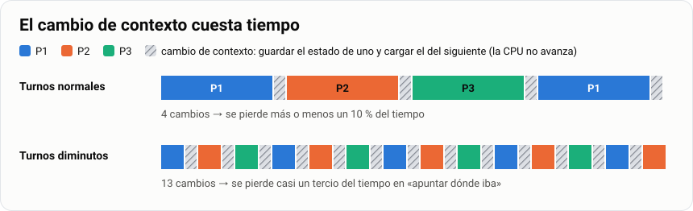
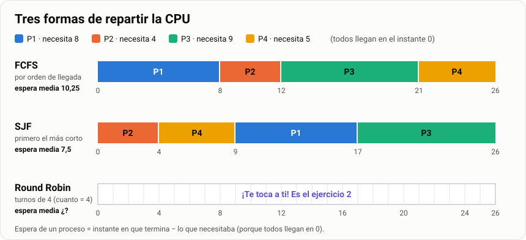
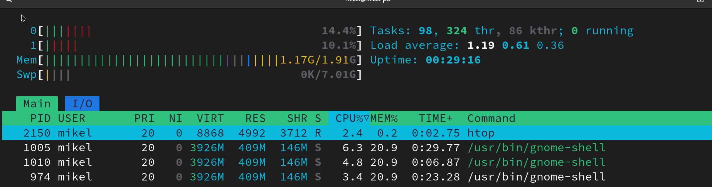
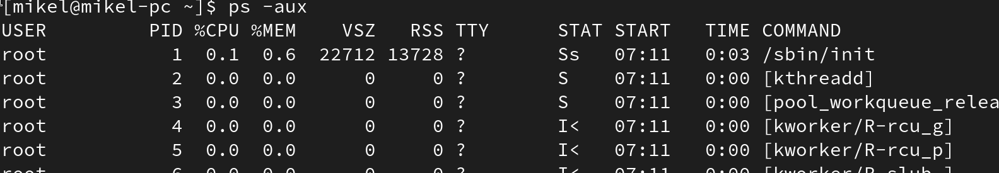
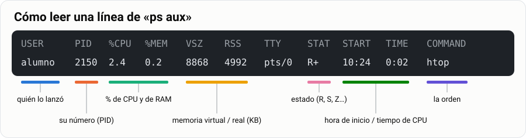
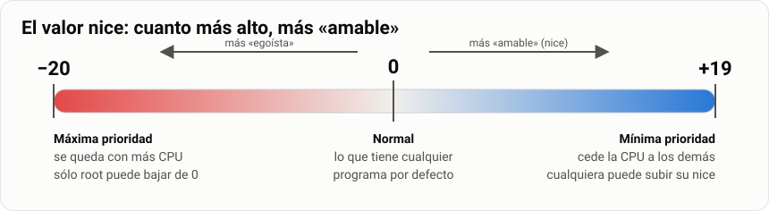
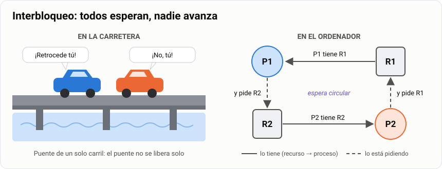

# Procesos: quién manda en la CPU

> **Antes de empezar.** Para la teoría basta con el ordenador del aula. Para los apartados 5, 6 y
> la práctica necesitas tu máquina virtual `Mint-SMR` encendida y un terminal abierto.

Abre el Administrador de tareas de Windows (`Ctrl` + `Mayús` + `Esc`). Verás más de cien programas
funcionando a la vez. Pero la CPU sólo puede hacer **una cosa en cada instante**. ¿Cómo lo
consigue? Haciendo turnos tan rápidos que parece que todo va a la vez. En esta guía vas a ver
quién reparte esos turnos. Y vas a aprender a mirar, pausar y cerrar programas desde el terminal.

> **Analogía.** Una cocina con **un solo fuego**. La receta escrita en el libro es un programa. La
> receta cocinándose en una olla es un proceso. El jefe de cocina es el sistema operativo: decide
> qué olla va al fuego y durante cuánto tiempo. Vamos a volver a esta cocina toda la guía.

| | |
|---|---|
| 🎯 **Qué vas a aprender** | Qué es un proceso, cómo se reparte la CPU y cómo ver, pausar y cerrar procesos en Linux y en Windows |
| 🧰 **Qué necesitas** | El ordenador del aula y tu MV `Mint-SMR` |
| ⏱️ **Tiempo** | 5 horas |
| 📦 **Qué entregas** | La tarea «Diagramas de planificación resueltos» ([Parte 4](#parte-4--entrega)) |

**Tu misión, paso a paso:**

- [ ] Distinguir programa, proceso e hilo.
- [ ] Saber en qué estado está un proceso y por qué.
- [ ] Repartir la CPU con tres reglas (FCFS, SJF y Round Robin) y dibujarlo en un Gantt.
- [ ] Ver, pausar y cerrar procesos en Linux y en Windows.
- [ ] Entregar los ejercicios.

## Índice

- [Parte 1 · Aprende](#parte-1--aprende)
  - [1. Programa, proceso e hilo](#1-programa-proceso-e-hilo)
  - [2. Los cinco estados de un proceso](#2-los-cinco-estados-de-un-proceso)
  - [3. La CPU hace turnos](#3-la-cpu-hace-turnos)
  - [4. Quién va primero: tres reglas](#4-quién-va-primero-tres-reglas)
  - [5. Ver los procesos en Linux](#5-ver-los-procesos-en-linux)
  - [6. Pausar y cerrar procesos en Linux](#6-pausar-y-cerrar-procesos-en-linux)
  - [7. Lo mismo en Windows](#7-lo-mismo-en-windows)
  - [8. Para saber más](#8-para-saber-más)
- [Parte 2 · Lo que te llevas](#parte-2--lo-que-te-llevas)
- [Parte 3 · Practica](#parte-3--practica)
- [Parte 4 · Entrega](#parte-4--entrega)

---

## Parte 1 · Aprende

### 1. Programa, proceso e hilo

Abre Firefox tres veces, en tres ventanas. ¿Cuántos Firefox hay? Depende de cómo lo mires:


- **Programa**: el fichero de Firefox guardado en el disco. Hay **uno**. Está quieto, como la
  receta en el libro.
- **Proceso**: cada Firefox funcionando en la memoria RAM. Hay **tres**. Es la receta cocinándose.
- **Hilo**: un trabajo dentro de un proceso. Un Firefox tiene un hilo que dibuja la página, otro
  que descarga y otro que reproduce el vídeo. Son dos cocineros en la misma olla.

Cada proceso tiene un número único, su **PID** (*Process ID*). Y sabe quién lo creó: su **padre**,
cuyo número es el **PPID**. Si abres Firefox desde el terminal, el padre es el terminal.

> [!NOTE]
> **¿Por qué hilos y no más procesos?** Porque un hilo es barato: comparte la memoria de su
> proceso. A cambio, si dos hilos escriben lo mismo a la vez, se lía. Dos procesos no pueden
> tocarse la memoria el uno al otro: van más seguros, pero gastan más.

> [!TIP]
> **🧪 Pruébalo.** En tu MV, abre un terminal y escribe:
>
> ```bash
> echo $$              # el PID de tu terminal
> ps -o pid,ppid,cmd   # tus procesos: su PID y el de su padre
> ```
>
> 👀 Deberías ver dos líneas: `bash` y `ps`. El PPID de `ps` es el PID de tu `bash`. El terminal
> es el padre de todo lo que lanzas desde él.

**🧠 ¿Lo has pillado?**

1. Abres tres ventanas de Firefox. ¿Cuántos programas hay? ¿Y cuántos procesos?
2. ¿Cómo se llama el número que identifica a cada proceso?

<details>
<summary>Ver respuestas</summary>

1. **Un** programa y **tres** procesos (o más: Firefox crea un proceso por cada pestaña).
2. El **PID**.

</details>

**📌 En una frase:** un programa es un fichero quieto; un proceso es ese programa funcionando, con
su número (PID); un hilo es un trabajo dentro del proceso.

### 2. Los cinco estados de un proceso

Un proceso casi nunca está trabajando. Casi siempre **espera**: a que le toque la CPU, a que
pulses una tecla, a que llegue un dato del disco.


- **Nuevo**: se está creando.
- **Listo**: quiere la CPU, pero está ocupada. Espera su turno.
- **En ejecución**: está usando la CPU **ahora mismo**.
- **Bloqueado**: espera algo de fuera (una tecla, el disco, la red). Mientras tanto, no quiere la
  CPU.
- **Terminado**: ha acabado.

> **Ejemplo.** Un proceso pide leer un fichero del disco → pasa a **Bloqueado**. Llega el dato →
> pasa a **Listo**, no a ejecución. Tiene que esperar su turno otra vez.

> [!IMPORTANT]
> En cada núcleo de la CPU sólo hay **un** proceso en ejecución en cada instante. Los cien que ves
> en el Administrador de tareas están casi todos listos o bloqueados. Parece que todo va a la vez
> porque el sistema cambia de proceso miles de veces por segundo.

Dos casos raros que salen en los ejercicios:

- 🧟 **Zombi**: ya ha terminado, pero su padre no ha recogido su «nota de salida». Sólo ocupa un
  número. No se puede cerrar: ya está muerto.
- 👶 **Huérfano**: su padre murió antes que él. Lo adopta el primer proceso de todos, `systemd`,
  que tiene **PID 1**.

> [!TIP]
> **🧪 Pruébalo.** Instala `htop` y ábrelo:
>
> ```bash
> sudo apt install htop
> htop
> ```
>
> 👀 Arriba a la derecha pone algo como `Tasks: 120, 300 thr; 1 running`. Es decir: 120 procesos,
> 300 hilos y sólo **1** en ejecución. Sal con `q`.

**🧠 ¿Lo has pillado?**

1. Un proceso espera a que pulses una tecla. ¿En qué estado está?
2. Pulsas la tecla. ¿Pasa a «en ejecución» directamente?

<details>
<summary>Ver respuestas</summary>

1. **Bloqueado**.
2. No: pasa a **Listo** y espera a que le toque la CPU.

</details>

**📌 En una frase:** un proceso está listo, en ejecución o bloqueado; en cada núcleo sólo hay uno
en ejecución.

### 3. La CPU hace turnos

Para pasar de un proceso a otro, la CPU tiene que **apuntar por dónde iba** el primero y
**cargar** por dónde iba el segundo. Eso se llama **cambio de contexto**. Es tiempo perdido:
mientras apunta, no avanza nada.

> **Analogía.** Estás con un ejercicio de mates y suena el móvil. Antes de cogerlo apuntas por
> dónde ibas. Al colgar, relees y retomas. Ese rato perdido es el cambio de contexto. Cuantas más
> llamadas, menos mates.



Por eso los turnos no pueden ser diminutos. Si el turno dura lo mismo que apuntar, la CPU se pasa
el día apuntando.

**🧪 Pruébalo en clase: «somos la CPU».** Una persona hace de CPU. El resto sois procesos, cada
uno con una columna de números para sumar. La CPU sólo puede atender a uno, y cada cierto tiempo
tiene que cambiar, apuntando por dónde iba cada uno. Cronometrad cuánto tarda el grupo con turnos
de **20 segundos**, de **5** y de **60**. ¿Cuál gana? ¿Por qué?

**📌 En una frase:** cambiar de proceso cuesta tiempo (cambio de contexto), así que los turnos no
pueden ser demasiado cortos.

### 4. Quién va primero: tres reglas

El **planificador** es el árbitro: decide qué proceso listo pasa a la CPU. Tiene tres reglas
clásicas. Vamos a verlas con cuatro procesos que llegan a la vez y necesitan este tiempo de CPU:

| Proceso | Tiempo que necesita |
|---|---|
| P1 | 8 |
| P2 | 4 |
| P3 | 9 |
| P4 | 5 |

Un **diagrama de Gantt** es una barra de tiempo: dice quién usa la CPU en cada momento.



**Regla 1 · FCFS: el que llega primero.** Como la cola del súper. Orden: P1, P2, P3, P4. P1
empieza en 0 y acaba en 8. P2 empieza en 8 y acaba en 12. P3 acaba en 21 y P4 en 26.

¿Cuánto ha esperado cada uno? **Espera = cuándo termina − lo que necesitaba.**

| Proceso | Termina | Espera |
|---|---|---|
| P1 | 8 | 8 − 8 = **0** |
| P2 | 12 | 12 − 4 = **8** |
| P3 | 21 | 21 − 9 = **12** |
| P4 | 26 | 26 − 5 = **21** |

Espera media: (0 + 8 + 12 + 21) / 4 = **10,25**.

**Regla 2 · SJF: el más corto primero.** «Pasa tú, que sólo llevas pan». Orden: P2 (4), P4 (5),
P1 (8), P3 (9).

| Proceso | Termina | Espera |
|---|---|---|
| P2 | 4 | 4 − 4 = **0** |
| P4 | 9 | 9 − 5 = **4** |
| P1 | 17 | 17 − 8 = **9** |
| P3 | 26 | 26 − 9 = **17** |

Espera media: (0 + 4 + 9 + 17) / 4 = **7,5**. Mejor que FCFS. Pero tiene trampa: hay que saber
de antemano cuánto va a durar cada proceso. Y un proceso largo puede no pasar nunca si siguen
llegando cortos.

**Regla 3 · Round Robin: turnos iguales.** Cada proceso tiene un turno fijo, el **cuanto**. Si no
acaba, vuelve al final de la cola. Como los turnos de un minuto para hablar. Es lo que usan
Windows y Linux: así ningún proceso se queda colgado esperando. Lo dibujas tú en el Pruébalo.

> [!TIP]
> **Cómo se hace un Gantt, en 4 pasos.**
>
> 1. Decide el orden según la regla.
> 2. Dibuja la barra sumando tiempos y apunta debajo cada instante en que cambia el proceso.
> 3. Para cada proceso: espera = cuándo termina − lo que necesitaba.
> 4. Suma las esperas y divide entre el número de procesos.

> [!TIP]
> **🧪 Pruébalo: Round Robin con cuanto = 4.** Dibuja el Gantt de los cuatro procesos de arriba.
> Empieza así y sigue tú:
>
> | Turno | Proceso | De… a… | Le queda |
> |---|---|---|---|
> | 1 | P1 | 0 → 4 | 4 |
> | 2 | P2 | 4 → 8 | 0 ✔ terminado |
> | 3 | P3 | 8 → 12 | 5 |
> | 4 | … | | |
>
> 👀 Tiene que acabar en el instante 26, igual que las otras dos reglas: el trabajo total es el
> mismo. Este Gantt es el **ejercicio 2** de la entrega: guárdalo.

**🧠 ¿Lo has pillado?**

1. ¿Qué regla da la espera media más baja? ¿Cuál es su trampa?
2. ¿Por qué tu ordenador usa Round Robin y no SJF?

<details>
<summary>Ver respuestas</summary>

1. **SJF**. La trampa: hay que adivinar cuánto dura cada proceso, y los largos pueden no pasar
   nunca.
2. Porque con turnos iguales el ratón y el teclado responden siempre. Con SJF, un programa largo
   (un juego) podría quedarse esperando sin fin.

</details>

**📌 En una frase:** el planificador reparte la CPU por orden de llegada (FCFS), el más corto
primero (SJF) o por turnos iguales (Round Robin, el de tu ordenador).

### 5. Ver los procesos en Linux

La forma fácil es `htop`, que ya has instalado:



```bash
htop        # la lista en vivo: arriba la CPU y la RAM, abajo los procesos
```

Dentro de `htop` sólo necesitas cuatro teclas: `F3` busca un proceso, `F5` enseña el árbol de
padres e hijos, `F9` cierra el proceso marcado y `q` sale.

La forma clásica es `ps aux`: una **foto** de todos los procesos en ese instante.

```bash
ps aux                  # todos los procesos
ps aux | grep firefox   # sólo las líneas que contienen «firefox»
```



Así se lee una línea:



Las columnas que importan: **USER** (quién lo lanzó), **PID**, **%CPU** y **%MEM** (lo que
gasta), **STAT** (su estado: `R` en ejecución o listo, `S` esperando, `Z` zombi) y **COMMAND**
(el programa).

> [!NOTE]
> En `ps aux | grep firefox` siempre sale una línea de más: el propio `grep firefox`. No es
> Firefox, es tu búsqueda.

> [!TIP]
> **🧪 Pruébalo.**
>
> ```bash
> firefox &                 # abre Firefox desde el terminal
> ps aux | grep firefox     # búscalo
> ```
>
> 👀 Verás varias líneas con `firefox`: crea un proceso por pestaña. Mira la columna STAT: casi
> todas tienen una `S`. Están esperando.

**📌 En una frase:** `htop` enseña los procesos en vivo; `ps aux | grep nombre` busca uno.

### 6. Pausar y cerrar procesos en Linux

Para cerrar un proceso le mandas un aviso con su PID. Hay dos avisos:

```bash
kill 1234        # «cierra cuando puedas»: el programa guarda y cierra
kill -9 1234     # «cierra YA»: el sistema lo elimina en seco, sin guardar
killall firefox  # cierra todos los procesos que se llamen así
```

> [!WARNING]
> Empieza siempre por `kill` a secas. `kill -9` es como desenchufar el ordenador: funciona
> siempre, pero puede dejar ficheros a medias. Y el comando es `kill` + número: `killid` no
> existe.

También puedes **pausar** un proceso y mandarlo a trabajar **en segundo plano**, para seguir
usando el terminal mientras tanto:


```bash
Ctrl + Z     # pausa lo que está en primer plano
bg           # lo reanuda en segundo plano: el terminal queda libre
fg           # lo trae otra vez a primer plano
jobs         # lista lo que tienes pausado o en segundo plano
comando &    # lanza algo directamente en segundo plano
```

> [!TIP]
> **🧪 Pruébalo.** `sleep 100` es un programa que no hace nada durante 100 segundos.
>
> ```bash
> sleep 100       # el terminal se queda bloqueado…
> ```
>
> Pulsa `Ctrl` + `Z`. 👀 Verás `[1]+ Detenido  sleep 100`. Ahora:
>
> ```bash
> jobs            # ahí está, detenido
> bg              # sigue contando, pero el terminal ya es tuyo
> fg              # vuelve a primer plano
> ```
>
> Pulsa `Ctrl` + `C` para cerrarlo. Después lanza `sleep 300 &`, búscalo con
> `ps aux | grep sleep` y ciérralo con `kill` y su PID. 👀 Si vuelves a buscarlo, ya no está.

**🧠 ¿Lo has pillado?**

1. ¿Qué diferencia hay entre `kill 1234` y `kill -9 1234`?
2. Has pulsado `Ctrl` + `Z` sin querer y el programa «ha desaparecido». ¿Qué haces?

<details>
<summary>Ver respuestas</summary>

1. `kill` le pide que cierre guardando; `kill -9` lo elimina en seco, sin guardar.
2. `jobs` para verlo y `fg` para recuperarlo. No ha desaparecido: está pausado.

</details>

**📌 En una frase:** `kill PID` cierra con educación y `kill -9 PID` a la fuerza; `Ctrl` + `Z`,
`bg` y `fg` pausan y recuperan.

### 7. Lo mismo en Windows

Todo lo anterior existe en Windows, con otros nombres. El **Administrador de tareas**
(`Ctrl` + `Mayús` + `Esc`) es el `htop` de Windows:

- Pestaña **Procesos**: lo que gasta cada programa. Es la que usa todo el mundo.
- Pestaña **Detalles**: la lista técnica, **con el PID**. Es la que usamos en clase.
- Clic derecho en un proceso → **Finalizar tarea** es el `kill`. **Establecer prioridad** cambia
  quién va primero.

Y desde la consola de comandos (CMD):

```cmd
tasklist                          :: la lista, como ps aux
tasklist | findstr notepad        :: buscar uno, como grep
taskkill /PID 1234                :: cerrar, como kill
taskkill /IM notepad.exe /F       :: cerrar por nombre y a la fuerza, como kill -9
```

**🧪 Pruébalo: la demostración de clase.**

1. Abre el Administrador de tareas en **Detalles** y ordena por memoria (clic en la columna).
2. Abre un editor de imágenes y carga una foto grande. 👀 La memoria de ese proceso sube.
3. Aplica un filtro pesado (desenfoque). 👀 La CPU se dispara un momento.
4. Apunta los valores en esta tabla. **Es parte de la entrega.**

| Momento | Memoria | % CPU |
|---|---|---|
| Editor abierto, sin foto | | |
| Con la foto cargada | | |
| Aplicando el filtro | | |

**📌 En una frase:** el Administrador de tareas es el `htop` de Windows, y `taskkill` es su
`kill`.

### 8. Para saber más

Dos ideas que no entran en la práctica, pero que te vas a cruzar.

**Prioridad.** No todos los procesos importan lo mismo: la música no puede cortarse; una copia de
seguridad puede esperar. En Linux la prioridad se llama `nice` («amable»): va de **−20** (el más
egoísta) a **+19** (el más amable, cede la CPU). Cualquiera puede bajar la prioridad de lo suyo
con `renice -n 10 -p PID`. Subirla sólo lo puede hacer root.



**Interbloqueo.** Dos coches en un puente de un solo carril, uno por cada lado. Ninguno
retrocede. Ninguno pasa. En el ordenador: el proceso A tiene la impresora y pide el escáner; B
tiene el escáner y pide la impresora. Se esperan para siempre. Se llama **interbloqueo**.



---

## Parte 2 · Lo que te llevas

**🎒 Si sólo te quedas con diez cosas:**

1. Un **programa** es un fichero quieto en el disco. Un **proceso** es ese programa funcionando
   en la RAM.
2. Un **hilo** es un trabajo dentro de un proceso. Los hilos comparten memoria; los procesos no.
3. Cada proceso tiene un número único, el **PID**, y un padre (**PPID**). El primero de todos es
   `systemd`, PID 1.
4. Un proceso está **listo**, **en ejecución** o **bloqueado** (esperando algo). En cada núcleo
   sólo hay uno en ejecución.
5. Cambiar de proceso cuesta tiempo: el **cambio de contexto**.
6. El **planificador** reparte la CPU: **FCFS** (orden de llegada), **SJF** (el más corto
   primero) o **Round Robin** (turnos iguales, el **cuanto**).
7. En un **Gantt**, espera = cuándo termina − lo que necesitaba. La espera media es la suma de
   esperas entre el número de procesos.
8. `htop` enseña los procesos en vivo; `ps aux | grep nombre` busca uno.
9. `kill PID` cierra con educación; `kill -9 PID`, a la fuerza. `Ctrl` + `Z`, `bg` y `fg` pausan y
   recuperan.
10. En Windows: Administrador de tareas (pestaña **Detalles**), `tasklist` y `taskkill`.

**Chuleta**

| Quiero… | Linux | Windows |
|---|---|---|
| Ver los procesos | `htop` o `ps aux` | Administrador de tareas o `tasklist` |
| Buscar uno | `ps aux \| grep nombre` | `tasklist \| findstr nombre` |
| Cerrarlo | `kill PID` | `taskkill /PID n` |
| Cerrarlo a la fuerza | `kill -9 PID` | `taskkill /PID n /F` |
| Pausar y reanudar | `Ctrl` + `Z` y `fg` | — |

Estados en `ps` y `htop`: `R` en ejecución o listo · `S` esperando · `Z` zombi.

---

## Parte 3 · Practica

> [!TIP]
> Los ejercicios **2, 3 y 7** van en la entrega. Los demás, hazlos igual: son los que te preparan
> para la prueba práctica.

**Ejercicio 1 · Cuenta procesos.** Abre `htop`. ¿Cuántos procesos hay (*Tasks*)? ¿Cuántos en
ejecución (*running*)? ¿Por qué hay tanta diferencia? *(Pista: el cuadro naranja del
[apartado 2](#2-los-cinco-estados-de-un-proceso).)*

**Ejercicio 2 · Round Robin.** Termina el Gantt de Round Robin con cuanto = 4 que empezaste en el
[apartado 4](#4-quién-va-primero-tres-reglas). Calcula la espera media y compárala con FCFS
(10,25) y SJF (7,5). ¿Cuál de las tres es mejor para un videojuego, que tiene que responder
rápido? ¿Por qué?

**Ejercicio 3 · Ahora no llegan a la vez.** Dibuja el Gantt de FCFS y el de SJF para estos
procesos. En SJF, el que está en la CPU no se interrumpe aunque llegue uno más corto.

| Proceso | Llega en | Tiempo que necesita |
|---|---|---|
| A | 0 | 6 |
| B | 2 | 3 |
| C | 4 | 8 |
| D | 5 | 2 |

> [!IMPORTANT]
> Con llegadas, la cuenta cambia: **espera = cuándo termina − cuándo llegó − lo que necesitaba**.
> Y en SJF sólo puedes elegir entre los que **ya han llegado**. En el instante 0 sólo está A, así
> que empieza A aunque no sea el más corto.

**Ejercicio 4 · Tres formas de cerrar.** Lanza `sleep 300 &` tres veces. Busca los tres PID con
`ps aux | grep sleep`. Cierra el primero con `kill PID`, el segundo con `kill -9 PID` y el tercero
con `killall sleep`. Copia los comandos y lo que responde el terminal.

**Ejercicio 5 · El glotón.** `yes > /dev/null &` lanza un programa que escribe «y» sin parar a la
papelera. Míralo en `htop`: ¿cuánta CPU gasta? ¿En qué estado está? Ciérralo con `kill`.

**Ejercicio 6 · El que más gasta.** En `htop`, pulsa `F6` y elige `PERCENT_MEM`: ¿qué proceso
gasta más memoria? Haz lo mismo en el Administrador de tareas de Windows. Apunta nombre, PID y
memoria de los dos.

**Ejercicio 7 · Zombis.** Con tus palabras: ¿qué es un proceso zombi? ¿Por qué `kill -9` no
sirve con él?

---

## Parte 4 · Entrega

**Tarea Moodle: «Diagramas de planificación resueltos»**
Calificación de 0 a 10 · Se aprueba con 5.

Entrega un documento con:

1. **Ejercicios 2, 3 y 7 resueltos**, con los Gantt dibujados (a mano y fotografiados, o con
   cualquier programa) y las esperas calculadas en una tabla.
2. **Informe de proceso pesado**: captura del Administrador de tareas o de `htop` con el proceso
   que más gasta en tu equipo. Di su **PID, usuario, CPU y memoria**, qué programa es y si es
   normal que gaste eso.
3. La **tabla de la demostración** del [apartado 7](#7-lo-mismo-en-windows).
4. La **chuleta** de la [Parte 2](#parte-2--lo-que-te-llevas) rellenada **de memoria** en una hoja
   y luego corregida. Entrega las dos versiones.

**✅ Antes de entregar, comprueba:**

- [ ] Cada Gantt tiene escrito debajo el instante en que cambia el proceso.
- [ ] Cada tabla tiene la espera de cada proceso **y** la media.
- [ ] En el ejercicio 2 dices cuál es la mejor regla **y por qué**.
- [ ] El informe del proceso pesado tiene PID, usuario, CPU y memoria.
- [ ] Las respuestas están escritas con tus palabras.

*Instrumento de evaluación: corrección de ejercicios y observación de la práctica.*
