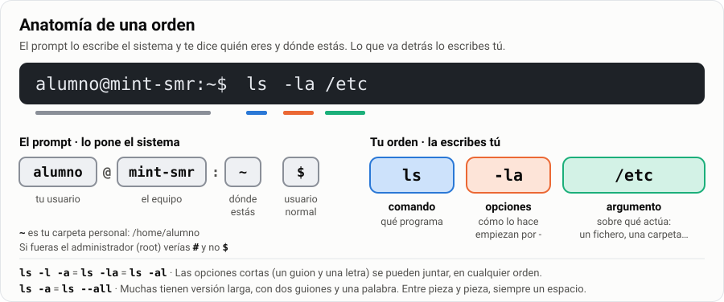
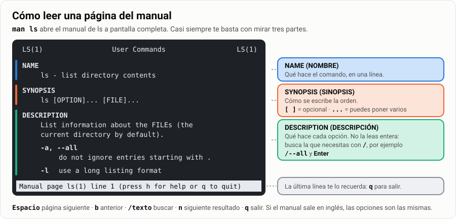
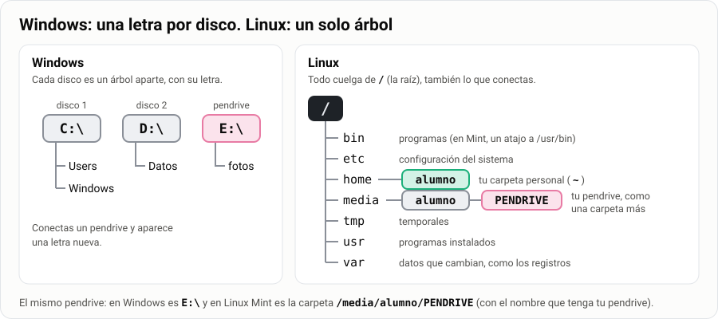
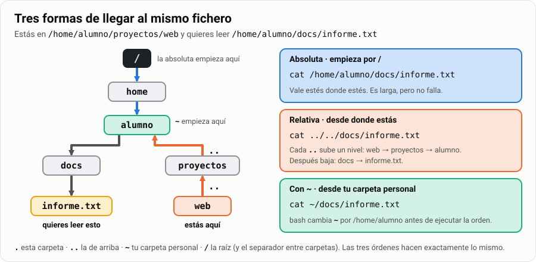
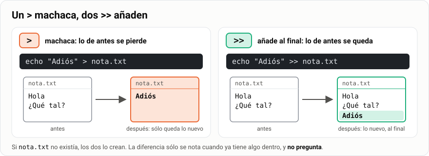
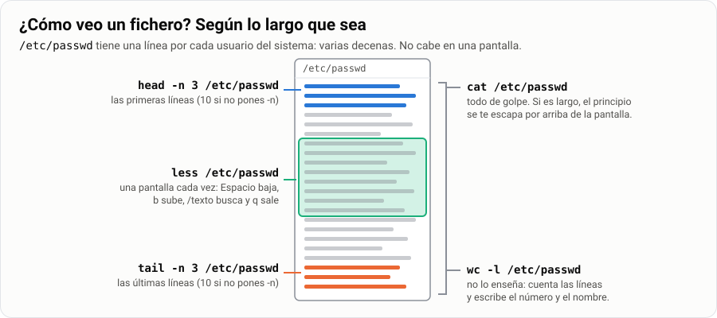
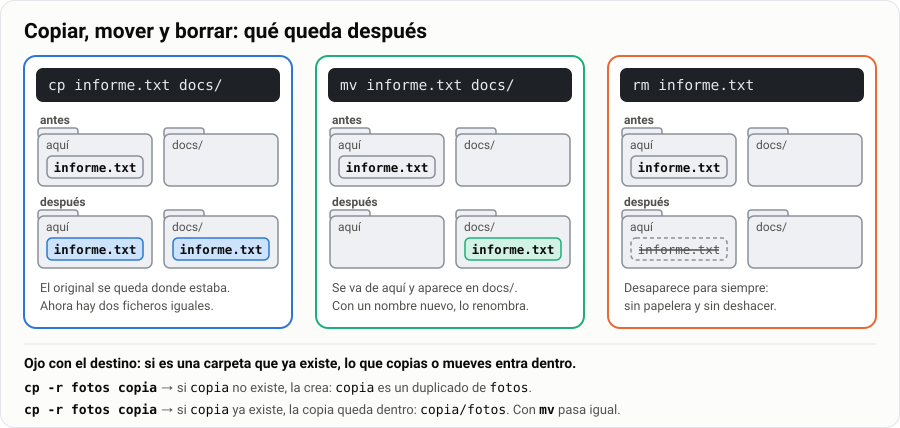
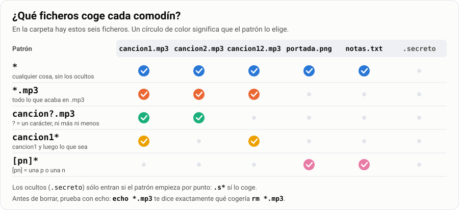

# Comandos y gestión de ficheros en GNU/Linux

> **Antes de empezar.** Necesitas tu máquina virtual de Linux Mint (`Mint-SMR`) instalada y
> funcionando: la del [tema 02](../02-instalar-mint-virtualbox/1-explicacion.md). Todo se hace en el
> terminal. Ábrelo con `Ctrl` + `Alt` + `T` o desde el menú. En los ejemplos el usuario es `alumno`
> y el equipo `mint-smr`: si los tuyos se llaman de otra forma, cámbialos.

¿Sabías que la mayoría de los servidores del mundo **no tienen escritorio ni ratón**? Sólo un
terminal: una ventana donde se escriben órdenes. Un técnico de sistemas pasa ahí buena parte del
día. En esta guía aprendes lo mínimo para defenderte: moverte por las carpetas y crear, ver,
copiar, mover y borrar ficheros **sólo con el teclado**. Y al final te espera un reto: encontrar
un tesoro escondido en un laberinto de carpetas.

> **Analogía.** El explorador de archivos es como pedir la comida señalando la carta con el dedo:
> funciona, pero sólo puedes pedir lo que está en la foto. El terminal es hablar el idioma: al
> principio cuesta más, pero puedes pedir «todos los platos sin gluten de menos de 10 euros,
> ordenados por precio». Eso, señalando la carta, no hay manera.

| | |
|---|---|
| 🎯 **Qué vas a aprender** | Moverte por el árbol de carpetas con rutas, y crear, ver, copiar, mover y borrar ficheros desde el terminal |
| 🧰 **Qué necesitas** | Tu MV `Mint-SMR` con el terminal abierto |
| ⏱️ **Tiempo** | 5 horas |
| 📦 **Qué entregas** | La tarea «Cuestionario de consola + práctica de gestión de ficheros» ([Parte 4](#parte-4--entrega)) |

**Tu misión, paso a paso:**

- [ ] Escribir órdenes con opciones y argumentos, y pedir ayuda con `--help` y `man`.
- [ ] Saber en qué carpeta estás y moverte por el árbol con rutas absolutas y relativas.
- [ ] Crear, ver, copiar, mover y borrar ficheros y carpetas.
- [ ] Elegir muchos ficheros a la vez con comodines, comprobándolo antes con `echo`.
- [ ] Hacer los 12 ejercicios y el reto del laberinto, y escribir tu propia chuleta.

## Índice

- [Comandos y gestión de ficheros en GNU/Linux](#comandos-y-gestión-de-ficheros-en-gnulinux)
  - [Índice](#índice)
  - [Parte 1 · Aprende](#parte-1--aprende)
    - [1. Cómo se escribe un comando](#1-cómo-se-escribe-un-comando)
    - [2. Pedir ayuda](#2-pedir-ayuda)
    - [3. El árbol de directorios](#3-el-árbol-de-directorios)
    - [4. Moverse: `pwd`, `cd`, `ls`](#4-moverse-pwd-cd-ls)
    - [5. Rutas absolutas y relativas](#5-rutas-absolutas-y-relativas)
    - [6. Crear ficheros y carpetas](#6-crear-ficheros-y-carpetas)
    - [7. Ver el contenido de un fichero](#7-ver-el-contenido-de-un-fichero)
    - [8. Copiar, mover y borrar](#8-copiar-mover-y-borrar)
    - [9. Comodines](#9-comodines)
  - [Parte 2 · Chuleta](#parte-2--chuleta)
  - [Parte 3 · Practica](#parte-3--practica)
    - [Bloque A · Moverse y rutas](#bloque-a--moverse-y-rutas)
    - [Bloque B · Crear y organizar](#bloque-b--crear-y-organizar)
    - [Bloque C · Ver ficheros](#bloque-c--ver-ficheros)
    - [Bloque D · Comodines](#bloque-d--comodines)
    - [Bloque E · Ayuda](#bloque-e--ayuda)
    - [Reto: el laberinto](#reto-el-laberinto)
  - [Parte 4 · Entrega](#parte-4--entrega)

---

## Parte 1 · Aprende

Cada apartado termina con un **🧪 Pruébalo**: comandos para escribir **en ese momento** en tu MV.
No te los saltes. En el terminal se aprende tecleando, no leyendo.

> [!TIP]
> **Tu arenero.** A partir del apartado 5 harás las pruebas en una carpeta llamada `~/arenero`.
> Como el arenero de un parque: puedes construir y romper lo que quieras, que no pasa nada. Los
> ejercicios que se entregan (Parte 3) van en otras carpetas.

### 1. Cómo se escribe un comando

Cuando abres el terminal ves esto:

```text
alumno@mint-smr:~$
```

Es el **prompt**: el terminal te dice que está esperando una orden. Tú la escribes detrás y pulsas
`Enter`.



Toda orden tiene la misma forma: **comando**, **opciones** y **argumentos**, separados por
espacios.

```bash
ls -l /etc       # comando ls, opción -l, argumento /etc
ls -l -a /etc    # dos opciones
ls -la /etc      # las mismas dos opciones, juntas: es lo mismo
ls --all /etc    # la opción -a en su versión larga
```

Cuatro reglas que ahorran disgustos:

1. **Mayúsculas y minúsculas son distintas.** `Documentos` y `documentos` son dos carpetas
   diferentes. `ls` funciona; `LS`, no.
2. **Los espacios separan.** Si un nombre tiene espacios, va entre comillas:
   `cat "mi informe.txt"`. Mejor todavía: no pongas espacios en los nombres.
3. **No hay papelera.** Lo que borras con `rm` desaparece para siempre.
4. **Si no dice nada, ha ido bien.** `cp` o `mkdir` no responden nada cuando funcionan. Si algo
   falla, te lo dicen.

Las teclas que vas a usar todo el rato:

| Tecla | Para qué |
|---|---|
| `Tab` | Completa nombres de comandos, ficheros y carpetas. Si hay varias posibilidades, pulsa dos veces y te las enseña |
| `↑` / `↓` | Recupera los comandos que ya has escrito |
| `Ctrl` + `C` | Para un comando que no termina |
| `Ctrl` + `L` | Limpia la pantalla (lo mismo que `clear`) |
| `Ctrl` + `Shift` + `C` / `V` | Copiar / pegar **dentro del terminal**. Sin `Shift` no funciona: `Ctrl` + `C` para el comando |

> [!TIP]
> **El tabulador es un corrector gratis.** Si pulsas `Tab` y no completa, es que ese fichero no
> existe o no estás en la carpeta que crees. Acostúmbrate a escribir tres letras y pulsar `Tab`.

> [!TIP]
> **🧪 Pruébalo.** Escribe una a una y mira qué responde cada orden:
>
> ```bash
> whoami          # ¿quién soy?
> hostname        # ¿cómo se llama este equipo?
> ls              # lo que hay en tu carpeta personal
> ls -l           # lo mismo, en lista
> ls -l -a        # dos opciones separadas...
> ls -la          # ...y juntas
> LS              # en mayúsculas
> ```
>
> Después, escribe `ls /us` y pulsa `Tab`. Luego escribe `ls /etc/host` y pulsa `Tab` dos veces.
>
> 👀 **Fíjate en:**
>
> - `whoami` y `hostname` dicen lo mismo que el prompt: `alumno` y `mint-smr`.
> - `ls -l -a` y `ls -la` sacan exactamente lo mismo.
> - Con `LS`, bash no encuentra ninguna orden con ese nombre.
> - `Tab` completa `/us` hasta `/usr/` porque es la única carpeta que empieza así. Con `/etc/host`
>   hay varias, y el doble `Tab` te las enseña.

**🧠 ¿Lo has pillado?**

1. En `cp -i notas.txt copia.txt`, ¿cuál es el comando, cuáles las opciones y cuáles los
   argumentos?
2. ¿Es lo mismo `ls -lh` que `ls -l -h`? ¿Y que `ls -hl`?
3. Escribes `mkdir trabajos` y el terminal no dice nada. ¿Ha fallado?

<details>
<summary>Ver respuestas</summary>

1. Comando: `cp`. Opción: `-i`. Argumentos: `notas.txt` y `copia.txt` (dos).
2. Sí, las tres son iguales. Las opciones cortas se pueden juntar y el orden no importa.
3. No: **si no dice nada, ha ido bien**. Compruébalo con `ls`.

</details>

### 2. Pedir ayuda

Nadie se sabe todas las opciones de memoria. Lo que sí hay que saber es **dónde mirarlas**:

```bash
ls --help      # resumen rápido de las opciones, en el propio terminal
man ls         # el manual completo, a pantalla completa
```



Dentro de `man`:

| Tecla | Qué hace |
|---|---|
| `Espacio` / `b` | Página siguiente / anterior |
| `/palabra` y `Enter` | Buscar esa palabra |
| `n` | Siguiente resultado de la búsqueda |
| `q` | **Salir** |

> [!NOTE]
> El manual puede salir en inglés aunque tu Mint esté en español. No pasa nada: las opciones
> (`-l`, `-a`, `--all`…) son las mismas en todos los idiomas. Si la ayuda de `--help` es larga y
> se sale por arriba, sube con la rueda del ratón o con `Shift` + `RePág`.

> [!TIP]
> **Si te quedas «atrapado»** dentro de algo que ocupa toda la pantalla (`man`, `less`), pulsa `q`.
> Si es un comando que no termina, `Ctrl` + `C`.

> [!TIP]
> **🧪 Pruébalo.**
>
> ```bash
> mkdir --help     # corto: cabe en la pantalla
> man ls           # el manual de ls
> ```
>
> Dentro de `man ls`, en este orden:
>
> 1. Escribe `/--all` y pulsa `Enter`: salta a la opción `-a, --all`.
> 2. Escribe `/sort`, pulsa `Enter` y luego `n` varias veces: va saltando por cada «sort».
> 3. Baja con `Espacio` y sube con `b`.
> 4. Sal con `q`.
>
> 👀 **Fíjate en** la ayuda de `mkdir`: busca la opción `-p`. La usarás en el apartado 6. Y en la
> SINOPSIS de `ls`: `ls [OPTION]... [FILE]...`. Todo va entre corchetes: `ls` funciona solo, sin
> nada más.

**🧠 ¿Lo has pillado?**

1. ¿Qué diferencia hay entre `ls --help` y `man ls`?
2. La sinopsis de `mkdir` es `mkdir [OPTION]... DIRECTORY...`. ¿Es obligatorio poner alguna
   opción? ¿Y algún directorio? ¿Cuántos?
3. La pantalla se ha llenado de texto y no te deja escribir. ¿Qué pruebas?

<details>
<summary>Ver respuestas</summary>

1. `--help` imprime un resumen en el terminal y termina. `man` abre el manual completo en un visor
   que recorres con teclas y del que sales con `q`.
2. Las opciones **no** (van entre corchetes). El directorio **sí** (no tiene corchetes). Y puedes
   poner uno o varios (los tres puntos).
3. Primero `q`. Si sigue igual, `Ctrl` + `C`.

</details>

➡️ **Ya puedes hacer** el [ejercicio 12](#bloque-e--ayuda).

### 3. El árbol de directorios

En Windows hay varios árboles: `C:\`, `D:\`, `E:\`. En Linux hay **uno solo**, que empieza en `/`
(la **raíz**), y todo cuelga de ahí, también los pendrives: cuando conectas uno, aparece como una
carpeta dentro de `/media`.



Las carpetas más importantes de la raíz:

```text
/
├── bin      → programas básicos (en Mint es un atajo a /usr/bin)
├── boot     → arranque del sistema
├── dev      → dispositivos: tu disco suele ser /dev/sda
├── etc      → la configuración del sistema
├── home     → carpetas personales: /home/alumno
├── media    → pendrives y discos que conectas
├── root     → carpeta personal del administrador (¡no es la raíz!)
├── tmp      → temporales; se vacía al reiniciar
├── usr      → programas instalados
└── var      → datos que cambian, como los registros (/var/log)
```

Esta organización es casi igual en todas las distribuciones: lo que aprendas en Mint te sirve en
Arch dentro de unas semanas.

> [!IMPORTANT]
> **En Linux casi todo es un fichero.** Tu disco es un fichero (`/dev/sda`) y la información del
> procesador se lee de otro (`/proc/cpuinfo`). Por eso, sabiendo manejar ficheros, puedes
> administrar todo el sistema.

> [!NOTE]
> En el [tema 05](../05-explorar-el-sistema/4-tarea-directorios-linux.md) recorrerás este árbol
> entero, carpeta por carpeta. Aquí basta con que te sitúes.

> [!TIP]
> **🧪 Pruébalo.**
>
> ```bash
> ls /                  # la raíz: todo cuelga de aquí
> ls /home              # una carpeta por usuario: verás la tuya
> ls -ld /bin           # mira el final de la línea
> head /proc/cpuinfo    # tu procesador... leído de un fichero
> ```
>
> 👀 **Fíjate en:**
>
> - `ls /` saca más carpetas que el esquema (`lib`, `opt`, `proc`…). Es normal: el esquema sólo
>   tiene las más importantes.
> - `ls -ld /bin` empieza por `l` y acaba en `/bin -> usr/bin`: es un **enlace**, un atajo.
> - Nadie ha escrito `/proc/cpuinfo` a mano: lo genera el núcleo cada vez que lo lees.

**🧠 ¿Lo has pillado?**

1. Conectas un pendrive a Mint. ¿Con qué letra aparece?
2. ¿Dónde buscarías un fichero de configuración del sistema? ¿Y tus documentos?
3. ¿Es lo mismo `/` que `/root`?

<details>
<summary>Ver respuestas</summary>

1. Con ninguna. Aparece como una carpeta dentro de `/media`: en Mint,
   `/media/alumno/NOMBRE-DEL-PENDRIVE`.
2. La configuración, en `/etc`. Tus documentos, en tu carpeta personal: `/home/alumno`.
3. No. `/` es la raíz de todo. `/root` es la carpeta personal del administrador, igual que
   `/home/alumno` es la tuya.

</details>

### 4. Moverse: `pwd`, `cd`, `ls`

```bash
pwd        # ¿dónde estoy?
cd /etc    # ir a /etc
cd         # volver a mi carpeta personal
cd ..      # subir un nivel
cd -       # volver a la carpeta en la que estaba antes
```

Para ver qué hay en una carpeta:

```bash
ls         # lo que hay aquí
ls -l      # en lista: permisos, propietario, tamaño y fecha
ls -a      # también los ficheros ocultos
ls -lh     # tamaños fáciles de leer (K, M, G)
ls -lah    # todo junto: la que más vas a usar
ls /etc    # lo que hay en otra carpeta, sin moverte de donde estás
```

> [!NOTE]
> **Ficheros ocultos.** En Linux un fichero está oculto si **su nombre empieza por punto**, por
> ejemplo `.bashrc`. No es un permiso especial, sólo una costumbre: `ls` no los enseña si no le
> pones `-a`.

Para ver las carpetas en forma de árbol:

```bash
sudo apt install tree   # si no lo tienes; se instala una sola vez (te pide tu contraseña)
tree                    # el árbol desde donde estás
tree -L 2               # sólo dos niveles de profundidad
```

> [!TIP]
> **🧪 Pruébalo.** Después de cada `cd`, mira también el prompt: la parte entre `:` y `$` cambia.
>
> ```bash
> pwd          # /home/alumno
> cd /etc
> pwd          # /etc   (y el prompt dice alumno@mint-smr:/etc$)
> cd ..
> pwd          # /
> cd
> pwd          # /home/alumno otra vez
> cd -         # vuelve a la anterior (/) y te la escribe
> cd
> ls -a        # tus ficheros ocultos: .bashrc, .profile…
> ```
>
> 👀 **Fíjate en** que `ls -a` también enseña dos «carpetas» raras: `.` y `..`. Las vas a entender
> en el apartado siguiente.

**🧠 ¿Lo has pillado?**

1. Estás en `/usr/share` y escribes `cd` sin nada más. ¿Dónde acabas?
2. ¿Qué hace que un fichero esté oculto?
3. ¿Cómo ves lo que hay en `/var/log` sin moverte de donde estás?

<details>
<summary>Ver respuestas</summary>

1. En tu carpeta personal: `/home/alumno`.
2. Que su nombre empiece por punto. Nada más.
3. Con `ls /var/log`: a `ls` le das la carpeta como argumento.

</details>

➡️ **Ya puedes hacer** los [ejercicios 1 y 2](#bloque-a--moverse-y-rutas).

### 5. Rutas absolutas y relativas

Una **ruta** es la dirección de un fichero o de una carpeta.

| Tipo | Empieza por | Ejemplo | Significa |
|---|---|---|---|
| **Absoluta** | `/` | `/home/alumno/docs/a.txt` | Desde la raíz. Vale estés donde estés |
| **Relativa** | cualquier otra cosa | `docs/a.txt` | Desde la carpeta en la que estás ahora |

| Símbolo | Significa |
|---|---|
| `.` | La carpeta en la que estoy |
| `..` | La carpeta de arriba (la «madre») |
| `~` | Mi carpeta personal (`/home/alumno`) |
| `/` | La raíz del sistema (al principio de la ruta) o el separador entre carpetas |

> **Analogía.** Una ruta absoluta es una dirección completa: «calle Mayor 3, Zornotza». Llega el
> cartero salga de donde salga. Una ruta relativa es «dos portales más abajo»: es más corta, pero
> sólo sirve si sabes desde dónde sales.

Ejemplo: estás en `/home/alumno/proyectos/web` y quieres ver `/home/alumno/docs/informe.txt`.



```bash
cat /home/alumno/docs/informe.txt   # absoluta
cat ../../docs/informe.txt          # relativa: subo dos niveles y bajo a docs
cat ~/docs/informe.txt              # con el atajo ~
```

Las tres hacen lo mismo. Si no sabes dónde estás, `pwd`.

> [!TIP]
> **🧪 Pruébalo.** Crea tu arenero con unas carpetas de prueba. Copia las dos primeras líneas tal
> cual: `mkdir` y `touch` los explicamos en el apartado 6.
>
> ```bash
> mkdir -p ~/arenero/musica/rock ~/arenero/fotos
> touch ~/arenero/fotos/playa.jpg
> cd ~/arenero/musica/rock
> ls /home/alumno/arenero/fotos     # absoluta
> ls ../../fotos                    # relativa: rock → musica → arenero, y bajo a fotos
> ls ~/arenero/fotos                # con ~
> cd ../..
> pwd                               # ¿dónde has acabado?
> ```
>
> 👀 **Fíjate en** que los tres `ls` dan lo mismo: `playa.jpg`. Y `cd ../..` sube dos niveles de
> golpe: acabas en `/home/alumno/arenero`.

**🧠 ¿Lo has pillado?**

1. Mira el diagrama. Estás en `/home/alumno/docs`. ¿Cuál es la ruta relativa hasta la carpeta
   `web`?
2. ¿Cuáles de estas rutas valen estés donde estés: `docs/a.txt`, `/tmp`, `~/docs`, `../docs`?
3. Estás en `/` y escribes `cd ..`. ¿Qué pasa?

<details>
<summary>Ver respuestas</summary>

1. `../proyectos/web`: subes a `alumno` y bajas a `proyectos/web`.
2. `/tmp`, porque es absoluta, y `~/docs`, porque bash cambia `~` por `/home/alumno` antes de
   ejecutar. Las otras dos dependen de dónde estés.
3. Nada: te quedas en `/`. La raíz no tiene carpeta de arriba.

</details>

➡️ **Ya puedes hacer** el [ejercicio 3](#bloque-a--moverse-y-rutas).

### 6. Crear ficheros y carpetas

```bash
touch nota.txt                 # crear un fichero vacío
touch a.txt b.txt c.txt        # varios a la vez
mkdir proyecto                 # crear una carpeta
mkdir -p proyecto/src/css      # crear la ruta entera, aunque falten carpetas por el camino
```

> [!TIP]
> Usa `mkdir -p` casi siempre: crea las carpetas que falten por el camino y no da error si la
> carpeta ya existe. Sin `-p`, `mkdir proyecto/src/css` falla si todavía no existen `proyecto` y
> `proyecto/src`.

> [!NOTE]
> **`touch` no vacía nada.** Si el fichero ya existe, sólo le cambia la fecha de modificación. Su
> contenido no se toca.

Con **llaves** puedes crear muchas cosas de golpe:

```bash
mkdir -p informes/{2025,2026,2027}   # tres carpetas: informes/2025, informes/2026...
touch prueba{1..5}.txt               # prueba1.txt, prueba2.txt ... prueba5.txt
```

Las llaves no buscan nada: **escriben las palabras por ti**. `touch prueba{1..5}.txt` es
exactamente lo mismo que escribir los cinco nombres a mano. Por eso sirven para crear.

Escribir en un fichero sin abrir un editor:

```bash
echo "Hola" > nota.txt           # escribe en el fichero (lo que hubiera antes, se pierde)
echo "Otra línea" >> nota.txt    # añade al final
```



> [!WARNING]
> **Un `>` machaca, dos `>>` añaden.** Si te equivocas y pones uno solo, el contenido anterior del
> fichero desaparece. Sin preguntar.

Para editar un fichero de verdad, **nano**:

```bash
nano nota.txt    # Ctrl+O guarda (y Enter para confirmar el nombre), Ctrl+X sale
```

> [!TIP]
> Si algún día te encuentras sin querer dentro de **vim** (una pantalla de la que no sabes salir):
> pulsa `Esc`, escribe `:q!` y pulsa `Enter`. Sales sin guardar nada.

> [!TIP]
> **🧪 Pruébalo.**
>
> ```bash
> cd ~/arenero
> mkdir -p informes/{2025,2026}       # dos carpetas de golpe
> touch prueba{1..3}.txt              # tres ficheros vacíos
> ls
> echo "Primera línea" > nota.txt
> echo "Segunda línea" >> nota.txt
> cat nota.txt                        # ¿cuántas líneas hay?
> echo "Me he equivocado" > nota.txt
> cat nota.txt                        # ¿y ahora?
> nano nota.txt                       # escribe algo, Ctrl+O, Enter, Ctrl+X
> cat nota.txt
> ```
>
> 👀 **Fíjate en** el segundo `cat`: sólo queda «Me he equivocado». Ese único `>` se ha llevado
> las dos líneas de antes. Es la trampa más típica del tema.

**🧠 ¿Lo has pillado?**

1. Partes de un `a.txt` que no existe. Ejecutas dos veces `echo hola > a.txt`. ¿Cuántas líneas
   tiene? ¿Y si las dos veces usas `>>`?
2. ¿Qué crea `mkdir -p clase/{lunes,martes}`?
3. Haces `touch notas.txt` y `notas.txt` ya tenía texto. ¿Lo pierdes?

<details>
<summary>Ver respuestas</summary>

1. Con `>`, **una**: la segunda vez machaca la primera. Con `>>`, **dos**.
2. La carpeta `clase` y, dentro, `lunes` y `martes`.
3. No. `touch` sólo cambia la fecha de un fichero que ya existe.

</details>

➡️ **Ya puedes hacer** los [ejercicios 4, 5 y 6](#bloque-b--crear-y-organizar).

### 7. Ver el contenido de un fichero

```bash
cat nota.txt             # todo de golpe (para ficheros cortos)
cat -n nota.txt          # con el número de cada línea
less /etc/passwd         # página a página (para ficheros largos)
head /etc/passwd         # las 10 primeras líneas
head -n 3 /etc/passwd    # las 3 primeras
tail -n 3 /etc/passwd    # las 3 últimas
wc -l /etc/passwd        # cuántas líneas tiene
```



> [!TIP]
> `less` usa las mismas teclas que `man`: `Espacio` para avanzar, `/palabra` para buscar y `q`
> para salir. Si un fichero no cabe en la pantalla, usa `less` y no `cat`.

> [!TIP]
> **🧪 Pruébalo.**
>
> ```bash
> cat /etc/hostname          # una sola línea
> cat -n /etc/hosts          # con número de línea
> head -n 3 /etc/passwd      # las 3 primeras
> tail -n 2 /etc/passwd      # las 2 últimas
> wc -l /etc/passwd          # ¿cuántas tiene?
> less /etc/services         # largo: baja con Espacio, busca /ssh, sal con q
> ```
>
> 👀 **Fíjate en:**
>
> - `/etc/hostname` dice `mint-smr`: el mismo nombre que el prompt.
> - `/etc/passwd` tiene una línea por usuario. La primera es `root`, y la de `alumno` suele estar
>   entre las últimas.
> - `wc -l` escribe el número de líneas y el nombre del fichero. A ti te saldrá otro número que a
>   tu compañero: depende de lo que haya instalado.

**🧠 ¿Lo has pillado?**

1. Un fichero tiene 3000 líneas. ¿Lo abres con `cat` o con `less`?
2. ¿Cómo ves sólo las 2 últimas líneas de un fichero?
3. ¿Cuántas líneas enseña `head` si no le dices cuántas?

<details>
<summary>Ver respuestas</summary>

1. Con `less`. Con `cat` el principio se escapa por arriba de la pantalla.
2. `tail -n 2 fichero`.
3. Diez.

</details>

➡️ **Ya puedes hacer** los [ejercicios 8 y 9](#bloque-c--ver-ficheros).

### 8. Copiar, mover y borrar



#### Copiar

```bash
cp origen.txt copia.txt       # copiar un fichero
cp a.txt b.txt carpeta/       # copiar varios a una carpeta
cp -r carpeta copia           # copiar una carpeta entera: hace falta -r
cp -i origen.txt copia.txt    # -i: pregunta antes de machacar un fichero que ya existe
```

#### Mover y renombrar

En Linux **mover y renombrar es el mismo comando**: `mv`.

```bash
mv viejo.txt nuevo.txt        # renombrar
mv fichero.txt carpeta/       # mover
mv carpeta1 carpeta2          # con las carpetas no hace falta -r
```

> [!IMPORTANT]
> **Mira bien el destino.** Si es una carpeta que **ya existe**, lo que copias o mueves entra
> **dentro**. `mv carpeta1 carpeta2` renombra `carpeta1` si `carpeta2` no existe; si existe, la
> mete dentro y queda `carpeta2/carpeta1`. Con `cp -r` pasa lo mismo.

#### Borrar

```bash
rm fichero.txt        # borrar un fichero
rm -i fichero.txt     # preguntando antes
rm -r carpeta         # borrar una carpeta con todo lo que tenga dentro
rmdir carpeta         # borrar una carpeta, pero SÓLO si está vacía
```

> [!CAUTION]
> **`rm` no tiene papelera ni «deshacer».** Dos costumbres que te van a salvar alguna vez:
>
> 1. **Antes de borrar, lista.** Cambia `rm` por `ls` en el mismo comando. Si `ls` te enseña lo
>    que esperabas, entonces sí, `rm`.
> 2. **Mira los espacios.** `rm -r ~/tmp` y `rm -r ~/ tmp` se parecen mucho, pero el segundo
>    borra **todo lo que hay en tu carpeta personal**.
>
> Si ves `rm -rf` en internet, no lo copies sin entender qué borra: no pregunta nada.

> [!TIP]
> **🧪 Pruébalo.** Sigue en tu arenero y ejecuta un `ls` después de cada paso:
>
> ```bash
> cd ~/arenero
> cp nota.txt copia.txt              # copiar
> mv copia.txt renombrada.txt        # renombrar
> mv renombrada.txt informes/        # mover a una carpeta que existe
> ls informes
> cp informes informes-bis           # sin -r: lee el error
> cp -r informes informes-bis        # ahora sí
> rm -i prueba1.txt                  # contesta n: no se borra
> rm -i prueba1.txt                  # contesta s: ahora sí
> rmdir informes                     # falla: no está vacía
> rm -r informes-bis
> ls
> ```
>
> 👀 **Fíjate en:**
>
> - Sin `-r`, `cp` se niega a copiar la carpeta y te avisa de que falta `-r`.
> - `rm -i` te pregunta antes de borrar. Contesta `s` (sí) o `n` (no).
> - `rmdir` sólo borra carpetas vacías: es el borrado «seguro».

**🧠 ¿Lo has pillado?**

1. ¿Cómo cambias el nombre de `foto.jpg` a `playa.jpg`?
2. ¿Qué diferencia hay entre `rmdir fotos` y `rm -r fotos`?
3. Copias de internet `rm -r ~/ descargas` (con un espacio de más). ¿Qué borra?
4. La carpeta `copia` ya existe. ¿Dónde acaba lo que copias con `cp -r fotos copia`?

<details>
<summary>Ver respuestas</summary>

1. `mv foto.jpg playa.jpg`.
2. `rmdir` sólo borra `fotos` si está vacía. `rm -r` la borra con todo lo que tenga dentro.
3. **Tu carpeta personal entera** (`~/`), y además intenta borrar `descargas` de la carpeta en la
   que estés. No lo ejecutes nunca.
4. Dentro: en `copia/fotos`.

</details>

➡️ **Ya puedes hacer** el [ejercicio 7](#bloque-b--crear-y-organizar).

### 9. Comodines

Los comodines sirven para elegir muchos ficheros a la vez sin escribir sus nombres.

| Comodín | Significa | Ejemplo |
|---|---|---|
| `*` | Cualquier cosa (también nada) | `*.txt` → todos los que terminan en `.txt` |
| `?` | **Un** carácter, ni más ni menos | `foto?.jpg` → `foto1.jpg`, pero no `foto10.jpg` |
| `[0-9]` | Un carácter de ese rango | `informe[0-9].pdf` → `informe1.pdf`… `informe9.pdf` |
| `[abc]` | Un carácter de esa lista | `[pn]*` → lo que empieza por `p` o por `n` |



**Antes de usar un comodín para borrar o mover, pruébalo con `echo` o con `ls`:**

```bash
echo *.txt          # te enseña exactamente qué ficheros va a coger
rm *.txt            # ahora sí, sabiendo lo que haces
```

Más ejemplos:

```bash
ls *.txt                  # todos los .txt
cp *.jpg imagenes/        # todas las imágenes a una carpeta
ls foto?.jpg              # foto1.jpg, foto2.jpg... pero no foto10.jpg
rm *.tmp                  # borrar todos los temporales
```

Tres detalles que despistan:

- **Los ocultos no entran.** `*` y `?` no cogen los ficheros que empiezan por punto. Para cogerlos,
  el patrón tiene que empezar por punto: `.s*`.
- **Si no coge nada, se queda tal cual.** Si no hay ningún `.jpg`, `echo *.jpg` responde `*.jpg`,
  y `ls *.jpg` se queja de que no existe ningún fichero llamado así.
- **Los comodines sólo encuentran lo que ya existe.** Para crear varios ficheros se usan las
  llaves del apartado 6.

> [!NOTE]
> **¿Y las llaves `{}`?** Se parecen, pero no son comodines: **escriben** todas las opciones,
> existan o no. `ls *.{jpg,png}` es lo mismo que `ls *.jpg *.png`. Si no tienes ningún `.png`,
> `ls` encuentra los `.jpg` y se queja del `*.png`.

> [!TIP]
> **🧪 Pruébalo.** Monta la carpeta del diagrama y compruébalo tú:
>
> ```bash
> mkdir -p ~/arenero/comodines
> cd ~/arenero/comodines
> touch cancion1.mp3 cancion2.mp3 cancion12.mp3 portada.png notas.txt .secreto
> echo *                 # todo... ¿falta alguno?
> echo *.mp3
> echo cancion?.mp3
> echo [pn]*
> echo *.jpg             # no hay ninguno: ¿qué responde?
> ls -a                  # aquí sí sale .secreto
> ```
>
> 👀 **Fíjate en** que `echo *` no enseña `.secreto`, y en que `echo *.jpg` te devuelve el patrón
> tal cual: es su forma de decir «no hay ninguno».

**🧠 ¿Lo has pillado?**

1. En una carpeta están `a.txt`, `ab.txt` y `.txt`. ¿Cuáles coge `?.txt`?
2. ¿Por qué conviene hacer `echo` antes de un `rm` con comodín?
3. Quieres crear `foto1.jpg`, `foto2.jpg` y `foto3.jpg`. ¿Usas `touch foto?.jpg` o
   `touch foto{1..3}.jpg`?

<details>
<summary>Ver respuestas</summary>

1. Sólo `a.txt`. `ab.txt` tiene dos caracteres delante de `.txt`, y `.txt` no tiene ninguno (y
   además es oculto).
2. Porque `echo` te enseña la lista exacta de lo que va a coger, sin tocar nada. Con `rm` ya no
   hay vuelta atrás.
3. Las llaves. El comodín sólo encuentra ficheros que ya existen; como no hay ninguno,
   `touch foto?.jpg` crearía un único fichero llamado literalmente `foto?.jpg`.

</details>

➡️ **Ya puedes hacer** los [ejercicios 10 y 11](#bloque-d--comodines) y el
[reto del laberinto](#reto-el-laberinto).

> [!TIP]
> **¿Has acabado con el arenero?** Míralo una última vez con `tree ~/arenero` y, si quieres,
> bórralo con `rm -r ~/arenero`. Antes de pulsar `Enter`, comprueba que no hay ningún espacio
> entre `~/` y `arenero`.

---

## Parte 2 · Chuleta

Tenla a mano mientras haces los ejercicios. Ojo: para la prueba práctica vale **tu** chuleta, la
que escribes en la [Parte 4](#parte-4--entrega), no ésta.

**Teclas**

| Tecla | Para qué |
|---|---|
| `Tab` | Completar (dos veces: ver las posibilidades) |
| `↑` / `↓` | Comandos anteriores |
| `Ctrl` + `C` | Parar un comando |
| `Ctrl` + `L` | Limpiar la pantalla |
| `Ctrl` + `Shift` + `C` / `V` | Copiar / pegar en el terminal |
| `q` | Salir de `man` y de `less` |

**Ayuda**

| Comando | Para qué |
|---|---|
| `comando --help` | Resumen de las opciones |
| `man comando` | Manual completo: `/` busca, `n` siguiente, `q` sale |

**Moverse y mirar**

| Comando | Para qué |
|---|---|
| `pwd` | ¿Dónde estoy? |
| `cd ruta` | Ir a una carpeta |
| `cd` | A mi carpeta personal |
| `cd ..` | Subir un nivel |
| `cd -` | Volver a la carpeta anterior |
| `ls -lah` | Listar todo: en lista, con ocultos y tamaños legibles |
| `tree -L 2` | Ver el árbol, dos niveles |

**Rutas**

| Símbolo | Significa |
|---|---|
| `/` al principio | Ruta absoluta: desde la raíz, vale desde cualquier sitio |
| sin `/` al principio | Ruta relativa: depende de dónde estés |
| `.` | Esta carpeta |
| `..` | La carpeta de arriba |
| `~` | Mi carpeta personal (`/home/alumno`) |

**Crear y escribir**

| Comando | Para qué |
|---|---|
| `touch f` | Fichero vacío (si ya existe, sólo cambia la fecha) |
| `mkdir -p a/b/c` | Carpetas, con las que falten por el camino |
| `mkdir -p x/{1,2,3}` | Varias de golpe, con llaves |
| `echo texto > f` | Escribir (**borra** lo anterior) |
| `echo texto >> f` | Añadir al final |
| `nano f` | Editar: `Ctrl` + `O` guarda, `Ctrl` + `X` sale |

**Ver**

| Comando | Para qué |
|---|---|
| `cat f` | Todo de golpe |
| `cat -n f` | Con número de línea |
| `less f` | Página a página |
| `head -n 5 f` | Primeras líneas |
| `tail -n 5 f` | Últimas líneas |
| `wc -l f` | Contar líneas |

**Copiar, mover y borrar**

| Comando | Para qué |
|---|---|
| `cp origen destino` | Copiar un fichero |
| `cp -r carpeta destino` | Copiar una carpeta |
| `mv origen destino` | Mover o renombrar |
| `rm -i f` | Borrar preguntando |
| `rm -r carpeta` | Borrar una carpeta con todo |
| `rmdir carpeta` | Borrar una carpeta vacía |

**Comodines y llaves**

| Patrón | Significa |
|---|---|
| `*` | Cualquier cosa, también nada (no coge ocultos) |
| `?` | Exactamente un carácter |
| `[0-9]`, `[abc]` | Un carácter del rango o de la lista |
| `{a,b}`, `{1..5}` | Llaves: escriben todas las opciones, existan o no. Sirven para crear |
| `echo patrón` | ¡Probar antes de borrar! |

**Errores típicos**

| Error | Qué pasa | Cómo evitarlo |
|---|---|---|
| `cd documentos` cuando es `Documentos` | No existe | Usa `Tab` |
| `cat mi informe.txt` | Busca dos ficheros: `mi` e `informe.txt` | Comillas: `cat "mi informe.txt"` |
| `echo algo > f` cuando querías añadir | Se pierde lo de antes | `>>` para añadir |
| `cp carpeta copia` | No copia la carpeta | Falta `-r` |
| `rm -r ~/ tmp` | Borra tu carpeta personal entera | Mira los espacios y lista antes con `ls` |
| `rm *.txt` sin mirar | Puede borrar más de lo que crees | `echo *.txt` antes |
| No sabes salir de `man`, `less` o vim | Te quedas atrapado | `q`; en vim, `Esc` y `:q!` |

---

## Parte 3 · Practica

Trabaja en tu máquina virtual `Mint-SMR`, en el terminal. Anota el comando **y** lo que sale.

> [!IMPORTANT]
> **Los 12 ejercicios y el reto cuentan para nota** ([Parte 4](#parte-4--entrega)). Hazlos en
> orden: varios usan carpetas que has creado en el anterior.

> [!TIP]
> **Cómo guardar lo que haces.** Abre ya en VS Code el documento de la entrega. Después de cada
> ejercicio, selecciona en el terminal el comando y su salida, pulsa `Ctrl` + `Shift` + `C` y
> pégalo en un bloque de código. Al final sólo tendrás que ordenar.

### Bloque A · Moverse y rutas

**Ejercicio 1.** Averigua en qué carpeta estás. Ve a `/etc`, vuelve a tu carpeta personal y
regresa a `/etc` con el comando más corto posible.

**Ejercicio 2.** Lista el contenido de `/var/log` enseñando los ficheros ocultos y con los tamaños
fáciles de leer.

> [!TIP]
> **Pistas.** En el ejercicio 1, el «comando más corto» para volver a la carpeta de antes está en
> la tabla del [apartado 4](#4-moverse-pwd-cd-ls). En el 2 necesitas tres opciones de `ls`: una
> para la lista, otra para los ocultos y otra para los tamaños. Se pueden juntar.

**Ejercicio 3.** Crea con **un solo comando** las carpetas `~/proyectos/web` y `~/docs`. Entra en
`~/proyectos/web` y, sin salir de ahí, lista `~/docs` de **tres formas**: con ruta absoluta, con
ruta relativa y con `~`.

| Forma | Comando |
|---|---|
| Ruta absoluta | |
| Ruta relativa | |
| Con `~` | |

> [!TIP]
> **Pista.** `mkdir -p` acepta varias rutas en la misma orden. Para la relativa, cuenta cuántos
> niveles tienes que subir desde `web` hasta tu carpeta personal. Es el mismo caso del
> [diagrama del apartado 5](#5-rutas-absolutas-y-relativas).

### Bloque B · Crear y organizar

**Ejercicio 4.** En tu carpeta personal, crea esta estructura con **un solo comando** y
compruébala con `tree`:

```text
practica/
├── documentos/
│   ├── 2025/
│   ├── 2026/
│   └── 2027/
├── imagenes/
└── scripts/
```

> [!TIP]
> **Pista.** Un solo comando puede llevar muchos argumentos: `mkdir -p` crea todas las rutas que le
> pases. Si quieres que quede corto, usa llaves para los tres años. Las llaves también se pueden
> meter unas dentro de otras.

**Ejercicio 5.** Crea de una vez los ficheros `nota1.txt` … `nota5.txt` dentro de
`practica/documentos/2026/`.

**Ejercicio 6.** Escribe tres líneas de texto en `nota1.txt` sin abrir ningún editor y muéstralas
numeradas.

> [!TIP]
> **Pista.** Piensa qué pasa con la primera línea cuando escribes la segunda. Repasa la diferencia
> entre `>` y `>>` del [apartado 6](#6-crear-ficheros-y-carpetas).

**Ejercicio 7.** Copia `nota1.txt` a la carpeta `2027`. Después renombra `nota5.txt` a
`final.txt`. Por último borra la carpeta `2025` con el comando que **sólo** borra carpetas vacías.

> [!TIP]
> **Pista.** Si trabajas desde dentro de `2026`, la carpeta `2027` está a un `..` de distancia. Y
> si el borrado se queja, mira con `ls` qué hay dentro de `2025`.

### Bloque C · Ver ficheros

**Ejercicio 8.** Muestra las 5 primeras líneas de `/etc/passwd` y después las 3 últimas. ¿Cuántas
líneas tiene en total?

**Ejercicio 9.** Abre `/etc/passwd` con `less`, busca la palabra `alumno` y sal. Escribe qué teclas
has usado.

| Tecla | Para qué la has usado |
|---|---|
| | |
| | |
| | |

> [!TIP]
> **Pista.** `less` usa las mismas teclas que `man`: las tienes en la tabla del
> [apartado 2](#2-pedir-ayuda).

### Bloque D · Comodines

**Ejercicio 10.** Dentro de `practica/imagenes/` crea `foto1.jpg`, `foto2.jpg`, `foto10.jpg`,
`doc1.pdf` y `doc2.pdf`. Escribe el comodín que elige cada grupo. Compruébalos **con `echo`** antes
de dar la respuesta, y pega lo que sale.

| Quiero elegir… | Comodín | Lo que responde `echo` |
|---|---|---|
| Sólo las tres imágenes | | |
| `foto1.jpg` y `foto2.jpg`, pero **no** `foto10.jpg` | | |
| Todo lo que empieza por `doc` | | |

**Ejercicio 11.** Mueve los dos PDF a `practica/documentos/` con un solo comando y un comodín.

> [!TIP]
> **Pista.** Antes de mover, haz `echo` con el mismo comodín: si salen justo los dos PDF, cambia
> `echo` por `mv` y añade el destino. Repasa el [diagrama del apartado 9](#9-comodines).

### Bloque E · Ayuda

**Ejercicio 12.** Con `man ls` averigua qué hacen las opciones `-S` y `-r`. Úsalas para listar
`/etc` del fichero más pequeño al más grande.

| Opción | Qué hace (con tus palabras) |
|---|---|
| `-S` | |
| `-r` | |
| Comando final | |

> [!TIP]
> **Pistas.** En `man`, busca con `/`. Ojo: `-s` y `-S` no son la misma opción. Para comprobar que
> el orden es el correcto, añade `-l` (o `-lh`): así ves el tamaño de cada fichero.

### Reto: el laberinto

El profesor te deja en Moodle un script, `laberinto.sh`, que te fabrica un laberinto de carpetas
con un tesoro escondido.

1. Descarga `laberinto.sh` de Moodle. El navegador lo guarda en `~/Descargas`.
2. Muévelo a tu carpeta personal con `mv` y ejecútalo desde allí:

   ```bash
   bash laberinto.sh
   ```

3. Te crea la carpeta `~/laberinto`. Para empezar, lee la primera pista:

   ```bash
   cat ~/laberinto/entrada/LEEME.txt
   ```

4. Sigue las pistas. Sólo necesitas comandos de esta guía.
5. Cuando encuentres el tesoro, **cópialo a tu carpeta personal** con el nombre
   `tesoro-TUNOMBRE.txt`.

*Cada vez que ejecutas el script, la clave del tesoro cambia: no sirve copiar la de un compañero.*

> [!TIP]
> **Si te atascas**, cada pista se resuelve con un apartado de la guía: ficheros ocultos
> ([apartado 4](#4-moverse-pwd-cd-ls)), subir niveles con `..`
> ([apartado 5](#5-rutas-absolutas-y-relativas)), ver sólo el final de un fichero
> ([apartado 7](#7-ver-el-contenido-de-un-fichero)), copiar ([apartado 8](#8-copiar-mover-y-borrar))
> y comodines ([apartado 9](#9-comodines)). Una idea para la caja buena: si no sabes su extensión,
> piensa qué tienen en común todas las que **no** te sirven.

> [!TIP]
> **Para la entrega necesitas los comandos en orden.** Al acabar, escribe `history`: te enseña los
> últimos comandos que has escrito, numerados. Copia de ahí los del laberinto.

> [!WARNING]
> **Si vuelves a ejecutar el script, borra `~/laberinto` y lo crea otra vez** con otra clave. No
> guardes nada tuyo dentro. La clave que entregues tiene que ser la de **tu**
> `tesoro-TUNOMBRE.txt`. Y si descargas el script dos veces, el navegador llama al segundo
> `laberinto(1).sh`: muévelo con ese nombre o renómbralo.

---

## Parte 4 · Entrega

**Tarea Moodle: «Cuestionario de consola + práctica de gestión de ficheros»**
Calificación de 0 a 10 · Se aprueba con 5 · Finalización automática por nota de aprobado.

Un documento Markdown exportado a PDF con:

| Parte | Qué entregas | Puntos |
|---|---|---|
| Ejercicios | Los 12 ejercicios: comando **y** salida, en bloque de código (no en captura) | 6 |
| Reto | Los comandos que has usado en el laberinto, en orden, y la clave del tesoro | 2 |
| Chuleta | **Tu propia chuleta**: los 15 comandos que más vas a usar, con una línea cada uno. Hazla tú, no la copies de la Parte 2: es la que podrás usar en la prueba práctica | 2 |

> [!TIP]
> **Cómo pasar la salida al documento.** Selecciona el texto en el terminal, `Ctrl` + `Shift` +
> `C`, y pégalo en VS Code dentro de un bloque de código. Sale limpio y se lee mejor que una
> captura. Copia también el prompt (`alumno@mint-smr:~$`): así se distingue lo que escribes de lo
> que responde el terminal.

**Plantilla del documento.** Cópiala en VS Code y rellénala:

````markdown
# Práctica · Comandos y ficheros en Linux

**Autor:** Nombre Apellido · **Máquina:** Mint-SMR · **Fecha:** AAAA-MM-DD

## Ejercicios

### Ejercicio 1

```bash
alumno@mint-smr:~$ (el comando)
(la salida, copiada tal cual del terminal)
```

(…lo mismo para cada ejercicio, del 1 al 12…)

## Reto: el laberinto

```bash
(los comandos que has usado, en orden)
```

**Clave del tesoro:** (la última línea de tu tesoro)

## Mi chuleta

| Comando | Para qué sirve |
|---|---|
| | |
````

**Antes de entregar, comprueba:**

- [ ] Están los 12 ejercicios, cada uno con el comando **y** su salida.
- [ ] Las salidas van en bloques de código, no en capturas.
- [ ] En el ejercicio 10 has probado cada comodín con `echo` y has pegado lo que sale.
- [ ] El reto tiene los comandos en orden y la clave de **tu** `tesoro-TUNOMBRE.txt`.
- [ ] Tu chuleta tiene 15 comandos con una línea cada uno, y la has escrito tú.
- [ ] El PDF se lee bien: los bloques de código no se cortan.

*Instrumento de evaluación: cuestionario autocorregible + prueba práctica en consola.*
