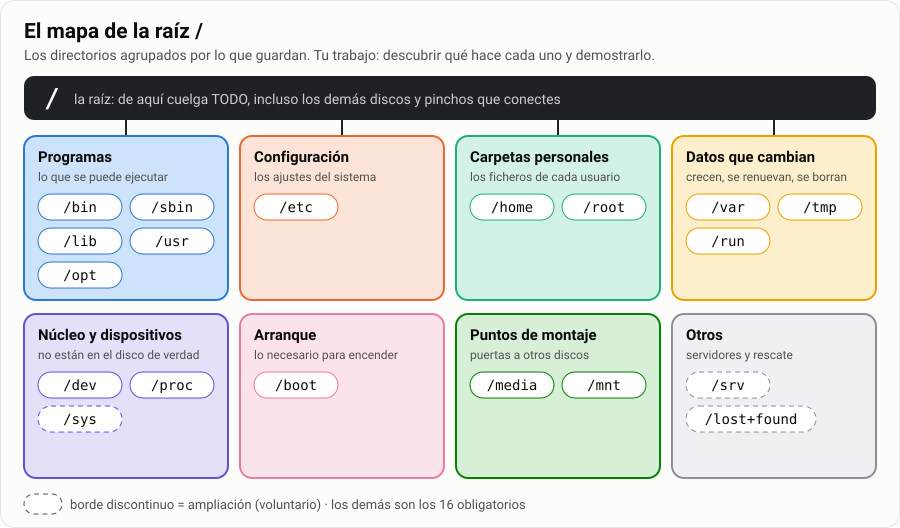
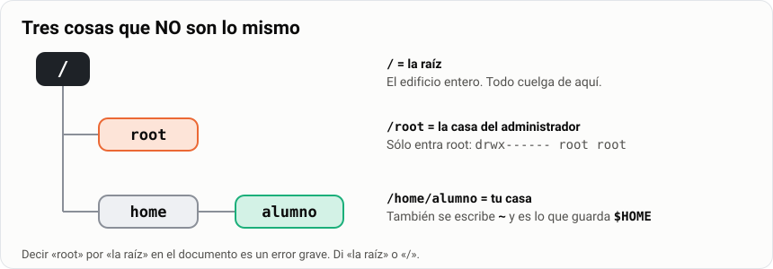
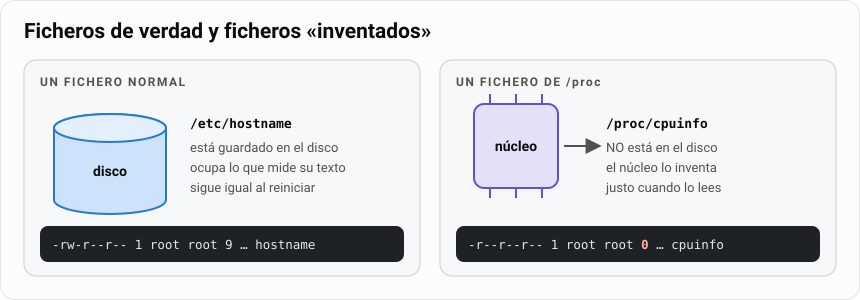
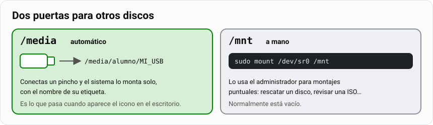
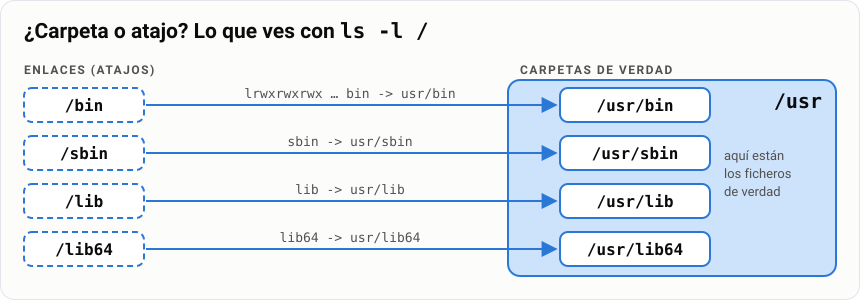

# Tarea · El mapa de directorios de Linux

> **Antes de empezar.** Necesitas tu máquina virtual `Mint-SMR` encendida, VS Code con la
> extensión Markdown All in One (ver la [guía de Markdown](../01-markdown/1-explicacion.md)) y
> haber hecho la [ficha de exploración](3-ejercicios.md). El árbol de directorios ya salió en la
> [guía de comandos](../04-comandos-y-ficheros/1-explicacion.md): ahora lo vas a recorrer entero
> y a documentarlo tú.

En Windows tus cosas están en `C:\Users\tu-nombre` y los programas en `C:\Program Files`. En Linux
**no hay letras de unidad**: todo cuelga de una sola raíz, `/`, y cada carpeta de primer nivel
tiene un trabajo fijo. En esta tarea vas a hacer de **detective**: entrar en cada una, mirar qué
hay, hacer pruebas y explicar con tus palabras para qué sirve.

> **Analogía.** El sistema de ficheros de Linux es un edificio con las plantas ya asignadas: en
> `/etc` está la oficina de administración con los contratos y las normas, en `/home` viven los
> inquilinos, en `/var/log` está el libro de incidencias del portero, en `/dev` el cuarto de
> contadores y en `/tmp` el trastero que se vacía cada noche. Tu documento será el **directorio del
> edificio** que le darías a un técnico nuevo para que sepa dónde buscar cada cosa.

| | |
|---|---|
| 🎯 **Qué vas a conseguir** | Saber qué guarda cada directorio de `/` y demostrarlo con pruebas en tu máquina |
| 🧰 **Qué necesitas** | `Mint-SMR`, el terminal y VS Code |
| ⏱️ **Tiempo** | 3 horas |
| 📦 **Qué entregas** | `mapa-directorios.pdf` en Moodle ([apartado 8](#8-entrega-y-criterios-de-apto)) |
| ✅ **Calificación** | Apto / No apto |

**Tu misión, paso a paso:**

- [ ] Mira el mapa de la raíz y localiza los 16 directorios obligatorios.
- [ ] Aprende el método del detective (6 pasos).
- [ ] Completa las 8 misiones de investigación, copiando las salidas de tu terminal.
- [ ] Rellena la tabla de referencia con lo que has descubierto.
- [ ] Escribe tu documento con la plantilla y expórtalo a PDF.

## Índice

- [Tarea · El mapa de directorios de Linux](#tarea--el-mapa-de-directorios-de-linux)
  - [Índice](#índice)
  - [1. Qué tienes que hacer](#1-qué-tienes-que-hacer)
  - [2. El mapa de la raíz](#2-el-mapa-de-la-raíz)
  - [3. Tu kit de detective](#3-tu-kit-de-detective)
  - [4. Las misiones](#4-las-misiones)
    - [Misión 1 · Los programas](#misión-1--los-programas)
    - [Misión 2 · La configuración](#misión-2--la-configuración)
    - [Misión 3 · Las casas](#misión-3--las-casas)
    - [Misión 4 · Lo que cambia](#misión-4--lo-que-cambia)
    - [Misión 5 · El núcleo y los dispositivos](#misión-5--el-núcleo-y-los-dispositivos)
    - [Misión 6 · El arranque](#misión-6--el-arranque)
    - [Misión 7 · Las puertas a otros discos](#misión-7--las-puertas-a-otros-discos)
    - [Misión 8 · Extras (ampliación)](#misión-8--extras-ampliación)
  - [5. La tabla de referencia](#5-la-tabla-de-referencia)
  - [6. Tu documento: estructura y plantilla](#6-tu-documento-estructura-y-plantilla)
  - [7. Lo que despista](#7-lo-que-despista)
  - [8. Entrega y criterios de Apto](#8-entrega-y-criterios-de-apto)

---

## 1. Qué tienes que hacer

Escribir **un documento en Markdown** que explique, uno por uno, los directorios que cuelgan de la
raíz `/` de tu Linux Mint: **qué guarda cada uno, para qué sirve y un ejemplo real** que hayas
comprobado en tu máquina.

El trabajo tiene tres piezas, y se hacen en este orden:

| Paso | Pieza | Dónde está |
|---|---|---|
| 1 | **Investigas** cada directorio con las misiones, copiando las salidas del terminal | [Apartado 4](#4-las-misiones) |
| 2 | **Resumes** lo que has visto en la tabla de referencia | [Apartado 5](#5-la-tabla-de-referencia) |
| 3 | **Escribes** el documento final con la plantilla | [Apartado 6](#6-tu-documento-estructura-y-plantilla) |

> [!WARNING]
> **No es un trabajo de copiar de internet.** Cada apartado tiene que llevar la **salida de un
> comando ejecutado en tu MV** que demuestre lo que cuentas. Un documento sin salidas propias es
> **No apto**. Esta guía te da pistas; la explicación tiene que salir de lo que **tú** veas.

> [!TIP]
> **Ve guardando mientras investigas.** Abre ya en VS Code un fichero `notas-directorios.md` y,
> en cada misión, pega ahí el comando y su salida. Para copiar del terminal: selecciona con el
> ratón y pulsa `Ctrl` + `Shift` + `C`. Al final sólo tendrás que ordenar y redactar.

## 2. El mapa de la raíz

Empieza por ver la raíz con tus propios ojos:

```bash
ls /          # los nombres
ls -l /       # con detalles: fíjate en las líneas que empiezan por l y tienen una flecha ->
```

Compara lo que sale con este mapa. Los directorios están agrupados en **barrios** según lo que
guardan:



Son **obligatorios** los 16 marcados; los tres del final son ampliación.

| Directorio | Nombre completo (pista) | Barrio del mapa | Obligatorio |
|---|---|---|---|
| `/bin` | *binaries* | Programas | ✔ |
| `/sbin` | *system binaries* | Programas | ✔ |
| `/lib` | *libraries* | Programas | ✔ |
| `/usr` | *Unix System Resources* | Programas | ✔ |
| `/opt` | *optional* | Programas | ✔ |
| `/etc` | *et cetera* (hoy: configuración) | Configuración | ✔ |
| `/home` | | Carpetas personales | ✔ |
| `/root` | | Carpetas personales | ✔ |
| `/var` | *variable* | Datos que cambian | ✔ |
| `/tmp` | *temporary* | Datos que cambian | ✔ |
| `/run` | | Datos que cambian | ✔ |
| `/dev` | *devices* | Núcleo y dispositivos | ✔ |
| `/proc` | *processes* | Núcleo y dispositivos | ✔ |
| `/boot` | | Arranque | ✔ |
| `/media` | | Puntos de montaje | ✔ |
| `/mnt` | *mount* | Puntos de montaje | ✔ |
| `/sys` | *system* | Núcleo y dispositivos | ampliación |
| `/srv` | *services* | Otros | ampliación |
| `/lost+found` | | Otros | ampliación |

> [!NOTE]
> En tu `ls /` verás también algunos que no están en la lista, como `cdrom`, `lib64` o `swapfile`.
> No son obligatorios, pero si te pica la curiosidad, investígalos con el mismo método.

## 3. Tu kit de detective

Para **cada** directorio vas a seguir siempre los mismos seis pasos. Así no te dejas nada y todas
las fichas salen completas.


| Paso | Comando | Qué te dice | Cómo leer la respuesta |
|---|---|---|---|
| 1. Mira dentro | `ls -l /etc` | Qué hay dentro | La primera letra: `d` carpeta, `-` fichero, `l` enlace (atajo) |
| 2. ¿De quién es? | `ls -ld /etc` | Permisos y propietario **del propio directorio** | La 3.ª columna es el dueño: si es `root`, sólo el administrador manda ahí |
| 3. ¿Qué tipo de ficheros hay? | `file /etc/hostname` | Si es texto, un programa, un enlace… | `ASCII text` = texto · `ELF … executable` = programa · `symbolic link` = atajo |
| 4. ¿Cuánto ocupa? | `sudo du -sh /etc` | El tamaño total | `K` kilobytes, `M` megas, `G` gigas. Compara directorios entre sí |
| 5. ¿Qué dice el manual? | `man hier` | La descripción oficial de cada directorio | Busca con `/etc` + `Enter`, siguiente con `n`, sal con `q` |
| 6. Haz el experimento | el de cada misión | Una prueba que **demuestra** para qué sirve | Es la salida que pondrás en tu documento |

> [!TIP]
> **Cambia `/etc` por el directorio que estés investigando.** Los pasos 1 a 5 son iguales para
> todos; lo que cambia en cada misión son los comandos extra y el experimento.

> [!IMPORTANT]
> **`man hier` es la chuleta oficial**: describe cada directorio en dos o tres líneas. Léelo, pero
> **explícalo con tus palabras** y con tu ejemplo. Si tu apartado dice lo mismo que el manual con
> las mismas palabras, no has entendido nada y se nota.

Mientras investigas, hazte siempre estas cuatro preguntas. Sus respuestas son las columnas de la
[tabla de referencia](#5-la-tabla-de-referencia):

1. ¿Qué **tipo** de cosas hay dentro: programas, configuración, datos de usuario, dispositivos…?
2. ¿**Quién** escribe ahí: el sistema, el administrador o el usuario normal? *(mira el propietario
   con `ls -ld`)*
3. ¿Es **fijo** o **cambia** mucho? ¿Sobrevive a un reinicio?
4. ¿Qué **fichero concreto** de dentro conoces y para qué sirve?

---

## 4. Las misiones

Cada directorio tiene su ficha con cinco partes:

- 🔤 **El nombre**: de dónde viene.
- 🔍 **Investiga**: los comandos que tienes que ejecutar (además de los pasos 1-5 del método).
- 👀 **Fíjate en**: qué tienes que buscar en la salida.
- ❓ **Responde**: las preguntas que tu apartado tiene que contestar.
- 🧪 **Experimento**: la prueba estrella para tu documento.

### Misión 1 · Los programas

Cuando escribes `ls` o `cp`, estás ejecutando un fichero que está guardado en algún sitio. Esta
misión va de **dónde viven los programas** y las piezas que necesitan.

#### `/bin`

🔤 *binaries*: ficheros binarios, es decir, programas ya compilados que el ordenador ejecuta.

🔍 **Investiga:**

```bash
ls -ld /bin                 # ¿carpeta (d) o enlace (l)? busca la flecha ->
ls /bin | head -n 20        # algunos programas: ¿cuáles conoces?
ls /bin | wc -l             # ¿cuántos hay?
which ls cp bash            # ¿dónde está cada programa de verdad?
file /bin/ls                # ¿qué tipo de fichero es ls?
ls -l /bin/ls               # ¿quién es su dueño? ¿quién puede ejecutarlo?
```

👀 **Fíjate en:**

- La primera letra de `ls -ld /bin` y lo que hay después de la flecha.
- `file` dice **ELF**: es el formato de los programas en Linux, como los `.exe` en Windows.
- Los permisos de `/bin/ls`: ¿tiene `x` para todo el mundo? ¿El dueño es `root`?

❓ **Responde:** ¿Qué hay en `/bin`? ¿Por qué `which ls` dice `/usr/bin/ls` y no `/bin/ls`?
¿Puede un usuario normal modificar estos programas?

🧪 **Experimento:** intenta crear un fichero dentro y copia el error.

```bash
touch /usr/bin/prueba       # ¿qué pasa? ¿por qué?
```

#### `/sbin`

🔤 *system binaries*: programas **del sistema**, pensados para el administrador.

🔍 **Investiga:**

```bash
ls -ld /sbin
ls /sbin | head -n 30       # ¿reconoces alguno? (fdisk, reboot, useradd…)
```

👀 **Fíjate en:** que también es un enlace, y en los nombres: casi todos sirven para **administrar**
el equipo (discos, usuarios, red, apagado).

❓ **Responde:** ¿Qué diferencia hay entre los programas de `/bin` y los de `/sbin`?

🧪 **Experimento:** usa un programa de administración con y sin permisos.

```bash
fdisk -l                    # como usuario normal: ¿qué responde?
sudo fdisk -l               # como administrador: ¿qué enseña ahora?
```

#### `/lib`

🔤 *libraries*: librerías, piezas de código que comparten muchos programas.

> **Analogía.** Una librería es como una pieza de LEGO que usan muchas construcciones distintas.
> En lugar de que cada programa traiga su propia pieza de «abrir ficheros» o «dibujar texto», todos
> usan la misma, guardada en `/lib`. En Windows se llaman `.dll`; en Linux, `.so`.

🔍 **Investiga:**

```bash
ls -ld /lib
ldd /bin/ls                       # ¿qué librerías necesita ls para funcionar?
ls /lib/x86_64-linux-gnu | head   # algunas librerías: fíjate en la extensión
uname -r                          # la versión de tu núcleo (kernel)
ls /lib/modules                   # los módulos (drivers) del núcleo
```

👀 **Fíjate en:** la flecha `=>` de `ldd`, que dice **dónde** está cada librería; la extensión
`.so`; y que la carpeta de `/lib/modules` se llama igual que lo que dice `uname -r`.

❓ **Responde:** ¿Qué es un fichero `.so`? ¿A qué se parece en Windows? ¿Qué le pasaría a `ls` si
borrases `libc.so.6`? *(razónalo, ¡no lo hagas!)*

#### `/usr`

🔤 *Unix System Resources*: los recursos del sistema. **No significa *user***, aunque lo parezca.

🔍 **Investiga:**

```bash
ls /usr                           # bin, lib, sbin, share, local…
sudo du -sh /usr                  # ¿cuánto ocupa? compáralo con /etc
ls /usr/share/backgrounds         # los fondos de pantalla de Mint
ls /usr/share/doc | wc -l         # documentación de los paquetes instalados
ls /usr/local/bin                 # lo que instala el administrador a mano
```

👀 **Fíjate en:** que dentro de `/usr` se repiten nombres (`bin`, `lib`, `sbin`) y en lo mucho
que ocupa comparado con el resto.

❓ **Responde:** ¿Por qué `/usr` es de los directorios más grandes? ¿Qué diferencia hay entre
`/usr/bin` y `/usr/local/bin`?

🧪 **Experimento:** instala un programa y mira **dónde** lo pone el sistema.

```bash
sudo apt install cowsay           # una vaca que habla
which cowsay                      # ¿dónde se ha instalado?
cowsay "Hola desde /usr"
dpkg -L cowsay | head -n 15       # TODOS los ficheros que ha instalado el paquete
```

#### `/opt`

🔤 *optional*: software opcional, normalmente de otras empresas.

🔍 **Investiga:**

```bash
ls -l /opt
ls -ld /opt
```

👀 **Fíjate en:** probablemente esté vacío o casi. Programas como Google Chrome o Zoom, cuando
los instalas, se meten aquí **cada uno en su carpeta**, con todo dentro.

❓ **Responde:** ¿Por qué en tu MV está vacío (o casi)? ¿Qué diferencia hay entre un programa
instalado en `/usr` (repartido en `bin`, `lib`, `share`) y uno instalado en `/opt` (todo junto)?

### Misión 2 · La configuración

#### `/etc`

🔤 *et cetera*: «y lo demás». Hoy se usa para **toda la configuración** del sistema.

🔍 **Investiga:**

```bash
ls /etc | wc -l                   # ¿cuántos elementos de configuración hay?
cat /etc/hostname                 # el nombre de tu equipo
cat /etc/os-release               # qué sistema y qué versión tienes
head -n 3 /etc/passwd             # las cuentas de usuario (lo viste en la ficha)
cat /etc/fstab                    # qué particiones se montan al arrancar
file /etc/hostname /etc/fstab     # ¿qué tipo de ficheros son?
ls -l /etc/passwd /etc/shadow     # compara los permisos de los dos
```

👀 **Fíjate en:** que `file` dice **texto** (`ASCII text`), no programas; que casi todo es de
`root`; y que el nombre de `/etc/hostname` es el mismo que sale en tu prompt
(`alumno@mint-smr`).

❓ **Responde:** ¿Hay programas en `/etc`? ¿Quién puede modificar estos ficheros? ¿Qué ficheros
de aquí conoces ya de la [ficha anterior](3-ejercicios.md) y para qué sirven?

🧪 **Experimento:** intenta modificar un fichero de configuración sin permisos y copia el error.

```bash
echo "prueba" >> /etc/hostname    # ¿te deja? ¿por qué?
```

> [!CAUTION]
> **No uses `sudo` en este experimento.** Si lo consiguieras, cambiarías el nombre del equipo y
> se liaría todo. La gracia está precisamente en ver que un usuario normal **no puede**.

### Misión 3 · Las casas

#### `/home`

🔤 *home*: hogar. Aquí vive cada usuario.

🔍 **Investiga:**

```bash
ls -l /home                 # una carpeta por cada usuario
echo $HOME                  # tu carpeta personal
ls -ld /home/alumno         # ¿de quién es? ¿qué permisos tiene?
ls -la ~                    # tus ficheros, incluidos los ocultos (.bashrc…)
du -sh ~                    # cuánto ocupas tú
```

👀 **Fíjate en:** que el dueño de tu carpeta eres **tú**, no `root`; en los ficheros que empiezan
por punto (ocultos) y en que `~` y `$HOME` son atajos de tu carpeta.

❓ **Responde:** ¿Quién es el propietario de tu carpeta? ¿Pueden los demás usuarios entrar en
ella? *(mira los permisos; los estudiarás a fondo en la
[guía de permisos](../../2-intermedio/09-permisos/1-guia.md))* ¿Qué son los ficheros que empiezan
por punto?

> **Reto.** Crea un usuario de prueba y mira qué pasa en `/home`. Después, bórralo:
>
> ```bash
> sudo adduser invitado            # te pedirá una contraseña y unos datos (Enter para saltar)
> ls -l /home                      # ¿qué ha aparecido?
> sudo deluser --remove-home invitado
> ```

#### `/root`

🔤 *root*: la casa del usuario **root**, el administrador. **No es la raíz** (ver
[Lo que despista](#7-lo-que-despista)).



🔍 **Investiga:**

```bash
ls /root                    # como usuario normal: ¿qué pasa?
ls -ld /root                # ¿de quién es? ¿qué permisos tiene?
sudo ls -la /root           # ahora como administrador
```

👀 **Fíjate en:** el error del primer comando y en los permisos `drwx------`: sólo el dueño
tiene permisos, los demás nada.

❓ **Responde:** ¿Qué diferencia hay entre `/` y `/root`? ¿Por qué crees que la casa del
administrador **no** está dentro de `/home`? *(pista: piensa qué pasa si `/home` está en otra
partición y esa partición falla)*

### Misión 4 · Lo que cambia

#### `/var`

🔤 *variable*: datos que **cambian** mientras el sistema funciona.

🔍 **Investiga:**

```bash
ls /var                           # log, cache, lib, spool, tmp…
ls -lh /var/log | head -n 15      # los registros (logs) del sistema
sudo du -sh /var/cache/apt        # los paquetes que ha descargado apt
```

👀 **Fíjate en:** las fechas y los tamaños de los ficheros de `/var/log`: se escriben **todo el
rato**.

❓ **Responde:** ¿Por qué se llama «variable»? ¿Qué pasaría si un programa escribiera sin parar en
un log? ¿Dónde mirarías para averiguar por qué ha fallado algo?

🧪 **Experimento:** deja tu firma en el registro del sistema y búscala.

```bash
logger "Hola, soy $USER y estoy investigando /var"
tail -n 3 /var/log/syslog         # ¿aparece tu mensaje?
```

> [!NOTE]
> Si `tail` dice que `/var/log/syslog` no existe, tu sistema guarda el registro de otra forma
> (el *journal*). Usa `journalctl -n 5` y busca tu mensaje igual.

#### `/tmp`

🔤 *temporary*: temporal.

🔍 **Investiga:**

```bash
ls -ld /tmp                       # mira la ÚLTIMA letra de los permisos
ls -l /tmp | head
df -h /tmp                        # ¿está en el disco o en la RAM (tmpfs)?
```

👀 **Fíjate en:** los permisos `drwxrwxrwt`: todo el mundo puede escribir, y la `t` final (el
*sticky bit*) hace que cada uno sólo pueda borrar lo suyo. Lo verás en la guía de permisos.

❓ **Responde:** ¿Quién puede escribir en `/tmp`? ¿Por qué no deberías guardar ahí nada
importante?

🧪 **Experimento:** ¿sobrevive un fichero a un reinicio?

```bash
echo "¿sigo aquí?" > /tmp/prueba-$USER.txt
ls -l /tmp/prueba-$USER.txt
# reinicia la MV, abre el terminal y vuelve a mirar:
ls -l /tmp/prueba-$USER.txt
```

#### `/run`

🔤 *run*: datos de lo que está funcionando **ahora mismo**.

🔍 **Investiga:**

```bash
ls /run | head -n 25              # fíjate en los nombres: son servicios del sistema
df -h /run                        # ¿en qué «disco» está?
ls /run/user/$(id -u)             # tu carpeta de ejecución (id -u es tu número de usuario)
```

👀 **Fíjate en:** que `df` dice **`tmpfs`**: no está en el disco, está **en la RAM**.

❓ **Responde:** ¿Qué pasa con el contenido de `/run` al apagar? ¿En qué se parece y en qué se
diferencia de `/tmp`?

🧪 **Experimento:** compara de un vistazo dónde vive cada cosa.

```bash
df -h / /tmp /run
```

### Misión 5 · El núcleo y los dispositivos

> [!IMPORTANT]
> **En Linux casi todo es un fichero:** tu disco, el teclado, el terminal, incluso los procesos.
> Esta misión es la que más sorprende. Tómatela con calma.

#### `/dev`

🔤 *devices*: dispositivos.

🔍 **Investiga:**

```bash
ls /dev | head -n 30              # tu hardware… convertido en ficheros
ls -l /dev/sda*                   # tu disco y sus particiones
lsblk                             # lo mismo, en forma de árbol
ls -l /dev/null /dev/tty /dev/random
```

👀 **Fíjate en:** la **primera letra** de `ls -l`: `b` (*block*, dispositivo de bloques: discos) o
`c` (*character*, dispositivo de caracteres: terminal, teclado…). Y en los nombres: `sda` es el
primer disco y `sda1` su primera partición.

❓ **Responde:** ¿Qué significan la `b` y la `c`? ¿Cuántas particiones tiene tu disco?
¿Coinciden con las que hiciste al instalar Mint (EFI, raíz, swap y home)?

🧪 **Experimento:** la papelera sin fondo.

```bash
echo "esto desaparece" > /dev/null
cat /dev/null                     # ¿qué sale?
```

> [!TIP]
> Si no existe `/dev/sda`, tu disco virtual se llama de otra forma (por ejemplo `nvme0n1`).
> Míralo con `lsblk` y usa ese nombre.

#### `/proc`

🔤 *processes*: procesos. Es una **ventana al núcleo**.



🔍 **Investiga:**

```bash
ls /proc | head -n 30             # ¿por qué hay tantas carpetas con números?
echo $$                           # el PID de tu terminal (tema 03)
ls /proc/$$                       # ¡tu terminal tiene una carpeta aquí!
head -n 6 /proc/$$/status         # su nombre, su estado, su PID…
cat /proc/cpuinfo | head -n 10    # tu procesador
nproc                             # cuántos núcleos ve tu MV
head -n 3 /proc/meminfo           # tu memoria RAM
ls -l /proc/cpuinfo               # ¿cuánto «ocupa»?
```

👀 **Fíjate en:** que las carpetas con número son **los PID de los procesos** que están
funcionando, y que `cpuinfo` ocupa **0 bytes** aunque al leerlo salga un montón de texto.

❓ **Responde:** ¿Por qué ocupa 0 bytes si al hacer `cat` sale texto? ¿Qué relación tienen las
carpetas con número con los procesos del [tema 03](../03-procesos/1-guia.md)?

🧪 **Experimento:** cambia el hardware y mira cómo cambia un fichero que nadie ha editado.

1. Apunta lo que dice `nproc`.
2. Apaga la MV. En VirtualBox: **Configuración → Sistema → Procesador** y cambia el número de
   procesadores.
3. Arranca y repite `nproc` y `cat /proc/cpuinfo | head -n 10`.

#### `/sys` (ampliación)

🔤 *system*: otra ventana al núcleo, más ordenada, centrada en el **hardware**.

🔍 **Investiga:**

```bash
ls /sys
ls /sys/class/net                 # tus tarjetas de red
cat /sys/class/net/*/address      # sus direcciones MAC
cat /sys/block/sda/size           # tamaño del disco, en sectores de 512 bytes
```

❓ **Responde:** ¿En qué se parece a `/proc`? Compara la MAC con la que muestra VirtualBox en
**Configuración → Red → Avanzadas**. Calcula el tamaño del disco en GiB:
sectores × 512 ÷ 1 073 741 824.

### Misión 6 · El arranque

#### `/boot`

🔤 *boot*: arranque. Lo que hace falta para **encender** el sistema.

🔍 **Investiga:**

```bash
ls -lh /boot                      # el núcleo (vmlinuz) y el initrd
uname -r                          # la versión del núcleo que está funcionando
ls /boot/grub                     # el cargador de arranque GRUB
lsblk -f                          # busca /boot/efi: es la partición EFI
sudo ls /boot/efi/EFI             # los cargadores UEFI que hay instalados
```

👀 **Fíjate en:** el fichero `vmlinuz-…`: su número coincide con `uname -r`. Ése **es** el
núcleo de Linux. Y en que `/boot/efi` es la partición EFI que creaste al instalar Mint.

❓ **Responde:** ¿Qué es `vmlinuz`? ¿Por qué puede haber varias versiones? ¿Qué relación tiene
`/boot/efi` con la partición EFI de la [instalación de Mint](../02-instalar-mint-virtualbox/1-explicacion.md)?
¿Qué pasaría si borrases `/boot`? *(razónalo, ¡no lo hagas!)*

### Misión 7 · Las puertas a otros discos

En Linux no hay `D:` ni `E:`. Cuando conectas un disco, su contenido aparece **dentro de una
carpeta**: a eso se le llama **montar**, y la carpeta es el **punto de montaje**.



#### `/media`

🔍 **Investiga:**

```bash
ls /media                         # puede estar vacío o tener una carpeta con tu nombre
ls -l /media
```

🧪 **Experimento:** conecta un disco y mira dónde aparece.

1. En la ventana de VirtualBox: **Dispositivos → Insertar imagen de CD de las «Guest Additions»…**
   (o conecta un pincho en **Dispositivos → USB**).
2. Mint lo monta solo. Mira dónde:

   ```bash
   ls /media/$USER
   lsblk                          # busca sr0 (el CD) y su punto de montaje
   ```

❓ **Responde:** ¿Quién ha montado el CD: tú o el sistema? ¿Qué nombre le ha puesto a la carpeta?

#### `/mnt`

🔤 *mount*: montar.

🔍 **Investiga:**

```bash
ls -l /mnt                        # ¿vacío?
```

🧪 **Experimento:** ahora monta **tú**, a mano, el mismo CD.

```bash
sudo mount /dev/sr0 /mnt          # avisará de que es de sólo lectura: es normal
ls /mnt                           # el mismo contenido, por otra «puerta»
sudo umount /mnt                  # desmontar (ojo: umount, sin la n)
ls /mnt                           # vuelve a estar vacío
```

❓ **Responde:** ¿Qué diferencia hay entre `/media` y `/mnt`? ¿Quién monta en cada uno?

### Misión 8 · Extras (ampliación)

#### `/srv`

🔤 *services*: datos de los servicios que el equipo **ofrece a otros** (una web, un FTP…).

```bash
ls -la /srv
```

❓ **Responde:** ¿Por qué en tu Mint está vacío? ¿Qué guardaría ahí un servidor web?

#### `/lost+found`

🔤 «Objetos perdidos».

```bash
ls -ld /lost+found
sudo ls -la /lost+found
lsblk -f                          # ¿en qué particiones ext4 habrá otro lost+found?
```

❓ **Responde:** ¿Cuándo aparecería algo aquí? *(pista: `man fsck`)* ¿Por qué hay uno en cada
partición ext4?

---

## 5. La tabla de referencia

Cuando termines las misiones, **resume en esta tabla lo que has descubierto**. Es tu chuleta
personal y va al final del documento.

> **Ejemplo.** Así quedaría una fila rellenada para `/usr/games` (no está en la lista: es sólo
> para que veas el nivel de detalle). Fíjate en que todo sale de pruebas reales del experimento de
> `cowsay`:
>
> | Directorio | Qué guarda | Quién escribe | ¿Fijo o cambia? | Ejemplo real | Comando-prueba |
> |---|---|---|---|---|---|
> | `/usr/games` | Juegos y programas de broma instalados con `apt` | root (al instalar paquetes) | Fijo: sólo cambia al instalar o desinstalar | `/usr/games/cowsay` | `which cowsay` |

Columnas:

- **Qué guarda**: con tus palabras, 15 palabras como mucho.
- **Quién escribe**: el sistema (núcleo), root/administrador, cada usuario, cualquiera…
- **¿Fijo o cambia?**: fijo · cambia a menudo · se borra al reiniciar · no está en el disco.
- **Ejemplo real**: un fichero o carpeta **concreto** que hayas visto en tu máquina.
- **Comando-prueba**: el comando que lo demuestra.

| Directorio | Qué guarda | Quién escribe | ¿Fijo o cambia? | Ejemplo real | Comando-prueba |
|---|---|---|---|---|---|
| `/bin` | | | | | |
| `/sbin` | | | | | |
| `/lib` | | | | | |
| `/usr` | | | | | |
| `/opt` | | | | | |
| `/etc` | | | | | |
| `/home` | | | | | |
| `/root` | | | | | |
| `/var` | | | | | |
| `/tmp` | | | | | |
| `/run` | | | | | |
| `/dev` | | | | | |
| `/proc` | | | | | |
| `/boot` | | | | | |
| `/media` | | | | | |
| `/mnt` | | | | | |
| `/sys` *(ampl.)* | | | | | |
| `/srv` *(ampl.)* | | | | | |
| `/lost+found` *(ampl.)* | | | | | |

> [!TIP]
> **¿No sabes qué poner en una casilla?** Es señal de que te falta un paso del método. Vuelve a la
> misión de ese directorio y repite el paso que corresponda: «quién escribe» sale de `ls -ld`;
> «¿fijo o cambia?», de mirar las fechas con `ls -l` o del experimento del reinicio.

## 6. Tu documento: estructura y plantilla

Copia esta plantilla en VS Code como `mapa-directorios.md` y rellénala. **Un apartado por
directorio, siempre con los tres bloques**: qué es, la prueba y qué has aprendido.

````markdown
# El mapa de directorios de Linux

**Autor:** Nombre Apellido · **Máquina:** Mint-SMR · **Fecha:** AAAA-MM-DD

## Índice

(genéralo con Markdown All in One: Ctrl+Shift+P → «Create Table of Contents»)

## Introducción

Qué es la raíz `/` y cómo he hecho la investigación (3 o 4 líneas).

## `/bin`

**Qué es y para qué sirve.** Con mis palabras, de 2 a 4 líneas: qué guarda, quién escribe ahí y
para qué lo usa el sistema.

**La prueba en mi máquina.**

```bash
alumno@mint-smr:~$ (el comando)
(la salida, copiada tal cual del terminal)
```

**Qué he aprendido.** Una frase que se deduce de la salida de arriba.

## `/sbin`

(…los mismos tres bloques para cada directorio…)

## Tabla de referencia

(la tabla del apartado 5, rellenada)

## Lo que más me ha sorprendido

Dos o tres líneas.
````

Y así quedaría un apartado bien hecho (otra vez con `/usr/games`, que no está en la lista):

> **Ejemplo.**
>
> **`/usr/games`**
>
> **Qué es y para qué sirve.** Es la carpeta donde `apt` instala los juegos y los programas «de
> broma». Los ficheros son de root, así que sólo cambian cuando el administrador instala o
> desinstala algo. Está dentro de `/usr` porque es software del sistema, no datos de un usuario.
>
> **La prueba en mi máquina.**
>
> ```bash
> alumno@mint-smr:~$ which cowsay
> /usr/games/cowsay
> alumno@mint-smr:~$ ls -ld /usr/games
> drwxr-xr-x 2 root root 4096 oct  5 10:12 /usr/games
> ```
>
> **Qué he aprendido.** Aunque yo ejecuto `cowsay` desde mi carpeta, el programa no está en mi
> `/home`: está en `/usr/games`, es de root y yo sólo tengo permiso para ejecutarlo (`r-x`).

> [!IMPORTANT]
> **Tus salidas tendrán otros números y otras fechas**: es justo lo que demuestra que son tuyas.
> El prompt `alumno@mint-smr` tiene que verse en cada bloque.

## 7. Lo que despista

> [!WARNING]
> **`/root` no es la raíz.** La raíz es `/`. `/root` es la carpeta personal del usuario
> administrador, igual que `/home/alumno` es la tuya. Confundirlos en el documento es error grave.

**En Mint `/bin` es un enlace a `/usr/bin`.** Haz `ls -ld /bin /sbin /lib` y verás una flecha
`->`. Desde hace años las distribuciones han unificado esas carpetas dentro de `/usr` (lo llaman
*usrmerge*); los nombres antiguos se mantienen como **atajos** para que los programas viejos no
se rompan. Explícalo en tu documento: es de lo que más se pregunta.



> [!NOTE]
> **`/proc` y `/sys` «ocupan» 0 bytes.** No están en el disco: los inventa el núcleo cada vez que
> los lees. Por eso `du -sh /proc` da resultados raros y por eso `/proc/cpuinfo` cambia si cambias
> la CPU de la MV.

> [!NOTE]
> **`/media` y `/mnt` no son lo mismo.** `/media` lo usa el sistema para montar pinchos y CD
> solos; `/mnt` es para los montajes que haces tú a mano.

> [!NOTE]
> **`/usr` no es *user*.** Las carpetas de los usuarios están en `/home`. `/usr` guarda el software
> instalado.

> [!NOTE]
> **`/tmp` y `/var/tmp` no son iguales.** Los dos son temporales, pero lo de `/var/tmp` sobrevive
> a los reinicios. Si haces el experimento del reinicio en los dos, lo verás.

## 8. Entrega y criterios de Apto

Entrega en la tarea de Moodle **«Tarea 5 · Mapa de directorios de Linux»**:

- `mapa-directorios.pdf` exportado desde VS Code (Markdown All in One → HTML → imprimir en el
  navegador como PDF).

Calificación **Apto / No apto**. Es **Apto** cuando se cumple **todo** esto:

| # | Criterio | Cómo se comprueba |
|---|---|---|
| 1 | Están los **16 directorios obligatorios**, cada uno con los tres bloques de la plantilla | Se cuentan los apartados |
| 2 | Cada apartado lleva **al menos un comando con su salida real** de `Mint-SMR` en bloque de código | La salida incluye tu prompt `alumno@mint-smr` y datos de tu máquina |
| 3 | La explicación es **tuya**: con tus palabras, y la línea «qué he aprendido» dice algo que se deduce de la salida | Se contrasta con `man hier`; texto copiado = No apto |
| 4 | No hay errores de concepto graves: `/root` ≠ `/`, `/etc` no guarda programas, `/home` no es de root, `/bin` → `/usr/bin` explicado | Lectura del profesor |
| 5 | La **tabla de referencia** está completa para los 16 obligatorios | Se revisa que no haya casillas vacías |

**Antes de entregar, comprueba:**

- [ ] Hay 16 apartados (más los de ampliación, si los has hecho).
- [ ] Cada apartado tiene **qué es**, **la prueba** y **qué he aprendido**.
- [ ] En cada bloque de código se ve `alumno@mint-smr`.
- [ ] En ningún sitio llamas «root» a la raíz.
- [ ] Explicas por qué `/bin` es un enlace.
- [ ] La tabla de referencia está completa.
- [ ] El PDF se lee bien: los bloques de código no se cortan.
