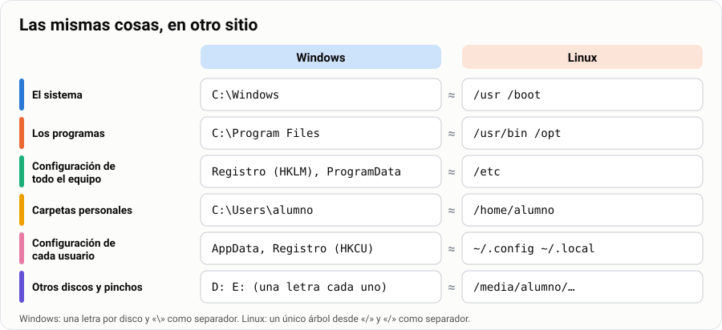
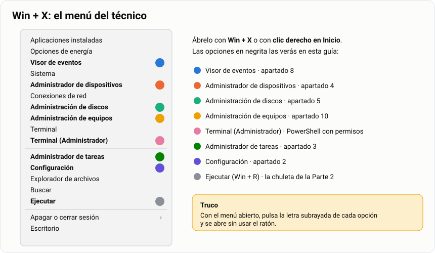
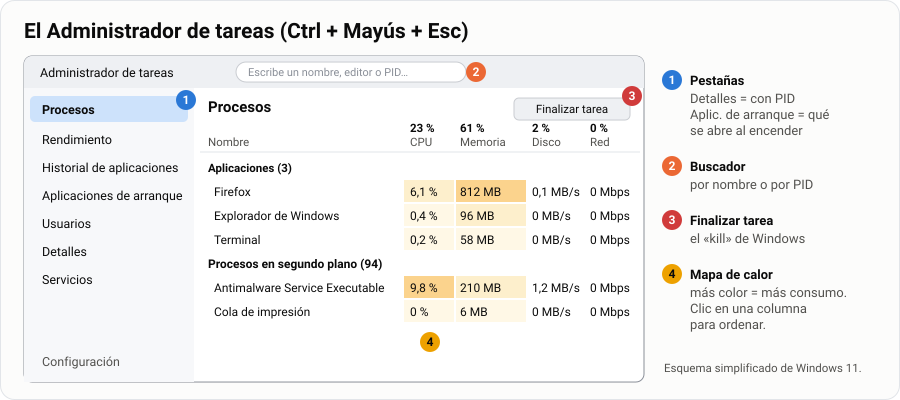
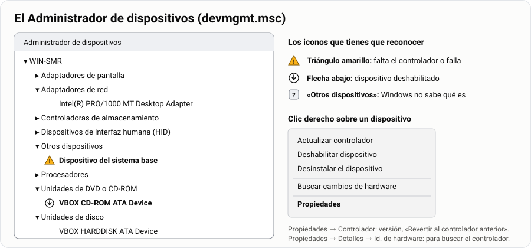
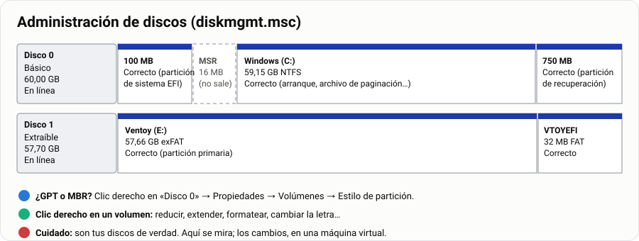
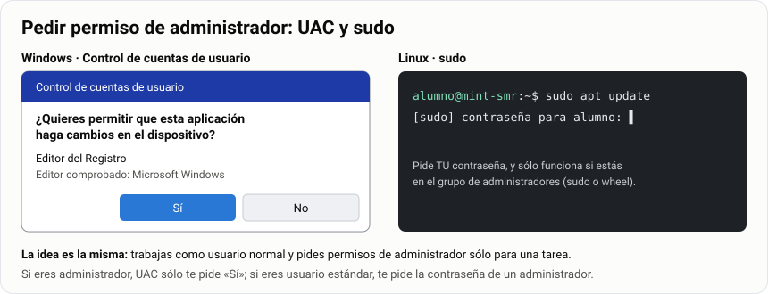
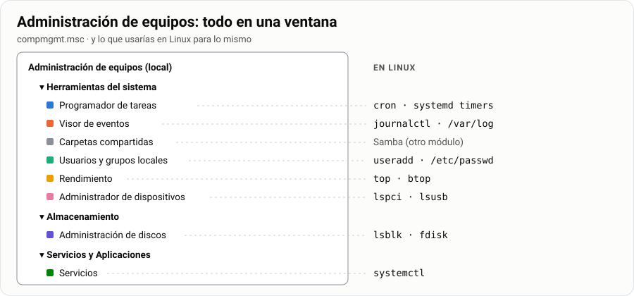

# Windows por dentro: diferencias con Linux y herramientas del técnico

> **Antes de empezar.** Conviene haber hecho la [guía de procesos](../03-procesos/1-guia.md) y la
> [tarea del mapa de directorios](../05-explorar-el-sistema/4-tarea-directorios-linux.md): aquí vas
> a comparar todo aquello con Windows. Trabaja en tu **máquina virtual de Windows** si la tienes;
> en el equipo del aula puedes mirar casi todo, pero crear usuarios o tocar servicios pide ser
> administrador.

Llevas años usando Windows… como usuario. Ahora toca mirarlo **como técnico**: dónde guarda cada
cosa, qué ventanas abres cuando algo falla y cómo se hacen en Windows las mismas tareas que ya
sabes hacer en Linux. Es una guía resumida: lo justo para moverte con soltura.

> **Analogía.** Windows y Linux son dos coches de marcas distintas. Los dos tienen volante, pedales
> y motor, pero los mandos están en otro sitio y se llaman de otra forma. Un buen mecánico no se
> aprende un coche: aprende **qué piezas tiene cualquier coche** y luego busca dónde las ha puesto
> cada marca.

| | |
|---|---|
| 🎯 **Qué vas a aprender** | Las diferencias clave con Linux y las ventanas que usa un técnico para gestionar Windows |
| 🧰 **Qué necesitas** | Windows 10 u 11 (mejor en una MV) y, para algunas tareas, una cuenta de administrador |
| ⏱️ **Tiempo** | 3 horas |
| 📦 **Qué entregas** | La ficha «Radiografía de mi Windows» ([Parte 4](#parte-4--entrega)) |

**Tu misión, paso a paso:**

- [ ] Saber dónde guarda Windows lo que en Linux está en `/etc`, `/home` o `/usr`.
- [ ] Abrir cualquier herramienta de administración en dos segundos (`Win` + `X` y `Win` + `R`).
- [ ] Leer el Administrador de tareas, el de dispositivos y la Administración de discos.
- [ ] Gestionar usuarios y grupos, con ventanas y con PowerShell.
- [ ] Revisar servicios, eventos y características de Windows.

## Índice

- [Windows por dentro: diferencias con Linux y herramientas del técnico](#windows-por-dentro-diferencias-con-linux-y-herramientas-del-técnico)
  - [Índice](#índice)
  - [Parte 1 · Aprende](#parte-1--aprende)
    - [1. Windows y Linux: lo mismo con otro nombre](#1-windows-y-linux-lo-mismo-con-otro-nombre)
    - [2. Configuración y Panel de control](#2-configuración-y-panel-de-control)
    - [3. Administrador de tareas](#3-administrador-de-tareas)
    - [4. Administrador de dispositivos](#4-administrador-de-dispositivos)
    - [5. Administración de discos](#5-administración-de-discos)
    - [6. Usuarios y grupos](#6-usuarios-y-grupos)
    - [7. Servicios](#7-servicios)
    - [8. Visor de eventos](#8-visor-de-eventos)
    - [9. Características y programas](#9-características-y-programas)
    - [10. Administración de equipos y otras herramientas](#10-administración-de-equipos-y-otras-herramientas)
  - [Parte 2 · Chuleta](#parte-2--chuleta)
  - [Parte 3 · Practica](#parte-3--practica)
  - [Parte 4 · Entrega](#parte-4--entrega)

---

## Parte 1 · Aprende

### 1. Windows y Linux: lo mismo con otro nombre

Lo primero que choca es **dónde** está cada cosa. En Linux todo cuelga de `/`; en Windows cada
disco tiene su letra.



Y estas son las diferencias que más vas a notar:

| | 🪟 Windows | 🐧 Linux |
|---|---|---|
| **Núcleo** | Windows NT | Linux |
| **Licencia** | De pago, código cerrado | Libre y gratuito |
| **Discos** | Una letra por disco: `C:`, `D:` | Un único árbol desde `/` |
| **Separador de rutas** | `\` (`C:\Users\alumno`) | `/` (`/home/alumno`) |
| **Mayúsculas en los nombres** | Dan igual: `Hola.txt` = `hola.txt` | Importan: son dos ficheros distintos |
| **Ficheros ocultos** | Tienen el atributo «oculto» | Empiezan por punto (`.bashrc`) |
| **¿Qué se puede ejecutar?** | Lo decide la extensión: `.exe`, `.msi`, `.bat`, `.ps1` | Lo decide el permiso `x` |
| **Configuración** | El **Registro** (una base de datos) y la app Configuración | Ficheros de texto en `/etc` y `~/.config` |
| **Instalar programas** | Instaladores `.exe`/`.msi`, Microsoft Store, `winget` | Gestor de paquetes: `apt`, `pacman` |
| **Administrador** | Grupo **Administradores** + aviso **UAC** | **root** + `sudo` |
| **Terminal** | PowerShell y CMD (dentro de Terminal de Windows) | bash, zsh |
| **Servicios** | Ventana **Servicios** | `systemctl` |
| **Registro de eventos** | **Visor de eventos** | `journalctl`, `/var/log` |
| **Tareas programadas** | **Programador de tareas** | `cron` |
| **Permisos** | NTFS: listas de quién puede qué | `rwx` (y ACL) |
| **Actualizar** | Windows Update | `apt upgrade`, `pacman -Syu` |

> [!IMPORTANT]
> **El Registro** es la gran diferencia. En Linux la configuración son miles de ficheros de texto
> que abres con `nano`; en Windows casi todo está en una única base de datos que se ve con el
> **Editor del Registro** (`regedit`). Tiene dos ramas principales: `HKEY_LOCAL_MACHINE` (todo el
> equipo, como `/etc`) y `HKEY_CURRENT_USER` (tu usuario, como `~/.config`).

> [!CAUTION]
> **No toques el Registro «a ver qué pasa».** No hay papelera ni «deshacer»: un valor mal cambiado
> puede impedir que Windows arranque. Si un tutorial te pide editarlo, antes haz **Archivo →
> Exportar** de la rama que vas a tocar.

**🧠 ¿Lo has pillado?**

1. ¿Dónde guardaría Windows lo que en Linux está en `/home/alumno`?
2. En Linux, `informe.TXT` e `informe.txt` son dos ficheros. ¿Y en Windows?

<details>
<summary>Ver respuestas</summary>

1. En `C:\Users\alumno`.
2. En Windows son **el mismo** fichero: no distingue mayúsculas de minúsculas en los nombres.

</details>

### 2. Configuración y Panel de control

Windows tiene **dos** sitios para configurarlo todo, de épocas distintas:

| | ⚙️ Configuración | 🧰 Panel de control |
|---|---|---|
| **Cómo se abre** | `Win` + `I` | `Win` + `R` → `control` |
| **Época** | Moderna (Windows 10 y 11) | Clásica (desde Windows 95) |
| **Para qué** | Casi todo lo del día a día | Lo que todavía no se ha pasado a Configuración |

Los apartados de **Configuración** en Windows 11: Sistema, Bluetooth y dispositivos, Red e
Internet, Personalización, Aplicaciones, Cuentas, Hora e idioma, Juegos, Accesibilidad, Privacidad
y seguridad, y Windows Update.

> [!TIP]
> **El atajo del técnico: `Win` + `X`** (o clic derecho en Inicio). Es un menú con las herramientas
> de administración más usadas. Lo verás durante toda la guía:



> [!TIP]
> **El otro atajo: `Win` + `R` (Ejecutar).** Escribes el nombre corto de una herramienta y se
> abre: `taskmgr`, `devmgmt.msc`, `services.msc`… Tienes la lista completa en la
> [chuleta](#parte-2--chuleta). Escribir el nombre en el buscador del menú Inicio también vale.

### 3. Administrador de tareas

`Ctrl` + `Mayús` + `Esc`. Ya lo usaste en la [guía de procesos](../03-procesos/1-guia.md#9-procesos-en-windows);
aquí lo miramos entero.



| Pestaña | Para qué la usa un técnico |
|---|---|
| **Procesos** | Ver qué consume CPU, memoria, disco o red y cerrar lo que se ha colgado |
| **Rendimiento** | Núcleos, RAM, tipo de disco, GPU y **tiempo activo** (desde cuándo está encendido) |
| **Historial de aplicaciones** | Qué apps han consumido más recursos últimamente |
| **Aplicaciones de arranque** | Qué se abre al encender y cuánto lo retrasa (**impacto de inicio**) |
| **Usuarios** | Quién tiene la sesión iniciada y qué consume cada uno |
| **Detalles** | La vista técnica, con el **PID** de cada proceso |
| **Servicios** | Los servicios, con un enlace a la ventana completa ([apartado 7](#7-servicios)) |

> [!TIP]
> **«El ordenador tarda mucho en arrancar»** → pestaña **Aplicaciones de arranque**, ordena por
> «Impacto de inicio» y deshabilita lo que no haga falta. Es el arreglo más rápido que existe.

> [!NOTE]
> **En Linux:** `top`, `htop` o `btop` para los procesos, y `systemctl list-unit-files` para lo que
> arranca con el sistema. Para ver aún más detalle en Windows, `Win` + `R` → `resmon` (Monitor de
> recursos).

### 4. Administrador de dispositivos

`Win` + `X` → **Administrador de dispositivos** (o `devmgmt.msc`). Es la lista de todo el hardware
que Windows ha encontrado y del **controlador** (*driver*) que usa cada pieza.



| Icono | Qué significa | Qué haces |
|---|---|---|
| ⚠️ Triángulo amarillo | Falta el controlador o da error | Clic derecho → **Actualizar controlador**, o descargarlo del fabricante |
| ⬇️ Flecha hacia abajo | El dispositivo está deshabilitado | Clic derecho → **Habilitar dispositivo** |
| ❓ En «Otros dispositivos» | Windows no sabe qué es | Buscar su **Id. de hardware** |

> [!TIP]
> **Encontrar el controlador de un dispositivo desconocido:** clic derecho → **Propiedades** →
> pestaña **Detalles** → **Id. de hardware**. Verás algo como `PCI\VEN_8086&DEV_100E`: `VEN` es el
> fabricante (8086 = Intel) y `DEV` el modelo. Buscando ese código das con el controlador exacto.

> [!WARNING]
> **Si tras actualizar un controlador algo va peor**, en **Propiedades → Controlador** tienes
> **Revertir al controlador anterior**. Por eso no se borra nunca un controlador «por si acaso».

> [!NOTE]
> **En Linux** los controladores vienen dentro del núcleo. Para ver el hardware: `lspci` (tarjetas
> internas), `lsusb` (USB) y `lsmod` (módulos del núcleo cargados).

### 5. Administración de discos

`Win` + `X` → **Administración de discos** (o `diskmgmt.msc`). Discos, particiones, sistemas de
archivos y letras.



Así instala Windows 11 su disco en un equipo UEFI, en **GPT**:

| Partición | Tamaño | Para qué | ¿La ves aquí? |
|---|---|---|---|
| Partición de sistema EFI | 100 MB | El arranque (como la de 512 MB de Mint y Arch) | Sí, sin letra |
| Reservada de Microsoft (MSR) | 16 MB | Uso interno de Windows | **No** |
| Windows (`C:`) | El resto | El sistema y tus datos, en NTFS | Sí |
| Recuperación | ~750 MB | Las herramientas para reparar Windows | Sí, sin letra |

> [!TIP]
> **¿El disco es GPT o MBR?** Clic derecho sobre «Disco 0» (el recuadro gris de la izquierda) →
> **Propiedades** → pestaña **Volúmenes** → **Estilo de partición**. O en PowerShell:
>
> ```powershell
> Get-Disk          # columna Partition Style: GPT o MBR
> ```

Con clic derecho sobre un volumen puedes **reducirlo**, **extenderlo**, **formatearlo** o
**cambiarle la letra**. Es lo que se usa para hacer hueco a un Linux junto a Windows.

> [!CAUTION]
> **Son tus discos de verdad.** Aquí se mira; los cambios, en una máquina virtual. Y recuerda lo
> del [pincho Ventoy](../../2-intermedio/07-usb-multiarranque-ventoy/1-guia.md#9-lo-que-despista):
> si Windows te ofrece «formatear» la partición `VTOYEFI`, **cancela**.

> [!NOTE]
> **En Linux:** `lsblk -f` para verlo todo, `fdisk -l` para ver la tabla, y `cfdisk` o GParted para
> cambiarla.

### 6. Usuarios y grupos

En Windows, igual que en Linux, cada persona tiene su cuenta, y los permisos se dan a **grupos**.

**Tipos de cuenta:**

| | Qué es |
|---|---|
| **Cuenta local** | Sólo existe en este equipo (como las de Linux) |
| **Cuenta Microsoft** | Se inicia con un correo y sincroniza ajustes y OneDrive |
| **Administrador** | Pertenece al grupo **Administradores**: puede instalar y cambiar el sistema |
| **Estándar** | Pertenece sólo a **Usuarios**: usa el equipo, pero no lo administra |

**Grupos locales que tienes que conocer:**

| Grupo | Quién está | En Linux sería… |
|---|---|---|
| **Administradores** | Quien puede administrar el equipo | El grupo `sudo` (Mint) o `wheel` (Arch) |
| **Usuarios** | Todas las cuentas normales | El grupo `users` |
| **Invitados** | La cuenta de invitado (deshabilitada por defecto) | — |
| **Usuarios de escritorio remoto** | Quien puede conectarse a distancia | — |

**Dónde se gestionan** (de más sencillo a más completo):

| Herramienta | Cómo se abre | Notas |
|---|---|---|
| Configuración → **Cuentas** → **Otros usuarios** | `Win` + `I` | Lo normal para crear cuentas y cambiar su tipo |
| **Cuentas de usuario** | `Win` + `R` → `netplwiz` | Ver todas las cuentas y cambiar a qué grupo pertenecen |
| **Usuarios y grupos locales** | `Win` + `R` → `lusrmgr.msc` | La vista completa. **No existe en Windows Home** |

> [!TIP]
> **Crear una cuenta local sin correo** desde Configuración: **Agregar cuenta** → «No tengo los
> datos de inicio de sesión de esta persona» → «Agregar un usuario sin cuenta Microsoft».

**Por PowerShell** (abre **Terminal (Administrador)** con `Win` + `X`):

```powershell
Get-LocalUser                                      # usuarios del equipo
Get-LocalGroup                                     # grupos
Get-LocalGroupMember -Group "Administradores"      # quién es administrador

$clave = Read-Host -AsSecureString "Contraseña"    # te la pide sin mostrarla
New-LocalUser -Name "prueba" -Password $clave -FullName "Usuario de prueba"
Add-LocalGroupMember -Group "Usuarios" -Member "prueba"
Remove-LocalUser -Name "prueba"                    # borrarlo al terminar
```

> [!NOTE]
> **Los nombres de los grupos dependen del idioma**: en un Windows en español es
> `"Administradores"`; en uno en inglés, `"Administrators"`. Compruébalo con `Get-LocalGroup`.
> También existe la forma clásica de CMD: `net user` y `net localgroup Administradores`.

**El aviso de UAC.** Aunque tu cuenta sea de administrador, Windows te hace trabajar como usuario
normal y te pregunta cada vez que algo necesita permisos de verdad. Es el **Control de cuentas de
usuario** (UAC), el primo de `sudo`:



> [!WARNING]
> **No desactives UAC.** Es lo que impide que un programa que has descargado cambie el sistema sin
> que te enteres. Si molesta mucho, es señal de que estás trabajando todo el día como
> administrador cuando no hace falta.

**🧠 ¿Lo has pillado?** En el ordenador de casa todos usáis la misma cuenta, que es de
administrador. ¿Qué cambiarías?

<details>
<summary>Ver respuesta</summary>

Una **cuenta estándar para cada persona** y una sola de administrador, con contraseña, que sólo se
usa para instalar o configurar. Así un error o un virus en la sesión de alguien no puede tocar el
sistema, y cada uno tiene sus archivos separados.

</details>

### 7. Servicios

Un **servicio** es un programa que funciona en segundo plano, sin ventana: la cola de impresión,
Windows Update, el antivirus… Se abre con `Win` + `R` → `services.msc`.

Lo importante de cada servicio son dos columnas: **Estado** (en ejecución o no) y **Tipo de
inicio**:

| Tipo de inicio | Qué significa | En Linux |
|---|---|---|
| **Automático** | Arranca al encender el equipo | `systemctl enable` |
| **Automático (inicio retrasado)** | Arranca un poco después, para no frenar el arranque | — |
| **Manual** | Sólo arranca cuando algo lo necesita | servicio sin `enable` |
| **Deshabilitado** | No puede arrancar | `systemctl mask` |

Doble clic sobre un servicio → **Iniciar**, **Detener** y cambiar el **Tipo de inicio**.

```powershell
Get-Service                                   # todos los servicios
Get-Service wuauserv                          # Windows Update
Get-Service | Where-Object Status -eq 'Running'
Restart-Service Spooler                       # reiniciar la cola de impresión (administrador)
```

> [!TIP]
> **«No imprime nada y la cola está atascada»** → reiniciar el servicio **Cola de impresión**
> (`Spooler`). Es una de las incidencias más típicas del soporte técnico.

> [!CAUTION]
> **No deshabilites servicios porque lo diga un vídeo de «optimizar Windows».** Muchos son
> necesarios y el fallo aparece semanas después, cuando ya no te acuerdas de qué tocaste.

### 8. Visor de eventos

`Win` + `X` → **Visor de eventos** (o `eventvwr.msc`). Es el diario de Windows: cada aviso, error o
inicio de sesión queda apuntado.

| Registro | Qué apunta |
|---|---|
| **Registros de Windows → Sistema** | Controladores, servicios, apagados inesperados |
| **Registros de Windows → Aplicación** | Errores de los programas |
| **Registros de Windows → Seguridad** | Inicios de sesión, correctos y fallidos |

Cada evento tiene un **nivel**: **Crítico**, **Error**, **Advertencia** o **Información**. Para no
ahogarte, usa **Filtrar registro actual** (panel de la derecha) y marca sólo Crítico y Error.

```powershell
Get-WinEvent -LogName System -MaxEvents 10    # los 10 últimos eventos del sistema
```

> [!TIP]
> **«Se apaga solo»** → filtra el registro **Sistema** por nivel **Crítico**. Un evento *Kernel-Power*
> con el ID **41** significa que el equipo se apagó sin cerrarse bien: fallo de corriente, de
> fuente o de temperatura.

> [!NOTE]
> **En Linux:** `journalctl -p err -b` (errores del arranque actual) y los ficheros de `/var/log`.

### 9. Características y programas

**Características de Windows.** Windows trae piezas opcionales que se activan o desactivan:
`Win` + `R` → `optionalfeatures` («Activar o desactivar las características de Windows»).

| Característica | Para qué |
|---|---|
| **Subsistema de Windows para Linux** (WSL) | Ejecutar un Linux de verdad dentro de Windows |
| **Hyper-V** | El virtualizador de Microsoft (sólo en Pro y superiores) |
| **Espacio aislado de Windows** (*Sandbox*) | Un Windows desechable para probar programas sospechosos |
| **.NET Framework 3.5** | Lo piden algunos programas antiguos |
| **SMB 1.0/CIFS** | Compartir archivos con equipos muy antiguos. **Inseguro: déjalo desactivado** |

> [!TIP]
> **Linux dentro de Windows en un comando.** En una Terminal (Administrador): `wsl --install`.
> Tras reiniciar tendrás un Ubuntu con su `bash`, `apt` y todo lo que has aprendido.

> [!WARNING]
> **Si activas Hyper-V o WSL, VirtualBox puede ir más lento**, porque pasa a funcionar por encima
> de Hyper-V. Tenlo en cuenta en el equipo donde haces las prácticas con máquinas virtuales.

**Programas instalados.** Configuración → **Aplicaciones** → **Aplicaciones instaladas** (o el
clásico `appwiz.cpl`). Y desde la terminal, con **`winget`**, el «gestor de paquetes» de Windows:

```powershell
winget search firefox                 # buscar
winget install Mozilla.Firefox        # instalar
winget list                           # qué hay instalado
winget upgrade --all                  # actualizar todo
```

> [!NOTE]
> `winget` es el `apt` de Windows: la misma idea de instalar desde la terminal con un nombre, sin
> buscar instaladores por internet.

### 10. Administración de equipos y otras herramientas

`Win` + `X` → **Administración de equipos** (o `compmgmt.msc`) reúne en una sola ventana casi todo
lo que has visto:



Y estas otras herramientas se abren con `Win` + `R`:

| Escribe | Abre | Para qué |
|---|---|---|
| `msinfo32` | **Información del sistema** | Todo sobre el equipo. Fíjate en **Modo de BIOS** (UEFI) y **Estado de arranque seguro** |
| `sysdm.cpl` | **Propiedades del sistema** | Nombre del equipo, variables de entorno y **puntos de restauración** |
| `msconfig` | **Configuración del sistema** | Arrancar en **modo seguro** (pestaña Arranque) |
| `taskschd.msc` | **Programador de tareas** | Tareas a una hora fija: el `cron` de Windows |
| `ncpa.cpl` | **Conexiones de red** | Ver y configurar los adaptadores de red |
| `wf.msc` | **Firewall de Windows Defender** | Reglas de entrada y salida |
| `regedit` | **Editor del Registro** | Con muchísimo cuidado ([apartado 1](#1-windows-y-linux-lo-mismo-con-otro-nombre)) |
| `gpedit.msc` | **Editor de directivas de grupo local** | Normas del equipo. **No existe en Windows Home** |
| `winver` | **Acerca de Windows** | Versión y edición exactas |

> [!TIP]
> **Herramientas de Windows** (`Win` + `R` → `control admintools`) es una carpeta con accesos
> directos a todas estas ventanas. Es la «caja de herramientas» oficial.

---

## Parte 2 · Chuleta

**Win + R: escribe y abre**

| Escribe | Abre | En Linux usarías… |
|---|---|---|
| `taskmgr` | Administrador de tareas | `top`, `htop`, `btop` |
| `resmon` | Monitor de recursos | `btop` |
| `devmgmt.msc` | Administrador de dispositivos | `lspci`, `lsusb` |
| `diskmgmt.msc` | Administración de discos | `lsblk`, `fdisk -l` |
| `compmgmt.msc` | Administración de equipos | — |
| `lusrmgr.msc` | Usuarios y grupos locales | `/etc/passwd`, `useradd` |
| `netplwiz` | Cuentas de usuario | — |
| `services.msc` | Servicios | `systemctl` |
| `eventvwr.msc` | Visor de eventos | `journalctl` |
| `taskschd.msc` | Programador de tareas | `cron` |
| `optionalfeatures` | Características de Windows | — |
| `appwiz.cpl` | Programas y características | `apt list --installed`, `pacman -Q` |
| `msinfo32` | Información del sistema | `fastfetch` |
| `msconfig` | Configuración del sistema | — |
| `sysdm.cpl` | Propiedades del sistema | `hostnamectl` |
| `ncpa.cpl` | Conexiones de red | `ip a`, `nmcli` |
| `regedit` | Editor del Registro | los ficheros de `/etc` |
| `control` | Panel de control | — |
| `winver` | Versión de Windows | `cat /etc/os-release` |
| `wt` | Terminal de Windows | el terminal |

**Atajos de teclado**

| Atajo | Qué hace |
|---|---|
| `Win` + `X` | Menú del técnico |
| `Win` + `R` | Ejecutar |
| `Win` + `I` | Configuración |
| `Win` + `E` | Explorador de archivos |
| `Ctrl` + `Mayús` + `Esc` | Administrador de tareas |
| `Win` + `L` | Bloquear el equipo |
| `Win` + `D` | Mostrar el escritorio |
| `Win` + `Tab` | Vista de tareas y escritorios virtuales |
| `Win` + `Mayús` + `S` | Captura de una zona de la pantalla |
| `Win` + `V` | Historial del portapapeles |
| `Win` + `.` | Emojis y símbolos |

**PowerShell de supervivencia**

```powershell
Get-ComputerInfo | Select-Object OsName, OsVersion, CsName   # qué Windows es
Get-Disk                                                     # discos y si son GPT
Get-LocalUser ; Get-LocalGroupMember -Group "Administradores"
Get-Service wuauserv
Get-WinEvent -LogName System -MaxEvents 10
winget upgrade --all
```

---

## Parte 3 · Practica

### Radiografía de tu Windows

Responde a cada pregunta con la herramienta indicada y apunta **cómo lo has averiguado**. La última
columna es para que pienses qué comando usarías en Linux para lo mismo.

| # | Pregunta | Herramienta | Tu respuesta | En Linux |
|---|---|---|---|---|
| 1 | ¿Qué edición y versión de Windows tienes? | `winver` | | |
| 2 | ¿Arranca en UEFI? ¿Está activado el arranque seguro? | `msinfo32` | | |
| 3 | ¿Cuántos núcleos y cuánta RAM tiene? ¿Cuánto tiempo lleva encendido? | Administrador de tareas → Rendimiento | | |
| 4 | ¿Qué programa de arranque tiene más impacto? | Administrador de tareas → Aplicaciones de arranque | | |
| 5 | ¿Qué adaptador de red tiene y qué versión de controlador usa? | Administrador de dispositivos | | |
| 6 | ¿Hay algún dispositivo con triángulo amarillo? ¿Cuál es su Id. de hardware? | Administrador de dispositivos | | |
| 7 | ¿El disco 0 es GPT o MBR? ¿Cuántas particiones tiene y de qué tamaño? | Administración de discos | | |
| 8 | ¿Quién pertenece al grupo Administradores? | `lusrmgr.msc` o PowerShell | | |
| 9 | ¿En qué estado está el servicio Windows Update y qué tipo de inicio tiene? | `services.msc` | | |
| 10 | ¿Cuál fue el último **error** del registro Sistema y de qué origen? | Visor de eventos | | |
| 11 | ¿Está activado el Subsistema de Windows para Linux? | `optionalfeatures` | | |

> [!TIP]
> **Si no encuentras algo**, vuelve al apartado de esa herramienta: cada respuesta está a uno o dos
> clics de donde se explica. La pregunta 7 tiene truco: la partición MSR no sale en esa ventana,
> pero `Get-Partition -DiskNumber 0` sí te la enseña.

### Crear un usuario de dos formas

**Sólo en tu máquina virtual de Windows** (necesitas ser administrador):

1. Crea con **Configuración → Cuentas → Otros usuarios** una cuenta local estándar llamada
   `alumno2`. Inicia sesión con ella y comprueba que no puede abrir `services.msc` sin pedir la
   contraseña de un administrador.
2. Crea con **PowerShell** una cuenta `prueba` y añádela al grupo `Usuarios` (comandos del
   [apartado 6](#6-usuarios-y-grupos)). Compruébalo con `Get-LocalGroupMember -Group "Usuarios"`.
3. Borra las dos cuentas al terminar.

> **Reto.** Haz lo mismo en tu Linux Mint con `sudo adduser alumno2` y `sudo deluser alumno2`.
> ¿Qué fichero de `/etc` cambia cuando creas un usuario? *(pista: la
> [ficha de exploración](../05-explorar-el-sistema/3-ejercicios.md))*

---

## Parte 4 · Entrega

**Tarea Moodle: «Radiografía de mi Windows»**
Calificación **Apto / No apto**.

Entrega un PDF exportado desde Markdown con:

1. La **tabla de la radiografía** completa, las 11 filas con las cinco columnas rellenas.
2. Una **captura** de cada herramienta que has usado, con un pie que diga qué se ve.
3. Los **comandos de PowerShell** con los que creaste y borraste el usuario `prueba`, y la salida
   de `Get-LocalGroupMember -Group "Usuarios"` antes de borrarlo, en bloque de código.
4. Tres **diferencias entre Windows y Linux** que te hayan sorprendido, explicadas con tus palabras.

Es **Apto** cuando están las cuatro partes y las respuestas son de **tu** equipo (se nota en las
capturas: nombre del equipo, versión, tamaños).

**Antes de entregar, comprueba:**

- [ ] Las 11 filas tienen herramienta, respuesta y equivalente en Linux.
- [ ] Cada captura tiene su pie.
- [ ] Los comandos están en texto, no en captura.
- [ ] Has borrado los usuarios de prueba de tu máquina.
