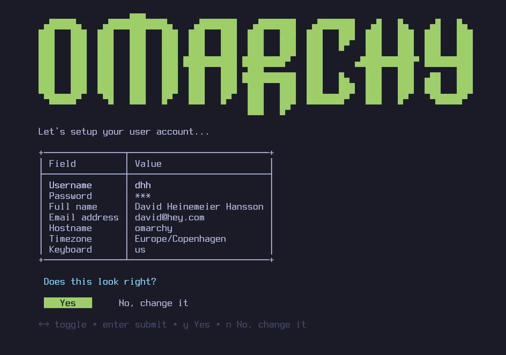
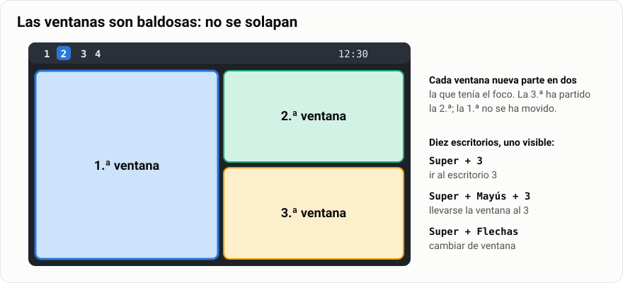
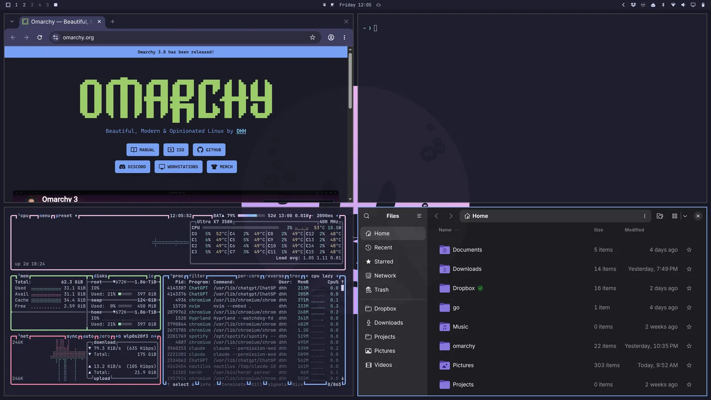
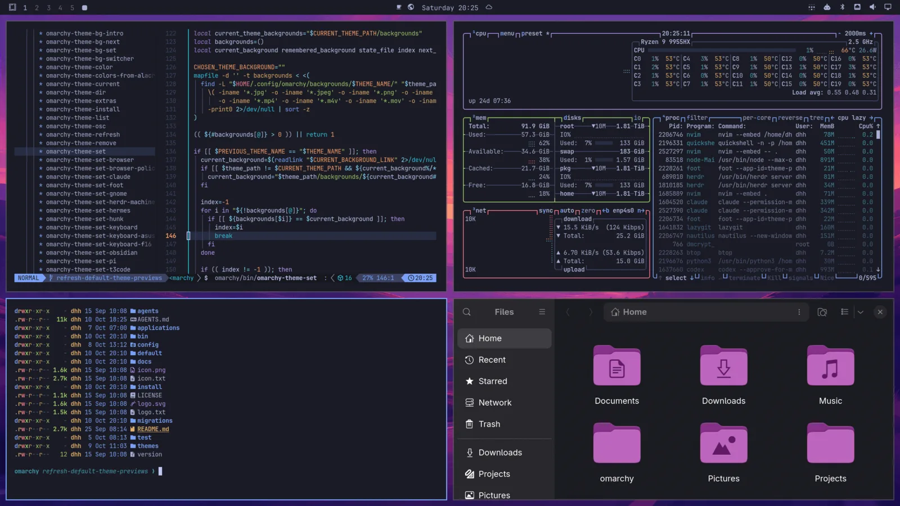
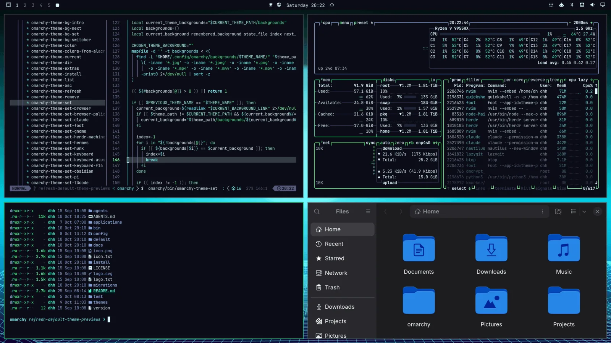
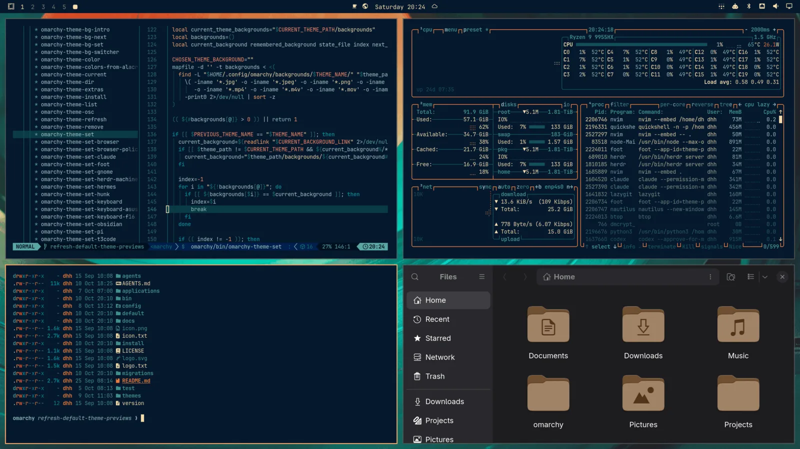
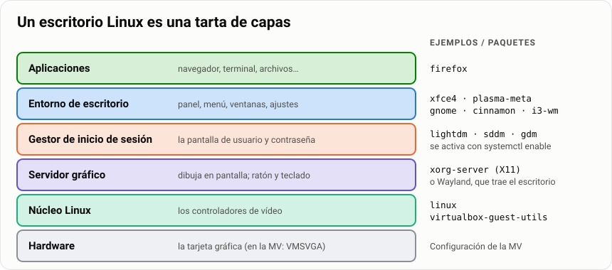
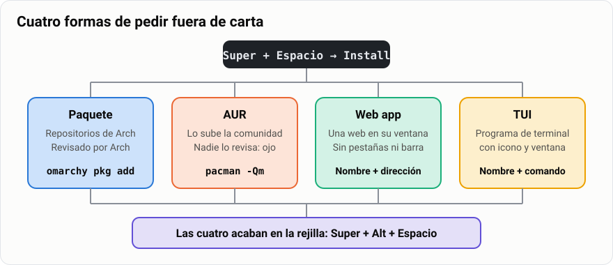

# Tarea · Omarchy, un Linux moderno y divertido

> **Antes de empezar.** Necesitas tu cuenta de Isard VDI (la ISO de Omarchy ya está ahí, con
> permiso para usarla), haber instalado [Mint](../02-instalar-mint-virtualbox/1-explicacion.md) y
> saber moverte por el terminal ([guía 04](../04-comandos-y-ficheros/1-guia.md)). Para ver de qué
> va antes de tocar nada, dos vídeos: el de su creador presentando
> [Omarchy Quattro](https://youtu.be/F7fe9pa8OeE) 🎬 y el de NetworkChuck
> [You need to switch to Linux RIGHT NOW!!](https://youtu.be/9SDkU5VDQEQ) 🔥 (en inglés, con subtítulos).


**Omarchy** es un Linux que se instala solo en un minuto y viene con todo elegido: escritorio,
terminal, programas, atajos y veinte temas de colores. Lo hace David Heinemeier Hansson, el creador de Ruby on Rails,
y en el otoño de 2026 ha puesto a medio internet a instalar Linux. Por debajo es **Arch Linux**,
el sistema que el trimestre que viene vas a instalar tú pieza a pieza. Hoy no toca sufrir: toca
ver adónde se puede llegar, **todo lo que se puede hacer con él** ⚡ y **cómo se instalan
programas** 📦.

> **Analogía.** Omarchy es el **menú del chef** (en japonés, *omakase*, de ahí el nombre): te
> sientas y te lo traen todo elegido. El trimestre que viene pedirás **a la carta**, plato a
> plato, y entenderás cada cosa que hoy te dan hecha. Hoy aprendes a comer con sus cubiertos (el
> teclado) y a pedir platos fuera de carta (instalar programas).

| | |
|---|---|
| 🎯 **Qué vas a conseguir** | Moverte por Omarchy sin ratón, dejarlo a tu estilo y añadirle programas de cuatro maneras |
| 🧰 **Qué necesitas** | Tu cuenta de Isard VDI, la ISO de Omarchy (ya la tienes ahí) y tu `Mint-SMR` para comparar |
| ⏱️ **Tiempo** | 4 horas, en dos sesiones: una para instalar, moverte y el estilo; otra para instalar programas |
| 📦 **Qué entregas** | `omarchy.pdf` en Moodle |
| ✅ **Calificación** | Apto / No apto |

## Índice

- [1. Instálalo en un minuto](#1-instálalo-en-un-minuto)
- [2. Qué se puede hacer con él](#2-qué-se-puede-hacer-con-él)
- [3. Instala programas de cuatro maneras](#3-instala-programas-de-cuatro-maneras)
- [4. La tabla final](#4-la-tabla-final)
- [5. Plantilla del documento](#5-plantilla-del-documento)
- [6. Lo que despista](#6-lo-que-despista)
- [7. Entrega](#7-entrega)
- [8. Si vas rápido](#8-si-vas-rápido)

En cada apartado haz lo mismo que en la tarea de los directorios: **ejecuta** lo que te damos,
**copia** el comando y lo que sale (o una captura) en tu documento y **contesta** cada ❓ en una o
dos frases con tus palabras.

> **Por qué a su creador le brillan los ojos.** DHH dice que un ordenador tiene que ser
> **tuyo de verdad**: que puedas abrir cualquier ajuste, leerlo, cambiarlo, romperlo y arreglarlo.
> En Windows y en el Mac hay una pared; aquí no hay pared. Omarchy es su manera de que mucha
> gente vuelva a sentir eso: 🧙 *yo mando en mi máquina*. Esta tarea va de probarlo en tus manos.

---

## 1. Instálalo en un minuto

Esto es un trámite: lo interesante empieza en el apartado 2.


Esta vez no hay VirtualBox: el escritorio vive en **Isard VDI**, el servidor de máquinas
virtuales del centro, y tú lo ves desde el navegador o desde el visor. En Isard:

1. Entra en **Medios** y busca la ISO de Omarchy. Pulsa su icono de **crear escritorio**.
2. Ponle nombre `Omarchy-SMR` y elige el hardware: **4 núcleos**, **4 GB** de RAM (8 si te deja)
   y **40 GB** de disco. Lo demás, como venga.
3. En **Visores**, marca también el visor **SPICE**. Lo vas a necesitar por la tecla `Super`.

> [!WARNING]
> **La tecla `Super` se la queda Windows.** En el visor del navegador, pulsar `Super` abre el menú
> de inicio de **tu** equipo, no el de Omarchy. Abre el escritorio con el **visor SPICE** y ponlo a
> **pantalla completa**: así todas las teclas van a la máquina virtual.



Arranca el escritorio. El instalador te pregunta el teclado (`es`), tu usuario (`alumno`), tu
contraseña y el nombre del equipo (`omarchy-smr`). Confirma, elige el disco (sólo hay uno) y
espera: tarda menos que un café ☕. Al acabar, **apaga** el escritorio, edítalo y cambia el
**arranque** a «Disco duro» (si no, volverá a salir el instalador). Vuelve a arrancarlo.

Al arrancar te pide **una contraseña antes de nada**: es la del **cifrado del disco**. Omarchy
cifra el disco entero por defecto; sin esa contraseña, el disco es ruido. Es la misma que pusiste
al instalar. Después entras directamente: no hay pantalla de usuario como en Mint.

Si todo se ve **enorme**, es normal: Omarchy está pensado para pantallas de portátil de alta
resolución, no para una máquina virtual. Pulsa `Super` + `Espacio`, entra en **Setup → Monitors**
y cambia esta línea:

```lua
local omarchy_gdk_scale = 2     -- pon 1: la MV es una pantalla normal
```

Se abre en Neovim: pulsa `i` para escribir, `Esc` cuando acabes y `:wq` + `Enter` para guardar y
salir. Al salir, Omarchy aplica el cambio solo.

❓ ¿Cuánto has tardado desde que arrancó la ISO hasta ver el escritorio? ¿Qué te pidió el
instalador y qué **no** te pidió, comparado con la instalación de Mint (particiones, idioma,
escritorio)?

❓ Abre un terminal (`Super` + `Enter`) y ejecuta `lsblk -f`. ¿Cuántas particiones hay? ¿En cuál
pone `crypto_LUKS` y qué significa?

---

## 2. Qué se puede hacer con él

Aquí empieza lo bueno. Los dos vídeos son tu referencia: DHH enseña en el suyo todo lo que viene
de serie, y NetworkChuck lo prueba por primera vez, como tú ahora. Cada apartado te dice qué
minuto mirar.

> **Para seguir el vídeo de NetworkChuck** 📺
> **1:31** instala Arch en un minuto → apartado 1 · **6:48** primer contacto con las ventanas en
> mosaico → 2.2 · **11:44** cambia de tema al instante → 2.3 · **16:33** el escritorio moldeable y
> cómo lo deja a su gusto → 2.7 · **2:46** y **25:01** qué es Arch y qué es Omarchy → 3.1 ·
> **20:12** juegos y **23:09** Windows dentro de Omarchy → 2.8.

### 2.1 · Todo con el teclado

Omarchy no tiene menú de inicio, ni iconos en el escritorio, ni barra de tareas con programas. Todo
sale del teclado, y casi todo empieza por `Super` (la tecla con el logo de Windows). Al principio
raro; a la media hora, no quieres volver 🚀. Prueba estos seis, en este orden:

```text
Super + Espacio          menú de Omarchy: desde aquí se hace casi todo
Super + Alt + Espacio    rejilla con todas las aplicaciones
Super + Enter            terminal
Super + Mayús + Enter    navegador
Super + W                cerrar la ventana (de verdad: el programa se cierra)
Super + K                la lista de todos los atajos: el único que hay que memorizar
```

❓ Abre el menú con `Super` + `Espacio` y anota sus apartados principales (Apps, Install, Style…).
¿Cuál crees que vas a usar más en la segunda sesión?

### 2.2 · Ventanas en mosaico y escritorios



Abre un terminal. Abre otro. Y otro. Fíjate: **no se solapan**. Cada ventana nueva parte en dos la
que tenía el foco. Eso es un escritorio **en mosaico**: las ventanas son baldosas que llenan la
pantalla y tú no arrastras nada. Así queda con cuatro:



```text
Super + Flechas          mover el foco de una ventana a otra
Super + Mayús + Flechas  intercambiar dos ventanas
Super + T                sacar la ventana del mosaico (flotante) y volver a meterla
Super + 2                ir al escritorio 2
Super + Mayús + 2        llevarse la ventana al escritorio 2
```

Hay **diez escritorios** y la barra de arriba te dice en cuál estás. Deja el navegador en el 1, los
terminales en el 2 y un `btop` (`Super` + `Mayús` + `T`) en el 3.

❓ Haz una captura con las tres ventanas en mosaico. ¿Qué pasa con las ventanas que ya estaban
cuando abres una cuarta? ¿Qué ventaja le ves a no poder solaparlas? ¿Y qué pega?

### 2.3 · Temas y fondos

Un **tema** cambia a la vez los colores del escritorio, de la barra, del terminal, del navegador y
de los menús. Omarchy trae más de veinte. Mira el mismo escritorio, **nada más instalar y sin
tocar nada**, con tres temas:







```text
Super + Ctrl + T         elegir tema (se ve en directo mientras eliges) 🎨
Super + Ctrl + W         elegir fondo de pantalla
```

Y lo mismo desde el terminal:

```bash
omarchy theme list            # los temas que hay
omarchy theme set nord        # aplica uno
```

❓ Elige un tema y un fondo. Haz una captura. ¿Qué cosas han cambiado de color además del fondo?
¿En Mint cambiar el tema cambiaba también el terminal?

### 2.4 · Capturas, colores y texto de una imagen

```text
Impr Pant                captura: arrastras una zona, o clic en una ventana, o clic en el fondo
Super + Impr Pant        cuentagotas: clic en un color y lo copia (#2a78d6…)
Super + Ctrl + Impr Pant lee el texto de una zona de la pantalla y lo copia 🪄
```

Las capturas se guardan en `~/Pictures/Screenshots` y se copian al portapapeles. Pruébalo con
una captura de este propio documento abierto en el navegador: selecciona un párrafo con
`Super` + `Ctrl` + `Impr Pant` y pégalo en el terminal con `Super` + `V`.

❓ Pega el texto que ha leído. ¿Ha acertado todo? ¿Para qué te serviría en clase?

### 2.5 · Un portapapeles con memoria y un recordatorio

En Omarchy copiar y pegar es **siempre** `Super` + `C` y `Super` + `V`, también en el terminal
(donde `Ctrl` + `C` sirve para parar un programa). Y el portapapeles **recuerda** lo que has
copiado: `Super` + `Ctrl` + `V` abre la lista, escribes para buscar y `Enter` lo recupera.


```bash
omarchy reminder 1 'Mira el portapapeles'    # aviso dentro de 1 minuto (Super + Ctrl + R hace lo mismo)
```

❓ Copia tres cosas distintas, abre el historial y recupera la primera. Captura. ¿Qué pasa cuando
suena el recordatorio?

### 2.6 · El terminal viene con extras

Los comandos de la guía 04 siguen ahí, pero Omarchy les pone mejoras. Compara:

```bash
ls                 # en Omarchy es eza: colores e iconos
lt                 # árbol de dos niveles
bat /etc/hostname  # cat con colores y números de línea
fd hostname /etc   # find más fácil: busca por nombre
rg alumno /etc/passwd   # grep más rápido
tldr tar           # ejemplos de un comando, sin leerte el man
```

❓ Elige dos de esos comandos y explica qué hacen mejor que `ls`, `cat`, `find` o `grep`. Abre
`fastfetch` desde el menú (**About**): ¿qué escritorio y qué núcleo dice?

### 2.7 · Déjalo a tu estilo

El tema ya lo has cambiado. Ahora lo que no se cambia desde un menú de colores: el **estilo** de
las ventanas, el fondo que tú quieras, la letra y tu propia marca. Aquí es donde empieza lo de
*yo mando en mi máquina* 🧙. Primero lo que es sólo una tecla:

```text
Super + Retroceso          ventana transparente (y otra vez: opaca)
Super + Mayús + Retroceso  quitar y poner los huecos y bordes entre ventanas
Super + Mayús + Espacio    esconder y enseñar la barra de arriba
```

Lo permanente vive en **ficheros de texto**: en Linux, cada ajuste es una línea en un fichero que
puedes leer. `Super` + `Espacio` → **Setup → Look & Feel** abre `~/.config/hypr/looknfeel.lua`.
Quita los `--` de estas líneas y cambia los números:

```lua
hl.config({
  general = {
    gaps_in = 0,        -- hueco entre ventanas (prueba 4, 8, 16)
    gaps_out = 0,       -- hueco con el borde de la pantalla
    border_size = 0,    -- grosor del borde (prueba 2 o 3)
  },
  decoration = {
    rounding = 8,       -- esquinas redondeadas (0 = cuadradas)
  },
})
```

Guarda (`:wq`) y mira cómo cambia solo 💥. Ahora tu fondo: `Super` + `Espacio` → **Install →
Style → Background** abre la carpeta de fondos del tema actual. Copia ahí una imagen tuya con el
gestor de archivos (`Super` + `Mayús` + `F`) y elígela con `Super` + `Ctrl` + `W`. La letra se
cambia en **Appearance → Font** (hay más en **Install → Style → Font**) y vale para todo: terminal,
barra y menús. Y tu marca: **Appearance → Branding → Screensaver → Edit Text** pone tu nombre en
el salvapantallas (es el fichero `~/.config/omarchy/branding/screensaver.txt`).

❓ Captura tu escritorio con los huecos, el borde, el fondo y la letra cambiados. Anota en una
tabla de tres columnas **qué has cambiado, en qué fichero o menú y por qué**. ¿Por qué `Super` +
`Mayús` + `Retroceso` no cambia el fichero `looknfeel.lua`?

> **Reto.** Un tema propio: copia uno de `/usr/share/omarchy/themes/` a `~/.config/omarchy/themes/`
> con otro nombre, edita sus colores en `colors.toml` y elígelo con `Super` + `Ctrl` + `T`. Si
> prefieres que los colores salgan de una foto, abre **Aether** en la rejilla: genera el tema entero
> a partir de un fondo.

### 2.8 · Lo que enseñan los vídeos y no cabe aquí

No puntúa, pero mira al menos uno en el vídeo para saber que existe:

- 🎮 **Juegos.** NetworkChuck (min 20:12) instala Steam desde **Install → Gaming** y juega a
  títulos de Windows gracias a Proton, la capa que los traduce a Linux. En la MV no va a
  funcionar bien: aquí la tarjeta gráfica es virtual.
- 🪟 **Windows dentro de Omarchy.** Min 23:09: arranca un Windows completo en una ventana,
  dentro de un contenedor Docker, para el programa que sólo exista en Windows. En el manual,
  capítulo *Windows VM*.
- 🤖 **Un agente de IA que te configura el escritorio.** Min 16:33: le pide a una IA que le
  cambie el escritorio y ésta edita los ficheros de `~/.config` por él. `Super` + `Mayús` +
  `Ctrl` + `A` abre el agente, y **Install → AI** ofrece varios. Necesitan cuenta.
- 🧩 **Plugins.** La barra, los menús y los paneles se amplían con plugins de la comunidad (hay
  cientos en omarchyplugins.com). DHH enseña varios en su vídeo.

---

## 3. Instala programas de cuatro maneras

### 3.1 · Es Arch por debajo



Un escritorio Linux es una tarta de capas, y Mint y Omarchy comparten las de abajo. Cambian las
de arriba: Mint usa Xorg y XFCE; Omarchy, **Wayland** y **Hyprland**, el escritorio en mosaico.
Y la base de Omarchy es **Arch Linux**, una distribución que no trae nada elegido y que instalarás
a mano el trimestre que viene. Compruébalo, en Omarchy y en tu Mint:

```bash
cat /etc/os-release            # qué sistema dice ser
echo $XDG_CURRENT_DESKTOP      # el escritorio
pacman -Q | wc -l              # cuántos programas hay instalados (en Mint: dpkg -l | wc -l)
```

❓ ¿Qué pone en `NAME` de `/etc/os-release` en cada máquina? ¿Y en el escritorio? ¿Cuál de las
dos tiene más paquetes instalados?

### 3.2 · Un paquete oficial



En Mint instalabas con `apt`. En Arch, y por tanto en Omarchy, el instalador de programas se
llama **`pacman`**. `Super` + `Espacio` → **Install → Package**, escribe `cmatrix` y acepta. Es lo
mismo que:

```bash
omarchy pkg add cmatrix        # por debajo llama a pacman
pacman -Si cmatrix             # la ficha del paquete: de qué repositorio viene
cmatrix                        # pruébalo 🕶️; sal con q
```

Ahora uno de verdad: instala por el menú un programa que quieras y que esté en los repositorios
oficiales (`vlc`, `gimp`, `audacity`… LibreOffice ya viene). Búscalo antes con `pacman -Ss nombre`.

❓ ¿De qué repositorio viene `cmatrix` (`Repository` en la ficha)? ¿Qué programa has elegido y
cómo lo abres después (rejilla, atajo, terminal)?

### 3.3 · Un editor desde AUR

`Super` + `Espacio` → **Install → Editor → VSCode**. Es el VS Code de clase. No viene de los
repositorios oficiales, sino de **AUR**, el repositorio de la comunidad de Arch: miles de
programas más que sube cualquiera, y **nadie de Arch los revisa**. Cuando acabe:

```bash
pacman -Qm                     # los paquetes que NO vienen de los repositorios oficiales
```

❓ ¿Aparece VS Code en `pacman -Qm`? ¿Por qué Omarchy te avisa antes de instalar algo de AUR y no
antes de un paquete oficial?

### 3.4 · Una web app

Una **web app** es una página web abierta en su propia ventana, sin pestañas ni barra de
direcciones, con su icono en la rejilla. Omarchy ya trae varias (YouTube, WhatsApp, Google Maps).
`Super` + `Espacio` → **Install → Web App**: nombre `Moodle`, dirección la de la Moodle del
centro. Si no encuentra el icono, te pedirá la dirección de uno.

❓ Abre tu web app y captura. ¿En qué se nota que no es el navegador normal? ¿Qué otra web
pondrías como app y por qué?

### 3.5 · Un programa de terminal con icono

Un **TUI** es un programa que vive en el terminal, como `btop` o el `cmatrix` de antes. Omarchy
puede darle icono y ventana propia: `Super` + `Espacio` → **Install → TUI**: nombre `Matrix`,
comando `cmatrix`, y elige ventana e icono.

❓ Busca `Matrix` en la rejilla (`Super` + `Alt` + `Espacio`) y ábrelo. ¿Qué diferencia hay
entre eso y escribir `cmatrix` en un terminal?

### 3.6 · Quitar y actualizar

```bash
omarchy pkg drop cmatrix       # o Remove → Package en el menú: quita el paquete y sus dependencias
omarchy update                 # NUNCA pacman -Syu aquí: Omarchy lo corta y te manda a este
```

Antes de actualizar, Omarchy guarda una **instantánea** del sistema: si la actualización rompe
algo, reinicias, eliges la instantánea en el menú de arranque y vuelves atrás. Es como las
instantáneas de VirtualBox que usaste con Mint, pero dentro del propio sistema. Romper sin miedo:
de eso va tener un ordenador tuyo 🛡️.

❓ ¿Por qué crees que Omarchy no quiere que uses `pacman -Syu` directamente? *(pista: la
instantánea)*. No hace falta que actualices.

---

## 4. La tabla final

Al final del documento, compara tu Mint con Omarchy. **Cinco palabras como mucho** por casilla.

| | Mint (guía 02) | Omarchy |
|---|---|---|
| Tiempo de instalación | | |
| Cómo abres un programa | | |
| Cómo se colocan las ventanas | | |
| Disco: particiones y cifrado | | |
| Cómo se instala un programa | | |
| Cómo se deshace un error | | |

> **Ejemplo.** Así quedaría una fila: Cómo abres un programa · Menú y ratón · Atajo de teclado.

## 5. Plantilla del documento

Copia esto en VS Code como `omarchy.md` y rellénalo:

````markdown
# Omarchy, un Linux moderno y divertido

**Autor:** Nombre Apellido · **Fecha:** AAAA-MM-DD

## 1 · Instalación

```bash
alumno@omarchy-smr:~$ lsblk -f
(lo que sale)
```

**Respuestas:** (una o dos frases por ❓)

## 2.1 · Todo con el teclado

(…lo mismo en los 14 apartados: comando o captura + respuestas…)

## Tabla final

(la tabla del apartado 4, rellena)
````

## 6. Lo que despista

> [!WARNING]
> **`Super` + `W` no minimiza: cierra.** En Omarchy no hay ventanas minimizadas. Si quieres
> quitar algo de en medio, llévatelo a otro escritorio con `Super` + `Mayús` + número.

> [!WARNING]
> **`pacman -Syu` está prohibido aquí.** Es el `apt upgrade` de Arch y sigue ahí, pero las
> actualizaciones van por `omarchy update`, que primero hace la instantánea.

> [!NOTE]
> **Dos sitios para la configuración.** Lo que trae Omarchy está en `/usr/share/omarchy` y las
> actualizaciones lo sobreescriben: no lo toques. Lo tuyo va en `~/.config` y gana. Lo verás a
> fondo en el [taller de personalización](../../3-avanzado/12-taller-personalizar-linux/1-guia.md#nivel-0--dónde-vive-la-configuración).

## 7. Entrega

Entrega en Moodle **«Tarea · Omarchy»** el fichero `omarchy.pdf` (Markdown All in One → exportar a
HTML → abrir en el navegador → imprimir como PDF).

Es **Apto** si:

| # | Criterio |
|---|---|
| 1 | Están los **14 apartados** (1, 2.1 a 2.7 y 3.1 a 3.6), cada uno con su comando o captura **de tu máquina** y sus respuestas |
| 2 | Las respuestas están escritas **con tus palabras**, no copiadas del manual |
| 3 | Has instalado algo por las **cuatro vías**: paquete, AUR, web app y TUI, y se ve en las capturas |
| 4 | La tabla de cambios de estilo (2.7) dice **en qué fichero o menú** está cada cambio |
| 5 | La **tabla final** está rellena y lo que pone de Mint coincide con lo que hiciste en la guía 02 |

**Antes de entregar, comprueba:**

- [ ] Hay 14 apartados, cada uno con comando o captura y respuesta.
- [ ] Las capturas son de Omarchy (se ve la barra de arriba), no fotos del móvil.
- [ ] En la tabla final no hay casillas vacías.
- [ ] Sabes abrir el terminal, cerrar una ventana y cambiar de escritorio sin mirar la chuleta.
- [ ] El PDF se lee bien.

## 8. Si vas rápido

> **Reto.** Tu propio atajo. Abre `Super` + `Espacio` → **Setup → Bindings** y añade al final una
> línea que abra la wiki de Arch con `Super` + `Mayús` + `Alt` + `W`:
>
> ```lua
> o.bind("SUPER + SHIFT + ALT + W", "Wiki de Arch", "xdg-open https://wiki.archlinux.org")
> ```
>
> Guarda y pruébalo. Esa wiki va a ser tu mejor amiga el trimestre que viene.

> **Reto.** Enséñaselo a alguien de casa en cinco minutos sin tocar el ratón: tema, mosaico,
> una web app y el texto sacado de una imagen. Si al final te pregunta «¿y esto cómo se instala?»,
> has entendido de qué va Omarchy 😎.
