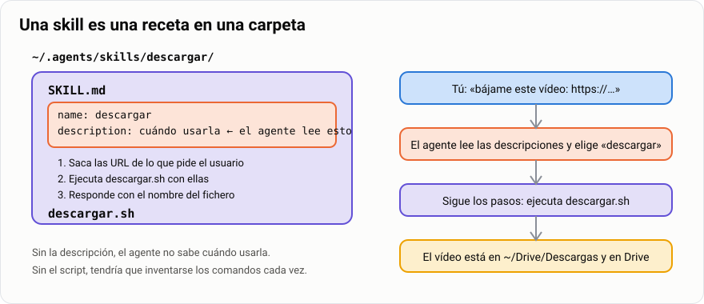

# Tarea · Tu ordenador en el bolsillo

> **Antes de empezar.** Necesitas tu `Omarchy-SMR` de la [tarea 16](../16-omarchy/1-tarea-omarchy.md)
> funcionando, tu móvil, una **cuenta de ChatGPT** (la gratuita vale; con menos de 18 años, con
> permiso de tu madre, padre o tutor) y una **cuenta de Google** para Tailscale y Drive. El
> profesor te dará además dos claves para Google Drive (`client_id` y `client_secret`): las usarás
> en el apartado 4.

Al final de esta tarea vas a poder sacar el móvil en el autobús, escribirle a tu ordenador
«bájame este vídeo» y, cuando llegues a casa, el vídeo estará en tu Google Drive 📱➡️💻➡️☁️. Por el
camino montas lo mismo que usa el profesor cada día: **Codex**, un agente de IA que trabaja
dentro de tu máquina; **Codex en remoto**, para hablarle desde la app del móvil; **Tailscale**,
un pasillo privado entre tus aparatos estén donde estén; **rclone**, para que una carpeta de tu
ordenador y una de Drive sean la misma; y tus **dos primeras skills**: pequeñas recetas que
enseñan al agente a hacer algo nuevo.

> **Analogía.** Tu ordenador es una **casa** y Codex, el **mayordomo** que vive en ella. Codex en
> remoto es el **teléfono del mayordomo**: le llamas desde donde estés. Tailscale es un **pasillo
> privado** entre tu casa y tu móvil. rclone es el **cartero** que lleva y trae lo de una carpeta
> a Drive. Y una skill es una **receta** que le dejas al mayordomo escrita en la cocina: la
> próxima vez no hace falta explicarle nada.

| | |
|---|---|
| 🎯 **Qué vas a conseguir** | Pedir desde el móvil que tu ordenador descargue algo y verlo aparecer en tu Drive |
| 🧰 **Qué necesitas** | `Omarchy-SMR`, tu móvil, cuenta de ChatGPT, cuenta de Google y las claves de Drive del aula |
| ⏱️ **Tiempo** | 6 horas en tres sesiones: Codex y el móvil · Tailscale y Drive · las dos skills |
| 📦 **Qué entregas** | Seis capturas y tus dos skills ([7. Entrega](#7-entrega)) |
| ✅ **Calificación** | Apto / No apto |

## Índice

- [1. El mapa](#1-el-mapa)
- [2. Codex en tu Omarchy](#2-codex-en-tu-omarchy)
- [3. Codex en remoto desde el móvil](#3-codex-en-remoto-desde-el-móvil)
- [4. Tailscale: tus aparatos se ven](#4-tailscale-tus-aparatos-se-ven)
- [5. Drive con rclone: una carpeta en dos sitios](#5-drive-con-rclone-una-carpeta-en-dos-sitios)
- [6. Tus dos primeras skills](#6-tus-dos-primeras-skills)
- [7. Entrega](#7-entrega)
- [8. Si vas rápido](#8-si-vas-rápido)

En cada apartado **haz** lo que te damos y **mira** lo que pasa. Las ❓ son para pensar y
comentarlas en clase. Lo que se entrega son **capturas** de que cada pieza funciona y tus dos
skills: ve haciendo las capturas por el camino.

> [!IMPORTANT]
> **Cuentas y contraseñas.** Todo lo de esta tarea entra con **tus** cuentas. No las compartas con
> nadie ni las pegues en ningún fichero. Las dos claves de Drive del aula sólo van en
> `rclone config`, donde te las pida. Y la cuenta gratuita de ChatGPT tiene un **cupo**: Codex se
> para si lo gastas, así que nada de pedirle tonterías.

---

## 1. El mapa


Cinco piezas y cada una tiene un apartado. Léelo una vez entero antes de empezar: así sabes para
qué sirve cada paso. El orden importa: sin Codex no hay remoto, sin rclone no hay Drive, y las
skills usan todo lo anterior.

❓ ¿Qué pieza del mapa se encarga de que el vídeo que pides desde el móvil acabe en Drive? ¿Y
cuál hace que puedas pedirlo desde el autobús?

---

## 2. Codex en tu Omarchy

Un **agente** es una IA que no sólo contesta: lee tus ficheros, ejecuta comandos y hace cosas en
tu máquina, pidiéndote permiso antes. **Codex** es el agente de OpenAI, el de ChatGPT, y Omarchy
ya trae el lanzador:

1. Pulsa `Super` + `Mayús` + `Ctrl` + `A` y elige **OpenAI Codex**: se instala solo la primera
   vez. Si no sale, en un terminal:

   ```bash
   curl -fsSL https://chatgpt.com/codex/install.sh | sh     # instala el comando codex
   codex --version                                          # tiene que decir un número
   ```

2. Crea tu carpeta de trabajo y arranca Codex desde ella:

   ```bash
   mkdir -p ~/Drive && cd ~/Drive
   codex
   ```

3. Elige **Sign in with ChatGPT**: se abre el navegador, entras con tu cuenta y vuelves al
   terminal. Si pregunta si confías en la carpeta, di que sí: es tuya.

Ahora pídele algo de verdad. Escribe:

> *Crea en esta carpeta un fichero `hola.md` con tres cosas que quiero aprender este curso.*

👀 Verás que te enseña lo que va a hacer y te pide permiso antes de escribir el fichero. Acepta y
míralo con `cat ~/Drive/hola.md` en otro terminal.

> [!TIP]
> **Cuatro cosas de Codex que vas a usar siempre:** `/status` (tu sesión y cuánto cupo te queda),
> `/permissions` (qué le dejas hacer sin preguntar), `/skills` (tus recetas) y `Ctrl` + `C` para
> salir.

❓ Codex te ha pedido permiso antes de escribir. ¿Por qué crees que no lo hace sin preguntar?
¿Qué le dejarías hacer sin preguntar y qué no?

---

## 3. Codex en remoto desde el móvil

Codex sigue corriendo **en tu Omarchy**, pero tú le hablas desde el móvil. La app de ChatGPT es
una ventana a la sesión que corre en tu máquina: si apagas la máquina o cierras el terminal, se
acabó la ventana.

1. Instala la app **ChatGPT** en el móvil (Android o iOS) y entra con la misma cuenta.
2. **Una sola vez, emparejar.** En Omarchy, en tu carpeta:

   ```bash
   cd ~/Drive
   codex remote-control start    # arranca el servidor en segundo plano
   codex remote-control pair     # imprime un código de emparejamiento que caduca en minutos
   ```

   En el móvil, en la app de ChatGPT, entra en **Codex**, añade un ordenador y elige
   **emparejar a mano** (*Pair manually*): escribe el código. Tu Omarchy aparece en la lista.
3. **Cada día, levantar la sesión.** A partir de ahora basta con:

   ```bash
   cd ~/Drive && codex remote-control    # deja este terminal abierto, en el escritorio 3
   ```

4. Desde el móvil, abre tu Omarchy en la app y escribe: *¿Qué ficheros hay en mi carpeta?* 👀 En
   el terminal de Omarchy verás la actividad; en el móvil, la respuesta con `hola.md`.

❓ Haz una captura del móvil con la respuesta y otra del terminal mientras tanto. ¿Dónde se ha
ejecutado el comando que ha listado los ficheros: en el móvil o en Omarchy? ¿Qué pasa si cierras
el terminal?

> [!NOTE]
> **Está marcado como experimental.** OpenAI avisa de que este remoto puede cambiar entre
> versiones. Si un día no aparece tu máquina, repite el emparejamiento. Y si no hay manera, el
> reto del apartado 4 te da otro camino al mismo sitio: SSH.

---

## 4. Tailscale: tus aparatos se ven

Tu Omarchy está en Isard y tu móvil en la red del móvil. No se ven. **Tailscale** crea una **red
privada** entre tus aparatos: cada uno recibe una dirección que empieza por `100.` y un nombre, y
se hablan entre ellos estén donde estén, cifrado. Es lo que usa el profesor para llegar a su
Raspberry desde cualquier sitio.

1. En Omarchy:

   ```bash
   omarchy pkg add tailscale
   sudo systemctl enable --now tailscaled   # el servicio
   sudo tailscale up                        # te da una dirección web: ábrela y entra con Google
   ```

2. En el móvil instala la app **Tailscale** y entra con **la misma** cuenta de Google.
3. Compruébalo en Omarchy:

   ```bash
   tailscale status                  # tus dos aparatos, con su dirección 100.x.x.x y su nombre
   tailscale ping NOMBRE-DEL-MOVIL   # el nombre que sale en status
   ```

👀 `ping` responde con el tiempo que tarda: tus dos aparatos se ven aunque uno esté en Isard y el
otro en el 5G.

❓ Captura `tailscale status` con los dos aparatos. ¿Qué dirección tiene tu Omarchy en Tailscale y
cuál en Isard (`ip -br a`)? ¿Por qué hacen falta dos?

> **Reto.** Entra en tu Omarchy **desde el móvil por SSH**: en Omarchy, `sudo tailscale set --ssh`;
> en el móvil, la app Termius (o cualquier cliente SSH) a `alumno@omarchy-smr`. Tailscale se
> encarga de la contraseña. Dentro, escribe `codex`: tu mayordomo, en el terminal del móvil, sin
> pasar por la app de ChatGPT.

---

## 5. Drive con rclone: una carpeta en dos sitios

Google no tiene app de Drive para Linux. **rclone** es el cartero: un programa de terminal que
habla con Drive y con cuarenta nubes más. Vas a hacer que `~/Drive/Fotos` en tu Omarchy y la
carpeta `Fotos` de tu Drive sean **la misma carpeta**, en las dos direcciones, cada cinco minutos.


### 5.1 · Conectar rclone con tu Drive

```bash
omarchy pkg add rclone
rclone config
```

Contesta así (lo demás, `Enter` para dejarlo como viene):

```text
n                      → nuevo remoto
name> drive            → así lo llamaremos siempre
Storage> drive         → Google Drive
client_id>             → la clave del aula que te ha dado el profesor
client_secret>         → la otra clave del aula
scope> 1               → acceso completo
Edit advanced config?  → n
Use web browser?       → y   (se abre el navegador: entra con TU cuenta de Google y acepta)
Shared Drive?          → n
```

> [!WARNING]
> **Las claves del aula no son tu cuenta.** Sólo le dicen a Google «este programa es rclone, de la
> clase de Zornotza». Lo que da acceso a **tu** Drive es la ventana del navegador en la que entras
> tú. Por eso nunca se las des a nadie ni las subas a ningún sitio.

```bash
rclone lsd drive:        # las carpetas de la raíz de tu Drive 👀
```

### 5.2 · La primera carpeta en dos sitios

```bash
mkdir -p ~/Drive/Fotos
echo "Carpeta creada el $(date)" > ~/Drive/Fotos/LEEME.txt
rclone mkdir drive:Fotos
rclone bisync ~/Drive/Fotos drive:Fotos --resync -v        # SÓLO la primera vez
```

**`bisync`** es «sincroniza en las dos direcciones». `--resync` es «es la primera vez: copia lo que
hay en cada lado al otro». A partir de ahora, **sin** `--resync`:

```bash
rclone bisync ~/Drive/Fotos drive:Fotos --resilient --recover --max-lock 2m --conflict-resolve newer --drive-skip-gdocs -v
```

👀 Abre la app de Drive en el móvil: ahí está `Fotos/LEEME.txt`. Sube una foto desde el móvil a
esa carpeta, repite el `bisync` y mira `ls ~/Drive/Fotos`. El cartero ha vuelto con la foto.

### 5.3 · Que se haga solo, cada cinco minutos

Un cartero que sólo sale cuando tú se lo dices no sirve. Arch no trae `cron`, el programador de
tareas: instálalo y deja escrito el guion del cartero.

```bash
omarchy pkg add cronie
sudo systemctl enable --now cronie
```

Crea el fichero `~/Drive/.sync.sh` (con `nano` o pidiéndoselo a Codex) con esto:

```bash
#!/bin/bash
# .sync.sh — sincroniza con Drive cada carpeta apuntada en ~/Drive/.carpetas (una por línea)
# Uso: .sync.sh            → todas
#      .sync.sh Fotos      → sólo esa
LISTA="$HOME/Drive/.carpetas"
LOG="$HOME/Drive/.sync.log"
[ -f "$LISTA" ] || exit 0
while read -r carpeta; do
  [ -z "$carpeta" ] && continue
  [ -n "$1" ] && [ "$1" != "$carpeta" ] && continue
  rclone bisync "$HOME/Drive/$carpeta" "drive:$carpeta" \
    --resilient --recover --max-lock 2m --conflict-resolve newer --drive-skip-gdocs \
    >> "$LOG" 2>&1 || echo "$(date) ERROR en $carpeta" >> "$LOG"
done < "$LISTA"
tail -n 500 "$LOG" > "$LOG.tmp" && mv "$LOG.tmp" "$LOG"
```

```bash
chmod +x ~/Drive/.sync.sh
echo "Fotos" >> ~/Drive/.carpetas
~/Drive/.sync.sh                       # a mano, para ver que funciona
(crontab -l 2>/dev/null; echo "*/5 * * * * $HOME/Drive/.sync.sh") | crontab -
crontab -l                             # 👀 la línea del cartero: cada 5 minutos
```

❓ Deja un fichero nuevo en `~/Drive/Fotos`, espera cinco minutos y mira el móvil. Captura
`crontab -l` y el `tail ~/Drive/.sync.log`. ¿Qué pasa si cambias el mismo fichero en el móvil y
en Omarchy a la vez? *(pista: `--conflict-resolve newer`)*

---

## 6. Tus dos primeras skills

Hasta ahora, cada vez que quieras una carpeta nueva en dos sitios tendrías que repetir cinco
comandos. Una **skill** es una receta que le dejas escrita al agente: una carpeta con un fichero
`SKILL.md` que dice **cuándo** usarla y **qué pasos** seguir, y, si hace falta, un script con los
comandos. Codex lee la descripción de todas tus skills y, cuando le pides algo que encaja, usa la
receta. Es un formato abierto: la misma carpeta vale para Codex, para Claude Code y para otros
agentes.



En Codex, tus skills personales viven en `~/.agents/skills/<nombre>/SKILL.md`. Se usan solas
cuando lo que pides encaja con la descripción, o a mano escribiendo `$nombre` o con `/skills`.
Vas a crear dos **con ayuda de Codex**, pero leyendo cada línea: en la entrega te preguntarán qué
hace cada una.

### 6.1 · Skill `carpeta-compartida`

Abre `codex` en `~/Drive` y pídele, con tus palabras, esto:

> *Crea una skill llamada `carpeta-compartida` en `~/.agents/skills/`. Tiene que servir cuando yo
> diga «crea una carpeta compartida llamada X». Su script `crear.sh NOMBRE` tiene que: crear
> `~/Drive/NOMBRE` con un `LEEME.txt` con la fecha, crear `drive:NOMBRE` con `rclone mkdir`, hacer
> el primer `rclone bisync --resync` entre las dos, y añadir NOMBRE a `~/Drive/.carpetas` si no
> está. Al acabar, la skill me dice la ruta local y la de Drive.*

Codex te enseñará los dos ficheros antes de escribirlos. Compara `SKILL.md` con este, que es el
mínimo que tiene que tener:

```markdown
---
name: carpeta-compartida
description: Crea una carpeta en ~/Drive sincronizada con la carpeta del mismo nombre en Google Drive (rclone bisync cada 5 min). Úsala cuando el usuario diga "crea una carpeta compartida", "nueva carpeta en Drive" o $carpeta-compartida NOMBRE. No la uses para copiar ficheros sueltos.
---

# carpeta-compartida

1. Saca el NOMBRE de lo que pide el usuario (sin espacios ni barras).
2. Ejecuta `bash ~/.agents/skills/carpeta-compartida/crear.sh NOMBRE`.
3. Responde con la ruta local (`~/Drive/NOMBRE`) y la de Drive (`drive:NOMBRE`), y recuerda que el cron la sincroniza cada 5 minutos.
```

Y `crear.sh`, que tiene que hacer exactamente lo de 5.2 pero con el nombre que le pasen:

```bash
#!/bin/bash
# crear.sh NOMBRE — carpeta en ~/Drive sincronizada con drive:NOMBRE
set -e
n="$1"; [ -z "$n" ] && { echo "Uso: crear.sh NOMBRE"; exit 1; }
mkdir -p "$HOME/Drive/$n"
[ -f "$HOME/Drive/$n/LEEME.txt" ] || echo "Carpeta creada el $(date)" > "$HOME/Drive/$n/LEEME.txt"
rclone mkdir "drive:$n"
rclone bisync "$HOME/Drive/$n" "drive:$n" --resync --resilient --drive-skip-gdocs -v
grep -qx "$n" "$HOME/Drive/.carpetas" 2>/dev/null || echo "$n" >> "$HOME/Drive/.carpetas"
echo "Lista: ~/Drive/$n  <->  drive:$n"
```

Pruébala: escribe `/skills` para ver que aparece (si no, sal y vuelve a entrar en `codex`) y
después *crea una carpeta compartida llamada Clase*. 👀 En el móvil, en Drive, aparece
`Clase/LEEME.txt`.

❓ ¿Qué parte del `SKILL.md` hace que Codex elija esta skill y no otra cuando dices «carpeta
compartida»? ¿Qué pasaría si dos skills tuvieran descripciones casi iguales?

### 6.2 · Skill `descargar`

Omarchy trae **yt-dlp**, un programa que descarga vídeo o audio de YouTube, Instagram, TikTok y
cientos de sitios más (si no está: `omarchy pkg add yt-dlp`). Pruébalo a mano primero:

```bash
yt-dlp -P ~/Drive/Descargas "URL-DE-UN-VIDEO-CORTO"      # -P: la carpeta donde lo deja
yt-dlp -P ~/Drive/Descargas -x --audio-format mp3 "URL"  # sólo el audio
```

Antes, crea `Descargas` como carpeta compartida con tu skill nueva (*crea una carpeta compartida
llamada Descargas*). Ahora pídele a Codex la segunda skill:

> *Crea una skill llamada `descargar` en `~/.agents/skills/`. Sirve cuando yo diga «descarga este
> vídeo», «bájame esto» o «guarda este reel en Drive», con la opción de sólo audio. Su script
> `descargar.sh [--audio] URL...` usa yt-dlp para dejar los ficheros en `~/Drive/Descargas` y
> después ejecuta `~/Drive/.sync.sh Descargas` para subirlos a Drive al momento. La skill me
> responde con el nombre del fichero y me recuerda que está en Drive, en Descargas.*

El script, como mínimo:

```bash
#!/bin/bash
# descargar.sh [--audio] URL... — descarga con yt-dlp a ~/Drive/Descargas y lo sube a Drive
set -e
destino="$HOME/Drive/Descargas"
mkdir -p "$destino"
opciones=()
if [ "$1" = "--audio" ]; then opciones=(-x --audio-format mp3); shift; fi
[ $# -eq 0 ] && { echo "Uso: descargar.sh [--audio] URL..."; exit 1; }
yt-dlp -P "$destino" "${opciones[@]}" "$@"
"$HOME/Drive/.sync.sh" Descargas
ls -t "$destino" | head -n "$#"
```

Pruébala desde el terminal: *descarga este vídeo: URL*. 👀 Codex ejecuta el script, te dice el
nombre del fichero y, en el móvil, Drive lo enseña en `Descargas`.

> [!WARNING]
> **Lo que no se descarga.** Nada que necesite contraseña, nada de pago y nada que no sea para
> ver y estudiar: lo que bajas es de otra persona. Instagram a veces avisa de «CSRF token»: es un
> aviso, baja igual.

### 6.3 · El cierre: desde el autobús

Deja `codex remote-control` corriendo en Omarchy (apartado 3). Coge el móvil, abre tu Omarchy en
la app de ChatGPT y escribe: *bájame este vídeo* con una URL. Espera. Abre la app de Drive.

🎉 Ahí está. Has pedido algo desde el móvil, lo ha hecho tu ordenador, y te ha llegado a la nube.
El profesor hace exactamente esto, con una Raspberry en vez de Isard.

❓ Repasa el mapa del apartado 1 y di por qué pieza ha pasado tu petición, en orden. ¿Qué pieza
podrías quitar y seguiría funcionando?

---

## 7. Entrega

Entrega en Moodle **«Tarea · Tu ordenador en el bolsillo»**:

**Seis capturas**, cada una con una línea que diga qué enseña:

1. 🤖 Codex en el terminal de Omarchy, con tu cuenta y `hola.md` creado.
2. 📱 El móvil con tu Omarchy en la app de ChatGPT respondiendo, y el terminal de Omarchy al lado.
3. 🔗 `tailscale status` con tus dos aparatos y un `tailscale ping` al móvil.
4. ☁️ `crontab -l` con la línea del cartero y la app de Drive del móvil enseñando `Fotos`.
5. 🧑‍🍳 Codex usando `carpeta-compartida` para crear `Clase`, y la carpeta en el móvil.
6. 🎬 La petición de descarga **hecha desde el móvil** y el vídeo en la app de Drive.

**Y tus dos skills**: los ficheros `SKILL.md` y los scripts de `carpeta-compartida` y
`descargar`, pegados en un documento o comprimidos (`tar czf skills.tgz -C ~/.agents skills`).

Es **Apto** si están las seis capturas, son de **tus** aparatos (se ve `omarchy-smr` y tu
usuario), las dos skills funcionan y **sabes explicar cada línea** de tus scripts cuando se te
pregunte.

**Antes de entregar, comprueba:**

- [ ] En la captura 6 la petición sale en el móvil, no en el terminal del ordenador.
- [ ] `crontab -l` tiene la línea de `.sync.sh` cada 5 minutos.
- [ ] Ninguna captura ni fichero enseña una contraseña ni las claves del aula.
- [ ] Sabes decir qué hace `--resync` y por qué sólo se usa la primera vez.

## 8. Si vas rápido

> **Reto.** Mejora `descargar` con una opción `--en SUBCARPETA` que deje el fichero en
> `~/Drive/Descargas/SUBCARPETA`. Pídeselo a Codex, lee el cambio y pruébalo desde el móvil:
> *bájame esto en la carpeta musica, sólo el audio*.

> **Reto.** Una tercera skill tuya. Algo que hagas a menudo en tres o cuatro comandos (hacer una
> copia de una carpeta a Drive, limpiar la carpeta de capturas, ver cuánto ocupa cada carpeta…).
> Escribe primero el `SKILL.md` a mano, sin Codex, y luego que él te haga el script.

> **Reto.** Mismas recetas, otro mayordomo. Copia tus dos skills a `~/.claude/skills/` y
> pruébalas con Claude Code si alguna vez tienes cuenta: el formato es el mismo y funcionan igual.
