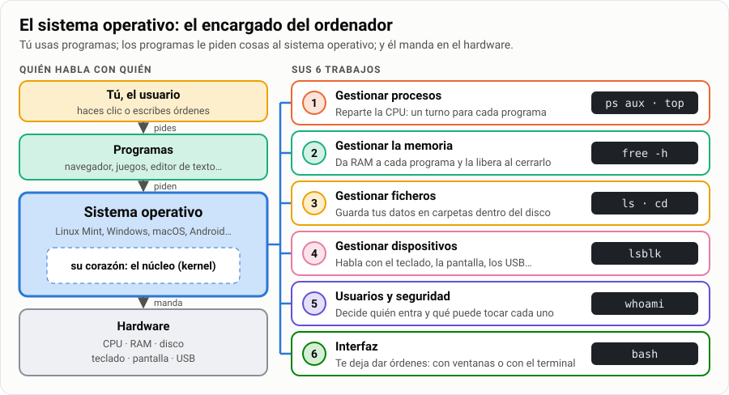
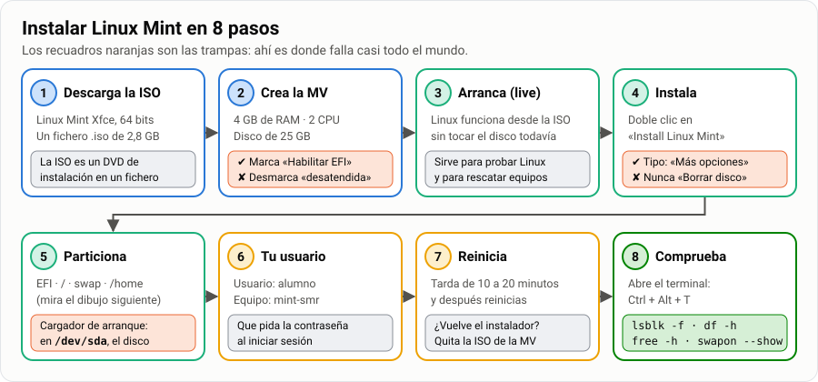
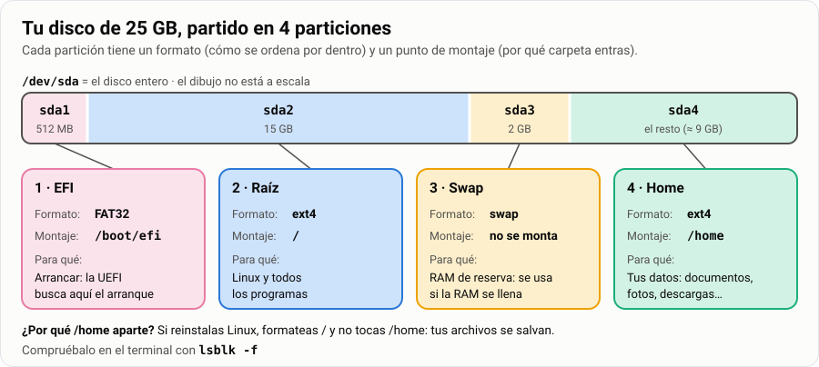
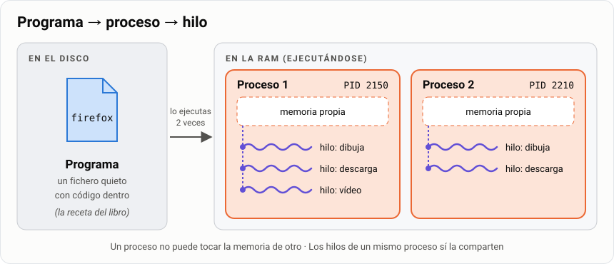
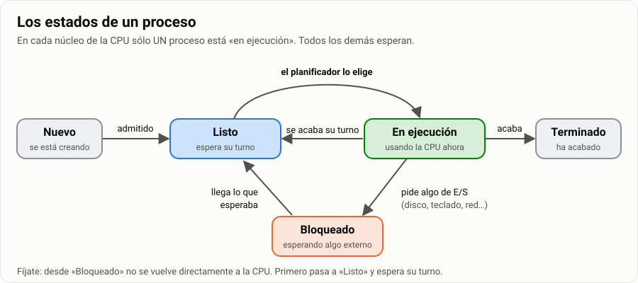
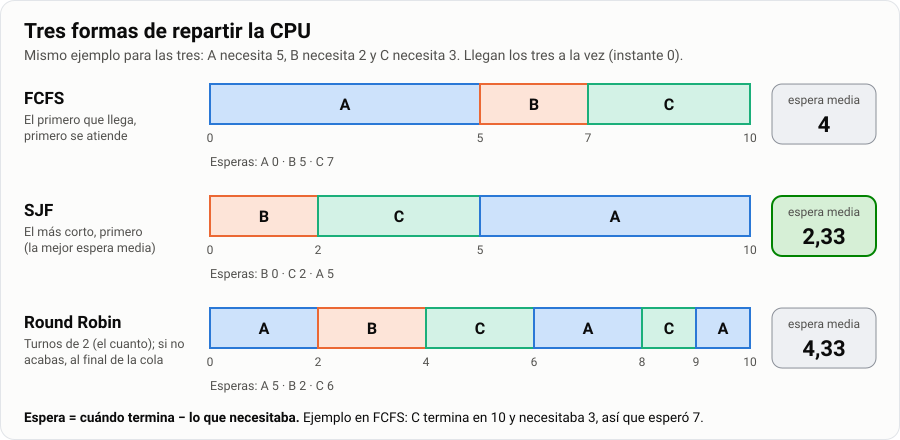
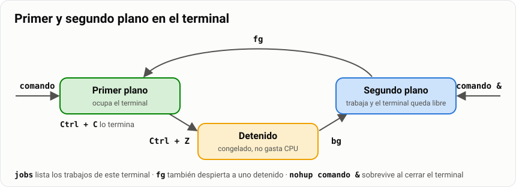
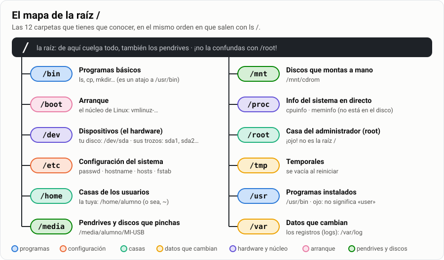
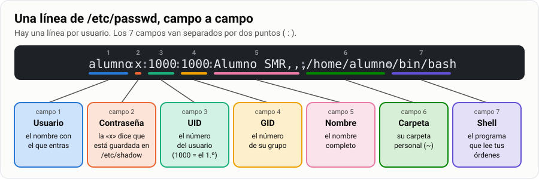

# Hoja de repaso para el examen · Temas 02 a 05

Aquí tienes **todo lo que entra en el examen**, resumido. No hay nada nuevo: es lo que ya has visto
en clase, contado más corto y con dibujos.

| | |
|---|---|
| 🎯 **Qué entra** | Qué hace un sistema operativo · Instalar Linux Mint y sus particiones · Procesos · Comandos básicos · Las carpetas de Linux |
| 🧰 **Qué necesitas** | Esta hoja, papel y boli. Si puedes, tu MV `Mint-SMR` encendida para probar los comandos |
| ⏱️ **Tiempo** | 2 horas, mejor repartidas en varios días |
| ✅ **Cómo sabes que estás listo** | Marcas todas las casillas de la [checklist final](#6-checklist-de-verificación) |

**Cómo usar esta hoja, en 3 pasos:**

1. **Lee un bloque.** Mira primero el dibujo: casi siempre lo explica todo.
2. **Tapa la hoja y contesta el «🧠 ¿Lo has pillado?»** del final del bloque. Después abre las
   respuestas y corrígete.
3. **Marca la [checklist](#6-checklist-de-verificación).** Lo que no puedas marcar, vuelve a leerlo.

> **Consejo.** Los comandos se aprenden **escribiéndolos**, no leyéndolos. Si tienes la MV a mano,
> prueba cada comando de esta hoja.

## Índice

- [1. Qué es un sistema operativo y para qué sirve](#1-qué-es-un-sistema-operativo-y-para-qué-sirve)
- [2. Instalar Linux Mint: particiones y tipos](#2-instalar-linux-mint-particiones-y-tipos)
- [3. Procesos](#3-procesos)
- [4. Comandos: moverse, rutas y ficheros](#4-comandos-moverse-rutas-y-ficheros)
- [5. Explorar el sistema: el árbol de carpetas](#5-explorar-el-sistema-el-árbol-de-carpetas)
- [6. Checklist de verificación](#6-checklist-de-verificación)

---

## 1. Qué es un sistema operativo y para qué sirve

**En una frase:** el sistema operativo es el **programa encargado** del ordenador. Se pone entre tú
y el hardware y lo reparte todo.



> **Analogía.** Un restaurante. Tú pides al camarero (el programa). El camarero pasa la comanda al
> jefe de cocina (el sistema operativo). El jefe decide qué fogón (CPU), qué nevera (RAM) y qué
> despensa (disco) se usan. Tú nunca entras en la cocina.

**Sus 6 funciones.** Apréndete las palabras en negrita:

| Función | Qué hace | Ejemplo de tu día |
|---|---|---|
| **Gestionar procesos** | Reparte la CPU: un turno para cada programa | Escuchas música mientras navegas |
| **Gestionar la memoria** | Da RAM a cada programa y la libera al cerrarlo | Cierras un juego y el PC va más rápido |
| **Gestionar ficheros** | Guarda los datos en carpetas, dentro del disco | Guardas un trabajo en `Documentos` |
| **Gestionar dispositivos** | Habla con el teclado, la pantalla, los USB… | Pinchas un USB y aparece solo |
| **Usuarios y seguridad** | Decide quién entra y qué puede tocar | Te pide la contraseña al entrar |
| **Interfaz** | Te deja darle órdenes | El escritorio Xfce, o el terminal |

> **Recuerda.** El **núcleo** (*kernel*) es el corazón del sistema operativo: la parte que manda de
> verdad en el hardware. En Mint ves su versión con `uname -r`.

Ejemplos de sistemas operativos: **Windows**, **Linux** (Mint, Ubuntu, Arch), **macOS**,
**Android**, **iOS**.

**🧠 ¿Lo has pillado?**

1. Di las 6 funciones del sistema operativo.
2. Al encender el PC te pide la contraseña. ¿Qué función está trabajando?
3. ¿Qué es el núcleo?

<details>
<summary>Ver respuestas</summary>

1. Gestionar procesos, gestionar la memoria, gestionar ficheros, gestionar dispositivos, usuarios y
   seguridad, e interfaz.
2. Usuarios y seguridad.
3. El corazón del sistema operativo: la parte que manda directamente en el hardware.

</details>

---

## 2. Instalar Linux Mint: particiones y tipos

### 2.1 Cuatro palabras que tienes que saber

| Palabra | Qué es | Ejemplo |
|---|---|---|
| **Máquina virtual (MV)** | Un ordenador «de mentira» que funciona dentro de tu ordenador real | `Mint-SMR` dentro de VirtualBox |
| **ISO** | Un DVD de instalación metido en un fichero | `linuxmint-22.3-xfce-64bit.iso` |
| **Sesión *live*** | Linux funcionando desde la ISO, sin instalar nada en el disco | Sirve para probar y para rescatar equipos |
| **Partición** | Un trozo del disco | El disco `sda` partido en 4: `sda1`, `sda2`, `sda3` y `sda4` |

### 2.2 Los pasos, en orden



Los **4 errores** que más se repiten:

| Error | Qué pasa | Cómo evitarlo |
|---|---|---|
| Dejar la **instalación desatendida** | VirtualBox lo instala todo solo y no haces las particiones | Desmarca esa casilla al crear la MV |
| Elegir **«Borrar disco e instalar»** | El instalador hace las particiones por ti | Elige **«Más opciones»** |
| Poner la EFI como «sistema de ficheros FAT32» | La máquina no arranca | Elige **«Partición del sistema EFI»** |
| Poner el cargador de arranque en `/dev/sda2` | La máquina no arranca | Elige el disco entero: **`/dev/sda`** |

### 2.3 BIOS o UEFI · MBR o GPT


- **BIOS / UEFI** = el programa que despierta al ordenador y busca el sistema operativo.
- **MBR / GPT** = el «índice» del disco: dice dónde empieza y dónde acaba cada partición.

> **Nota.** **Tipos de partición.** En MBR sólo caben **4 particiones primarias**. Para tener más,
> una de ellas se convierte en **extendida** y dentro se crean particiones **lógicas**. En GPT esto
> no existe: todas las particiones son iguales y caben 128.

### 2.4 Las 4 particiones



Dos palabras nuevas, y ya está:

- **Formato** (o sistema de ficheros): cómo se ordenan los datos dentro de la partición.
- **Punto de montaje**: la carpeta por la que «entras» en esa partición. Si entras en `/home`, estás
  dentro de la partición 4.

> **Analogía.** El disco es un armario. Las **particiones** son los cajones. El **formato** es cómo
> ordenas cada cajón por dentro. El **punto de montaje** es la etiqueta pegada en el cajón.

**Los formatos que tienes que conocer:**

| Formato | Dónde lo usas |
|---|---|
| **ext4** | El de Linux: la raíz `/` y `/home` |
| **FAT32** | La partición EFI y muchos pendrives (lo lee cualquier sistema) |
| **swap** | La memoria de reserva |
| **NTFS** | El de Windows (no lo usamos en Mint) |

**Por qué cada cosa:**

- **`/home` aparte:** si reinstalas Linux, formateas `/` y no tocas `/home`. Tus archivos se salvan.
  Es como tener `C:` para Windows y `D:` para tus cosas.
- **Swap:** si la RAM se llena, Linux pasa a la swap lo que menos usa. Es más lenta que la RAM, pero
  evita que todo se cuelgue. Le damos la mitad de la RAM: 2 GB.
- **EFI 512 MB:** es lo normal. Sólo guarda lo necesario para arrancar.

> **Ojo.** En VirtualBox creas un disco de **25 GB** y el instalador dice **26 843 MB**. No es un
> error: es el mismo disco medido con dos reglas (1 GB = 1024 MB o 1000 MB).

### 2.5 Comprobar que está bien

```bash
lsblk -f        # las 4 particiones, su formato y dónde se montan
df -h           # cuánto espacio libre queda
free -h         # la RAM y la swap
swapon --show   # la swap está encendida
```

Con `lsblk -f` tienes que ver algo así (aquí sólo están las columnas importantes):

```text
NAME   FSTYPE  MOUNTPOINTS
sda
├─sda1 vfat    /boot/efi     ← la EFI (vfat = FAT32)
├─sda2 ext4    /             ← la raíz
├─sda3 swap    [SWAP]        ← la swap
└─sda4 ext4    /home         ← tus datos
```

**🧠 ¿Lo has pillado?**

1. Al crear la MV, ¿qué casilla tienes que **marcar** y cuál **desmarcar**?
2. Di las 4 particiones con su formato y su punto de montaje.
3. ¿Por qué ponemos `/home` en una partición aparte?
4. ¿Dónde va el cargador de arranque: en `/dev/sda` o en `/dev/sda1`?
5. Di dos diferencias entre MBR y GPT.

<details>
<summary>Ver respuestas</summary>

1. Marcar **Habilitar EFI**. Desmarcar la **instalación desatendida**.
2. EFI (FAT32, `/boot/efi`) · raíz (ext4, `/`) · swap (swap, no se monta) · home (ext4, `/home`).
3. Para poder reinstalar Linux sin perder tus archivos.
4. En `/dev/sda`, el disco entero.
5. MBR: como mucho 4 particiones primarias y discos de hasta 2 TB. GPT: hasta 128 particiones y
   discos enormes.

</details>

---

## 3. Procesos

### 3.1 Programa, proceso e hilo



| | Qué es | En la cocina |
|---|---|---|
| 📄 **Programa** | Un fichero quieto en el disco | La receta escrita en el libro |
| ⚙️ **Proceso** | Un programa funcionando, en la RAM | La receta cocinándose en un fogón |
| 🧵 **Hilo** | Un trabajo dentro de un proceso | Dos cocineros en la misma olla |

- Cada proceso tiene un número único: el **PID**.
- El proceso que lo creó es su «padre», y su número es el **PPID**.
- El primer proceso de todos es `systemd`, con **PID 1**.

> **Ejemplo.** Abres 3 ventanas del navegador: hay **1 programa** y **varios procesos**.

### 3.2 Los estados de un proceso



| Estado | Qué le pasa |
|---|---|
| **Nuevo** | Se está creando |
| **Listo** | Quiere la CPU, pero está esperando su turno |
| **En ejecución** | Está usando la CPU ahora mismo |
| **Bloqueado** | Espera algo: una tecla, un dato del disco, la red… |
| **Terminado** | Ha acabado |

> **Recuerda.** En cada núcleo de la CPU, **sólo un proceso está en ejecución en cada instante**.
> Parece que todo va a la vez porque el sistema cambia de proceso miles de veces por segundo.

> **Ejemplo.** Un proceso pide un fichero al disco → pasa a **Bloqueado**. Llega el dato → pasa a
> **Listo** (no a ejecución: tiene que esperar su turno).

### 3.3 El planificador: quién usa la CPU

El **planificador** es la parte del sistema operativo que decide qué proceso usa la CPU.



| Algoritmo | Cómo decide | En la vida real |
|---|---|---|
| **FCFS** | Por orden de llegada | La cola del súper |
| **SJF** | Primero el más corto | «Pasa tú, que sólo llevas pan» |
| **Round Robin** | Turnos iguales (el **cuanto**); si no acabas, vuelves al final | Turnos de un minuto para hablar |

> **Consejo.** **Cómo hacer un Gantt en 4 pasos:**
> 1. Decide el orden según el algoritmo.
> 2. Dibuja la barra y escribe debajo cuándo empieza y acaba cada trozo.
> 3. Espera de cada proceso = **cuándo termina − lo que necesitaba**.
> 4. Espera media = suma de las esperas ÷ número de procesos.

**Otras palabras que te pueden preguntar:**

| Palabra | Qué es |
|---|---|
| **Cambio de contexto** | Guardar por dónde iba un proceso y cargar el siguiente. Es tiempo perdido |
| **Prioridad (`nice`)** | Va de **−20** (la más alta) a **+19** (la más baja). Normal: 0 |
| **Zombi** | Proceso que ya ha terminado, pero su padre aún no lo ha «recogido» |
| **Interbloqueo** | Dos procesos esperándose el uno al otro para siempre, como dos coches en un puente estrecho |

### 3.4 Comandos de procesos

| Quiero… | Comando |
|---|---|
| Ver todos los procesos (una foto) | `ps aux` |
| Buscar uno por su nombre | `ps aux \| grep firefox` o `pgrep -l firefox` |
| Verlos en directo (un vídeo) | `top` o `htop` · se sale con `q` |
| Terminarlo por las buenas | `kill 2345` (el número es el PID) |
| Terminarlo a la fuerza | `kill -9 2345` |
| Terminarlo por su nombre | `killall firefox` |



| Tecla o comando | Qué hace |
|---|---|
| `Ctrl` + `C` | Termina el comando que está en marcha |
| `Ctrl` + `Z` | Lo pausa |
| `comando &` | Lo lanza en segundo plano: el terminal queda libre |
| `jobs` | Lista los procesos pausados o en segundo plano |
| `bg` / `fg` | Lo reanuda en segundo plano / lo trae al primer plano |

> **Ejemplo.** Paso a paso:
>
> ```bash
> sleep 300 &          # lanza un proceso en segundo plano
> # [1] 2345           ← el terminal te dice su PID: 2345
> ps aux | grep sleep  # ahí está
> kill 2345            # terminado
> ```

> **Ojo.** Empieza siempre por `kill` a secas. `kill -9` es como desenchufar: funciona siempre, pero
> el programa no puede guardar nada.

**En Windows:** `Ctrl` + `Shift` + `Esc` abre el **Administrador de tareas** (en la pestaña
**Detalles** ves el PID). En el terminal: `tasklist` para ver y `taskkill /PID 2345` para terminar.

**🧠 ¿Lo has pillado?**

1. ¿Qué diferencia hay entre un programa y un proceso?
2. Un proceso espera a que pulses una tecla. ¿En qué estado está?
3. Procesos que llegan a la vez: X necesita 4 y Y necesita 1. Con FCFS (orden X, Y) y con SJF,
   ¿cuánto espera cada uno?
4. ¿Con qué comando terminas el proceso de PID 4321? ¿Y si no hace caso?

<details>
<summary>Ver respuestas</summary>

1. El programa es un fichero quieto en el disco. El proceso es ese programa funcionando en la RAM.
2. **Bloqueado**.
3. FCFS: X espera 0 y Y espera 4 (media 2). SJF: Y va primero y espera 0, X espera 1 (media 0,5).
4. `kill 4321`. Si no hace caso, `kill -9 4321`.

</details>

---

## 4. Comandos: moverse, rutas y ficheros

### 4.1 Cómo se escribe una orden


Toda orden tiene la misma forma: **comando**, **opciones** y **argumentos**, separados por espacios.

Cuatro reglas:

1. **Mayúsculas y minúsculas son distintas.** `Documentos` y `documentos` son dos carpetas.
2. **Los espacios separan.** Un nombre con espacios va entre comillas: `cat "mi informe.txt"`.
3. **No hay papelera.** Lo que borras con `rm` desaparece para siempre.
4. **Si no dice nada, ha ido bien.** Si algo falla, te avisa.

| Tecla | Para qué |
|---|---|
| `Tab` | Completa nombres. Si no completa, es que ese nombre no existe ahí |
| `↑` / `↓` | Recupera los comandos de antes |
| `Ctrl` + `C` | Para un comando que no termina |
| `q` | Sale de `man`, `less` y `top` |

### 4.2 Moverse por las carpetas

| Comando | Qué hace |
|---|---|
| `pwd` | Dice en qué carpeta estás |
| `cd /etc` | Va a `/etc` |
| `cd ..` | Sube un nivel |
| `cd` | Vuelve a tu carpeta personal |
| `cd -` | Vuelve a la carpeta de antes |
| `ls` | Lista lo que hay aquí |
| `ls -l` | En lista: permisos, dueño, tamaño y fecha |
| `ls -a` | También los ocultos (los que empiezan por punto, como `.bashrc`) |
| `ls -lah` | Todo junto, con tamaños fáciles de leer |

### 4.3 Rutas absolutas y relativas


**La regla:** ¿la ruta empieza por `/`? Entonces es **absoluta** (vale estés donde estés). Si no,
es **relativa** (depende de dónde estés).

| Símbolo | Significa |
|---|---|
| `/` al principio | La raíz: empieza desde arriba del todo |
| `.` | La carpeta en la que estoy |
| `..` | La carpeta de arriba |
| `~` | Mi carpeta personal (`/home/alumno`) |

> **Ejemplo.** Estás en `/home/alumno/proyectos/web`. Las tres órdenes abren el mismo fichero:
>
> ```bash
> cat /home/alumno/docs/informe.txt   # absoluta
> cat ../../docs/informe.txt          # relativa: subo dos y bajo a docs
> cat ~/docs/informe.txt              # con ~
> ```

### 4.4 Crear y escribir

| Comando | Qué hace |
|---|---|
| `touch nota.txt` | Crea un fichero vacío |
| `mkdir fotos` | Crea una carpeta |
| `mkdir -p a/b/c` | Crea todas las carpetas del camino de golpe |
| `echo "Hola" > nota.txt` | Escribe en el fichero **borrando** lo que había |
| `echo "Adiós" >> nota.txt` | **Añade** al final |
| `nano nota.txt` | Lo edita. `Ctrl` + `O` guarda, `Ctrl` + `X` sale |


### 4.5 Ver lo que hay dentro

| Comando | Qué hace |
|---|---|
| `cat f` | Lo enseña todo de golpe (para ficheros cortos) |
| `less f` | Página a página (para ficheros largos). Sales con `q` |
| `head -n 3 f` | Las 3 primeras líneas (sin `-n`, 10) |
| `tail -n 3 f` | Las 3 últimas líneas |
| `wc -l f` | Cuenta las líneas |

### 4.6 Copiar, mover y borrar


| Comando | Qué hace |
|---|---|
| `cp a.txt b.txt` | Copia un fichero |
| `cp -r fotos copia` | Copia una carpeta entera (hace falta `-r`) |
| `mv a.txt docs/` | Mueve |
| `mv viejo.txt nuevo.txt` | Renombra (¡es el mismo comando!) |
| `rm a.txt` | Borra un fichero |
| `rm -r fotos` | Borra una carpeta con todo lo de dentro |
| `rmdir fotos` | Borra una carpeta, pero sólo si está vacía |

**Dos comodines** para elegir muchos ficheros a la vez:

| Comodín | Significa | Ejemplo |
|---|---|---|
| `*` | Cualquier cosa | `ls *.txt` → todos los que acaban en `.txt` |
| `?` | Exactamente un carácter | `ls foto?.jpg` → `foto1.jpg`, pero no `foto10.jpg` |

> **Ojo.** Antes de borrar con comodín, **pruébalo con `ls`**: `ls *.txt`. Si sale lo que
> esperabas, entonces `rm *.txt`.

**Pedir ayuda:** `ls --help` (resumen) o `man ls` (el manual completo; sales con `q`).

### 4.7 Ejemplo completo, de principio a fin

```bash
cd                           # 1. voy a mi carpeta personal
mkdir -p clase/apuntes       # 2. creo clase y, dentro, apuntes
cd clase                     # 3. entro en clase
echo "pan" > lista.txt       # 4. creo lista.txt con una línea
echo "leche" >> lista.txt    # 5. le añado otra
cat lista.txt                # 6. veo:  pan  y  leche
cp lista.txt apuntes/        # 7. copio lista.txt dentro de apuntes
mv lista.txt compra.txt      # 8. le cambio el nombre
rm apuntes/lista.txt         # 9. borro la copia
pwd                          # 10. → /home/alumno/clase
```

**🧠 ¿Lo has pillado?**

1. En `cp -r fotos copia`, ¿cuál es el comando, cuál la opción y cuáles los argumentos?
2. ¿Es absoluta o relativa `docs/a.txt`? ¿Y `/tmp`?
3. Escribes dos veces `echo hola > a.txt`. ¿Cuántas líneas tiene `a.txt`? ¿Y con `>>`?
4. En el [ejemplo completo](#47-ejemplo-completo-de-principio-a-fin), ¿qué hay en `clase` al final?

<details>
<summary>Ver respuestas</summary>

1. Comando `cp`, opción `-r`, argumentos `fotos` y `copia`.
2. `docs/a.txt` es relativa (no empieza por `/`). `/tmp` es absoluta.
3. Con `>`, **una** línea: la segunda vez borra la primera. Con `>>`, **dos**.
4. El fichero `compra.txt` (con «pan» y «leche») y la carpeta `apuntes`, vacía.

</details>

---

## 5. Explorar el sistema: el árbol de carpetas

### 5.1 Un solo árbol


En Windows hay letras: `C:`, `D:`… En Linux **no hay letras**: hay un solo árbol que empieza en
**`/`**, la **raíz**. Un pendrive aparece como una carpeta dentro de `/media`.

### 5.2 El mapa de la raíz



> **Consejo.** Lo comprobaste en la tarea 7 con un comando por carpeta: `cat /etc/hostname`,
> `ls -l /home`, `ls /var/log`, `lsblk`, `head /proc/cpuinfo`, `ls /boot`… Si dudas de una carpeta,
> entra y mira qué hay.

### 5.3 Ficheros importantes

| Fichero | Qué guarda | Para verlo |
|---|---|---|
| `/etc/passwd` | La lista de usuarios: una línea por usuario | `cat /etc/passwd` |
| `/etc/shadow` | Las contraseñas, cifradas. Sólo root puede leerlo | `sudo cat /etc/shadow` |
| `/etc/hostname` | El nombre del equipo (`mint-smr`) | `cat /etc/hostname` |
| `/etc/hosts` | Nombres de equipos y su dirección IP | `cat /etc/hosts` |
| `/etc/fstab` | Qué partición se monta en qué carpeta al arrancar | `cat /etc/fstab` |
| `/etc/shells` | Los shells (intérpretes de órdenes) instalados | `cat /etc/shells` |
| `/proc/cpuinfo` | Tu procesador | `head /proc/cpuinfo` |
| `/proc/meminfo` | Tu memoria RAM | `head -n 3 /proc/meminfo` |
| `/var/log/` | Los registros: lo que ha pasado en el sistema | `ls /var/log` |
| `/boot/vmlinuz-…` | El núcleo de Linux | `ls /boot` |
| `/dev/sda` | Tu disco | `lsblk` |

### 5.4 `/etc/passwd` por dentro



### 5.5 Variables útiles

| Variable | Qué guarda | Ejemplo |
|---|---|---|
| `$HOME` | Tu carpeta personal | `/home/alumno` |
| `$USER` | Tu nombre de usuario | `alumno` |
| `$PATH` | Las carpetas donde el sistema busca los programas | `/usr/local/bin:/usr/bin:…` |
| `$SHELL` | Tu shell | `/bin/bash` |

Se ven con `echo`: `echo $HOME`.

### 5.6 Lo que despista

> **Ojo.** **`/root` no es la raíz.** La raíz es `/`. `/root` es la casa del administrador, igual
> que `/home/alumno` es la tuya.

> **Ojo.** **`/usr` no significa *user*.** Las casas de los usuarios están en `/home`. En `/usr`
> están los programas instalados.

> **Nota.** **`/bin` es un atajo** a `/usr/bin` (por eso `ls -ld /bin` enseña una flecha `->`).
> **`/proc` no está en el disco:** el núcleo inventa sus ficheros cada vez que los lees. **`/tmp`
> se vacía** al reiniciar: no guardes ahí nada importante.

**🧠 ¿Lo has pillado?**

1. ¿Dónde buscas la configuración del sistema? ¿Y tus documentos?
2. Pinchas un pendrive en Mint. ¿Con qué letra aparece?
3. En la línea `ana:x:1001:1001::/home/ana:/bin/bash`, ¿cuál es la carpeta personal de `ana`? ¿Y
   su shell?
4. ¿Por qué no puedes leer `/etc/shadow` sin `sudo`?

<details>
<summary>Ver respuestas</summary>

1. La configuración, en `/etc`. Tus documentos, en `/home/alumno`.
2. Con ninguna: aparece como una carpeta dentro de `/media`, por ejemplo `/media/alumno/MI-USB`.
3. Carpeta: `/home/ana`. Shell: `/bin/bash`.
4. Porque guarda las contraseñas (cifradas) y sólo root puede leerlo.

</details>

---

## 6. Checklist de verificación

Marca una casilla **sólo si puedes hacerlo sin mirar la hoja**. Si no puedes, vuelve al bloque que
se indica.

**Bloque 1 · Sistema operativo**

- [ ] Explico con una frase qué es un sistema operativo.
- [ ] Digo sus 6 funciones y un ejemplo de cada una.
- [ ] Sé qué es el núcleo (*kernel*).

**Bloque 2 · Instalación y particiones**

- [ ] Explico qué es una máquina virtual, una ISO y una sesión *live*.
- [ ] Sé qué casilla se marca (Habilitar EFI) y cuál se desmarca (desatendida) al crear la MV.
- [ ] Diferencio BIOS de UEFI, y MBR de GPT.
- [ ] Sé qué son las particiones primarias, extendidas y lógicas, y por qué en GPT no hacen falta.
- [ ] Dibujo las 4 particiones con su tamaño, su formato y su punto de montaje.
- [ ] Explico qué es un formato (ext4, FAT32, swap, NTFS) y qué es un punto de montaje.
- [ ] Explico por qué `/home` va aparte y para qué sirve la swap.
- [ ] Sé dónde va el cargador de arranque (`/dev/sda`).
- [ ] Compruebo las particiones con `lsblk -f`.

**Bloque 3 · Procesos**

- [ ] Diferencio programa, proceso e hilo, con un ejemplo.
- [ ] Sé qué son el PID y el PPID.
- [ ] Dibujo el diagrama de estados y sé cuándo un proceso pasa a «bloqueado».
- [ ] Dibujo un Gantt con FCFS, SJF y Round Robin, y calculo la espera media.
- [ ] Veo los procesos con `ps aux` y `top`, y busco uno por su nombre.
- [ ] Termino un proceso con `kill`, y sé cuándo usar `kill -9`.
- [ ] Uso `Ctrl` + `C`, `Ctrl` + `Z`, `&`, `jobs`, `bg` y `fg`.

**Bloque 4 · Comandos**

- [ ] Separo comando, opciones y argumentos en una orden.
- [ ] Me muevo con `pwd`, `cd`, `cd ..`, `cd` y `cd -`, y listo con `ls -la`.
- [ ] Distingo ruta absoluta y relativa, y uso `.`, `..` y `~`.
- [ ] Creo ficheros y carpetas con `touch` y `mkdir -p`.
- [ ] Sé la diferencia entre `>` y `>>`.
- [ ] Edito con `nano`: sé guardar y salir.
- [ ] Veo ficheros con `cat`, `less`, `head` y `tail`.
- [ ] Copio (`cp`, `cp -r`), muevo y renombro (`mv`) y borro (`rm`, `rm -r`, `rmdir`).
- [ ] Uso `*` y `?`, y lo pruebo con `ls` antes de borrar.
- [ ] Pido ayuda con `--help` y `man`, y sé salir con `q`.

**Bloque 5 · El árbol de carpetas**

- [ ] Explico por qué en Linux hay un solo árbol y dónde aparece un pendrive.
- [ ] Digo para qué sirven `/bin`, `/boot`, `/dev`, `/etc`, `/home`, `/media`, `/mnt`, `/proc`,
      `/root`, `/tmp`, `/usr` y `/var`.
- [ ] No confundo `/` con `/root`.
- [ ] Sé qué guardan `/etc/passwd`, `/etc/shadow`, `/etc/hostname`, `/etc/hosts` y `/etc/fstab`.
- [ ] Leo una línea de `/etc/passwd` campo a campo.
- [ ] Sé qué guardan `$HOME` y `$PATH`.

### Prueba final en el terminal (15 minutos)

Hazla en tu MV **sin mirar la hoja**. Si te sale todo, estás listo para la parte práctica.

1. Di en qué carpeta estás.
2. Ve a `/etc` y lista su contenido en forma de lista y con los ocultos.
3. Enseña las 3 primeras líneas de `/etc/passwd`.
4. Vuelve a tu carpeta personal y crea `repaso/a/b` con **un solo** comando.
5. Escribe dos líneas en `repaso/notas.txt` sin abrir ningún editor.
6. Copia `repaso/notas.txt` dentro de `repaso/a` con el nombre `copia.txt`.
7. Lanza `sleep 500` en segundo plano, búscalo y termínalo.
8. Enseña tus particiones con su formato, y el nombre de tu equipo.
9. Borra la carpeta `repaso` entera.

<details>
<summary>Ver soluciones</summary>

```bash
pwd                                      # 1
cd /etc                                  # 2
ls -la
head -n 3 /etc/passwd                    # 3
cd                                       # 4
mkdir -p repaso/a/b
echo "primera" > repaso/notas.txt        # 5
echo "segunda" >> repaso/notas.txt
cp repaso/notas.txt repaso/a/copia.txt   # 6
sleep 500 &                              # 7: apunta el PID que sale, por ejemplo 2345
ps aux | grep sleep
kill 2345
lsblk -f                                 # 8
cat /etc/hostname
rm -r repaso                             # 9
```

</details>
