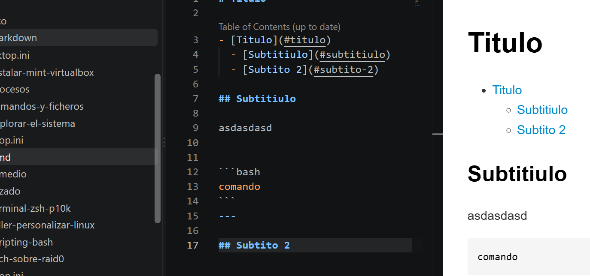

# Titulo

- [Titulo](#titulo)
  - [Subtitiulo](#subtitiulo)
  - [Subtito 2](#subtito-2)

## Subtitiulo

asdasdasd


```bash
comando
```
--- 

## Subtito 2



- elemein
  - elemti
    - elemto 3
  - ele 2

1. bat
2. bi
   1. bi
   2. hir

> 