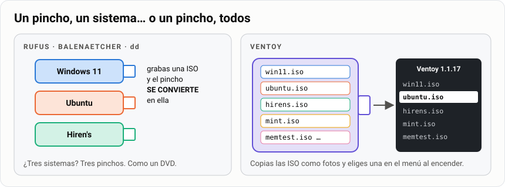
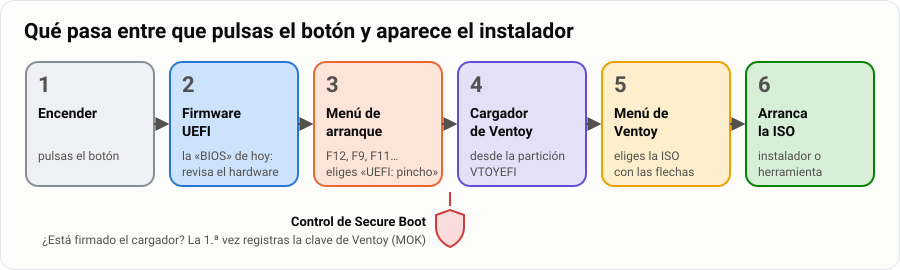
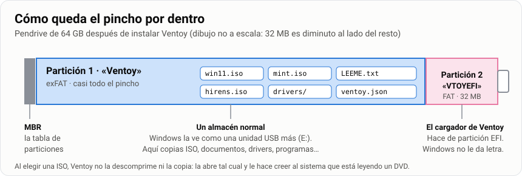
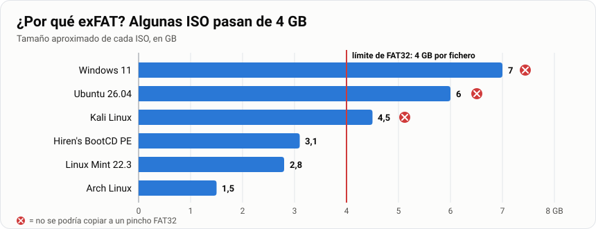
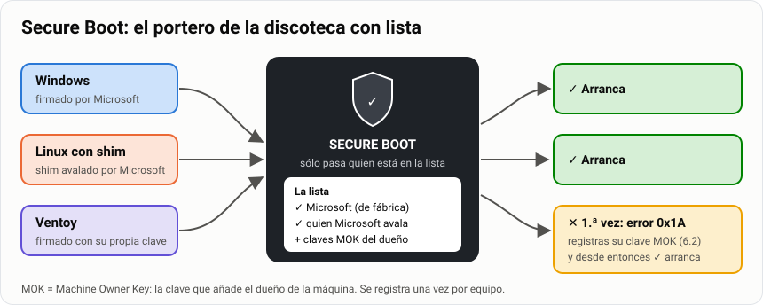
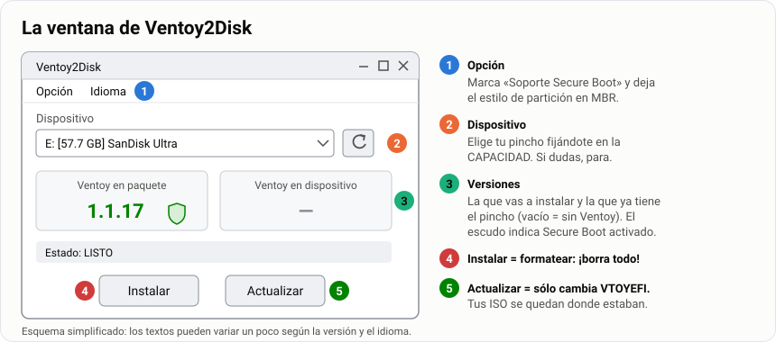
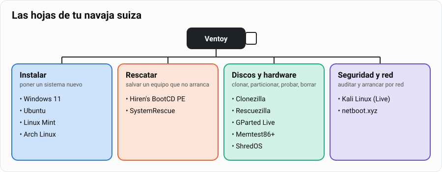
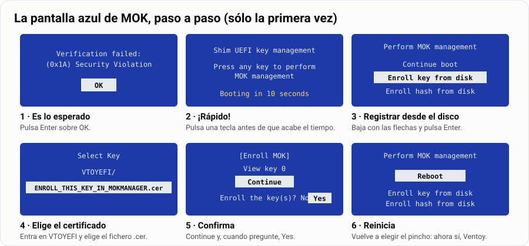

# USB multiarranque con Ventoy: la navaja suiza del técnico

> **Antes de empezar.** Es el paso previo a [instalar Arch Linux](../08-instalar-arch-uefi/1-guia.md): ahí
> arrancarás desde una ISO, y aquí aprendes qué pasa entre que pulsas el botón de encendido y
> aparece el instalador.

Imagina que llega a tu mesa un portátil que no arranca. Otro va lentísimo. A un tercero hay que
instalarle Linux. Un técnico no lleva una caja llena de pinchos: lleva **uno solo** que lo
arranca todo. Al terminar esta guía tendrás el tuyo.

| | |
|---|---|
| 🎯 **Qué vas a conseguir** | Un pendrive que arranca una docena de sistemas y herramientas, elegidos desde un menú |
| 🧰 **Qué necesitas** | Un pendrive de 64 GB, un PC con Windows y permisos de administrador ([apartado 0](#0-qué-necesitas)) |
| ⏱️ **Tiempo** | 5 horas: 2 sesiones en el aula + las descargas |
| 📦 **Qué entregas** | La tarea «Mi navaja suiza USB» y una defensa en el aula ([Parte 4](#parte-4--entrega)) |

**Tu misión, paso a paso:**

- [ ] Entender cómo arranca un equipo desde un pincho y qué hace Ventoy.
- [ ] Instalar Ventoy y comprobar las dos particiones que crea.
- [ ] Descargar y **verificar** las ISO de la navaja.
- [ ] Organizar el pincho con carpetas y un `ventoy.json`.
- [ ] Arrancar tres ISO en un equipo real, registrando la clave de Secure Boot si hace falta.
- [ ] Saber qué herramienta sacar en cada situación.

## Índice

- [USB multiarranque con Ventoy: la navaja suiza del técnico](#usb-multiarranque-con-ventoy-la-navaja-suiza-del-técnico)
  - [Índice](#índice)
  - [Parte 1 · Aprende y monta tu navaja](#parte-1--aprende-y-monta-tu-navaja)
    - [0. Qué necesitas](#0-qué-necesitas)
    - [1. Cómo funciona Ventoy por dentro](#1-cómo-funciona-ventoy-por-dentro)
    - [2. Descargar Ventoy](#2-descargar-ventoy)
    - [3. Instalar Ventoy en el pincho](#3-instalar-ventoy-en-el-pincho)
    - [4. Las ISO de la navaja](#4-las-iso-de-la-navaja)
    - [5. Organizar el pincho](#5-organizar-el-pincho)
    - [6. Arrancar desde el pincho](#6-arrancar-desde-el-pincho)
    - [7. Qué herramienta saco en cada situación](#7-qué-herramienta-saco-en-cada-situación)
    - [8. Mantener la navaja afilada](#8-mantener-la-navaja-afilada)
    - [9. Lo que despista](#9-lo-que-despista)
    - [10. Problemas frecuentes](#10-problemas-frecuentes)
  - [Parte 2 · Chuleta](#parte-2--chuleta)
  - [Parte 3 · Practica](#parte-3--practica)
  - [Parte 4 · Entrega](#parte-4--entrega)

---

## Parte 1 · Aprende y monta tu navaja

> **Analogía.** Con las herramientas clásicas (Rufus, balenaEtcher, `dd`), un pincho es como un
> **DVD**: grabas **una** ISO y el pincho *se convierte* en ella. Para tener cinco sistemas
> necesitas cinco pinchos.
>
> Ventoy convierte el pincho en una **estantería con conserje**. Tú copias los ficheros `.iso` en
> la estantería como copiarías fotos, y al encender el equipo el conserje (el cargador de arranque
> de Ventoy) te enseña la lista y arranca el que elijas. ¿Nueva versión de Ubuntu? Borras la ISO
> vieja y copias la nueva. No se reinstala nada.



Por el camino vas a tocar con las manos lo que en la teoría del arranque son sólo palabras:
**UEFI y BIOS**, **tabla de particiones**, **partición EFI**, **sistemas de archivos** y
**Secure Boot**.

### 0. Qué necesitas

| Qué | Detalle |
|---|---|
| 💾 **Pendrive** | **64 GB recomendado** (32 GB vale con la lista reducida del [apartado 4.2](#42-cuánto-ocupa-todo)). Mejor USB 3: con USB 2 arrancar Windows tarda una eternidad |
| 🪟 **Equipo Windows** | Con permisos de administrador: Ventoy tiene que escribir en el disco a bajo nivel |
| 📥 **Descargas** | Unos 30 GB de ISO. Si el profesor las ha dejado en la carpeta compartida del aula, cópialas de ahí |
| 🖥️ **Un equipo donde probar** | Uno del aula que te indique el profesor, con permiso para abrir su menú de arranque |

> [!WARNING]
> **Instalar Ventoy borra el pendrive entero.** Copia antes lo que tengas en él. Y comprueba
> **tres veces** qué disco eliges: Ventoy te enseña los discos USB, pero si hay un disco externo
> conectado también aparecerá. **Desconéctalo antes de empezar.**

### 1. Cómo funciona Ventoy por dentro

#### 1.1 Del botón al instalador

Antes de tocar nada, mira el camino completo que recorre el equipo cuando arranca desde tu
pincho. Cada caja es un apartado de esta guía:



#### 1.2 Las dos particiones del pincho

Cuando instalas Ventoy, el pincho queda así:



- La **partición 2 (`VTOYEFI`)** es la que busca el firmware al arrancar. En un equipo UEFI hace
  de **partición EFI** (la misma idea que la partición de 512 MB de tu MV de Mint); en un equipo
  antiguo con BIOS, el arranque empieza en el **MBR** del pincho y salta a ella.
- La **partición 1 (`Ventoy`)** es un almacén normal. Windows la ve como una unidad USB cualquiera
  y puedes guardar en ella también documentos, drivers o instaladores de programas.

> [!NOTE]
> Cuando eliges una ISO en el menú, Ventoy **no la descomprime ni la copia**: la abre
> directamente y le hace creer al sistema que arranca que está leyendo un DVD. Por eso basta con
> copiar el fichero.

#### 1.3 Por qué exFAT y no FAT32

**FAT32 no admite ficheros de 4 GB o más.** Y mira cuánto ocupan algunas ISO:



En FAT32 ni siquiera se podrían copiar. **exFAT** no tiene ese límite y lo leen Windows, macOS y
Linux.

> [!TIP]
> **Para comparar.** Herramientas como Rufus en modo FAT32 tienen que **partir** el fichero
> `install.wim` de Windows para que quepa. Con Ventoy ese problema no existe: la ISO viaja
> entera.

#### 1.4 Secure Boot en dos minutos

**Secure Boot** es una función de UEFI que sólo deja arrancar programas **firmados** con una
clave en la que el firmware confía. Los fabricantes traen de serie las claves de **Microsoft**, y
Microsoft firma también un pequeño programa llamado **shim** que usan casi todas las
distribuciones Linux para arrancar con Secure Boot activo.



> **Analogía.** Secure Boot es el **portero de una discoteca con lista**. La lista de fábrica sólo
> tiene a Microsoft y a quien Microsoft avala. Ventoy no está en la lista, así que la primera vez
> tienes que **apuntarlo tú**: eso es la pantalla azul de *MOK* del
> [apartado 6.2](#62-primer-arranque-con-secure-boot-registrar-la-clave). MOK significa *Machine
> Owner Key*: la clave que añade el dueño de la máquina.

> [!IMPORTANT]
> **Lo que tienes que saber en 2026.** Los certificados de Microsoft de 2011 que firmaban esos
> shim caducaron en junio de 2026 y se están sustituyendo por los de 2023. Por eso **Ventoy 1.1.14
> cambió su clave**. En la práctica:
>
> - Usa **Ventoy 1.1.14 o posterior** (en esta guía, la 1.1.17).
> - Un pincho con un Ventoy antiguo hay que **actualizarlo**, y el equipo te pedirá registrar la
>   clave nueva **aunque ya tuviera la vieja**.

> [!CAUTION]
> **La otra cara.** Una vez registrada su clave, Ventoy por defecto **se salta** Secure Boot para
> las ISO que arranca: por eso arrancan también las que no están firmadas (Arch, Memtest86+…). Es
> cómodo, pero es un agujero: en un equipo con la clave de Ventoy registrada, cualquiera con un
> pincho Ventoy arranca lo que quiera. Lo comentaremos en clase.

**🧠 ¿Lo has pillado?**

1. ¿En qué partición del pincho copias las ISO? ¿Y cuál busca el firmware al arrancar?
2. Tienes un pincho FAT32 con 40 GB libres. ¿Por qué no puedes copiar la ISO de Windows 11?

<details>
<summary>Ver respuestas</summary>

1. Las ISO van en la partición grande, **`Ventoy`** (exFAT). El firmware busca la pequeña,
   **`VTOYEFI`**, que hace de partición EFI.
2. Porque el problema no es el espacio libre sino el **tamaño de cada fichero**: FAT32 no admite
   ficheros de 4 GB o más, y la ISO de Windows 11 pasa de 7 GB.

</details>

### 2. Descargar Ventoy

1. Entra en la web oficial, https://www.ventoy.net/en/download.html, o en la página de versiones
   de GitHub, https://github.com/ventoy/Ventoy/releases.
2. Descarga **`ventoy-1.1.17-windows.zip`** (o la versión más reciente que aparezca).
3. **Descomprime la carpeta entera** (clic derecho → *Extraer todo*). No lo ejecutes desde dentro
   del zip: el programa necesita los ficheros que lo acompañan.

> [!TIP]
> **Buena costumbre profesional.** Comprueba la huella SHA-256 del zip con la que publica la
> página de descarga, igual que hiciste con la ISO de Mint:
>
> ```powershell
> Get-FileHash .\ventoy-1.1.17-windows.zip -Algorithm SHA256
> ```
>
> Algunos antivirus marcan Ventoy como sospechoso porque escribe en el disco a bajo nivel, que es
> justo lo que hace el malware. Por eso importa descargarlo **sólo** de la web oficial o de su
> GitHub y verificar la huella.

### 3. Instalar Ventoy en el pincho

Abre **`Ventoy2Disk.exe`** y acepta el aviso de administrador. Si sale en inglés: menú
**Language → Español**.

#### 3.1 Conoce la ventana



#### 3.2 Opciones antes de instalar

Antes de pulsar nada, revisa el menú **Opción** (zona 1):

| Opción | Qué elegir | Por qué |
|---|---|---|
| **Soporte Secure Boot** (*Secure Boot Support*) | ✅ **Marcada** | Sin ella, en los equipos con Secure Boot activo tendrías que entrar en la BIOS a desactivarlo |
| **Estilo de partición** (*Partition Style*) | **MBR** (el predeterminado) | Un pincho MBR arranca en UEFI y en BIOS; algunos equipos viejos no arrancan pinchos GPT |
| **Configuración de partición** (*Partition Configuration*) | Sin espacio reservado | Sirve para dejar hueco al final del pincho para otra partición. No lo necesitas |

> [!IMPORTANT]
> **«¿MBR? ¡Pero si en el curso todo es GPT!»** No hay contradicción: la tabla de particiones es
> una propiedad **de cada disco**, no del ordenador. Tu portátil puede tener el disco interno en
> GPT y arrancar sin problema desde un pincho MBR. Es una buena pregunta de examen.

#### 3.3 Instalar

1. En **Dispositivo** (zona 2), elige tu pendrive. Fíjate en la **capacidad**: es la forma de
   distinguirlo de otros discos.
2. Pulsa **Instalar** (zona 4). Ventoy avisa **dos veces** de que borrará todo. Lee la letra y el
   tamaño antes de aceptar la segunda.
3. Al terminar, la columna **Ventoy en dispositivo** (zona 3) muestra la versión, y aparece un
   escudo si el soporte de Secure Boot está activo.

> [!WARNING]
> **Instalar ≠ Actualizar.** **Instalar** formatea el pincho y borra las ISO. **Actualizar** sólo
> cambia la partición `VTOYEFI` y **no toca** tus ficheros. Cuando salga una versión nueva de
> Ventoy, el botón que quieres es **Actualizar**.

#### 3.4 Comprobar lo que ha hecho

No te fíes: **mira**. En Windows, clic derecho en Inicio → **Administración de discos**, o en
PowerShell como administrador:

```powershell
Get-Disk | Where-Object BusType -eq 'USB'
Get-Partition -DiskNumber N          # N = el número de disco del pincho
Get-Volume | Where-Object FileSystemLabel -in 'Ventoy','VTOYEFI'
```

Tienes que ver **dos particiones**: una grande exFAT llamada `Ventoy` y una de 32 MB llamada
`VTOYEFI`. El Explorador de Windows sólo te enseña la primera; la segunda no tiene letra, igual
que la partición EFI de tu disco interno.

> [!TIP]
> Si conectas el pincho a tu MV de Mint (menú **Dispositivos → USB** de VirtualBox), también lo
> puedes ver con la herramienta que ya conoces:
>
> ```bash
> lsblk -f /dev/sdb      # o la letra que tenga el pincho
> ```

### 4. Las ISO de la navaja

#### 4.1 La lista

Estas son las «hojas» de tu navaja, agrupadas por lo que resuelven:



Versiones vigentes en septiembre de 2026.

> [!WARNING]
> **Descarga siempre desde la web oficial.** Una ISO de una web de descargas cualquiera puede
> venir modificada, y es un sistema que vas a arrancar **con todos los permisos sobre el equipo**.

**🔵 Instalar sistemas**

| ISO | Para qué | Fichero (versión actual) | Tamaño | Web oficial |
|---|---|---|---|---|
| **Windows 11** | Instalar o reinstalar Windows | ISO multiedición x64, versión 25H2 | ~7 GB | https://www.microsoft.com/es-es/software-download/windows11 → *Descargar imagen de disco (ISO)* |
| **Ubuntu** | Instalar Ubuntu o probar si el hardware funciona con Linux | `ubuntu-26.04.1-desktop-amd64.iso` | 6,0 GB | https://ubuntu.com/download/desktop |
| **Linux Mint** | La distribución del curso; ideal para revivir equipos viejos | `linuxmint-22.3-xfce-64bit.iso` | 2,8 GB | https://linuxmint.com/download.php |
| **Arch Linux** | La [instalación de Arch](../08-instalar-arch-uefi/1-guia.md) | `archlinux-2026.09.01-x86_64.iso` (sale una nueva cada mes) | 1,5 GB | https://archlinux.org/download/ |

**🟠 Rescatar y reparar**

| ISO | Para qué | Fichero (versión actual) | Tamaño | Web oficial |
|---|---|---|---|---|
| **Hiren's BootCD PE** | Un Windows 11 que arranca desde el pincho con decenas de utilidades: explorador, antivirus, recuperación de ficheros, diagnóstico de discos, edición del registro | `HBCD_PE_x64.iso` (v1.0.8) | ~3,1 GB | https://www.hirensbootcd.org/download/ |
| **SystemRescue** | El equivalente en Linux: reparar GRUB, montar discos, `chroot`, `fsck`, `testdisk` | `systemrescue-13.02-amd64.iso` | ~1,3 GB | https://www.system-rescue.org/Download/ |

**🟢 Clonar, particionar, diagnosticar, borrar**

| ISO | Para qué | Fichero (versión actual) | Tamaño | Web oficial |
|---|---|---|---|---|
| **Clonezilla** | Clonar un disco entero o guardar una imagen del sistema. En modo texto, muy fiable | `clonezilla-live-3.3.3-37-amd64.iso` | ~0,5 GB | https://clonezilla.org/downloads.php |
| **Rescuezilla** | Lo mismo que Clonezilla pero con ventanas; compatible con sus imágenes | `rescuezilla-2.6.2-64bit.resolute.iso` | ~1,3 GB | https://rescuezilla.com/download |
| **GParted Live** | Crear, mover y redimensionar particiones de forma gráfica | `gparted-live-1.8.1-6-amd64.iso` | ~0,6 GB | https://gparted.org/download.php |
| **Memtest86+** | Probar la memoria RAM durante horas | `mt86plus_8.10_x86_64.iso` (viene en un **.zip**: descomprímelo) | < 50 MB | https://www.memtest.org/ |
| **ShredOS** | Borrar un disco de forma segura con `nwipe` antes de vender o reciclar el equipo | la `.iso` de x86-64 más reciente | < 200 MB | https://github.com/PartialVolume/shredos.x86_64/releases |

**🟣 Seguridad y red**

| ISO | Para qué | Fichero (versión actual) | Tamaño | Web oficial |
|---|---|---|---|---|
| **Kali Linux** (*Live*) | Auditoría de seguridad. La usarás en el ciclo; aquí, para conocerla | la ISO **Live** más reciente (2026.x) | ~4,5 GB | https://www.kali.org/get-kali/ → *Live Boot* |
| **netboot.xyz** | Una ISO diminuta que descarga por red el instalador de decenas de sistemas | `netboot.xyz.iso` | < 5 MB | https://netboot.xyz/downloads/ |

> [!CAUTION]
> **Kali y las herramientas de contraseñas no son juguetes.** Kali trae herramientas de ataque y
> Hiren's trae utilidades para quitar la contraseña de una cuenta local de Windows. Úsalas **sólo
> en equipos tuyos o en los que te hayan autorizado por escrito**. Entrar en un sistema ajeno sin
> permiso es delito en España (artículo 197 bis del Código Penal), aunque «sólo estuvieras
> mirando». En el aula: sólo en tus máquinas virtuales.

> [!NOTE]
> **¿Y Windows 10?** Perdió el soporte gratuito en octubre de 2025. Si te lo piden para un equipo
> concreto, añádelo, pero no forma parte de la navaja estándar.

#### 4.2 Cuánto ocupa todo

| Conjunto | Tamaño aproximado | Pincho |
|---|---|---|
| Todo lo del apartado 4.1 | ~29 GB | **64 GB** (un pincho «de 32 GB» tiene unos 29,8 GB útiles: no cabe con margen) |
| Lista reducida: Windows 11, Mint, Hiren's, SystemRescue, Clonezilla, GParted, Memtest86+ | ~15 GB | 32 GB |

**¿Por qué un pincho de 32 GB no tiene 32 GB?** Porque el fabricante y Windows cuentan distinto:

| Quién | Cómo cuenta | 1 «giga» son… |
|---|---|---|
| El fabricante | **GB decimales** | 1 000 000 000 bytes |
| Windows | **GiB binarios** (aunque ponga «GB») | 1 073 741 824 bytes |

32 000 000 000 ÷ 1 073 741 824 ≈ **29,8**. No te han timado: es la misma cantidad de bytes contada
con otra unidad. Es lo mismo que pasaba con tu disco de 25 GB, que salía como 26 843 MB en el
instalador de Mint, pero al revés.

#### 4.3 Verificar cada descarga

Cada web oficial publica la huella SHA-256 de sus ISO (un fichero `SHA256SUMS`, `sha256sum.txt` o
la propia cifra junto al botón de descarga). Compruébala **antes** de copiar la ISO al pincho:

```powershell
Get-FileHash .\archlinux-2026.09.01-x86_64.iso -Algorithm SHA256
```

Para verificar todas las ISO de una carpeta de una vez y copiar el resultado al entregable:

```powershell
Get-ChildItem *.iso | Get-FileHash -Algorithm SHA256 | Format-Table Hash, Path -AutoSize
```

> [!IMPORTANT]
> **Por qué importa aquí más que nunca.** Un programa normal se ejecuta dentro de Windows, con sus
> permisos y su antivirus vigilando. Una ISO de arranque se ejecuta **antes** que Windows, con
> acceso total a todos los discos. Es la puerta de atrás perfecta, y la huella es la única manera
> de saber que el fichero es el que publicó el autor.

> **Analogía.** La huella SHA-256 es como el **precinto** de un bote de comida: si el número que
> calculas no coincide con el de la web, alguien ha abierto el bote (o la descarga se ha roto).
> Basta con que cambie un solo bit para que la huella sea completamente distinta.

### 5. Organizar el pincho

#### 5.1 Carpetas

Ventoy busca ISO **en todo el pincho**, también dentro de carpetas. Aprovéchalo para que el menú
tenga orden:

```text
Ventoy (E:)
├── ISO/
│   ├── 1-instalar/
│   │   ├── Win11_25H2_Spanish_x64.iso
│   │   ├── ubuntu-26.04.1-desktop-amd64.iso
│   │   ├── linuxmint-22.3-xfce-64bit.iso
│   │   └── archlinux-2026.09.01-x86_64.iso
│   ├── 2-rescate/
│   │   ├── HBCD_PE_x64.iso
│   │   └── systemrescue-13.02-amd64.iso
│   ├── 3-discos/
│   │   ├── clonezilla-live-3.3.3-37-amd64.iso
│   │   ├── rescuezilla-2.6.2-64bit.resolute.iso
│   │   ├── gparted-live-1.8.1-6-amd64.iso
│   │   ├── mt86plus_8.10_x86_64.iso
│   │   └── shredos-...-x86-64.iso
│   └── 4-seguridad-y-red/
│       ├── kali-linux-2026.x-live-amd64.iso
│       └── netboot.xyz.iso
├── ventoy/
│   └── ventoy.json          ← configuración (apartado 5.2)
└── LEEME.txt                ← qué hay, qué versión y cuándo lo actualizaste
```

Normas:

- Nombres de carpeta **sin espacios ni tildes** (como en la guía de Markdown).
- Las ISO con su **nombre original**, que ya dice la versión.

> [!WARNING]
> **Espera a que termine la copia y usa «Expulsar»** antes de sacar el pincho. Con ficheros de
> varios GB, sacarlo a lo bruto deja ISO a medias que luego «no arrancan sin motivo».

#### 5.2 El fichero ventoy.json

Ventoy funciona sin configurar nada. Pero con un fichero `/ventoy/ventoy.json` puedes cambiar su
comportamiento con **plugins**. Hay dos formas de escribirlo:

| Forma | Cómo | Ojo con |
|---|---|---|
| ✍️ **A mano** | En VS Code | Es JSON puro: cuidado con las comas y **sin comentarios** (JSON no los admite) |
| 🖱️ **Con VentoyPlugson.exe** | Viene en la misma carpeta que Ventoy2Disk. Abre un formulario en el navegador y escribe el fichero por ti | Guarda una copia `ventoy_backup.json` |

Un ejemplo razonable para empezar:

```json
{
    "control": [
        { "VTOY_DEFAULT_MENU_MODE": "1" }
    ],
    "menu_alias": [
        { "image": "/ISO/1-instalar/linuxmint-22.3-xfce-64bit.iso",
          "alias": "Linux Mint 22.3 Xfce (la del curso)" },
        { "image": "/ISO/2-rescate/HBCD_PE_x64.iso",
          "alias": "Hiren's BootCD PE (rescate Windows)" },
        { "image": "/ISO/3-discos/mt86plus_8.10_x86_64.iso",
          "alias": "Memtest86+ (probar la RAM)" }
    ]
}
```

| Clave | Qué hace |
|---|---|
| `VTOY_DEFAULT_MENU_MODE` | `1` abre el menú en **vista de árbol**, con las carpetas del apartado anterior. `0` es la lista plana. También se cambia al vuelo con `F3` |
| `menu_alias` | Sustituye el nombre del fichero por un texto descriptivo en el menú. La ruta empieza en la raíz del pincho, **con barras `/`** aunque estés en Windows |

> [!TIP]
> **¿Te da error el JSON?** Ábrelo en VS Code: las comas que faltan o sobran salen subrayadas en
> rojo. Un error típico es dejar una coma después del **último** elemento de una lista.

> [!NOTE]
> **Lo que Ventoy ya hace por ti con Windows 11.** Por defecto tiene activada la opción
> `VTOY_WIN11_BYPASS_CHECK`, que salta las comprobaciones de TPM, Secure Boot, RAM y procesador
> del instalador de Windows 11. Útil en el aula con equipos antiguos; recuerda que un Windows 11
> instalado así en hardware no compatible **no tiene garantizadas las actualizaciones**.

#### 5.3 Persistencia: un Linux que recuerda (ampliación)

> **Ampliación.** Un Linux *live* arrancado desde el pincho lo olvida todo al apagar. Con
> **persistencia**, los cambios (programas instalados, ficheros, ajustes) se guardan en un fichero
> `.dat` dentro del pincho. Es como darle al sistema *live* una **mochila**.

1. Crea el fichero de persistencia **desde tu MV de Mint**, con el paquete de Linux de Ventoy
   (`ventoy-1.1.17-linux.tar.gz`), y déjalo en la carpeta compartida con Windows:

   ```bash
   tar xf ventoy-1.1.17-linux.tar.gz
   cd ventoy-1.1.17
   sudo ./CreatePersistentImg.sh -s 4096 -l casper-rw -o mint-persistencia.dat
   ```

   `-s` es el tamaño en MB y `-l` la etiqueta, que **depende de la distribución**: `casper-rw`
   para Ubuntu y Mint, `persistence` para Kali, `vtoycow` para Arch.
2. Copia `mint-persistencia.dat` al pincho, en una carpeta `/persistence/`.
3. Añade al `ventoy.json`, al mismo nivel que `menu_alias`:

   ```json
   "persistence": [
       { "image": "/ISO/1-instalar/linuxmint-22.3-xfce-64bit.iso",
         "backend": "/persistence/mint-persistencia.dat" }
   ]
   ```

Al arrancar Mint, Ventoy preguntará si quieres usar la persistencia o arrancar limpio.

### 6. Arrancar desde el pincho

#### 6.1 El menú de arranque del equipo

No hace falta cambiar el orden de arranque en la BIOS. Casi todos los equipos tienen un **menú de
arranque de un solo uso** al que se entra pulsando una tecla nada más encender:

| Fabricante | Tecla habitual |
|---|---|
| Dell, Lenovo, Acer, Gigabyte, Toshiba | `F12` (en Acer hay que activarlo antes en la BIOS) |
| HP | `F9` (o `Esc` y luego `F9`) |
| ASUS | `F8` en sobremesa, `Esc` en portátil |
| MSI, ASRock | `F11` |

> [!TIP]
> **Pulsa la tecla repetidamente** desde que enciendes, como quien llama a un ascensor con prisa.

> [!WARNING]
> **Si Windows arranca igualmente**, no lo has apagado de verdad: el apagado normal de Windows
> 10/11 es en realidad una hibernación y se salta el firmware. Apágalo con **Mayús + Apagar** o,
> desde Windows, *Configuración → Sistema → Recuperación → Inicio avanzado → Usar un
> dispositivo*.

En el menú puede aparecer el pincho **dos veces**: una con `UEFI:` delante y otra sin ella. Elige
**la de UEFI**, que es el modo en que trabajamos todo el curso.

#### 6.2 Primer arranque con Secure Boot: registrar la clave

Si el equipo tiene Secure Boot activo, la **primera vez** no aparece Ventoy sino una pantalla azul
en inglés, sin ratón. Es el portero preguntando por el nuevo de la lista. Se maneja con las
**flechas** y **Enter**:



1. Sale un aviso **`Verification failed: (0x1A) Security Violation`**. Es lo esperado. Pulsa
   **OK**.
2. Pulsa una tecla para entrar en **Perform MOK management**. **Hazlo rápido**: hay una cuenta
   atrás de unos segundos y, si se acaba, el equipo sigue arrancando sin registrar nada.
3. Elige **Enroll key from disk**.
4. Selecciona el volumen **`VTOYEFI`** y dentro el fichero **`ENROLL_THIS_KEY_IN_MOKMANAGER.cer`**.
5. **Continue** → **Yes**.
6. **Reboot**. Vuelve a abrir el menú de arranque y elige otra vez el pincho. Ahora sí sale Ventoy.

> [!NOTE]
> Esto se hace **una vez por equipo**. Si en lugar de la pantalla azul aparece un error y el
> equipo no deja registrar claves, la salida es desactivar Secure Boot en la BIOS para la práctica
> (y volver a activarlo al terminar).

#### 6.3 El menú de Ventoy

Verás la lista de ISO (o el árbol de carpetas). Se maneja con el teclado:

| Tecla | Qué hace |
|---|---|
| `Enter` | Abre el submenú de la ISO; elige **Boot in normal mode** |
| `F3` | Cambia entre vista de lista y de árbol |
| `F5` | Herramientas: comprobar la ISO, ajustes temporales (por ejemplo, desactivar el salto de comprobaciones de Windows 11 para un arranque) |
| `F6` | Menú personalizado, si lo has creado |
| `Esc` | Volver atrás |

En el submenú de cada ISO hay otros modos para cuando el normal falla:

| Modo | Atajo | Cuándo |
|---|---|---|
| **GRUB2** | `Ctrl` + `R` | Algunas distribuciones Linux que no arrancan en modo normal |
| **WIMBOOT** | `Ctrl` + `W` | Imágenes de Windows |
| **MEMDISK** | `Ctrl` + `D` | Carga la ISO entera en RAM; para imágenes pequeñas como Memtest86+ en equipos BIOS |

**🎯 Prueba mínima de la práctica**: arranca tres ISO y llega hasta su pantalla principal, **sin
instalar nada**:

1. **Linux Mint** hasta el escritorio *live*.
2. **Hiren's BootCD PE** hasta su escritorio.
3. **El instalador de Windows 11** hasta la pantalla de idioma. Ahí, **apaga**.

> [!CAUTION]
> **En un equipo real no pulses «Instalar»** en ningún instalador ni «Start» en ShredOS o
> Clonezilla: borrarías el disco del equipo del aula. Las instalaciones de verdad se hacen en
> máquinas virtuales.

### 7. Qué herramienta saco en cada situación

Tener las ISO no te hace técnico: lo que te hace técnico es saber **qué hoja de la navaja abrir**.

| Situación | Herramienta | Qué harías |
|---|---|---|
| Windows no arranca y hay que salvar las fotos del usuario | **Hiren's** | Arrancar, abrir el explorador, copiar la carpeta del usuario a un disco externo |
| El portátil va lentísimo y quieres pasar el sistema a un SSD nuevo | **Clonezilla** o **Rescuezilla** | Clonar disco a disco (*device-device*) |
| Pantallazos azules al azar, sin patrón | **Memtest86+** | Dejarlo varias pasadas; un solo error ya significa RAM defectuosa |
| Quieres instalar Linux junto a Windows y no hay espacio libre | **GParted Live** | Reducir la partición de Windows (desfragmentada y sin hibernar antes) |
| Tras instalar Windows, desaparece el GRUB de Arch | **SystemRescue** o **Arch** *live* | Montar las particiones, `arch-chroot` y reinstalar GRUB |
| Vas a donar un equipo con disco mecánico | **ShredOS** | `nwipe` con una pasada; con discos SSD, mejor el borrado seguro del fabricante (un SSD reparte las escrituras y sobrescribir no garantiza nada) |
| Ordenador de 2012 que ya no mueve Windows | **Linux Mint** | Probar en *live*; si va fino, instalar |
| Quieres saber si la wifi de un portátil funciona en Linux antes de instalar | **Ubuntu** *live* | Arrancar y probar sin tocar el disco |
| Hay que hacer una copia completa del sistema antes de tocar nada | **Clonezilla** | Guardar una imagen del disco en un disco externo (*device-image*) |

> [!TIP]
> **Regla del técnico:** antes de cualquier operación que pueda borrar algo (particionar, reparar,
> reinstalar), **primero una copia** con Clonezilla o Hiren's. Cinco minutos de copia te ahorran
> un disgusto enorme.

### 8. Mantener la navaja afilada

- 🔁 **Actualizar una ISO**: borras la vieja, copias la nueva y cambias el alias en
  `ventoy.json` si lo tenía. Nada más.
- ⬆️ **Actualizar Ventoy**: descargas la versión nueva, abres Ventoy2Disk y pulsas
  **Actualizar** (no Instalar). Las ISO se quedan donde estaban.
- 📝 **`LEEME.txt` en la raíz del pincho**, con qué hay, qué versión y cuándo lo revisaste. Un
  técnico que abre tu pincho dentro de un año tiene que saber de un vistazo si el Windows es el de
  2026 o el de 2031.
- 📅 **Revisión trimestral**: Arch publica una ISO al mes y Kali una por trimestre. Un instalador
  viejo funciona, pero luego descarga cientos de actualizaciones.

### 9. Lo que despista

| Lo que pasa | Lo que significa |
|---|---|
| «Windows me dice que formatee el pincho» | Es la partición `VTOYEFI`, que Windows no entiende del todo. **Cancela**. Si la formateas, Ventoy deja de arrancar (se arregla con *Actualizar*) |
| «He copiado una ISO de 7 GB y no ha dado error» | Correcto: es exFAT. Si alguna vez da error de «archivo demasiado grande», alguien ha reformateado la partición a FAT32 |
| «He copiado Memtest86+ y no sale en el menú» | Viene dentro de un `.zip`. Ventoy no ve los zip: descomprímelo y copia la `.iso` |
| «Pendrive MBR, pero el curso dice UEFI + GPT» | El pincho y el disco del equipo son discos distintos, cada uno con su tabla. Ver [apartado 3.2](#32-opciones-antes-de-instalar) |
| «¿Dónde está el botón de grabar?» | No hay: las ISO no se «graban», se **copian**, como cualquier fichero |
| «Ventoy me ha borrado el disco del equipo» | No: Ventoy sólo **arranca** el instalador. Lo que pasa después (particionar, formatear) es cosa de cada sistema, y ahí es donde se borran discos |

### 10. Problemas frecuentes

| Síntoma | Causa habitual | Solución |
|---|---|---|
| El pincho no aparece en el menú de arranque del equipo | Arranque desde USB desactivado en la BIOS, o puerto USB 3 que el firmware no ve | Probar otro puerto (mejor uno trasero en sobremesa); activar *USB Boot* en la BIOS |
| Pantalla azul `Verification failed (0x1A)` | Secure Boot activo y clave de Ventoy sin registrar | Registrar la clave ([apartado 6.2](#62-primer-arranque-con-secure-boot-registrar-la-clave)) |
| Después de actualizar Ventoy vuelve a pedir la clave | Desde la 1.1.14 la clave es distinta | Normal: registrar la nueva una vez |
| Sale un error en lugar de la pantalla de MOK | El firmware no acepta la gestión de claves | Desactivar Secure Boot en la BIOS para la práctica |
| Una ISO concreta se queda en negro o da error al arrancar | Descarga corrupta, o modo de arranque no compatible | Comprobar SHA-256; si está bien, probar el modo **GRUB2** (`Ctrl` + `R`) o **MEMDISK** (`Ctrl` + `D`) |
| Una ISO no aparece en el menú | Está comprimida (`.zip`, `.7z`) o tiene una extensión rara | Descomprimirla; Ventoy lista `.iso`, `.wim`, `.img`, `.vhd(x)` y `.efi` |
| Windows arranca sin enseñar el menú de arranque | Inicio rápido de Windows (hibernación) | Apagar con **Mayús + Apagar** o usar *Inicio avanzado* |
| Ventoy2Disk no ve el pincho | Es un disco que Windows identifica como fijo, o falta permiso de administrador | Ejecutar como administrador; *Opción → Mostrar todos los dispositivos* **con muchísimo cuidado** |
| El pincho «de 64 GB» se llena con 20 GB o las ISO salen corruptas al copiar | Pendrive falsificado que miente sobre su capacidad | Comprobarlo con H2testw (Windows) o `f3` (Linux) y tirarlo |
| Mint *live* arranca pero la persistencia no guarda nada | Etiqueta del `.dat` incorrecta | Recrearlo con `-l casper-rw` (Kali: `persistence`) |

---

## Parte 2 · Chuleta

**La práctica en 8 pasos**

1. Descargar `ventoy-1.1.17-windows.zip`, verificar SHA-256 y descomprimir.
2. Desconectar otros discos externos.
3. `Ventoy2Disk.exe` → **Opción**: Secure Boot ✅, estilo **MBR**.
4. Elegir el pincho **por su capacidad** → **Instalar** (acepta dos avisos).
5. Comprobar las dos particiones (`Ventoy` y `VTOYEFI`) en Administración de discos.
6. Descargar las ISO **de la web oficial**, verificar SHA-256 y copiarlas en carpetas.
7. Escribir `ventoy/ventoy.json` y el `LEEME.txt`.
8. Arrancar en un equipo real con la tecla del menú de arranque → registrar MOK si lo pide.

**Teclas**

| Dónde | Tecla | Qué hace |
|---|---|---|
| Al encender | `F12` / `F9` / `F11` / `F8` / `Esc` | Menú de arranque (según fabricante) |
| Menú de Ventoy | `Enter` → *Boot in normal mode* | Arrancar la ISO |
| Menú de Ventoy | `F3` | Lista ↔ árbol |
| Menú de Ventoy | `F5` | Herramientas |
| Submenú de la ISO | `Ctrl` + `R` / `W` / `D` | Modo GRUB2 / WIMBOOT / MEMDISK |
| MokManager | flechas + `Enter` | Navegar (no hay ratón) |

**Comprobaciones en PowerShell (como administrador)**

```powershell
Get-Disk | Where-Object BusType -eq 'USB'                             # ver el pincho
Get-Partition -DiskNumber N                                           # sus particiones
Get-ChildItem *.iso | Get-FileHash -Algorithm SHA256 | Format-Table Hash, Path -AutoSize
```

**Las tres ideas clave**

| Idea | En una frase |
|---|---|
| exFAT | Porque FAT32 no admite ficheros de 4 GB o más |
| MBR en el pincho | La tabla de particiones es de cada disco, no del ordenador |
| MOK | La clave del dueño de la máquina: apunta a Ventoy en la lista de Secure Boot |

---

## Parte 3 · Practica

Antes de la práctica real, comprueba que lo tienes claro. **No cuentan para nota**: son para ti.

**Calentamiento**

1. Te dan un pincho de 64 GB. ¿Cuántos GB verá Windows, aproximadamente? Haz la cuenta.
2. Sale Ventoy 1.1.18 y quieres ponerla en tu pincho sin perder las ISO. ¿Qué botón pulsas?
3. Arrancas un HP y aparece Windows en lugar del menú de arranque. ¿Qué dos cosas pudieron fallar?
4. Has calculado la SHA-256 de una ISO y no coincide con la de la web. ¿Qué haces?

<details>
<summary>Ver respuestas</summary>

1. 64 000 000 000 ÷ 1 073 741 824 ≈ **59,6 GB**.
2. **Actualizar**. Instalar formatearía el pincho y borraría las ISO.
3. No pulsaste la tecla correcta a tiempo (en HP es `F9`, o `Esc` y luego `F9`), o Windows estaba
   **hibernado** en lugar de apagado: hay que apagar con **Mayús + Apagar**.
4. **No la uses.** Bórrala y vuelve a descargarla de la web oficial. Si vuelve a no coincidir, no
   la arranques nunca.

</details>

**Situaciones de práctica** (como las que te pondrá el profesor en la entrega): para cada una,
¿qué herramienta sacas y qué pasos das?

1. Un compañero ha borrado sin querer la partición de Linux de su portátil y ahora el equipo
   arranca directamente en una pantalla negra con `grub rescue>`.
2. Una empresa te pide revisar 10 ordenadores que se van a reciclar: no puede quedar ni un dato.
   Tienen discos mecánicos.
3. Un cliente dice que su ordenador «se reinicia solo cuando juega», y ya ha cambiado la fuente de
   alimentación.

<details>
<summary>Ver respuestas</summary>

1. **SystemRescue** (o la ISO de Arch *live*): arrancar, montar las particiones que queden,
   `chroot` y reinstalar GRUB. Si la partición está borrada del todo, `testdisk` (incluido en
   SystemRescue) puede intentar recuperarla. **Antes de tocar nada**, imagen del disco con
   Clonezilla.
2. **ShredOS** con `nwipe`, una pasada por disco, y apuntar el número de serie de cada disco
   borrado como justificante.
3. **Memtest86+** varias pasadas para descartar la RAM. Si la RAM está bien, seguiría por la
   temperatura (con Hiren's se pueden ver los sensores).

</details>

---

## Parte 4 · Entrega

**Tarea Moodle: «Mi navaja suiza USB»**
Calificación de 0 a 10 · Se aprueba con 5.

Entrega un **PDF exportado desde Markdown** (como en la
[guía de Markdown](../../1-basico/01-markdown/1-explicacion.md)) con:

1. **Ficha del pincho**: marca, capacidad anunciada y capacidad real que ve Windows, versión de
   Ventoy, estilo de partición y si tiene Secure Boot activado. Explica la diferencia entre las
   dos capacidades.
2. **Captura de Administración de discos** (o la salida de `Get-Partition` en texto) donde se vean
   las dos particiones, y un párrafo que explique para qué sirve cada una.
3. **Tabla de ISO**: nombre, versión, tamaño, web oficial y **resultado de la comprobación
   SHA-256** (la salida de `Get-FileHash` en texto, no en captura).
4. Tu **`ventoy.json`** con al menos `VTOY_DEFAULT_MENU_MODE` y tres `menu_alias`.
5. **Prueba de arranque** en un equipo real: foto con el móvil del menú de Ventoy y de las tres
   pantallas del [apartado 6.3](#63-el-menú-de-ventoy). Indica el modelo del equipo, la tecla del
   menú de arranque y si tuviste que registrar la clave MOK.
6. **Cuatro preguntas**, con tus palabras:
   1. ¿Por qué Ventoy formatea en exFAT y no en FAT32?
   2. ¿Por qué un pincho con tabla MBR puede arrancar en un equipo UEFI con disco GPT?
   3. ¿Qué es la clave MOK y por qué la pide Ventoy la primera vez?
   4. Ventoy se salta Secure Boot una vez registrada su clave. ¿Qué riesgo supone eso en los
      equipos de una empresa?
7. **Tres situaciones** que te dará el profesor en Moodle, del estilo de las del
   [apartado 7](#7-qué-herramienta-saco-en-cada-situación): qué herramienta sacas y qué pasos
   darías.
8. **Incidencias**: qué se torció y cómo lo resolviste.

**Rúbrica**

| Criterio | Puntos |
|---|---|
| Ficha del pincho y explicación de las particiones (1 y 2) | 1,5 |
| Tabla de ISO completa y verificada con SHA-256 (3) | 2 |
| `ventoy.json` válido y funcionando (4) | 1 |
| Prueba de arranque documentada (5) | 2 |
| Respuestas a las cuatro preguntas (6) | 2 |
| Situaciones resueltas con criterio (7) | 1 |
| Incidencias y calidad del documento (8, formato, capturas con pie) | 0,5 |

> [!IMPORTANT]
> **Defensa en el aula** (sin nota aparte, pero sin ella no se califica la tarea): el profesor te
> pide una herramienta de la lista y tienes que llegar a su pantalla principal en un equipo del
> aula en menos de **tres minutos**, desde el equipo apagado. Practica antes: ¿sabes la tecla del
> menú de arranque de los equipos del aula?

**Antes de entregar, comprueba:**

- [ ] La ficha explica por qué la capacidad real es menor que la anunciada.
- [ ] Se ven las **dos** particiones y explicas cada una.
- [ ] Las huellas SHA-256 están **en texto**, no en captura.
- [ ] Tu `ventoy.json` funciona (lo has probado arrancando).
- [ ] Hay foto del menú de Ventoy y de las tres pantallas.
- [ ] Las cuatro preguntas están respondidas con tus palabras.
