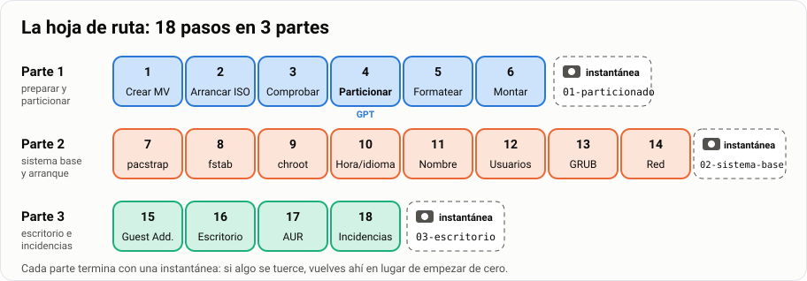
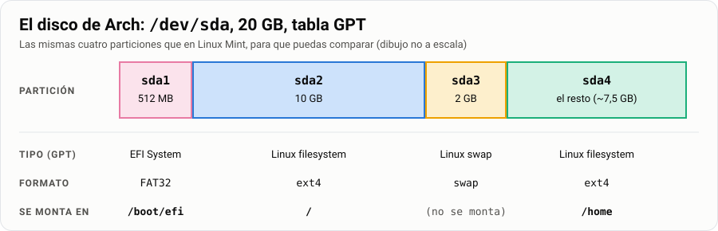
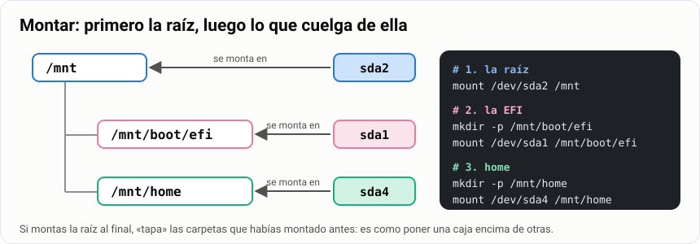
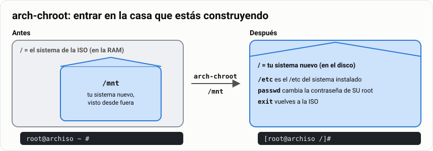
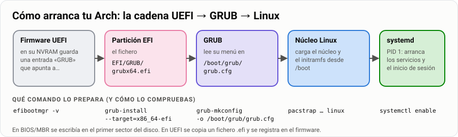

# Instalar Arch Linux desde la consola

> **Antes de empezar.** Necesitas VirtualBox, la ISO de Arch (o tu pincho Ventoy) y haber
> instalado ya [Linux Mint](../../1-basico/02-instalar-mint-virtualbox/1-explicacion.md).

En Mint, un asistente con botones lo hizo todo por ti. Arch no tiene asistente: te da una consola
negra y tú escribes cada paso. Da un poco de vértigo. Pero al terminar sabrás qué hace de verdad
cualquier instalador: partir el disco, formatear, copiar el sistema, poner el arranque y elegir
el escritorio. Y sabrás arreglar un Linux que no arranca.

> **Analogía.** Instalar Mint es pedir un menú del día: llega todo hecho. Instalar Arch es
> cocinar: compras los ingredientes, los preparas en orden y, si te saltas un paso, no sale. Al
> final sabes cocinar. Vamos a volver a esta cocina toda la guía.

| | |
|---|---|
| 🎯 **Qué vas a conseguir** | Un Arch Linux en UEFI + GPT con tu usuario, `sudo`, red y el escritorio que elijas |
| 🧰 **Qué necesitas** | VirtualBox, la ISO de Arch y unos 20 GB libres en el disco |
| ⏱️ **Tiempo** | 15 horas, en tres partes |
| 📦 **Qué entregas** | Tres bitácoras y el manual de instalación ([Parte 5](#parte-5--entrega)) |

**Tu misión, paso a paso:**

- [ ] Crear la MV con **EFI activado** y arrancar la ISO.
- [ ] Partir el disco en **GPT** con cuatro particiones y comprobar que es GPT.
- [ ] Copiar el sistema base, configurarlo desde dentro con `arch-chroot` y poner GRUB.
- [ ] Arrancar tu Arch, entrar con tu usuario, tener red e instalar un escritorio.
- [ ] Saber rescatar el sistema cuando no arranca.

## Índice

- [La hoja de ruta](#la-hoja-de-ruta)
- [Parte 1 · Preparar y particionar](#parte-1--preparar-y-particionar)
  - [1. Crear la máquina virtual](#1-crear-la-máquina-virtual)
  - [2. Arrancar la ISO](#2-arrancar-la-iso)
  - [3. Comprobaciones previas](#3-comprobaciones-previas)
  - [4. Particionado en GPT](#4-particionado-en-gpt)
  - [5. Formateo](#5-formateo)
  - [6. Montaje](#6-montaje)
- [Parte 2 · Sistema base y primer arranque](#parte-2--sistema-base-y-primer-arranque)
  - [7. Instalar el sistema base](#7-instalar-el-sistema-base)
  - [8. fstab](#8-fstab)
  - [9. Entrar en el sistema con chroot](#9-entrar-en-el-sistema-con-chroot)
  - [10. Hora, idioma y teclado](#10-hora-idioma-y-teclado)
  - [11. Nombre del equipo y hosts](#11-nombre-del-equipo-y-hosts)
  - [12. Usuarios y sudo](#12-usuarios-y-sudo)
  - [13. Gestor de arranque GRUB](#13-gestor-de-arranque-grub)
  - [14. Red y primer arranque](#14-red-y-primer-arranque)
- [Parte 3 · Escritorio, AUR e incidencias](#parte-3--escritorio-aur-e-incidencias)
  - [15. Guest Additions](#15-guest-additions)
  - [16. Entorno gráfico: elige el tuyo](#16-entorno-gráfico-elige-el-tuyo)
  - [17. Repositorio AUR](#17-repositorio-aur)
  - [18. Diagnóstico de incidencias](#18-diagnóstico-de-incidencias)
- [Parte 4 · Lo que te llevas](#parte-4--lo-que-te-llevas)
- [Parte 5 · Entrega](#parte-5--entrega)

## La hoja de ruta



Tres partes. Al final de cada una guardas una instantánea: una foto de la MV a la que puedes
volver. Si algo se rompe, restauras la última y no empiezas de cero. La documentación oficial
está en inglés (https://wiki.archlinux.org/title/Installation_guide): aprender a leerla es parte
del trabajo.

> [!TIP]
> **Trabajad en parejas.** Uno teclea y el otro lee la guía y comprueba cada salida. Cambiad a
> mitad de sesión. Quien sólo mira no aprende a instalar.

> [!IMPORTANT]
> **Rellena la bitácora desde el principio.** Al final de cada parte hay un cuadro «📝 Para tu
> bitácora» con lo que tienes que capturar. Si lo dejas para el final, repetirás la instalación.

## Parte 1 · Preparar y particionar

### 1. Crear la máquina virtual

Descarga la ISO de https://archlinux.org/download/ o usa tu
[pincho Ventoy](../07-usb-multiarranque-ventoy/1-guia.md). En VirtualBox pulsa **Nueva** y pon:

- **Nombre**: `Arch-SMR`, tipo Linux, versión Arch Linux (64-bit).
- **Memoria**: 2048 MB (4096 MB para KDE Plasma o GNOME). **Procesadores**: 2.
- **Habilitar EFI**: **sí**. Es la casilla más importante de toda la guía.
- **Disco**: 20 GB, reserva dinámica. **Red**: NAT.
- **Pantalla**: 128 MB de vídeo, controlador VMSVGA, sin aceleración 3D.

**UEFI** es el programa que se enciende antes que nada y busca el sistema en el disco: es el
arranque de los ordenadores actuales y sustituye a la BIOS antigua.

> [!CAUTION]
> **Si no marcas «Habilitar EFI»**, todo irá bien hasta el paso 13 y ahí `grub-install` fallará
> con un error sobre `efivarfs`. **Compruébalo ahora.** Y, como en Mint, desmarca «Unattended
> Installation»: nada de instalación desatendida.

**📌 En una frase:** MV `Arch-SMR` de 20 GB, 2048 MB y **EFI activado**.

### 2. Arrancar la ISO

Arranca la MV y elige la primera opción del menú, *Arch Linux install medium (x86_64, UEFI)*.
Terminas en una consola que pone `root@archiso ~ #`. Lo primero, el teclado:

```bash
loadkeys es        # teclado español, sólo para esta sesión del instalador
setfont ter-132b   # letra más grande, si la ves muy pequeña
```

👀 Ya puedes escribir la `ñ`. Cada vez que arranques la ISO tendrás que repetir `loadkeys es`;
en el paso 10 lo dejarás guardado para siempre.

**📌 En una frase:** `loadkeys es` pone el teclado en español hasta que apagues.

### 3. Comprobaciones previas

Cuatro comprobaciones de un minuto que te ahorran horas después:

```bash
cat /sys/firmware/efi/fw_platform_size   # ¿he arrancado en UEFI?  → debe decir 64
ping -c 3 archlinux.org                  # ¿hay internet?          → tres respuestas
timedatectl set-ntp true                 # hora automática: con la hora mal fallan las firmas
lsblk                                    # ¿qué discos hay?
```

👀 En `lsblk` deberías ver un disco `sda` de 20 GB sin particiones (`sr0` y `loop0` son el CD:
no los toques). Si el primer comando dice «No such file or directory», arrancaste en modo BIOS:
apaga, activa EFI y vuelve a empezar.

**📌 En una frase:** `64`, `ping` responde, hora automática y un `sda` de 20 GB: adelante.

### 4. Particionado en GPT

Vas a partir el disco en cuatro trozos. Antes, el disco necesita un índice que diga dónde empieza
y acaba cada trozo: la **tabla de particiones**. Hay dos tipos:


**MBR** es la antigua, de las BIOS: cuatro particiones y una sola copia del índice. **GPT** es la
actual, la de UEFI: 128 particiones, copia de seguridad al final y cada partición con su tipo.
**Usamos siempre GPT.** Las cuatro particiones son las mismas que hiciste en Linux Mint: la EFI
para el arranque, la raíz para el sistema, la swap de apoyo a la memoria y home para tus cosas.



Se crean con `cfdisk /dev/sda`, que se maneja con las flechas y `Enter`:

1. Te pregunta la etiqueta (el tipo de tabla): elige **`gpt`**. Nunca `dos`.
2. Sobre *Free space*: **New** → `512M` → **Type** → *EFI System*.
3. **New** → `10G` → deja el tipo *Linux filesystem*.
4. **New** → `2G` → **Type** → *Linux swap*.
5. **New** → `Enter` (acepta todo el resto) → tipo *Linux filesystem*.
6. **Write**, escribe `yes`, y **Quit**.

> [!TIP]
> **🧪 Pruébalo: ¿es GPT de verdad?** No te fíes: compruébalo.
>
> ```bash
> fdisk -l /dev/sda                          # busca la línea «Disklabel type»
> lsblk -o NAME,SIZE,PARTTYPENAME /dev/sda   # el tipo de cada partición
> ```
>
> 👀 Deberías ver **`Disklabel type: gpt`** y, debajo, `sda1` *EFI System*, `sda2` *Linux
> filesystem*, `sda3` *Linux swap* y `sda4` *Linux filesystem*.

> [!WARNING]
> **¿Pone `Disklabel type: dos`?** Elegiste `dos`, que es MBR. Aún no hay nada instalado: borra la
> tabla con `wipefs -a /dev/sda` (¡todo el disco!), vuelve a `cfdisk /dev/sda` y elige `gpt`.

**📌 En una frase:** cuatro particiones con `cfdisk`, etiqueta **`gpt`**, y `fdisk -l` lo confirma.

### 5. Formateo

Crear la partición es reservar el sitio. **Formatear** es poner dentro un sistema de archivos: la
forma de ordenar los ficheros que el sistema sabe leer. Uno por partición:

```bash
mkfs.fat -F32 /dev/sda1   # EFI: en FAT32, el único formato que UEFI lee siempre
mkfs.ext4 /dev/sda2       # raíz: ext4, el formato normal de Linux
mkswap /dev/sda3          # swap
mkfs.ext4 /dev/sda4       # home: ext4
swapon /dev/sda3          # enciende la swap
lsblk -f                  # comprueba: la columna FSTYPE
```

👀 Deberías ver `vfat` en sda1, `ext4` en sda2 y sda4, y `swap` en sda3.

**📌 En una frase:** la EFI en FAT32, raíz y home en ext4, y la swap encendida con `swapon`.

### 6. Montaje

Las particiones están listas, pero vacías. Para copiar el sistema dentro hay que **montarlas**:
colgar cada una de una carpeta. Mientras instalas, tu sistema nuevo vive en `/mnt`.



```bash
mount /dev/sda2 /mnt              # 1. la raíz, SIEMPRE la primera
mkdir -p /mnt/boot/efi            # 2. la carpeta para la EFI…
mount /dev/sda1 /mnt/boot/efi     #    …y la EFI dentro
mkdir -p /mnt/home                # 3. la carpeta para home…
mount /dev/sda4 /mnt/home         #    …y home dentro
findmnt /mnt                      # comprueba: la raíz está en /mnt
lsblk                             # comprueba: la última columna dice dónde está cada una
```

👀 `findmnt` enseña `/mnt` en `/dev/sda2`; en `lsblk` ves `/mnt/boot/efi` en sda1 y `/mnt/home`
en sda4. Si montas la raíz al final, tapa lo que ya habías montado: por eso va primero.

**📌 En una frase:** `mount` cuelga cada partición de su carpeta, y la raíz va siempre primero.

**✅ Comprueba antes de seguir:**

- [ ] `fdisk -l /dev/sda` dice `Disklabel type: gpt`.
- [ ] `lsblk -f` muestra `vfat`, `ext4`, `swap` y `ext4`.
- [ ] `findmnt /mnt` muestra la raíz, y `lsblk` enseña `/mnt/boot/efi` y `/mnt/home`.

> [!TIP]
> **📸 Instantánea `01-particionado`.** Apaga con `shutdown now` y crea la instantánea. Al volver
> a arrancar repite `loadkeys es`, `swapon /dev/sda3` y los tres `mount`: los montajes no se
> guardan, el particionado sí.

> **📝 Para tu bitácora (Parte 1).** El esquema de particiones justificado (por qué GPT y por qué
> cada tamaño) y las salidas de `fdisk -l /dev/sda`, `lsblk -f` y `findmnt /mnt`.

**🧠 ¿Lo has pillado?**

1. Tu compañero eligió `dos` en `cfdisk`. ¿Qué tabla tiene su disco? ¿Cómo lo arregla?
2. ¿Qué pasa si montas `/dev/sda4` en `/mnt/home` y **después** `/dev/sda2` en `/mnt`?

<details>
<summary>Ver respuestas</summary>

1. **MBR**. Con `wipefs -a /dev/sda` y otra vez `cfdisk` eligiendo `gpt`. No pierde nada.
2. La raíz **tapa** `/mnt/home`: lo que vaya a `/home` acabará en sda2, no en sda4.

</details>

## Parte 2 · Sistema base y primer arranque

### 7. Instalar el sistema base

`pacstrap` descarga los paquetes básicos y los copia en `/mnt`. Es el «copiando el sistema» que
en Mint hacía la barra de progreso:

```bash
# base linux linux-firmware   → lo mínimo: utilidades, el núcleo y los controladores
# networkmanager              → la red
# grub efibootmgr             → el arranque en UEFI
# sudo nano vim               → administrar y editar ficheros
# base-devel man-db man-pages → compilar (hará falta en AUR) y los manuales
# -K                          → prepara el llavero de claves de pacman
pacstrap -K /mnt base linux linux-firmware networkmanager grub efibootmgr \
  sudo nano vim base-devel man-db man-pages
```

👀 Tarda varios minutos. Al acabar vuelve el prompt sin errores. Si ves «signature is unknown
trust», ejecuta `pacman -Sy archlinux-keyring` y repite.

**📌 En una frase:** `pacstrap` copia en `/mnt` el núcleo, la red, GRUB, `sudo` y los manuales.

### 8. fstab

```bash
genfstab -U /mnt >> /mnt/etc/fstab   # escribe la lista de montajes del sistema nuevo
cat /mnt/etc/fstab                   # léela
```

El **fstab** es la lista de lo que el sistema monta solo en cada arranque. `genfstab` mira lo que
tienes montado ahora y lo apunta; con `-U` usa el número de serie de cada partición (el UUID) en
vez de `sda2`, que puede cambiar si añades otro disco.

👀 Cuatro líneas que empiezan por `UUID=`: `/`, `/boot/efi`, `/home` y la swap. Es el mismo
`/etc/fstab` que abriste en Mint: allí lo escribió el instalador, aquí tú.

**📌 En una frase:** `genfstab` apunta en el fstab qué montar en cada arranque, por UUID.

### 9. Entrar en el sistema con chroot

```bash
arch-chroot /mnt     # a partir de aquí, / es tu sistema nuevo
```



**chroot** cambia cuál es la carpeta raíz para todo lo que escribas a partir de ahora. Hasta ahora
`/` era la ISO; ahora `/` es tu sistema nuevo. Es entrar en la casa que estabas construyendo desde
fuera: lo que toques en `/etc` es el `/etc` del sistema instalado.

👀 El prompt cambia de `root@archiso ~ #` a `[root@archiso /]#`: los corchetes dicen que estás dentro.

**📌 En una frase:** `arch-chroot /mnt` te mete dentro del sistema nuevo; el prompt lo confirma.

### 10. Hora, idioma y teclado

Tres ajustes que en Mint elegiste con el ratón. La hora:

```bash
ln -sf /usr/share/zoneinfo/Europe/Madrid /etc/localtime   # hora de Madrid
hwclock --systohc                                          # guárdala en el reloj de la máquina
```

El idioma: abre `nano /etc/locale.gen`, busca con `Ctrl` + `W` y quita la `#` de las líneas
`en_US.UTF-8 UTF-8` y `es_ES.UTF-8 UTF-8`. Guarda con `Ctrl` + `O`, `Enter`, y sal con `Ctrl` + `X`.

```bash
locale-gen                                   # genera los dos idiomas: una línea «done» por cada uno
echo "LANG=es_ES.UTF-8" > /etc/locale.conf   # el idioma del sistema: español
echo "KEYMAP=es" > /etc/vconsole.conf        # el teclado, ahora sí para siempre
```

**📌 En una frase:** hora de Madrid, `LANG=es_ES.UTF-8` y `KEYMAP=es`; el teclado ya no se olvida.

### 11. Nombre del equipo y hosts

```bash
echo "arch-smr" > /etc/hostname   # el nombre de tu máquina
nano /etc/hosts                   # quién es quién en local: escribe estas tres líneas
```

```text
127.0.0.1   localhost
::1         localhost
127.0.1.1   arch-smr.localdomain   arch-smr
```

> [!WARNING]
> **No lo hagas con tres `echo … > /etc/hosts`.** Con `>` cada línea **borra** la anterior y sólo
> queda la última. Para añadir sin borrar se usa `>>`. Este despiste rompe muchísimos scripts.

**📌 En una frase:** `arch-smr` en `/etc/hostname` y tres líneas en `/etc/hosts`.

### 12. Usuarios y sudo

Primero la contraseña de root, después tu usuario de cada día:

```bash
passwd                                    # contraseña de root
useradd -m -G wheel -s /bin/bash alumno   # -m crea /home/alumno
                                          # -G wheel: el grupo de los administradores en Arch
                                          # -s /bin/bash: su terminal será Bash
passwd alumno                             # su contraseña
groups alumno                             # comprueba: alumno wheel
```

> **Analogía.** Root lleva siempre las llaves maestras del instituto. Tú, como `alumno`, las pides
> en conserjería con `sudo` para un comando concreto y las devuelves. Por eso no se trabaja de root.

Ahora dale permiso al grupo `wheel` para usar `sudo`:

```bash
EDITOR=nano visudo     # abre /etc/sudoers comprobando que no rompes nada
```

Busca la línea `%wheel ALL=(ALL:ALL) ALL` y quítale la `#`. Guarda y sal como en `nano`.

> [!CAUTION]
> **No descomentes la línea `NOPASSWD`**: `sudo` no pediría contraseña nunca. Y siempre `visudo`,
> nunca `nano /etc/sudoers`: un error ahí deja el sistema sin `sudo` para nadie. Lo verás a fondo
> en la [guía de permisos](../09-permisos/1-guia.md).

**📌 En una frase:** root tiene contraseña, `alumno` está en `wheel` y `visudo` le da `sudo`.

### 13. Gestor de arranque GRUB

Tu sistema ya está en el disco, pero UEFI no sabe arrancarlo. **GRUB** es el gestor de arranque:
el menú que sale al encender y carga Linux.



```bash
# --target=x86_64-efi       → la versión UEFI de GRUB, no la de BIOS
# --efi-directory=/boot/efi → dónde está montada la partición EFI
# --bootloader-id=GRUB      → el nombre de la entrada en el menú de UEFI
grub-install --target=x86_64-efi --efi-directory=/boot/efi --bootloader-id=GRUB
grub-mkconfig -o /boot/grub/grub.cfg   # escribe el menú de GRUB
```

En UEFI no se escribe en el primer sector del disco: se copia un fichero `.efi` en la partición
EFI y se apunta en la memoria del firmware. Un tutorial con `grub-install /dev/sda` a secas es de
BIOS y aquí falla.

> [!TIP]
> **🧪 Pruébalo.**
>
> ```bash
> ls /boot/efi/EFI/GRUB/    # el fichero que arranca
> efibootmgr -v             # las entradas de arranque del firmware
> ```
>
> 👀 Deberías ver `grubx64.efi` y una entrada `GRUB` con `HD(1,GPT,…)/\EFI\GRUB\grubx64.efi`:
> partición 1 de un disco GPT. Todo encaja.

**📌 En una frase:** `grub-install` copia `grubx64.efi` a la partición EFI y `grub-mkconfig` escribe el menú.

### 14. Red y primer arranque

Deja la red lista para el próximo arranque, sal y reinicia:

```bash
systemctl enable NetworkManager   # la red arrancará sola al encender
exit                              # salir del chroot: vuelves a la ISO
umount -R /mnt                    # desmontarlo todo
reboot
```

`enable` deja el servicio preparado para el próximo arranque; `start` lo arrancaría ahora, y
dentro del chroot el sistema no está en marcha. **Quita la ISO** de la unidad óptica en cuanto se
apague (Configuración → Almacenamiento), o volverás al instalador.

👀 Deberías ver el menú de GRUB y, después, una consola pidiendo usuario. Entra como `alumno`.

> [!TIP]
> **🧪 Pruébalo: tu Arch ya funciona.**
>
> ```bash
> ping -c 3 archlinux.org    # hay red
> sudo pacman -Syu           # sudo funciona y el sistema se actualiza
> sudo pacman -S fastfetch   # instala…
> fastfetch                  # …y enseña tu Arch con su logo
> ```
>
> 👀 Deberías ver el logo de Arch y, al lado, `OS: Arch Linux`.

**📌 En una frase:** `enable NetworkManager`, `exit`, `umount -R /mnt`, `reboot`, quita la ISO y entra.

**✅ Comprueba antes de seguir:**

- [ ] Sale el menú de GRUB y arranca sin la ISO.
- [ ] Entras como `alumno`, hay red y `sudo` funciona.
- [ ] `fastfetch` muestra tu Arch.

> [!TIP]
> **📸 Instantánea `02-sistema-base`.** El punto más valioso de toda la instalación: desde aquí
> puedes probar escritorios sin reinstalar.

> **📝 Para tu bitácora (Parte 2).** Los comandos con una frase de qué hace cada uno; capturas del
> menú de GRUB, del inicio de sesión y de `fastfetch`; y la salida de `groups alumno`,
> `efibootmgr -v` y `cat /etc/fstab`.

**🧠 ¿Lo has pillado?**

1. ¿Por qué dentro del chroot se usa `systemctl enable` y no `start`?
2. Arrancas y el teclado vuelve a estar en inglés. ¿Qué fichero falta?

<details>
<summary>Ver respuestas</summary>

1. Porque el sistema nuevo **no está en marcha**: sólo puedes dejarlo preparado para el próximo arranque.
2. `/etc/vconsole.conf` con `KEYMAP=es`.

</details>

## Parte 3 · Escritorio, AUR e incidencias

### 15. Guest Additions

En Arch no hace falta el CD de VirtualBox: los controladores están en los repositorios.

```bash
sudo pacman -S virtualbox-guest-utils      # los controladores de VirtualBox
sudo systemctl enable --now vboxservice    # --now = enable + start en un solo comando
sudo gpasswd -a alumno vboxsf              # para las carpetas compartidas
```

👀 Cierra sesión y vuelve a entrar: `groups` debería mostrar `vboxsf` al final.

**📌 En una frase:** `virtualbox-guest-utils` y `vboxservice` activado: la pantalla se ajustará a la ventana.

### 16. Entorno gráfico: elige el tuyo

Arch no trae escritorio: lo eliges tú. Pero un escritorio no es un programa, es una tarta de capas:


Abajo, el servidor gráfico (Xorg, el clásico, o Wayland, el moderno) dibuja en pantalla. En medio,
el **gestor de inicio de sesión**: la pantalla de usuario y contraseña (LightDM, SDDM o GDM). Es
un servicio: si no lo activas con `systemctl enable`, al reiniciar verás la consola de texto.
Arriba, el entorno de escritorio: panel, menú, ventanas y ajustes. Elige el tuyo:


**La recomendada es XFCE**: ligera, estable y la del
[taller de personalización](../../3-avanzado/12-taller-personalizar-linux/1-guia.md). Se instala
así, y las demás igual: `pacman -S` con sus paquetes y `systemctl enable --now` con su gestor:

```bash
sudo pacman -S xorg-server xfce4 xfce4-goodies lightdm lightdm-gtk-greeter network-manager-applet
sudo systemctl enable --now lightdm
```

| Escritorio | Se parece a… | RAM | Paquetes (`sudo pacman -S …`) | Activar (`sudo systemctl enable --now …`) |
|---|---|---|---|---|
| ⭐ **XFCE** | Windows clásico | 2 GB | `xorg-server xfce4 xfce4-goodies lightdm lightdm-gtk-greeter network-manager-applet` | `lightdm` |
| **KDE Plasma** | Windows 10/11; se configura todo | 4 GB | `plasma-meta konsole dolphin kate sddm` | `sddm` |
| **GNOME** | macOS o una tableta: pulsas `Super` y escribes | 4 GB | `gnome gnome-tweaks` | `gdm` |
| **Cinnamon** | Linux Mint | 3 GB | `xorg-server cinnamon lightdm lightdm-gtk-greeter gnome-terminal` | `lightdm` |
| **MATE** | Linux clásico, dos paneles | 2 GB | `xorg-server mate mate-extra lightdm lightdm-gtk-greeter` | `lightdm` |
| **LXQt** | Windows, en ligero | 2 GB | `xorg-server lxqt breeze-icons sddm` | `sddm` |
| **i3** *(ampliación)* | Nada: ventanas en mosaico, todo con teclado | 2 GB | `xorg-server i3-wm i3status i3lock dmenu xterm lightdm lightdm-gtk-greeter` | `lightdm` |

> [!TIP]
> **Antes de instalar.** Si eliges KDE Plasma, GNOME o Cinnamon, apaga la MV y sube la memoria a
> 4096 MB (**Configuración → Sistema**). Y si `pacman` pregunta «Enter a selection (default=all)»
> o «There are N providers available», pulsa `Enter`.

Con **i3** la primera vez elige **Win** como tecla modificadora: `Super` + `Enter` abre un
terminal, `Super` + `D` el lanzador y `Super` + `Mayús` + `Q` cierra. Engancha: hazlo después de
entregar.

**Después de cualquier opción**, un navegador y fuentes para que se vea todo (también emojis):

```bash
sudo pacman -S firefox noto-fonts noto-fonts-emoji
```

👀 Al reiniciar deberías ver la pantalla de inicio de sesión gráfica, y el escritorio se ajusta
al tamaño de la ventana. Si no se ajusta, mira `systemctl status vboxservice`.

**¿Y si quiero probar varios?** Puedes instalar varios escritorios, pero con **un solo gestor de
inicio de sesión activo**: en su pantalla eliges con cuál entrar. Para cambiar de gestor,
`sudo systemctl disable lightdm` y después `sudo systemctl enable sddm`; si ves
«display-manager.service already exists», el viejo sigue activo. Lo más limpio: restaura la
instantánea `02-sistema-base` e instala el otro.

**📌 En una frase:** instala el escritorio y activa su gestor de inicio de sesión con `systemctl enable --now`, uno solo.

### 17. Repositorio AUR

**AUR** es el repositorio de la comunidad de Arch: miles de programas que no están en los
oficiales. `pacman` no lo lee; hace falta un ayudante. Instalamos `paru`:

```bash
sudo pacman -S --needed base-devel git             # lo necesario para compilar
mkdir -p ~/repos && cd ~/repos
git clone https://aur.archlinux.org/paru-bin.git   # descarga la receta de paru
cd paru-bin
makepkg -si                                        # compila e instala. NUNCA con sudo: falla a propósito
paru -Ss cowsay                                    # comprueba: busca en los oficiales y en AUR
```

👀 Deberías ver resultados de los dos sitios: líneas `extra/…` y líneas `aur/…`. Compilar código
bajado de internet como administrador es mala idea: por eso `makepkg` se niega con `sudo`.

**📌 En una frase:** AUR son los programas de la comunidad; `paru` los instala, y `makepkg` nunca con `sudo`.

### 18. Diagnóstico de incidencias

Es la parte que más se parece al trabajo real. Cuando algo falla, primero mira los registros:

```bash
journalctl -b -p err        # los errores de este arranque
systemctl status lightdm    # el estado de un servicio (cambia lightdm por tu gestor)
journalctl -u lightdm -b    # el registro de ese servicio en este arranque
```

**Si no arranca, rescátalo.** Arranca desde la ISO, monta tu sistema y entra con `chroot`:

```bash
loadkeys es
mount /dev/sda2 /mnt             # la raíz primero
mount /dev/sda1 /mnt/boot/efi
mount /dev/sda4 /mnt/home
arch-chroot /mnt
# … arregla lo que sea (por ejemplo, repite el paso 13) …
exit
umount -R /mnt
reboot
```

> [!IMPORTANT]
> **Guarda estos comandos.** En clase el profesor va a **romper una máquina a propósito** y
> tendrás que recuperarla. El chroot de rescate separa «hay que reinstalar» de «lo arreglo en
> cinco minutos».

**Los seis errores más frecuentes** (síntoma → causa → arreglo):

- `grub-install` habla de `efivarfs` → la MV no tiene EFI → apaga, activa EFI y repite el paso 13.
- `fdisk -l` dice `Disklabel type: dos` → elegiste `dos` → `wipefs -a /dev/sda` y particiona en `gpt`.
- Al reiniciar vuelve el instalador → la ISO sigue puesta → quítala en Almacenamiento.
- «error: no such partition» al arrancar → faltó `grub-mkconfig`, o se hizo fuera del chroot →
  rescate y repite el paso 13.
- No hay red tras reiniciar → falta `systemctl enable NetworkManager` → actívalo y reinicia.
- Tras instalar el escritorio sale la consola → gestor de sesión sin activar →
  `sudo systemctl enable --now lightdm` (o `sddm`, o `gdm`).

**📌 En una frase:** `journalctl -b -p err` para ver qué falla y el chroot desde la ISO para arreglarlo.

**✅ Comprueba antes de terminar:**

- [ ] Al encender sale la pantalla de inicio de sesión gráfica.
- [ ] Entras en tu escritorio y la ventana se ajusta al tamaño de la MV.
- [ ] `paru -Ss cowsay` funciona.

> [!TIP]
> **📸 Instantánea `03-escritorio`.** Es la base del [taller de personalización](../../3-avanzado/12-taller-personalizar-linux/1-guia.md).

> **📝 Para tu bitácora (Parte 3).** La ficha de incidencias: para cada problema, síntoma, causa,
> solución aplicada y comprobación de que se resolvió. Y una captura de tu escritorio con una
> frase de por qué lo elegiste.

**🧠 ¿Lo has pillado?**

1. Has instalado XFCE, pero al reiniciar sale la consola de texto. ¿Qué te falta?
2. ¿Puedes tener XFCE y KDE Plasma instalados a la vez?

<details>
<summary>Ver respuestas</summary>

1. Activar el gestor de inicio de sesión: `sudo systemctl enable --now lightdm`.
2. **Sí**, con un único gestor de sesión activo; eliges el escritorio en su pantalla.

</details>

## Parte 4 · Lo que te llevas

**🎒 Si sólo te quedas con diez cosas:**

1. **UEFI** es el arranque de los ordenadores actuales y va con **GPT**, la tabla de particiones
   moderna. En VirtualBox: **Habilitar EFI**.
2. Cuatro particiones: EFI (512 MB, FAT32), raíz (10 GB, ext4), swap (2 GB) y home (el resto, ext4).
3. `cfdisk` con etiqueta **`gpt`**, nunca `dos`. Se comprueba con `fdisk -l`: `Disklabel type: gpt`.
4. **Formatear** es poner un sistema de archivos; **montar** es colgar la partición de una carpeta.
   La raíz se monta **primero**.
5. `pacstrap` copia el sistema en `/mnt`; `genfstab` escribe el **fstab**, la lista de montajes.
6. `arch-chroot /mnt` te mete dentro del sistema nuevo: `/` deja de ser la ISO.
7. `useradd -m -G wheel` crea tu usuario; `visudo` da `sudo` al grupo `wheel`. Nunca `NOPASSWD`.
8. **GRUB** en UEFI es un fichero `.efi` en la partición EFI: `grub-install` lo copia y
   `grub-mkconfig` escribe el menú.
9. Un escritorio son capas; el **gestor de inicio de sesión** es un servicio que hay que activar,
   y sólo uno.
10. Si no arranca: ISO, `mount`, `arch-chroot /mnt` y arreglar. `journalctl -b -p err` dice qué falla.

**Chuleta de toda la instalación** (es la de la prueba práctica):

| Fase | Comandos |
|---|---|
| Preparación | `loadkeys es` · `cat /sys/firmware/efi/fw_platform_size` · `timedatectl set-ntp true` · `lsblk` · `ping -c3 archlinux.org` |
| Particionado | `cfdisk /dev/sda` (etiqueta **`gpt`**) |
| Comprobar GPT | `fdisk -l /dev/sda` (`Disklabel type: gpt`) · `lsblk -o NAME,SIZE,PARTTYPENAME` |
| Formateo | `mkfs.fat -F32 /dev/sda1` · `mkfs.ext4 /dev/sda2` · `mkswap /dev/sda3` · `swapon /dev/sda3` · `mkfs.ext4 /dev/sda4` |
| Montaje | `mount /dev/sda2 /mnt` · `mkdir -p /mnt/boot/efi` · `mount /dev/sda1 /mnt/boot/efi` · `mkdir -p /mnt/home` · `mount /dev/sda4 /mnt/home` |
| Base | `pacstrap -K /mnt base linux linux-firmware networkmanager grub efibootmgr sudo nano vim base-devel man-db man-pages` |
| fstab | `genfstab -U /mnt >> /mnt/etc/fstab` |
| chroot | `arch-chroot /mnt` |
| Hora | `ln -sf /usr/share/zoneinfo/Europe/Madrid /etc/localtime` · `hwclock --systohc` |
| Idioma | `nano /etc/locale.gen` · `locale-gen` · `echo "LANG=es_ES.UTF-8" > /etc/locale.conf` |
| Teclado | `echo "KEYMAP=es" > /etc/vconsole.conf` |
| Equipo | `echo "arch-smr" > /etc/hostname` · `nano /etc/hosts` |
| Usuarios | `passwd` · `useradd -m -G wheel -s /bin/bash alumno` · `passwd alumno` · `EDITOR=nano visudo` |
| Arranque | `grub-install --target=x86_64-efi --efi-directory=/boot/efi --bootloader-id=GRUB` · `grub-mkconfig -o /boot/grub/grub.cfg` |
| Servicios | `systemctl enable NetworkManager` |
| Salir | `exit` · `umount -R /mnt` · `reboot` |

Los escritorios, con sus paquetes y su gestor, están en la tabla del
[paso 16](#16-entorno-gráfico-elige-el-tuyo).

**Rescate**

```bash
loadkeys es
mount /dev/sda2 /mnt && mount /dev/sda1 /mnt/boot/efi && mount /dev/sda4 /mnt/home
arch-chroot /mnt
```

## Parte 5 · Entrega

**Parte 1 · Bitácora de instalación: preparación y particionado**
Esquema de particionado justificado (por qué GPT y por qué cada tamaño) + salida de
`fdisk -l /dev/sda`, `lsblk -f` y `findmnt /mnt`.
*Evaluación: observación del proceso y lista de cotejo del particionado.*

**Parte 2 · Bitácora de instalación: sistema base y arranque**
Comandos ejecutados con una frase explicando qué hace cada uno + capturas del menú de GRUB, del
inicio de sesión y de `fastfetch`. Salida de `groups alumno`, `efibootmgr -v` y `cat /etc/fstab`.
*Evaluación: lista de cotejo del arranque correcto y del usuario creado.*

**Parte 3 · Ficha de incidencias**
Para cada problema: síntoma, causa, solución aplicada y comprobación de que se resolvió. Incluye
una captura de tu escritorio y por qué lo elegiste.
*Evaluación: rúbrica de resolución de problemas.*

**Al terminar · Manual de instalación de Arch Linux (entregable principal del bloque, CM1)**
Reúne las tres bitácoras en un manual **reproducible**. Después, otro equipo va a instalar Arch
siguiendo tu manual **sin poder preguntarte nada**, y anotará todo lo que falte o esté ambiguo.
Escríbelo pensando en eso.

> [!TIP]
> **Trabajo en parejas (parte 2).** Roles alternos: uno teclea (*operador*) y el otro lee la guía y
> verifica (*verificador*). Se cambia a mitad de sesión.

**✅ Antes de entregar, comprueba:**

- [ ] La salida de `fdisk -l` dice `gpt` y explicas por qué GPT y no MBR.
- [ ] Cada comando de la bitácora tiene su frase de explicación.
- [ ] Están las capturas de GRUB, del inicio de sesión, de `fastfetch` y del escritorio.
- [ ] La ficha de incidencias tiene síntoma, causa, solución y comprobación.
- [ ] Alguien que no te conoce podría seguir tu manual sin preguntarte.
