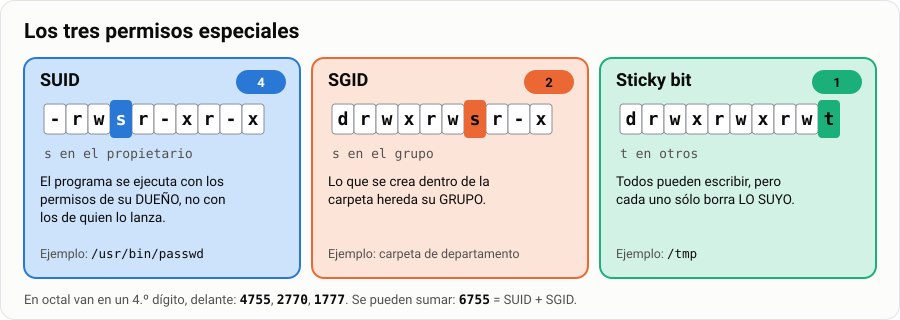
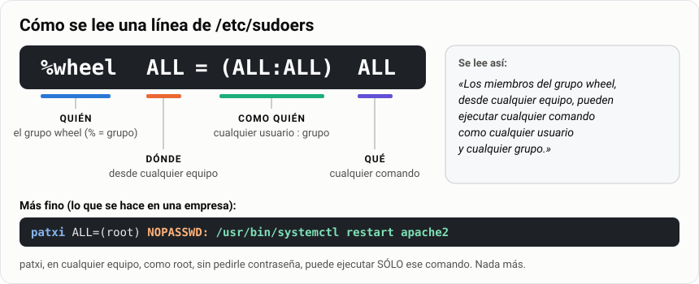

# Permisos en Linux: notación octal y simbólica. Root y sudo

> **Antes de empezar.** Si ya has aplicado permisos NTFS en Windows, aquí aplicas **la misma
> matriz de permisos** sobre la máquina de Linux. Al final tienes que poder explicar en qué se
> parecen los dos modelos y en qué no.

¿Por qué puedes leer `/etc/passwd` pero no `/etc/shadow`? ¿Por qué tu compañero no puede entrar
en tu carpeta personal? ¿Por qué `sudo` te pide **tu** contraseña y no la de root? Todo eso son
**permisos**, y en esta guía vas a aprender a leerlos, cambiarlos y diseñarlos para una empresa.

> **Analogía.** Los permisos de Linux son como las llaves de un edificio de oficinas: hay una llave
> para el titular del despacho, otra para el equipo que trabaja allí y otra para el resto del
> edificio. Cada llave puede abrir para **leer**, para **escribir** o para **entrar**. Windows, en
> cambio, usa una lista en recepción: «esta persona sí, esta no, esta sólo por la mañana». El
> modelo de Linux es más rígido, pero mucho más rápido de leer de un vistazo.

| | |
|---|---|
| 🎯 **Qué vas a aprender** | Leer y cambiar permisos en notación simbólica y octal, usar SUID, SGID, sticky, ACL y `sudo` |
| 🧰 **Qué necesitas** | Tu MV de Linux y una sesión con permiso de `sudo` |
| ⏱️ **Tiempo** | 5 horas |
| 📦 **Qué entregas** | La tarea «Matriz de permisos Linux + configuración de sudo documentada» ([Parte 4](#parte-4--entrega)) |

**Tu misión, paso a paso:**

- [ ] Leer de un vistazo cualquier línea de `ls -l`.
- [ ] Cambiar permisos con `chmod` en simbólico y en octal, y pasar de una notación a otra.
- [ ] Entender por qué los permisos de una carpeta no significan lo mismo que los de un fichero.
- [ ] Usar SGID, sticky bit y ACL para montar las carpetas de una empresa.
- [ ] Dar permisos de administrador «a medida» con `sudo`.

## Índice

- [Permisos en Linux: notación octal y simbólica. Root y sudo](#permisos-en-linux-notación-octal-y-simbólica-root-y-sudo)
  - [Índice](#índice)
  - [Parte 1 · Aprende](#parte-1--aprende)
    - [1. Ver los permisos](#1-ver-los-permisos)
    - [2. Las tres categorías](#2-las-tres-categorías)
    - [3. Notación simbólica: `chmod`](#3-notación-simbólica-chmod)
    - [4. Notación octal](#4-notación-octal)
    - [5. Los permisos en directorios no significan lo mismo](#5-los-permisos-en-directorios-no-significan-lo-mismo)
    - [6. Propietario y grupo: `chown` y `chgrp`](#6-propietario-y-grupo-chown-y-chgrp)
    - [7. `umask`: los permisos por defecto](#7-umask-los-permisos-por-defecto)
    - [8. Permisos especiales: SUID, SGID y sticky bit](#8-permisos-especiales-suid-sgid-y-sticky-bit)
    - [9. Listas de control de acceso (ACL)](#9-listas-de-control-de-acceso-acl)
    - [10. Atributos extendidos: `lsattr` y `chattr`](#10-atributos-extendidos-lsattr-y-chattr)
    - [11. Root, `su` y `sudo`](#11-root-su-y-sudo)
    - [12. Comparación con NTFS](#12-comparación-con-ntfs)
  - [Parte 2 · Chuleta](#parte-2--chuleta)
  - [Parte 3 · Practica](#parte-3--practica)
  - [Parte 4 · Entrega](#parte-4--entrega)

---

## Parte 1 · Aprende

### 1. Ver los permisos

```bash
ls -l          # permisos de los ficheros del directorio
ls -la         # incluye los ocultos (los que empiezan por punto)
ls -ld carpeta # permisos DE la carpeta, no de lo que tiene dentro
```

Así se ve en un terminal real:


Y así se lee cada línea:


Los tres permisos básicos:

| Letra | Nombre | En un fichero | En un directorio |
|---|---|---|---|
| `r` | *read* | Leer su contenido | Listar los nombres que contiene |
| `w` | *write* | Modificar su contenido | Crear, borrar y renombrar dentro |
| `x` | *execute* | Ejecutarlo como programa | **Entrar** en él (`cd`) y atravesarlo |

> [!TIP]
> **Pruébalo.** Mira los permisos de tu carpeta personal y de dos ficheros del sistema que ya
> conoces:
>
> ```bash
> ls -ld ~
> ls -l /etc/passwd /etc/shadow
> ```
>
> ¿Quién puede leer cada uno? ¿Por qué tiene sentido que sean distintos?

**🧠 ¿Lo has pillado?** Mira esta línea:

```text
drwxr-x---  2  ana  ventas  4096  9 sep 10:24  informes
```

1. ¿Es un fichero o una carpeta? ¿Quién es su dueño?
2. ¿Qué puede hacer un usuario del grupo `ventas`?
3. ¿Y uno que no es `ana` ni está en `ventas`?

<details>
<summary>Ver respuestas</summary>

1. Una **carpeta** (empieza por `d`). Su dueña es **ana**.
2. `r-x`: ver la lista de ficheros y entrar, pero **no** crear ni borrar nada dentro.
3. `---`: **nada**, ni siquiera entrar.

</details>

### 2. Las tres categorías

| Categoría | Letra | Quién es |
|---|---|---|
| Propietario | `u` (*user*) | El dueño del fichero (por defecto, quien lo creó) |
| Grupo | `g` (*group*) | Los miembros del grupo al que pertenece el fichero |
| Otros | `o` (*other*) | Todos los demás |
| Todos | `a` (*all*) | Los tres anteriores a la vez |

¿Y si eres el dueño **y** además estás en el grupo? Linux no suma permisos: busca **la primera
categoría que encaja** y se queda con esa.


> [!WARNING]
> **Sólo se aplica una categoría, y se comprueban en ese orden.** Si eres el propietario, se te
> aplican los permisos de propietario **y punto**: no se miran los del grupo aunque sean más
> permisivos. Por eso un fichero con permisos `r--rwxrwx` del que **tú eres propietario** no lo
> puedes escribir, aunque tu grupo sí pueda. Esto sorprende a todo el mundo la primera vez (y es
> el [ejercicio 4](#ejercicio-4)).

**🧠 ¿Lo has pillado?** Un fichero tiene permisos `---rwxrwx`. Su dueña es `ana` y su grupo
`ventas`. `ana` también está en `ventas`. ¿Puede `ana` leerlo?

<details>
<summary>Ver respuesta</summary>

**No.** Es la propietaria, así que se le aplican los permisos de propietario (`---`) y no se mira
nada más. Eso sí: como es la dueña, **puede cambiar los permisos** con `chmod` y darse lectura.

</details>

### 3. Notación simbólica: `chmod`

La notación simbólica es como una frase: **a quién** + **qué hago** + **qué permiso**.

```bash
chmod [quién][operador][permisos] fichero
```

| Quién | | Operador | | Permisos |
|---|---|---|---|---|
| `u` propietario | | `+` añade | | `r` lectura |
| `g` grupo | | `-` quita | | `w` escritura |
| `o` otros | | `=` deja exactamente eso | | `x` ejecución |
| `a` todos | | | | |

Ejemplos, leídos en voz alta:

```bash
chmod u+x prueba.txt      # al propietario, añade ejecución
chmod go+wx prueba.txt    # a grupo y otros, añade escritura y ejecución
chmod o-r prueba.txt      # a otros, quita lectura
chmod a+r prueba.txt      # a todos, añade lectura
chmod g=rx prueba.txt     # al grupo, deja exactamente r y x (quita la w si la tenía)
chmod u+x,g-w,o= fich     # varias órdenes a la vez, separadas por comas (o= quita todo a otros)
chmod -R g+w carpeta/     # recursivo: la carpeta y todo lo que tiene dentro
```

> [!CAUTION]
> **Cuidado con `-R`.** `chmod -R 777 carpeta` es el «arreglo» que se encuentra en internet para
> cualquier problema de permisos. También es la forma más rápida de dejar un servidor abierto de
> par en par. En esta asignatura, un `777` sin justificación en el entregable **resta nota**.

### 4. Notación octal

En octal, cada permiso es un **interruptor** con un valor. Se suman los encendidos de cada grupo:


| Permiso | Valor |
|---|---|
| `r` (lectura) | **4** |
| `w` (escritura) | **2** |
| `x` (ejecución) | **1** |

Con esos tres números salen todas las combinaciones posibles:

| Octal | Suma | Simbólico | Significado |
|---|---|---|---|
| 0 | 0 | `---` | ningún permiso |
| 1 | 1 | `--x` | ejecución |
| 2 | 2 | `-w-` | escritura |
| 3 | 2+1 | `-wx` | escritura y ejecución |
| 4 | 4 | `r--` | lectura |
| 5 | 4+1 | `r-x` | lectura y ejecución |
| 6 | 4+2 | `rw-` | lectura y escritura |
| 7 | 4+2+1 | `rwx` | todos |

Se escriben **tres dígitos**: propietario, grupo, otros.

```bash
chmod 000 prueba.txt   # ---------  nadie puede nada
chmod 644 prueba.txt   # rw-r--r--  el típico de un documento
chmod 755 prueba.txt   # rwxr-xr-x  el típico de un programa o una carpeta
chmod 700 privado/     # rwx------  sólo yo
chmod 777 prueba.txt   # rwxrwxrwx  todos todo (casi nunca es lo correcto)
```

> [!TIP]
> **De simbólico a octal:** parte en grupos de tres y suma.
>
> ```text
> rwxr-xr--
> rwx = 4+2+1 = 7
> r-x = 4+0+1 = 5
> r-- = 4+0+0 = 4
>         → 754
> ```
>
> **De octal a simbólico:** descompón cada cifra en 4, 2 y 1. Por ejemplo, 6 = 4 + 2 → `rw-`;
> 5 = 4 + 1 → `r-x`; 3 = 2 + 1 → `-wx`.

**🧠 ¿Lo has pillado?**

1. ¿Cómo se escribe `640` en simbólico?
2. ¿Y `r-xr-x---` en octal?
3. Un fichero con contraseñas que sólo debe leer y modificar su dueño, ¿qué permisos lleva?

<details>
<summary>Ver respuestas</summary>

1. 6 = `rw-`, 4 = `r--`, 0 = `---` → **`rw-r-----`**.
2. `r-x` = 5, `r-x` = 5, `---` = 0 → **550**.
3. **600** (`rw-------`).

</details>

### 5. Los permisos en directorios no significan lo mismo

Es lo que más se pregunta en el examen porque es lo menos intuitivo. Piensa en un directorio como
en una **habitación**:


| Quiero… | Necesito en el directorio |
|---|---|
| Ver los nombres de los ficheros (`ls`) | `r` |
| Entrar (`cd`) o abrir un fichero de dentro | `x` |
| Crear, borrar o renombrar dentro | `w` **y** `x` |
| Ver los detalles (`ls -l`) | `r` **y** `x` |

Consecuencias que vas a comprobar en el [ejercicio 8](#ejercicio-8):

- Un directorio con `r--`: puedes hacer `ls` y ver los nombres, pero no puedes entrar ni leer
  ningún fichero de dentro. Ves los nombres por la ventana y nada más.
- Un directorio con `--x`: no puedes listar, pero **sí** puedes abrir un fichero de dentro si
  sabes su nombre exacto. Es la base de las carpetas «ocultas por oscuridad».

> [!IMPORTANT]
> **Para borrar un fichero no necesitas permiso sobre el fichero, sino sobre la carpeta que lo
> contiene.** Puedes borrar un fichero de otro usuario, que ni siquiera puedes leer, si tienes `w`
> y `x` en la carpeta. Es el motivo de que exista el *sticky bit* (apartado 8).

**🧠 ¿Lo has pillado?** Quieres que los demás usuarios puedan **abrir** los ficheros de tu carpeta
`~/apuntes` si saben su nombre, pero **no ver la lista** de lo que hay. ¿Qué permisos les das a
«otros» en la carpeta?

<details>
<summary>Ver respuesta</summary>

**`--x`** (sólo la puerta, sin ventana). Por ejemplo, `chmod 711 ~/apuntes`. Además, cada fichero
tiene que tener `r` para otros, o podrán entrar pero no leerlo.

</details>

### 6. Propietario y grupo: `chown` y `chgrp`

```bash
sudo chown alumno informe.txt              # cambiar el propietario
sudo chgrp profesores informe.txt          # cambiar el grupo
sudo chown alumno:profesores informe.txt   # los dos de una vez
sudo chown -R alumno:profesores carpeta/   # recursivo
```

> [!NOTE]
> **Sólo root puede regalar un fichero a otro usuario.** Si no fuera así, cualquiera podría poner
> un fichero enorme a nombre de otro y saltarse las cuotas de disco.

### 7. `umask`: los permisos por defecto

Cuando creas un fichero, ¿de dónde salen sus permisos? De la `umask`: una máscara que **tapa**
permisos del valor máximo, como cinta adhesiva sobre los interruptores.


```bash
umask          # ver la actual (normalmente 0022 o 0002)
umask -S       # verla en simbólico
```

| Elemento | Valor de partida | umask | Resultado |
|---|---|---|---|
| Ficheros | 666 (`rw-rw-rw-`) | 022 | **644** (`rw-r--r--`) |
| Directorios | 777 (`rwxrwxrwx`) | 022 | **755** (`rwxr-xr-x`) |

> [!NOTE]
> **¿Por qué los ficheros parten de 666 y no de 777?** A propósito: un fichero recién creado no
> debería ser ejecutable nunca. Si lo fuera por defecto, cualquier cosa que descargaras se podría
> ejecutar.

> [!TIP]
> **No es una resta de números, es tapar bits.** Con 022 sale lo mismo que restando, pero con
> `umask 033` un fichero queda en 644, no en 633: no se puede tapar una `x` que el fichero no
> tenía.

Cámbiala para la sesión actual y compruébalo:

```bash
umask 077
touch secreto.txt
ls -l secreto.txt     # -rw------- : sólo tú
```

Para que sea permanente va en `~/.bashrc` o en `/etc/profile`, el mismo mecanismo de la
[guía de personalización del terminal](../../3-avanzado/11-terminal-zsh-p10k/1-explicacion.md).

### 8. Permisos especiales: SUID, SGID y sticky bit

Además de `rwx`, hay tres permisos especiales. Ocupan el sitio de una `x` en `ls -l`:



#### 8.1 Sticky bit (`t`)

En un directorio con sticky bit, **cada uno sólo puede borrar lo suyo**, aunque todos tengan
permiso de escritura sobre la carpeta.

```bash
chmod +t /tmp/compartida
chmod 1777 /tmp/compartida     # equivalente en octal
ls -ld /tmp/compartida         # drwxrwxrwt
```

> **Ejemplo.** El caso real es `/tmp`: todo el mundo escribe ahí, pero nadie puede borrar los
> ficheros de otro. Compruébalo: `ls -ld /tmp`.

#### 8.2 SGID (`s` en el grupo)

En un **directorio**, hace que todo lo que se cree dentro herede el grupo del directorio en lugar
del grupo de quien lo crea.


```bash
sudo chgrp ventas /datos/ventas
sudo chmod g+s /datos/ventas
sudo chmod 2770 /datos/ventas   # equivalente en octal
```

> [!IMPORTANT]
> **Éste es el permiso que hace que funcione una carpeta departamental compartida.** Sin SGID,
> cada fichero que cree un usuario llevará su grupo personal y sus compañeros no podrán tocarlo.
> Es la pieza que se te pide en la [práctica](#práctica) y en el reto final.

En un fichero ejecutable, SGID hace que se ejecute con los permisos del **grupo** propietario.

#### 8.3 SUID (`s` en el propietario)

En un ejecutable, hace que se ejecute con los permisos del **propietario del fichero**, no del
usuario que lo lanza.

```bash
chmod u+s programa
chmod 4755 programa
```

El ejemplo real es `passwd`:

```bash
ls -l /usr/bin/passwd     # -rwsr-xr-x ... root root
```

Un usuario normal necesita escribir en `/etc/shadow` para cambiar su contraseña, y ese fichero
sólo lo puede tocar root. `passwd` es propiedad de root y tiene SUID, así que durante ese instante
se ejecuta con permisos de root.

> [!CAUTION]
> **SUID sobre un script no funciona** en Linux, por seguridad: el núcleo lo ignora. Y SUID sobre
> un binario propio es un agujero clásico: si el programa permite ejecutar cualquier cosa, has
> creado una escalada de privilegios. No pongas SUID sin saber muy bien qué estás haciendo.

> **Ejemplo.** Compruébalo tú: crea `pruebasuid.sh` **como root** con este contenido…
>
> ```bash
> #!/bin/bash
> echo "Usuario real:"
> id -un
> echo "UID efectivo:"
> echo $EUID
> ```
>
> …dale SUID con `sudo chmod 4755 pruebasuid.sh` y ejecútalo con tu usuario. Verás la `s` en
> `ls -l`, pero el UID efectivo seguirá siendo **el tuyo** (1000), no el de root (0): el núcleo ha
> ignorado el SUID.

#### 8.4 Cómo se escriben en octal

Se añade **un cuarto dígito por delante**:

| Bit | Valor |
|---|---|
| SUID | **4** |
| SGID | **2** |
| Sticky | **1** |

```bash
chmod 4755 fichero    # SUID   → rwsr-xr-x
chmod 2775 carpeta    # SGID   → rwxrwsr-x
chmod 1777 carpeta    # sticky → rwxrwxrwt
chmod 6755 fichero    # SUID + SGID (4+2)
```

#### 8.5 Mayúscula o minúscula: el detalle que decide el examen

| Se ve | Significa |
|---|---|
| `s` minúscula | El bit especial **y** el permiso de ejecución están puestos |
| `S` mayúscula | El bit especial está puesto pero **falta** la ejecución |
| `t` minúscula | Sticky **y** ejecución en «otros» |
| `T` mayúscula | Sticky pero **sin** ejecución en «otros» |

> [!TIP]
> **Método en dos pasos.** 1) Cuenta los permisos normales: una `s` o `t` **minúscula** cuenta
> como `x` (vale 1); una **mayúscula**, como `-` (vale 0). 2) Después añade delante el cuarto
> dígito sumando los bits especiales que veas.

Ejemplos resueltos:

| Simbólico | Paso 1: base | Paso 2: especial | Resultado |
|---|---|---|---|
| `r-srwx---` | `r-s`=5 · `rwx`=7 · `---`=0 → **570** | SUID = 4 | **4570** |
| `r--rws---` | `r--`=4 · `rws`=7 · `---`=0 → **470** | SGID = 2 | **2470** |
| `r--rwx--t` | `r--`=4 · `rwx`=7 · `--t`=1 → **471** | sticky = 1 | **1471** |
| `r--rwx--T` | `r--`=4 · `rwx`=7 · `--T`=0 → **470** | sticky = 1 | **1470** |
| `r--rws--T` | `r--`=4 · `rws`=7 · `--T`=0 → **470** | SGID + sticky = 3 | **3470** |

### 9. Listas de control de acceso (ACL)

El modelo de tres categorías se queda corto cuando necesitas dar acceso a **una persona concreta**
que no es la propietaria ni está en el grupo. Para eso están las ACL, que es lo más parecido a lo
que hace NTFS.

```bash
getfacl informe.txt                          # ver las ACL
setfacl -m u:patxi:rw informe.txt            # dar rw a un usuario concreto
setfacl -m g:direccion:r informe.txt         # dar r a un grupo concreto
setfacl -x u:patxi informe.txt               # quitar esa entrada
setfacl -b informe.txt                       # quitar todas las ACL
setfacl -d -m g:ventas:rwx /datos/ventas     # ACL por defecto: la heredan los ficheros nuevos
```

Cuando un fichero tiene ACL, `ls -l` muestra un **`+`** al final de los permisos:

```text
-rw-rw----+ 1 alumno ventas 0 9 sep 10:30 informe.txt
```

> **Analogía.** Los permisos normales son las tres llaves del despacho. Una ACL es **una llave
> extra con nombre propio** que le das a una persona concreta: «la de Patxi».

> [!NOTE]
> **`setfacl -d` es la herencia de Linux.** Es el equivalente a la herencia de permisos de NTFS, y
> la comparación entre ambas es parte del entregable.

### 10. Atributos extendidos: `lsattr` y `chattr`

Los atributos son una capa **por encima** de los permisos, propia del sistema de archivos (ext4).
Un fichero puede tener `rwx` para todos y aun así ser intocable.

```bash
lsattr fichero          # ver atributos
sudo chattr +i fichero  # poner el atributo i
sudo chattr -i fichero  # quitarlo
```

| Atributo | Qué hace |
|---|---|
| `i` (*immutable*) | No se puede modificar, borrar ni renombrar. **Ni siquiera root**, hasta que se quita el atributo |
| `a` (*append only*) | Sólo se puede añadir al final. Ideal para ficheros de registro |
| `s` (*secure deletion*) | Al borrarlo, sus bloques se sobrescriben con ceros |
| `u` (*undeletable*) | Al borrarlo, el contenido se conserva para poder recuperarlo |
| `c` (*compressed*) | Se guarda comprimido |
| `e` (*extent format*) | **Sólo informativo**: indica que el fichero usa *extents*. Aparece en casi todos los ficheros de ext4 y **no se puede quitar** |

> [!IMPORTANT]
> **Los que funcionan de verdad y hay que saberse son `i` y `a`.** `s`, `u` y `c` **no están
> implementados en el ext4 estándar** de Linux: se pueden poner, pero el sistema de archivos no
> los aplica. Y ojo con lo que leas por ahí: `e` **no** borra con ceros (eso sería `s`); sólo
> indica el formato interno.

Prueba obligatoria:

```bash
touch prueba.txt
sudo chattr +i prueba.txt
lsattr prueba.txt
rm prueba.txt              # falla
sudo rm prueba.txt         # falla también, aunque seas root
sudo chattr -i prueba.txt
rm prueba.txt              # ahora sí
```

Así se ve `lsattr` con los atributos `i` y `e`:


### 11. Root, `su` y `sudo`

| Comando | Qué hace | Contraseña que pide |
|---|---|---|
| `su` | Cambia a root | **La de root** |
| `su - alumno` | Cambia a otro usuario **cargando su entorno** (el `-` es importante) | La de ese usuario |
| `sudo comando` | Ejecuta **un solo** comando como root | **La tuya** |
| `sudo -i` | Abre una sesión interactiva de root | La tuya |
| `sudo -u patxi comando` | Ejecuta el comando como otro usuario | La tuya |

> **Analogía.** `su` es pedirle **la llave maestra** al conserje y quedártela. `sudo` es pedirle
> que te abra **una puerta concreta**: él decide si te deja (según una lista), apunta en su libreta
> que lo has pedido y se queda la llave.

Quién puede usar `sudo` y para qué se configura en `/etc/sudoers`, **siempre** con `visudo`:

```bash
sudo EDITOR=nano visudo
```



Permisos más finos (esto es lo que se hace en una empresa):

```text
# Sólo un comando concreto, sin contraseña
patxi ALL=(root) NOPASSWD: /usr/bin/systemctl restart apache2

# Un grupo que sólo puede gestionar usuarios
%rrhh ALL=(root) /usr/sbin/useradd, /usr/sbin/usermod
```

```bash
sudo -l        # ver qué me permite sudo a mí
```

> [!CAUTION]
> **Usa siempre `visudo`, nunca `nano /etc/sudoers` a secas.** `visudo` comprueba la sintaxis
> antes de guardar. Un error ahí deja el sistema sin `sudo` para nadie y hay que arrancar desde la
> ISO para arreglarlo.

> [!WARNING]
> **`NOPASSWD: ALL` para todo un grupo no es aceptable** en el entregable. Significa que cualquiera
> que se siente delante de una sesión abierta es administrador sin más.

> [!NOTE]
> En Arch el grupo de administradores se llama `wheel`; en Mint y Ubuntu, `sudo`. Mira cuál tienes
> con `groups`.

### 12. Comparación con NTFS

Rellénala tú: **es parte del entregable**.

| Aspecto | NTFS | Linux |
|---|---|---|
| Unidad básica de permiso | | |
| ¿A cuántas personas o grupos se puede dar permiso distinto? | | |
| ¿Existe «denegar» explícito? | | |
| ¿Cómo se hereda de la carpeta padre? | | |
| ¿Cómo se corta la herencia? | | |
| Herramienta gráfica | | |
| Herramienta de consola | | |
| Cambiar el propietario | | |
| ¿Qué gana si hay conflicto? | | |

> [!TIP]
> **Pista para pensar:** NTFS **sí** tiene «denegar» explícito y gana sobre «permitir». Linux
> **no** tiene denegar: la ausencia de permiso es la denegación. Y en Linux se comprueba una sola
> categoría (la primera que coincide), mientras que NTFS acumula todas las entradas de la lista.
> Son dos filosofías distintas y las dos son defendibles.

---

## Parte 2 · Chuleta

**Leer una línea de `ls -l`**

```text
-rwxr-x---  1  alumno  tecnicos  1024  sep 22 10:24  informe.sh
│└┬┘└┬┘└┬┘      │        │
│ u  g  o       │        └── grupo
│               └── propietario
└── tipo: - fichero · d directorio · l enlace
```

**Valores**

| Letra | Octal | En un fichero | En un directorio |
|---|---|---|---|
| `r` | 4 | Leer el contenido | Listar lo que hay dentro |
| `w` | 2 | Modificarlo | Crear, borrar y renombrar dentro (con `x`) |
| `x` | 1 | Ejecutarlo | Entrar (`cd`) y atravesarlo |

**Permisos típicos**

| Octal | Simbólico | Uso típico |
|---|---|---|
| `755` | `rwxr-xr-x` | Scripts y carpetas públicas |
| `750` | `rwxr-x---` | Carpeta de un departamento |
| `700` | `rwx------` | Carpeta privada |
| `644` | `rw-r--r--` | Fichero normal |
| `640` | `rw-r-----` | Fichero del departamento |
| `600` | `rw-------` | Fichero privado (claves, contraseñas) |
| `2770` | `rwxrws---` | Carpeta compartida con SGID |
| `1777` | `rwxrwxrwt` | `/tmp`: todos escriben, cada uno borra lo suyo |

**Comandos**

```bash
chmod 750 carpeta              # octal
chmod u+x,g-w,o= fichero       # simbólico: añadir, quitar, fijar
chmod -R g+rX carpeta          # recursivo; X = x sólo en carpetas (y en lo que ya era ejecutable)
chown alumno:tecnicos fichero  # propietario y grupo
chgrp tecnicos fichero         # sólo el grupo
umask                          # máscara actual (0022 → ficheros 644, carpetas 755)
umask 027                      # ficheros 640, carpetas 750
```

**Permisos especiales**

| Permiso | Octal | Letra | Para qué |
|---|---|---|---|
| SUID | `4000` | `s` en el propietario | Se ejecuta con los permisos del dueño (`passwd`) |
| SGID | `2000` | `s` en el grupo | En carpetas: lo nuevo hereda el grupo |
| Sticky | `1000` | `t` en otros | Sólo el dueño borra sus ficheros |

`s`/`t` **minúscula**: el especial **y** la `x` debajo. `S`/`T` **mayúscula**: el especial está
puesto pero **falta la `x`**, así que normalmente no sirve.

**ACL, atributos y sudo**

```bash
getfacl carpeta
setfacl -m u:ana:rwx carpeta       # permiso a un usuario concreto
setfacl -d -m g:ventas:rx carpeta  # por defecto: lo que se cree dentro lo hereda
setfacl -x u:ana carpeta           # quitar
lsattr fichero
sudo chattr +i fichero             # inmutable: ni root lo borra hasta quitar la i
sudo chattr +a registro.log        # sólo se puede añadir al final
sudo visudo                        # editar sudoers SIEMPRE con visudo
su -                               # hacerse root (contraseña de root)
sudo -i                            # shell de root (tu contraseña)
```

**Errores típicos**

| Error | Por qué está mal |
|---|---|
| `chmod -R 777` para «arreglarlo» | Abre todo a todo el mundo |
| Dar `w` a una carpeta sin `x` | Sin la puerta no se puede crear ni borrar nada |
| Pensar que el dueño tiene también los permisos del grupo | Sólo se aplica una categoría |
| Contar `S` mayúscula como `x` | Mayúscula = falta la `x` |
| Editar `/etc/sudoers` con `nano` | Un error de sintaxis te deja sin `sudo` |

---

## Parte 3 · Practica

> [!NOTE]
> **Sobre las capturas de los ejercicios 2, 4, 5, 6 y 7.** Están hechas con un terminal
> personalizado, y el primer carácter de los permisos sale como un **punto** (`.`) en lugar de un
> guion (`-`). Significa lo mismo: es un fichero normal.

### Ejercicio 1

Relaciona cada valor octal con su notación simbólica. Escribe la letra al lado de cada número
(por ejemplo, `462 → h`).

| Octal | | Letra | Simbólico |
|---|---|---|---|
| 462 | | a | `rwx--x--x` |
| 123 | | b | `--x-w--wx` |
| 711 | | c | `--x-----x` |
| 333 | | d | `-wx-wx-wx` |
| 161 | | e | `r-xrw-rwx` |
| 765 | | f | `rwxrw-r-x` |
| 567 | | g | `--xrw--w-` |
| 101 | | h | `r--rw--w-` |
| 162 | | i | `--xrw---x` |

### Ejercicio 2

Mira la captura:


1. ¿Qué permisos tiene ahora el fichero, en octal?
2. ¿Qué permisos tendrá **después** de ejecutar el `chmod` que se ve escrito? Dalos en simbólico y
   en octal.

### Ejercicio 3

Pasa a notación octal. *(Los cuatro últimos llevan permisos especiales: usa el método de dos pasos
del [apartado 8.5](#85-mayúscula-o-minúscula-el-detalle-que-decide-el-examen).)*

- `r--r-xrw-`
- `--xr-xr--`
- `r--------`
- `--------x`
- `rwsr-xr-x`
- `rwxr-sr-x`
- `r--rw---T`

### Ejercicio 4

¿Qué ocurrirá al ejecutar el siguiente comando?


1. La salida de `whoami` se guardará en el fichero, porque siendo el propietario los permisos no
   me afectan.
2. La salida de `whoami` **no** se podrá guardar, porque aunque sea el propietario, el permiso
   asignado al fichero prevalece.

*Justifica la respuesta con lo que dice el [apartado 2](#2-las-tres-categorías).*

### Ejercicio 5

¿Cómo conseguirías cambiar los permisos del fichero `file` para que pase de la primera línea a la
segunda? Da la solución **en simbólico y en octal**.


### Ejercicio 6

¿Qué permisos en octal hay que asignar para que el fichero quede como se indica?


### Ejercicio 7

¿Podré borrar este fichero, con los permisos que tiene configurados?


1. Sí
2. No

> [!TIP]
> **Pista:** la pregunta no va sobre los permisos del fichero. Vuelve a la caja «Importante» del
> [apartado 5](#5-los-permisos-en-directorios-no-significan-lo-mismo). ¿Qué te falta saber para
> responder con seguridad?

### Ejercicio 8

En la máquina virtual, reproduce y explica:

```bash
mkdir ~/pruebas && cd ~/pruebas
mkdir solo-lectura && touch solo-lectura/dato.txt
chmod 444 solo-lectura
ls solo-lectura           # ¿funciona?
cd solo-lectura           # ¿funciona?
cat solo-lectura/dato.txt # ¿funciona?
chmod 111 solo-lectura
ls solo-lectura           # ¿y ahora?
cat solo-lectura/dato.txt # ¿y ahora?
chmod 755 solo-lectura    # al terminar, déjala como estaba
```

Rellena esta tabla y **explica por qué** con la tabla del apartado 5:

| Comando | Con `444` (`r--r--r--`) | Con `111` (`--x--x--x`) | Por qué |
|---|---|---|---|
| `ls solo-lectura` | | | |
| `cd solo-lectura` | | | |
| `cat solo-lectura/dato.txt` | | | |

### Práctica

Sobre la máquina virtual de Linux, aplica **la misma matriz de permisos que en NTFS**, pero al
estilo Linux. La empresa tiene tres departamentos: **dirección**, **ventas** y **técnicos**, y un
usuario externo, **auditor**.


1. Crea los grupos y añade a los usuarios.

   > **Consejo. ¿Todavía no tienes usuarios de prueba?** Crea al menos uno por departamento y el auditor:
   >
   > ```bash
   > sudo groupadd direccion; sudo groupadd ventas; sudo groupadd tecnicos
   > sudo adduser marta  && sudo usermod -aG direccion marta
   > sudo adduser ana    && sudo usermod -aG ventas ana
   > sudo adduser luis   && sudo usermod -aG ventas luis
   > sudo adduser patxi  && sudo usermod -aG tecnicos patxi
   > sudo adduser auditor
   > ```

2. Crea la estructura:

   ```text
   /datos
   ├── direccion     → sólo el grupo direccion, nadie más entra
   ├── ventas        → el grupo ventas trabaja aquí; direccion puede leer
   ├── tecnicos      → el grupo tecnicos trabaja aquí; direccion puede leer
   └── comun         → todos escriben, pero cada uno sólo borra lo suyo
   ```

3. Requisitos concretos:
   - `/datos/direccion` **no** debe ser accesible ni siquiera de lectura para los demás.
   - `/datos/ventas` y `/datos/tecnicos` deben tener **SGID** para que los ficheros nuevos hereden
     el grupo del departamento.
   - `/datos/comun` debe tener **sticky bit**.
   - El usuario `auditor`, que no pertenece a ningún departamento, debe poder **leer**
     `/datos/ventas`. Como no está en el grupo, hay que usar **ACL**.

   > **Consejo. Piensa antes de teclear.** Si «el resto» no puede entrar en `ventas`, ¿cómo consigue leer
   > dirección, que tampoco es del grupo `ventas`? La herramienta es la misma que para el auditor.

4. Configura `sudo` para que el grupo `tecnicos` pueda reiniciar servicios **sin ser
   administradores de todo** (mira el ejemplo de `patxi` en el [apartado 11](#11-root-su-y-sudo)).
5. **Comprueba cada requisito iniciando sesión con cada usuario** (`su - usuario`) e intentando lo
   que debe y lo que no debe poder hacer. Una configuración no comprobada no cuenta.

Comandos de verificación:

```bash
ls -ld /datos/*
getfacl /datos/ventas
sudo -l -U auditor
```

> [!TIP]
> **Así se prueba un requisito:** «ana puede crear en ventas» →
> `su - ana` y luego `touch /datos/ventas/prueba-ana && ls -l /datos/ventas`. ¿Tiene el fichero el
> grupo `ventas`? Si sí, el SGID funciona. Después `exit` y prueba con el siguiente usuario.

---

## Parte 4 · Entrega

**Tarea Moodle: «Matriz de permisos Linux + configuración de sudo documentada»**
Calificación de 0 a 10 · Se aprueba con 5.

1. **Ejercicios 1 a 8 resueltos**, con la justificación de los ejercicios 4, 7 y 8.
2. **Matriz de permisos** en tabla: para cada carpeta, propietario, grupo, permisos en octal **y**
   en simbólico, y bits especiales, con una frase de justificación por fila.
3. Los **comandos exactos** que has usado, en bloque de código.
4. Capturas de `ls -ld /datos/*` y `getfacl /datos/ventas`.
5. **Pruebas de acceso**: por cada usuario, una captura de algo que sí puede hacer y algo que no
   puede, con el mensaje de error incluido.
6. Configuración de `sudo`, con la línea que has añadido a `/etc/sudoers` explicada campo a campo.
7. La [tabla de comparación con NTFS](#12-comparación-con-ntfs) rellenada.

**Antes de entregar, comprueba:**

- [ ] Los ejercicios 4, 7 y 8 tienen su **porqué**, no sólo la respuesta.
- [ ] Cada carpeta de la matriz tiene octal **y** simbólico.
- [ ] No hay ningún `777` sin justificar.
- [ ] Hay pruebas de acceso de **todos** los usuarios, con su mensaje de error.
- [ ] La línea de `sudoers` no da `NOPASSWD: ALL` a nadie.
- [ ] La tabla de NTFS está completa.

*Instrumento de evaluación: prueba práctica de permisos en Linux y de escalada de privilegios con
`sudo`.*
