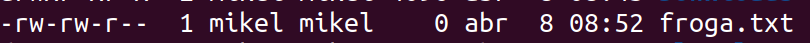
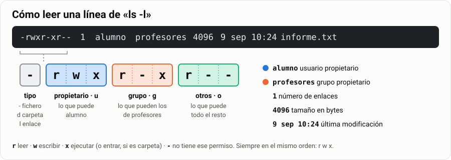
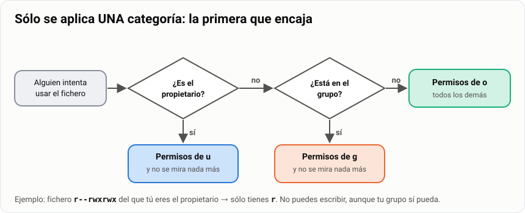
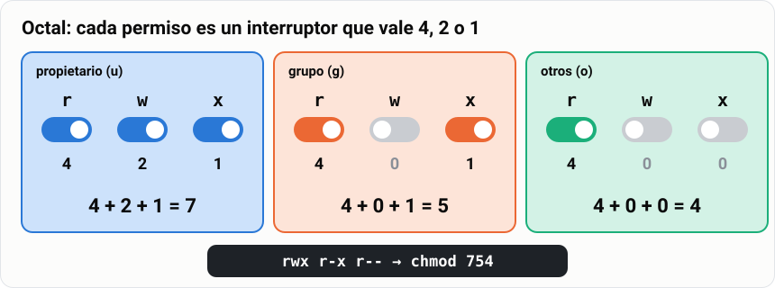
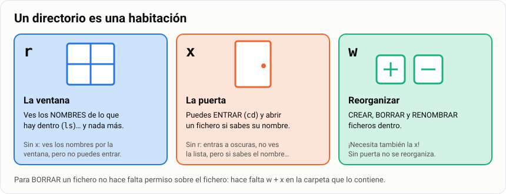
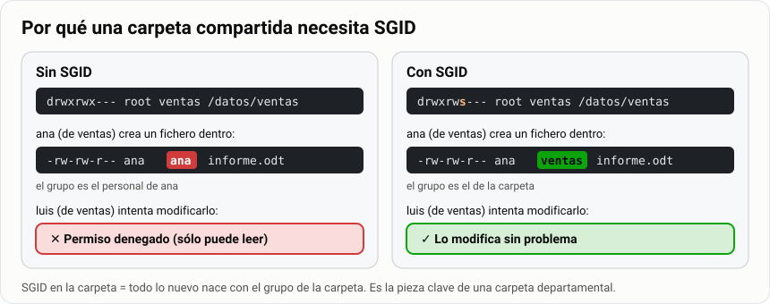
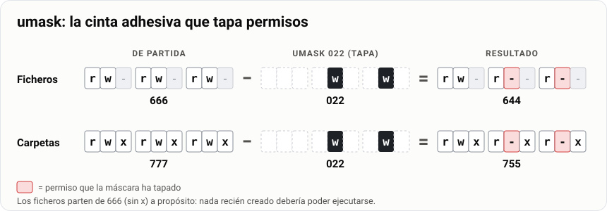
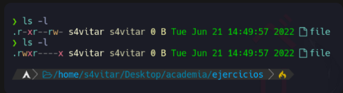
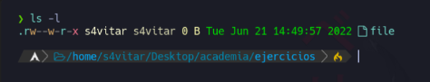
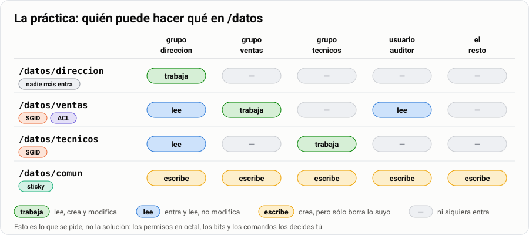

# Permisos en Linux, root y sudo

> **Antes de empezar.** Necesitas tu máquina virtual `Mint-SMR` encendida, un terminal abierto y
> saber moverte con `cd`, `ls`, `mkdir` y `touch` ([guía 04](../../1-basico/04-comandos-y-ficheros/1-guia.md)).

Escribe `cat /etc/shadow` en tu terminal. Te dirá «Permiso denegado»: ahí están las contraseñas y
Linux no deja que las leas. Pero `cat /etc/passwd` sí funciona. ¿Quién decide eso? Los
**permisos**: tres letras que dicen quién puede leer, escribir o entrar en cada fichero. En esta
guía vas a leerlos, cambiarlos y montar con ellos las carpetas de una empresa.

> **Analogía.** Un edificio de oficinas con llaves. Cada despacho tiene **tres llaves**: una para
> su dueño, otra para su equipo y otra para el resto del edificio. Cada llave abre para **leer**,
> para **escribir** o para **entrar**. El conserje tiene la llave maestra: es root.

| | |
|---|---|
| 🎯 **Qué vas a aprender** | Leer y cambiar permisos con letras y con números, usar SUID, SGID y sticky, y dar permisos de administrador con `sudo` |
| 🧰 **Qué necesitas** | Tu MV `Mint-SMR` y un usuario que pueda usar `sudo` |
| ⏱️ **Tiempo** | 5 horas |
| 📦 **Qué entregas** | La tarea «Matriz de permisos Linux + configuración de sudo documentada» ([Parte 4](#parte-4--entrega)) |

**Tu misión, paso a paso:**

- [ ] Leer de un vistazo cualquier línea de `ls -l`.
- [ ] Cambiar permisos con `chmod`, con letras y con números.
- [ ] Explicar por qué los permisos de una carpeta no significan lo mismo que los de un fichero.
- [ ] Montar una carpeta compartida con SGID y otra con sticky bit.
- [ ] Dar permisos de administrador «a medida» con `sudo` y entregar la práctica de `/datos`.

## Índice

- [Parte 1 · Aprende](#parte-1--aprende)
  - [1. Leer los permisos](#1-leer-los-permisos)
  - [2. Propietario, grupo y otros](#2-propietario-grupo-y-otros)
  - [3. Cambiar permisos con letras](#3-cambiar-permisos-con-letras)
  - [4. Cambiar permisos con números](#4-cambiar-permisos-con-números)
  - [5. Los permisos en una carpeta](#5-los-permisos-en-una-carpeta)
  - [6. Permisos especiales: SUID, SGID y sticky](#6-permisos-especiales-suid-sgid-y-sticky)
  - [7. Root, su y sudo](#7-root-su-y-sudo)
  - [8. Para saber más](#8-para-saber-más)
- [Parte 2 · Lo que te llevas](#parte-2--lo-que-te-llevas)
- [Parte 3 · Practica](#parte-3--practica)
- [Parte 4 · Entrega](#parte-4--entrega)

---

## Parte 1 · Aprende

### 1. Leer los permisos

Escribe `ls -l` en tu carpeta personal. Cada fichero sale en una línea como esta:



Lo que importa son los **diez caracteres del principio**. Así se leen:



- El **primer carácter** dice qué es: `-` fichero, `d` carpeta, `l` enlace.
- Después, **tres bloques de tres letras**: para el dueño, para su grupo y para el resto.
- En cada bloque, siempre en este orden: `r` leer, `w` escribir, `x` ejecutar. Un `-` es que ese
  permiso no está. Esto son los permisos **con letras** (`rwx`); en el apartado 4 los verás
  también **con números** (`754`). Son dos formas de escribir lo mismo.

> [!TIP]
> **🧪 Pruébalo.** Mira tu carpeta personal y dos ficheros del sistema:
>
> ```bash
> ls -ld ~                        # -d: la carpeta en sí, no lo que tiene dentro
> ls -l /etc/passwd /etc/shadow
> ```
>
> 👀 Tu carpeta empieza por `d` y pone `alumno alumno`: es tuya. `/etc/passwd` acaba en `r--`:
> lo lee todo el mundo. `/etc/shadow` acaba en `---`: el resto del edificio no tiene llave.

**📌 En una frase:** `ls -l` enseña diez caracteres: el tipo y tres bloques `rwx` para el dueño,
su grupo y el resto.

### 2. Propietario, grupo y otros

Cada fichero tiene tres llaves, una para cada categoría de gente:

- **Propietario** (`u`, de *user*): el dueño del fichero. Normalmente, quien lo creó.
- **Grupo** (`g`): los usuarios que están en el grupo del fichero. Por ejemplo, `ventas`.
- **Otros** (`o`): todo el mundo que no es ni lo uno ni lo otro. (`a`, *all*, son los tres.)

¿Y si eres el dueño **y** además estás en el grupo? Linux no suma llaves. Mira en este orden y
**se queda con la primera que encaja**:



> [!WARNING]
> **Sólo se aplica una categoría.** Si eres el propietario, te tocan los permisos de propietario
> **y punto**, aunque los del grupo sean mejores. Un fichero `r--rwxrwx` del que tú eres dueño
> **no lo puedes escribir**. Esto sorprende a todo el mundo y cae en el examen (ejercicio 4).

> [!TIP]
> **🧪 Pruébalo.** Averigua qué categoría te toca en `/etc/shadow`:
>
> ```bash
> id                     # tu usuario y tus grupos
> ls -l /etc/shadow      # dueño root, grupo shadow
> cat /etc/shadow
> ```
>
> 👀 No eres `root` ni estás en `shadow`: eres «otros», `---`. Por eso `cat` dice `Permiso denegado`.

**🧠 ¿Lo has pillado?** Un fichero tiene permisos `---rwxrwx`. Su dueña es `ana`, que también
está en el grupo `ventas`. ¿Puede `ana` leerlo?

<details>
<summary>Ver respuesta</summary>

**No.** Es la propietaria: se le aplica `---` y no se mira nada más. Pero como es la dueña puede
cambiar los permisos con `chmod` y darse lectura.

</details>

**📌 En una frase:** tres categorías (propietario, grupo y otros), y sólo se aplica **una**: la
primera que encaja.

### 3. Cambiar permisos con letras

Para cambiar permisos se usa `chmod`. Con letras es como una frase: **a quién** + **qué hago** +
**qué permiso**. Sólo el dueño del fichero (o root) puede cambiarlos.

```bash
chmod u+x hola.sh      # al propietario (u), añade (+) ejecución (x)
chmod o-r hola.sh      # a otros (o), quita (-) lectura (r)
chmod g=rx hola.sh     # al grupo (g), deja exactamente (=) r y x
chmod u+x,o= hola.sh   # varias órdenes separadas por comas (o= quita todo a otros)
chmod -R g+w carpeta/  # recursivo: la carpeta y todo lo que tiene dentro
```

> [!CAUTION]
> **Cuidado con `chmod -R 777`.** Es el «arreglo» de internet para cualquier problema de permisos.
> También es la forma más rápida de dejar un servidor abierto de par en par. En el entregable, un
> `777` sin justificar **resta nota**.

> [!TIP]
> **🧪 Pruébalo.**
>
> ```bash
> touch hola.sh && ls -l hola.sh   # permisos de partida
> chmod u+x hola.sh && ls -l hola.sh
> chmod o-r hola.sh && ls -l hola.sh
> ```
>
> 👀 De partida, algo como `-rw-rw-r--`. Tras `u+x`, una `x` en el primer bloque: `-rwxrw-r--`.
> Tras `o-r`, el último bloque en `---`: `-rwxrw----`.

**📌 En una frase:** `chmod` con letras es «quién (`u`, `g`, `o`, `a`) + qué (`+`, `-`, `=`) +
permiso (`r`, `w`, `x`)».

### 4. Cambiar permisos con números

Con números (en los libros, «notación octal») cada permiso es un **interruptor** con un valor:
`r` vale **4**, `w` vale **2** y `x` vale **1**. Sumas los encendidos de cada bloque y te salen
tres cifras: propietario, grupo, otros.



> **Ejemplo.** De letras a números: `rwxr-xr--` → `rwx` = 4+2+1 = **7**, `r-x` = 4+0+1 = **5**,
> `r--` = 4+0+0 = **4** → **754**. De números a letras: **640** → 6 = 4+2 = `rw-`, 4 = `r--`,
> 0 = `---` → `rw-r-----`.

Los tres números que más vas a escribir:

```bash
chmod 644 informe.txt   # rw-r--r--  el típico de un documento
chmod 755 hola.sh       # rwxr-xr-x  el típico de un programa o una carpeta
chmod 700 privado/      # rwx------  sólo yo
```

> [!TIP]
> **🧪 Pruébalo.** Con el `hola.sh` de antes:
>
> ```bash
> chmod 600 hola.sh && ls -l hola.sh
> chmod 755 hola.sh && ls -l hola.sh
> ```
>
> 👀 Primero `-rw-------` (sólo tú lees y escribes). Después `-rwxr-xr-x` (tú todo; los demás,
> leer y ejecutar).

**📌 En una frase:** `r` = 4, `w` = 2, `x` = 1; sumas cada bloque y salen tres cifras, como
`chmod 754`.

### 5. Los permisos en una carpeta

En una carpeta, `r`, `w` y `x` no significan lo mismo que en un fichero. Piensa en la carpeta
como en una **habitación**:



- `r` es la **ventana**: ves los nombres (`ls`), nada más.
- `x` es la **puerta**: entras (`cd`) y abres un fichero de dentro si sabes su nombre.
- `w` es **reorganizar**: crear, borrar y renombrar dentro. Necesita también la puerta (`x`).

> [!IMPORTANT]
> **Para borrar un fichero no hace falta permiso sobre el fichero, sino `w` y `x` en la carpeta
> que lo contiene.** Puedes borrar un fichero de otro que ni siquiera puedes leer. Por eso existe
> el sticky bit (apartado 6) y por eso el ejercicio 7 tiene trampa.

> [!TIP]
> **🧪 Pruébalo.** Una carpeta que sólo tiene ventana:
>
> ```bash
> mkdir caja && echo hola > caja/dato.txt
> chmod 444 caja
> ls caja               # ventana: funciona
> cd caja               # puerta: falla
> cat caja/dato.txt     # sin puerta tampoco se abre nada de dentro
> chmod 755 caja        # déjala como estaba
> ```
>
> 👀 `ls` enseña `dato.txt` (aunque se queje de que no puede «acceder»). `cd` y `cat` responden
> `Permiso denegado`. Ves los nombres por la ventana y nada más.

**📌 En una frase:** en una carpeta, `r` es la ventana (ver nombres), `x` la puerta (entrar) y `w`
reorganizar (crear y borrar, con `x`).

### 6. Permisos especiales: SUID, SGID y sticky

Además de `rwx` hay tres permisos especiales. En `ls -l` ocupan el sitio de una `x`:


- **Sticky bit** (`t` en otros): en una carpeta donde todos escriben, **cada uno sólo borra lo
  suyo**. Es lo que tiene `/tmp`.
- **SGID** (`s` en el grupo): en una carpeta, todo lo que se cree dentro **hereda el grupo de la
  carpeta**, no el de quien lo crea. Es la pieza que hace funcionar una carpeta de departamento.
- **SUID** (`s` en el propietario): un programa se ejecuta **con los permisos de su dueño**, no
  con los de quien lo lanza. Así `passwd`, que es de root, puede escribir tu contraseña en
  `/etc/shadow`.

Por qué una carpeta compartida necesita SGID:



Con números van en un **cuarto dígito por delante**: SUID **4**, SGID **2**, sticky **1**:

```bash
chmod 1777 comun/        # sticky:  drwxrwxrwt   (con letras: chmod +t)
chmod 2770 ventas/       # SGID:    drwxrws---   (con letras: chmod g+s)
chmod 4755 programa      # SUID:    -rwsr-xr-x   (con letras: chmod u+s)
```

**Mayúscula o minúscula.** Una `s` o `t` **minúscula** significa que debajo también está la `x`:
cuenta como `x` (vale 1). Una `S` o `T` **mayúscula** significa que **falta** la `x`: cuenta como
`-` (vale 0) y el permiso especial normalmente no sirve.

> **Ejemplo.** `rwxr-sr-x`: la `s` es minúscula, cuenta como `x` → `755`; añade SGID delante →
> **2755**. `r--rw---T`: la `T` es mayúscula, cuenta como `-` → `460`; añade sticky delante →
> **1460**.

> [!TIP]
> **🧪 Pruébalo.** Los dos casos reales de tu sistema:
>
> ```bash
> ls -ld /tmp
> ls -l /usr/bin/passwd
> ```
>
> 👀 `/tmp` acaba en `t`: `drwxrwxrwt`. `passwd` tiene una `s` en el primer bloque:
> `-rwsr-xr-x`, y es de `root`.

**🧠 ¿Lo has pillado?** Ves `drwxrwxrwT`. ¿Tiene sticky bit? ¿Pueden entrar los otros?

<details>
<summary>Ver respuesta</summary>

Sí tiene sticky (la `T`). Pero es **mayúscula**: falta la `x` de otros, así que no pueden entrar.

</details>

**📌 En una frase:** sticky (`t`, 1) = cada uno borra lo suyo; SGID (`s` en grupo, 2) = lo nuevo
hereda el grupo; SUID (`s` en dueño, 4) = se ejecuta como el dueño.

### 7. Root, su y sudo

**root** es el administrador: el conserje con la llave maestra. Puede leer, escribir y borrar
cualquier cosa. Hay dos formas de usar esa llave:

```bash
su -               # te conviertes en root; pide la contraseña DE ROOT
sudo comando       # ejecuta UN comando como root; pide TU contraseña
sudo -i            # abre una sesión de root; pide TU contraseña
sudo -l            # qué me deja hacer sudo a mí
```

> **Analogía.** `su` es pedirle la llave maestra al conserje y quedártela. `sudo` es pedirle que te
> abra **una puerta concreta**: él mira su lista, apunta que lo has pedido y se queda la llave.

Esa lista es el fichero `/etc/sudoers`. Cada línea dice quién, desde dónde, como quién y qué:


> **Ejemplo.** `patxi ALL=(root) NOPASSWD: /usr/bin/systemctl restart apache2` se lee: patxi,
> desde cualquier equipo, como root, sin contraseña, puede ejecutar **sólo ese comando**. Para un
> grupo entero se pone `%tecnicos` en vez de `patxi`.

En Mint el grupo de administradores se llama `sudo`; en Arch, `wheel`. Míralo con `groups`.

> [!CAUTION]
> **Edita `/etc/sudoers` siempre con `sudo visudo`, nunca con `nano` a secas.** `visudo` comprueba
> que no has roto nada antes de guardar; un error ahí deja el sistema sin `sudo` para nadie. Y
> `NOPASSWD: ALL` para un grupo **no vale** en el entregable: cualquiera que se siente delante de
> una sesión abierta sería administrador.

> [!TIP]
> **🧪 Pruébalo.**
>
> ```bash
> cat /etc/sudoers        # falla: es de root
> sudo cat /etc/sudoers   # funciona y te pide TU contraseña, no la de root
> ```
>
> 👀 Verás la línea `%sudo ALL=(ALL:ALL) ALL`: todos los del grupo `sudo` pueden hacer todo.

**📌 En una frase:** root es la llave maestra; `su` te la queda, `sudo` abre una puerta concreta
con tu contraseña y según la lista de `/etc/sudoers`.

### 8. Para saber más

Cuatro cosas que no hace falta dominar, pero que te vas a cruzar (dos las usas en la práctica).

**Cambiar el dueño y el grupo.** Sólo root puede regalar un fichero a otro usuario:

```bash
sudo chown ana informe.txt          # cambiar el propietario
sudo chgrp ventas informe.txt       # cambiar el grupo
sudo chown -R ana:ventas carpeta/   # los dos a la vez, y todo lo de dentro
```

**umask: de dónde salen los permisos de un fichero nuevo.** Los ficheros parten de `666` y las
carpetas de `777`. La **umask** es una cinta adhesiva que tapa permisos: con la habitual, `022`,
quedan `644` y `755`. Cámbiala con `umask 077` y todo lo que crees será sólo tuyo.



**ACL: una llave extra con nombre propio.** Para dar permiso a **una persona concreta** que no es
el dueño ni está en el grupo, usas una **ACL** (lista de control de acceso). La necesitas en la
práctica, para el auditor:

```bash
getfacl /datos/ventas                      # ver las ACL (y ls -l marca un + al final)
setfacl -m u:auditor:rx /datos/ventas      # dar r y x a un usuario concreto
setfacl -d -m u:auditor:rx /datos/ventas   # por defecto: lo que se cree dentro lo hereda
```

**chattr +i: intocable hasta para root.** `sudo chattr +i fichero` lo hace inmutable: nadie lo
modifica ni lo borra, ni root, hasta que se quita con `chattr -i`. Se ve con `lsattr`:


---

## Parte 2 · Lo que te llevas

**🎒 Si sólo te quedas con ocho cosas:**

1. `ls -l` enseña **diez caracteres**: el tipo (`-`, `d`, `l`) y tres bloques `rwx` para el
   **propietario**, el **grupo** y **otros**. `r` leer, `w` escribir, `x` ejecutar.
2. **Sólo se aplica una categoría**: la primera que encaja. El dueño no hereda los del grupo.
3. **Con letras**: `chmod u+x`, `chmod o-r`, `chmod g=rx`. Quién + qué + permiso.
4. **Con números**: `r` = 4, `w` = 2, `x` = 1. Se suma cada bloque: `rwxr-xr--` = `754`.
5. En una **carpeta**: `r` es la ventana (ver nombres), `x` la puerta (entrar), `w` reorganizar
   (crear y borrar, con `x`). Para borrar un fichero hace falta `w` y `x` **en la carpeta**.
6. **Sticky** (`t`, 1): cada uno borra lo suyo. **SGID** (`s` en grupo, 2): lo nuevo hereda el
   grupo. **SUID** (`s` en dueño, 4): se ejecuta como el dueño. Van en un cuarto dígito delante.
7. `s`/`t` **minúscula** = hay `x` debajo. `S`/`T` **mayúscula** = falta la `x`.
8. **root** es la llave maestra. `su` pide la contraseña de root; `sudo` pide la **tuya** y mira
   `/etc/sudoers`, que se edita con `visudo`.

**Chuleta**

| Números | Letras | Para qué |
|---|---|---|
| `755` | `rwxr-xr-x` | Programas y carpetas públicas |
| `700` | `rwx------` | Carpeta privada |
| `644` | `rw-r--r--` | Documento normal |
| `600` | `rw-------` | Fichero privado (claves, contraseñas) |
| `2770` | `rwxrws---` | Carpeta de departamento (SGID) |
| `1777` | `rwxrwxrwt` | Todos escriben y cada uno borra lo suyo (`/tmp`) |

```bash
ls -ld carpeta                  # ver los permisos de una carpeta
chmod 750 carpeta               # cambiar con números
chmod u+x,g-w,o= fichero        # cambiar con letras
sudo chown ana:ventas fichero   # cambiar dueño y grupo
sudo -l                         # qué me deja hacer sudo
sudo visudo                     # editar /etc/sudoers, siempre así
```

---

## Parte 3 · Practica

> [!NOTE]
> **Sobre las capturas.** Están hechas con un terminal personalizado: el primer carácter de los
> permisos sale como un punto (`.`) en vez de un guion (`-`). Significa lo mismo: fichero normal.

**Ejercicio 1 · Une números y letras.** Escribe la letra al lado de cada número (por ejemplo,
`462 → h`).

| Números | | Letra | Con letras |
|---|---|---|---|
| 462 | | a | `rwx--x--x` |
| 123 | | b | `--x-w--wx` |
| 711 | | c | `--x-----x` |
| 333 | | d | `-wx-wx-wx` |
| 161 | | e | `r-xrw-rwx` |
| 765 | | f | `rwxrw-r-x` |
| 567 | | g | `--xrw--w-` |
| 101 | | h | `r--rw--w-` |
| 162 | | i | `--xrw---x` |

**Ejercicio 2 · Antes y después.** Mira la captura:


1. ¿Qué permisos tiene ahora el fichero, con números?
2. ¿Qué permisos tendrá **después** del `chmod` que se ve escrito? Dalos con letras y con números.

**Ejercicio 3 · Pasa a números.** `r--r-xrw-` · `--xr-xr--` · `r--------` · `--------x` ·
`rwsr-xr-x` · `rwxr-sr-x` · `r--rw---T`. Los tres últimos llevan permisos especiales: mira el
ejemplo de mayúscula y minúscula del [apartado 6](#6-permisos-especiales-suid-sgid-y-sticky).

**Ejercicio 4 · El dueño sin permiso.** ¿Qué pasa al ejecutar el comando de la captura? Justifica
la respuesta con el dibujo del [apartado 2](#2-propietario-grupo-y-otros).


1. La salida de `whoami` se guarda en el fichero: soy el propietario y los permisos no me afectan.
2. La salida **no** se guarda: aunque sea el propietario, se aplica el permiso que tiene el fichero.

**Ejercicio 5 · De una línea a la otra.** ¿Qué `chmod` hace que `file` pase de la primera línea a
la segunda? Da la solución **con letras y con números**.



**Ejercicio 6 · Con números.** ¿Qué número hay que dar a `chmod` para que el fichero quede así?



**Ejercicio 7 · ¿Se puede borrar?** ¿Podré borrar este fichero con los permisos que tiene? Sí o
no, y por qué. Pista: la pregunta no va sobre los permisos del fichero; vuelve al cuadro naranja
del [apartado 5](#5-los-permisos-en-una-carpeta). ¿Qué te falta saber para responder seguro?


**Ejercicio 8 · Ventana y puerta.** En la máquina virtual, reproduce y explica:

```bash
mkdir ~/pruebas && cd ~/pruebas
mkdir solo-lectura && touch solo-lectura/dato.txt
chmod 444 solo-lectura
ls solo-lectura           # ¿funciona?
cd solo-lectura           # ¿funciona?
cat solo-lectura/dato.txt # ¿funciona?
chmod 111 solo-lectura
ls solo-lectura           # ¿y ahora?
cat solo-lectura/dato.txt # ¿y ahora?
chmod 755 solo-lectura    # al terminar, déjala como estaba
```

Rellena la tabla y **explica por qué** con la habitación del apartado 5:

| Comando | Con `444` (`r--r--r--`) | Con `111` (`--x--x--x`) | Por qué |
|---|---|---|---|
| `ls solo-lectura` | | | |
| `cd solo-lectura` | | | |
| `cat solo-lectura/dato.txt` | | | |

**Práctica · Las carpetas de la empresa.** En la máquina virtual, monta en `/datos` las carpetas de
una empresa con tres departamentos (**dirección**, **ventas** y **técnicos**) y un usuario externo,
**auditor**. Es la misma matriz que hiciste en NTFS, pero al estilo Linux.



1. Crea los grupos (`direccion`, `ventas`, `tecnicos`) y los usuarios: `marta` (direccion), `ana`
   y `luis` (ventas), `patxi` (tecnicos) y `auditor` (sin departamento).

   > **Consejo.** Por cada uno: `sudo groupadd ventas`, `sudo adduser ana` y
   > `sudo usermod -aG ventas ana`.

2. Crea las cuatro carpetas y ponles dueño, grupo y permisos:
   - `/datos/direccion`: sólo el grupo `direccion`. Nadie más entra, ni para leer.
   - `/datos/ventas` y `/datos/tecnicos`: trabaja su grupo y `direccion` puede leer. Con **SGID**,
     para que lo nuevo herede el grupo.
   - `/datos/comun`: todos escriben, cada uno borra lo suyo. Con **sticky bit**.
   - El `auditor` no es de ningún departamento, pero tiene que **leer** `/datos/ventas`: usa una
     **ACL** ([apartado 8](#8-para-saber-más)).

   > **Consejo.** Si «el resto» no entra en `ventas`, ¿cómo lee `direccion`, que tampoco es del
   > grupo? La herramienta es la misma que para el auditor.

3. Configura `sudo` para que el grupo `tecnicos` pueda reiniciar servicios **sin ser
   administradores de todo** (el ejemplo de `patxi` del [apartado 7](#7-root-su-y-sudo)).
4. **Comprueba cada requisito entrando con cada usuario** (`su - usuario`) e intentando lo que
   tiene que poder hacer y lo que no. Por ejemplo: `su - ana`, `touch /datos/ventas/prueba-ana` y
   `ls -l /datos/ventas`; si el fichero tiene grupo `ventas`, el SGID funciona. Revisa el conjunto
   con `ls -ld /datos/*`, `getfacl /datos/ventas` y `sudo -l -U patxi`. Una configuración sin
   comprobar no cuenta.

---

## Parte 4 · Entrega

**Tarea Moodle: «Matriz de permisos Linux + configuración de sudo documentada»**
Calificación de 0 a 10 · Se aprueba con 5.

Entrega un documento con:

1. **Ejercicios 1 a 8 resueltos**, con el porqué en los ejercicios 4, 7 y 8.
2. **Matriz de permisos** en una tabla: para cada carpeta de `/datos`, dueño, grupo, permisos con
   números **y** con letras, bits especiales y una frase de justificación.
3. Los **comandos exactos** que has usado, en un bloque de código.
4. Capturas de `ls -ld /datos/*` y `getfacl /datos/ventas`.
5. **Pruebas de acceso**: por cada usuario, una captura de algo que sí puede hacer y de algo que
   no, con el mensaje de error.
6. La **línea de `sudoers`** que has añadido, explicada campo a campo.
7. La **tabla de comparación con NTFS** rellenada:

| Aspecto | NTFS | Linux |
|---|---|---|
| Unidad básica de permiso | | |
| ¿A cuántas personas o grupos se puede dar permiso distinto? | | |
| ¿Existe «denegar» explícito? | | |
| ¿Cómo se hereda de la carpeta padre? | | |
| ¿Cómo se corta la herencia? | | |
| Herramienta gráfica | | |
| Herramienta de consola | | |
| Cambiar el propietario | | |
| ¿Qué gana si hay conflicto? | | |

> [!TIP]
> **Pista para la tabla.** NTFS **sí** tiene «denegar» y gana sobre «permitir»; en Linux, no tener
> permiso ya es la denegación. Linux mira una sola categoría; NTFS acumula todas las entradas de la
> lista. La herencia de NTFS, en Linux, es `setfacl -d`.

**✅ Antes de entregar, comprueba:**

- [ ] Los ejercicios 4, 7 y 8 tienen su **porqué**, no sólo la respuesta.
- [ ] Cada carpeta de la matriz tiene permisos con números **y** con letras.
- [ ] No hay ningún `777` sin justificar.
- [ ] Hay pruebas de acceso de **todos** los usuarios, con su mensaje de error.
- [ ] La línea de `sudoers` no da `NOPASSWD: ALL` a nadie.
- [ ] La tabla de NTFS está completa.

*Instrumento de evaluación: prueba práctica de permisos en Linux y de escalada de privilegios con
`sudo`.*
