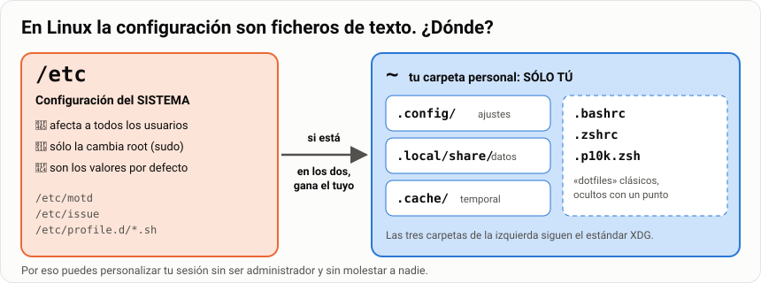
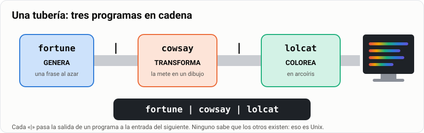
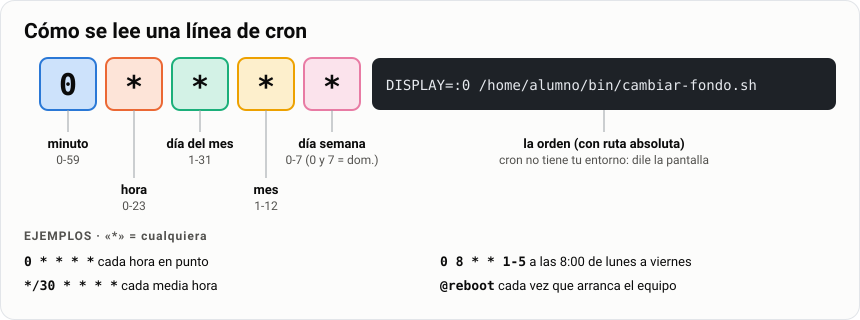
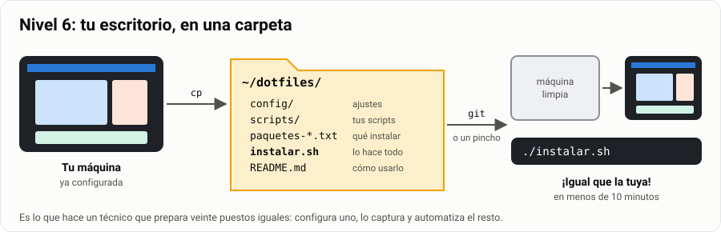

# Taller: personaliza tu Linux

> **Antes de empezar.** Necesitas tu Arch con escritorio de la
> [guía de instalación](../../2-intermedio/08-instalar-arch-uefi/1-guia.md) (instantánea
> `03-escritorio`) y haber hecho la [guía de zsh y Powerlevel10k](../11-terminal-zsh-p10k/1-explicacion.md),
> que se ocupa del *prompt*. Este taller se ocupa de **todo lo demás**.

Esto es un taller: se hace, se enseña y se compara. Vas a dejar tu Linux a tu gusto (colores,
atajos, información en pantalla, mensajes, tareas que se hacen solas) y, sobre todo, vas a
aprender **dónde vive cada ajuste** para poder llevártelo a cualquier máquina con un solo comando.

> [!NOTE]
> **Por qué esto no es perder el tiempo.** Configurar un escritorio parece un juego, y en parte lo
> es. Pero por el camino aprendes dónde guarda Linux la configuración, la diferencia entre lo que
> es del usuario y lo que es del sistema, cómo se automatiza una tarea y cómo se hace reproducible
> una configuración. Eso es exactamente lo que hace un técnico cuando prepara veinte puestos
> iguales para una empresa.

| | |
|---|---|
| 🎯 **Qué vas a conseguir** | Un escritorio y un terminal a tu medida, documentados y reconstruibles en 10 minutos |
| 🧰 **Qué necesitas** | Tu Arch con escritorio (XFCE recomendado; cualquier otro sirve) y zsh configurado |
| ⏱️ **Tiempo** | 2 sesiones de taller + trabajo autónomo |
| 📦 **Qué entregas** | «Entorno de trabajo documentado» y el concurso de escritorios ([Parte 4](#parte-4--entrega)) |

**Tu misión, paso a paso:**

- [ ] Saber en qué carpeta vive cada ajuste.
- [ ] Cambiar tema, iconos, fondo, atajos y panel de tu escritorio.
- [ ] Convertir el terminal en un panel de control con `fastfetch`, `btop` y `conky`.
- [ ] Poner tu propio mensaje de bienvenida.
- [ ] *(Ampliación)* Encadenar comandos, automatizar tareas con `cron` y hacerlo todo reproducible.
- [ ] Presentar tu escritorio en el concurso.

## Índice

- [Taller: personaliza tu Linux](#taller-personaliza-tu-linux)
  - [Índice](#índice)
  - [Cómo funciona el taller](#cómo-funciona-el-taller)
  - [Parte 1 · El taller](#parte-1--el-taller)
    - [Nivel 0: dónde vive la configuración](#nivel-0-dónde-vive-la-configuración)
    - [Nivel 1: el escritorio](#nivel-1-el-escritorio)
    - [Nivel 2: el terminal como panel de control](#nivel-2-el-terminal-como-panel-de-control)
    - [Nivel 3: tu propio mensaje de bienvenida](#nivel-3-tu-propio-mensaje-de-bienvenida)
    - [Nivel 4: comandos que parecen tontería y no lo son](#nivel-4-comandos-que-parecen-tontería-y-no-lo-son)
    - [Nivel 5: que se haga solo](#nivel-5-que-se-haga-solo)
    - [Nivel 6: hazlo reproducible](#nivel-6-hazlo-reproducible)
    - [Cómo deshacerlo todo](#cómo-deshacerlo-todo)
    - [Ampliación: gestores de ventanas en mosaico](#ampliación-gestores-de-ventanas-en-mosaico)
  - [Parte 2 · Chuleta](#parte-2--chuleta)
  - [Parte 3 · Practica: el concurso de escritorios](#parte-3--practica-el-concurso-de-escritorios)
  - [Parte 4 · Entrega](#parte-4--entrega)

---

## Cómo funciona el taller


**Las cuatro reglas del taller:**

1. 📸 **Instantánea antes de empezar.** Apaga la máquina y crea la instantánea `antes-del-taller`.
   Es la única forma de experimentar sin miedo.
2. ↩️ **Todo tiene que ser reversible.** Antes de tocar un fichero de configuración,
   `cp fichero{,.bak}`. Antes de tocar algo de `/etc`, doblemente.
3. 📝 **Todo tiene que estar documentado.** Si no sabes explicar qué hace una línea que has
   puesto, quítala. Un escritorio precioso que no sabes reconstruir no vale nada.
4. ⏱️ **Reconstruible en 10 minutos.** El nivel 6 consiste justo en eso: un script que deja la
   máquina como la tienes.

> [!TIP]
> **`cp fichero{,.bak}` es un atajo de Bash**: equivale a `cp fichero fichero.bak`. Las llaves se
> expanden en «fichero» y «fichero.bak».

> [!IMPORTANT]
> **¿Qué escritorio tienes?** El taller está escrito para **XFCE**, el recomendado en la guía de
> Arch. Si elegiste otro, sigue igual: en cada nivel tienes las equivalencias. Compruébalo con:
>
> ```bash
> echo $XDG_CURRENT_DESKTOP
> ```

---

## Parte 1 · El taller

### Nivel 0: dónde vive la configuración

Antes de tocar nada, el mapa. En Linux **la configuración son ficheros de texto**, y sólo hay que
saber en cuál de estos sitios está la que buscas:



| Ruta | Qué contiene | A quién afecta |
|---|---|---|
| `/etc/` | Configuración del **sistema** | A todos los usuarios |
| `~/.config/` | Configuración de **aplicaciones** del usuario | Sólo a ti |
| `~/.algo` (dotfiles) | Configuración de programas «clásicos» del usuario | Sólo a ti |

```bash
ls -a ~              # tus ficheros de configuración ocultos
ls ~/.config         # una carpeta por aplicación
ls /etc | head -30   # la del sistema
```

> [!IMPORTANT]
> **La regla de oro: lo del usuario gana.** Si un ajuste está en `/etc` y también en tu carpeta
> personal, manda el tuyo. Por eso puedes personalizar tu sesión sin ser administrador y sin
> molestar a nadie. Lo comprobarás al final creando un usuario nuevo: entrará con el escritorio de
> fábrica.

> [!NOTE]
> **Estándar XDG.** `~/.config` (configuración), `~/.local/share` (datos) y `~/.cache`
> (temporales) son un estándar llamado *XDG Base Directory*, pensado para que tu carpeta personal
> no se llene de ficheros ocultos sueltos. Las aplicaciones modernas lo respetan; las antiguas
> (como `.bashrc`) siguen a la vieja usanza.

**Antes de empezar, aprende a buscar paquetes.** La primera pregunta siempre es «¿existe esto y
cómo se llama?»:

```bash
pacman -Ss cowsay          # buscar en los repositorios oficiales
pacman -Si cowsay          # información de un paquete
paru -Ss asciiquarium      # buscar también en AUR
pacman -Qe                 # qué he instalado yo explícitamente
```

En Linux Mint o Ubuntu: `apt search cowsay` y `apt show cowsay`.

**🧪 Pruébalo:** ejecuta `ls ~/.config` antes y después de abrir por primera vez un programa
(por ejemplo, `btop`). ¿Ha aparecido una carpeta nueva?

**🧠 ¿Lo has pillado?**

1. Cambias el tema de tu escritorio. ¿Lo verá tu compañero si entra con su usuario en la misma
   máquina?
2. ¿Dónde pondrías un ajuste que deben tener **todos** los usuarios?

<details>
<summary>Ver respuestas</summary>

1. **No**: se ha guardado en tu `~/.config`, que sólo te afecta a ti.
2. En `/etc` (con `sudo`), que es la configuración del sistema.

</details>

### Nivel 1: el escritorio

#### 1.1 Temas, iconos y fuentes

```bash
sudo pacman -S arc-gtk-theme papirus-icon-theme ttf-jetbrains-mono ttf-jetbrains-mono-nerd
```

Después, en **Configuración → Apariencia** (XFCE):

- **Estilo:** Arc-Dark (o el que instales)
- **Iconos:** Papirus-Dark
- **Fuentes:** una fuente legible a 10-11 puntos

Y en **Configuración → Gestor de ventanas** eliges el marco de las ventanas, que se configura
aparte del resto.

> [!NOTE]
> **Dónde ha ido a parar eso.** Nada de esto es magia: XFCE lo ha escrito en un fichero XML.
> Míralo:
>
> ```bash
> cat ~/.config/xfce4/xfconf/xfce-perchannel-xml/xsettings.xml
> ```
>
> Ése es el fichero que copiarás en el nivel 6 para llevarte tu escritorio a otra máquina.
> También puedes cambiarlo por comandos, sin tocar ninguna ventana:
>
> ```bash
> xfconf-query -c xsettings -p /Net/ThemeName -s "Arc-Dark"
> xfconf-query -c xsettings -p /Net/IconThemeName -s "Papirus-Dark"
> xfconf-query -c xsettings -l          # ver todas las propiedades disponibles
> ```

Buscar más temas:

```bash
paru -Ss gtk-theme
paru -Ss icon-theme
```

Para instalar uno descargado a mano: los temas van en `~/.themes/` o `/usr/share/themes/`, y los
iconos en `~/.icons/` o `/usr/share/icons/`. En tu carpeta personal sólo lo ves tú; en
`/usr/share`, todos los usuarios. Es exactamente la regla del nivel 0.

#### 1.2 Papel de pared

**Configuración → Escritorio → Fondo.** O por comandos:

```bash
xfconf-query -c xfce4-desktop -l | grep last-image
xfconf-query -c xfce4-desktop -p /backdrop/screen0/monitor0/workspace0/last-image \
  -s /home/alumno/imagenes/fondo.jpg
```

> [!TIP]
> El nombre exacto de la propiedad (`monitor0`, `monitorVirtual-1`…) depende de tu pantalla. Usa
> el que te devuelva el primer comando.

#### 1.3 Atajos de teclado propios

Ésta es la parte que más productividad da y la que menos gente configura.
**Configuración → Teclado → Atajos de aplicación → Añadir.**

| Atajo | Comando | Para qué |
|---|---|---|
| `Super` + `Intro` | `xfce4-terminal` | Abrir un terminal al instante |
| `Super` + `E` | `thunar` | Explorador de archivos |
| `Super` + `B` | `firefox` | Navegador |
| `Super` + `L` | `xflock4` | Bloquear la pantalla |
| `Impr Pant` | `xfce4-screenshooter` | Captura de pantalla |

> [!NOTE]
> `Super` es la tecla de Windows. En VirtualBox puede estar capturada por el anfitrión; si un atajo
> no responde, prueba con `Ctrl` + `Alt` en su lugar, o cambia la tecla anfitrión de VirtualBox en
> **Archivo → Preferencias → Entrada**.

En **Configuración → Ventanas → Teclado** tienes además los atajos de gestión de ventanas
(maximizar, mover a otro escritorio, cambiar de área de trabajo). Configura al menos los de cambio
de área de trabajo: tener cuatro escritorios y saltar entre ellos con el teclado cambia la forma
de trabajar.

#### 1.4 El panel

Clic derecho en el panel → **Panel → Preferencias**. Merece la pena añadir:

- 📈 **Monitor de CPU** y **Monitor de red**.
- 🕒 **Reloj** con formato personalizado.
- 📂 **Menú Whisker**, un menú de aplicaciones con buscador.

```bash
sudo pacman -S xfce4-cpugraph-plugin xfce4-netload-plugin xfce4-whiskermenu-plugin
```

#### 1.5 Si tu escritorio no es XFCE

Los conceptos son los mismos; cambian las ventanas y el sitio donde se guarda todo:

| Qué | KDE Plasma | GNOME | Cinnamon | MATE | LXQt |
|---|---|---|---|---|---|
| Ajustes | Preferencias del sistema | Configuración | Configuración del sistema | Centro de control | Configuración de LXQt |
| Tema e iconos | Colores y temas | Retoques (`gnome-tweaks`) | Temas | Apariencia | Apariencia |
| Fondo | Clic derecho en el escritorio | Configuración → Apariencia | Fondos de escritorio | Apariencia → Fondo | Clic derecho en el escritorio |
| Atajos | Teclado → Accesos rápidos | Teclado → Atajos | Teclado → Atajos | Atajos de teclado | Atajos globales |
| Dónde lo guarda | `~/.config/*rc` (texto) | base de datos **dconf** | dconf | dconf | `~/.config/lxqt/` (texto) |
| Por comandos | `kwriteconfig6`, `plasma-apply-…` | `gsettings` | `gsettings` | `gsettings` | editar los `.conf` |

Ejemplos de cambio por comandos:

```bash
# GNOME
gsettings set org.gnome.desktop.interface icon-theme 'Papirus-Dark'
gsettings set org.gnome.desktop.interface color-scheme 'prefer-dark'
# Cinnamon
gsettings set org.cinnamon.desktop.interface icon-theme 'Papirus-Dark'
# MATE
gsettings set org.mate.interface icon-theme 'Papirus-Dark'
# KDE Plasma
plasma-apply-colorscheme BreezeDark
plasma-apply-wallpaperimage ~/imagenes/fondo.jpg
```

> [!NOTE]
> **dconf** es una base de datos binaria (`~/.config/dconf/user`) que no se lee con `cat`: se
> consulta con `gsettings` o con `dconf-editor`. Para el nivel 6 la exportas con
> `dconf dump / > ~/dotfiles/dconf.ini` y la recuperas con `dconf load / < dconf.ini`.

**🧪 Pruébalo:** cambia el tema desde la ventana de ajustes y, con la ventana aún abierta, mira
cómo cambia el fichero (XFCE) o la clave (`gsettings get …`) correspondiente.

### Nivel 2: el terminal como panel de control

#### 2.1 `fastfetch` a tu gusto

```bash
sudo pacman -S fastfetch
fastfetch --gen-config          # crea ~/.config/fastfetch/config.jsonc
nano ~/.config/fastfetch/config.jsonc
```

Una configuración compacta para empezar:

```jsonc
{
  "$schema": "https://github.com/fastfetch-cli/fastfetch/raw/dev/doc/json_schema.json",
  "logo": {
    "type": "small",
    "padding": { "top": 1, "right": 3 }
  },
  "display": {
    "separator": "  ",
    "color": { "keys": "blue", "title": "cyan" }
  },
  "modules": [
    "title",
    "separator",
    { "type": "os",       "key": "  Sistema " },
    { "type": "kernel",   "key": "  Núcleo  " },
    { "type": "uptime",   "key": "  Encendido" },
    { "type": "packages", "key": "  Paquetes" },
    { "type": "shell",    "key": "  Shell   " },
    { "type": "wm",       "key": "  Escritorio" },
    { "type": "terminal", "key": "  Terminal" },
    { "type": "cpu",      "key": "  CPU     " },
    { "type": "memory",   "key": "  RAM     " },
    { "type": "disk",     "key": "  Disco   " },
    "break",
    "colors"
  ]
}
```

Y con tu propio dibujo en lugar del logo de la distribución:

```bash
fastfetch --logo-type file --logo ~/.config/fastfetch/logo.txt
```

Puedes generar el dibujo con `figlet` (nivel 4) o dibujarlo tú en un fichero de texto.

#### 2.2 `btop`

```bash
sudo pacman -S btop
btop
```

Dentro, pulsa `Esc` → **Options** para cambiar el tema, qué gráficas se ven y si aparecen la red
y el disco. Se guarda en `~/.config/btop/btop.conf`.

> [!TIP]
> `btop` no es sólo bonito: es la herramienta con la que se diagnostica «el equipo va lento».
> Aprender a leerlo es parte del temario ([guía de procesos](../../1-basico/03-procesos/1-guia.md)),
> no del taller.

#### 2.3 `conky`: información sobre el escritorio

`conky` dibuja información del sistema directamente sobre el fondo de pantalla.

> [!WARNING]
> `conky` funciona en escritorios **X11** (XFCE, Cinnamon, MATE, LXQt, i3). En KDE Plasma y GNOME,
> que van sobre Wayland, usa sus propios *widgets*: en Plasma, clic derecho en el escritorio →
> **Añadir elementos gráficos** → «Monitor del sistema».

```bash
sudo pacman -S conky
mkdir -p ~/.config/conky
cp /etc/conky/conky.conf ~/.config/conky/conky.conf
nano ~/.config/conky/conky.conf
```

Una configuración mínima y legible:

```lua
conky.config = {
    alignment = 'top_right',
    gap_x = 20,
    gap_y = 40,
    minimum_width = 250,
    own_window = true,
    own_window_type = 'desktop',
    own_window_transparent = true,
    double_buffer = true,
    update_interval = 2.0,
    use_xft = true,
    font = 'JetBrains Mono:size=10',
    default_color = 'white',
}

conky.text = [[
${color cyan}${time %A %d de %B}${color}
${color cyan}${time %H:%M:%S}${color}

${color cyan}SISTEMA${color}
Equipo    $nodename
Encendido $uptime
Núcleo    $kernel

${color cyan}CPU${color}  ${cpu}%
${cpubar 6}
${top name 1}  ${top cpu 1}%
${top name 2}  ${top cpu 2}%

${color cyan}RAM${color}  $mem / $memmax
${membar 6}

${color cyan}DISCO${color}  ${fs_used /} / ${fs_size /}
${fs_bar 6 /}
]]
```

Arráncalo con `conky &`. Para que arranque solo con la sesión: **Configuración → Sesión e inicio →
Autoarranque de aplicaciones → Añadir**, con el comando `conky`.

> [!NOTE]
> **Lo que has aprendido sin darte cuenta:** dónde se configuran los programas que arrancan con la
> sesión. Es lo mismo que la carpeta de Inicio de Windows y que `systemctl enable`, pero a nivel de
> sesión gráfica. En **cualquier** escritorio funciona además crear un fichero `.desktop` en
> `~/.config/autostart/`: mira los que ya hay con `ls ~/.config/autostart`.

### Nivel 3: tu propio mensaje de bienvenida

#### 3.1 El MOTD: lo que se ve al iniciar sesión en consola

`motd` es *message of the day*. Se muestra **después** de iniciar sesión en una consola de texto o
por SSH.

```bash
sudo nano /etc/motd
```

```text
===========================================
  Equipo:  arch-smr
  Aula:    SMR 1.º — Sistemas Operativos
  Aviso:   máquina de prácticas. Haz snapshots.
===========================================
```

Sal a una consola de texto con `Ctrl` + `Alt` + `F2` e inicia sesión para verlo. Vuelve al
escritorio con `Ctrl` + `Alt` + `F1` (o `F7`, según el escritorio).

Un mensaje **dinámico**, que se genera cada vez:

```bash
sudo nano /etc/profile.d/bienvenida.sh
```

```bash
#!/bin/bash
# Se ejecuta al iniciar sesión en consola, para TODOS los usuarios

echo
echo "  Hola, $(whoami). Son las $(date '+%H:%M') del $(date '+%d/%m/%Y')."
echo "  Equipo: $(hostname)  ·  Encendido desde hace $(uptime -p | sed 's/up //')"
echo "  Disco raíz: $(df -h / | awk 'NR==2 {print $3 " de " $2 " (" $5 ")"}')"
echo "  Usuarios conectados: $(who | wc -l)"
echo
```

```bash
sudo chmod +x /etc/profile.d/bienvenida.sh
```

Cierra sesión en la consola de texto y vuelve a entrar.

> [!CAUTION]
> **Cuidado con lo que metes en `/etc/profile.d/`.** Se ejecuta para **todos** los usuarios en
> **cada** inicio de sesión. Si pones algo lento, todo el mundo espera. Si pones algo con un error,
> puedes dejar el inicio de sesión inutilizable. Lo que va en tu `~/.zshrc` sólo te afecta a ti; lo
> que va en `/etc` afecta a todos. Eso es el principio de mínimo privilegio.

#### 3.2 `/etc/issue`: lo que se ve antes de iniciar sesión

```bash
sudo nano /etc/issue
```

```text
Arch Linux \r (\l)
Aula SMR — acceso restringido a alumnado autorizado
```

`\r` es la versión del núcleo y `\l` el terminal. Es donde las empresas ponen el aviso legal de
uso del equipo.

**🧠 ¿Lo has pillado?** ¿Qué diferencia hay entre `/etc/issue` y `/etc/motd`?

<details>
<summary>Ver respuesta</summary>

`/etc/issue` se ve **antes** de iniciar sesión (en la pantalla de `login:`); `/etc/motd`,
**después** de iniciarla.

</details>

### Nivel 4: comandos que parecen tontería y no lo son

Cada uno de estos comandos enseña algo real. La gracia está en usarlos **encadenados**, porque así
se entiende la filosofía de las tuberías.

```bash
sudo pacman -S cowsay lolcat figlet fortune-mod cmatrix sl
```

*(Si alguno no aparece en los repositorios oficiales, búscalo en AUR con `paru -Ss nombre`. En
Linux Mint: `sudo apt install cowsay lolcat figlet fortune-mod cmatrix sl`.)*

| Comando | Qué hace | **Qué enseña de verdad** |
|---|---|---|
| `cowsay` | Una vaca dice lo que le pases | Lee de la **entrada estándar**: el ejemplo perfecto de tubería |
| `lolcat` | Colorea la salida en arcoíris | Es un **filtro**: no genera nada, sólo transforma lo que le llega |
| `figlet` | Texto en letras gigantes | Generador de salida para encadenar |
| `fortune` | Una cita al azar | Fuente de datos para una tubería |
| `cmatrix` | La lluvia de código de Matrix | Un proceso que ocupa el terminal: `Ctrl` + `C` para terminarlo |
| `sl` | Un tren cruza la pantalla si escribes `sl` en vez de `ls` | Existe para castigar la errata. Y para hablar del `PATH` |

**La tubería obligatoria del taller:**

```bash
fortune | cowsay | lolcat
```



Léela de izquierda a derecha: `fortune` **genera** una frase, `cowsay` la **transforma** en un
dibujo, `lolcat` la **colorea**. Tres programas que no saben nada el uno del otro, encadenados por
la salida estándar. Eso es Unix.

Más combinaciones:

```bash
figlet "SMR" | lolcat
date | cowsay -f tux
ls -l | lolcat
cowsay -l                       # ver todas las "vacas" disponibles
fortune | cowsay -f dragon | lolcat
whoami | figlet | lolcat
```

Y al final de tu `.zshrc`, para que salga al abrir el terminal:

```zsh
fortune | cowsay -f tux | lolcat
```

> **Reto.** Otros que suelen estar en AUR y merecen la pena: `pipes.sh` (tuberías de colores),
> `asciiquarium` (un acuario), `tty-clock` (un reloj a pantalla completa), `cava` (visualizador de
> audio). Búscalos con `paru -Ss` antes de instalar.

> [!TIP]
> **Ejercicio real escondido en la broma.** Ejecuta `which sl` y `which ls`: están en `/usr/bin`.
> Crea un script tuyo llamado `ls` en `~/bin`, dale permiso de ejecución y comprueba con
> `which ls` cuál gana según el orden de tu `PATH` (`echo $PATH`). Eso explica por qué el
> directorio actual **no** está en el `PATH` por defecto: alguien podría dejarte un «`ls`» trampa.

### Nivel 5: que se haga solo

Aquí se une la personalización con las tareas programadas y el scripting.

#### 5.0 Preparar cron

`cron` ejecuta órdenes a una hora fija. **En Arch no viene instalado**:

```bash
sudo pacman -S cronie
sudo systemctl enable --now cronie
```



#### 5.1 Fondo de pantalla que cambia solo

```bash
mkdir -p ~/imagenes/fondos ~/bin
nano ~/bin/cambiar-fondo.sh
```

```bash
#!/bin/bash
#===============================================================
# cambiar-fondo.sh — pone un fondo de pantalla al azar
# Uso: ./cambiar-fondo.sh   (o desde cron)
#===============================================================
set -euo pipefail

ESCRITORIO="xfce"     # xfce | kde | gnome | cinnamon | mate | lxqt | i3
CARPETA="$HOME/imagenes/fondos"
LOG="$HOME/.local/share/cambiar-fondo.log"

if [ ! -d "$CARPETA" ]; then
    echo "No existe $CARPETA" >&2
    exit 1
fi

FONDO=$(find "$CARPETA" -type f \( -name "*.jpg" -o -name "*.png" \) | shuf -n 1)

if [ -z "$FONDO" ]; then
    echo "No hay imágenes en $CARPETA" >&2
    exit 1
fi

case "$ESCRITORIO" in
    xfce)
        for PROP in $(xfconf-query -c xfce4-desktop -l | grep last-image); do
            xfconf-query -c xfce4-desktop -p "$PROP" -s "$FONDO"
        done ;;
    kde)      plasma-apply-wallpaperimage "$FONDO" ;;
    gnome)    gsettings set org.gnome.desktop.background picture-uri "file://$FONDO"
              gsettings set org.gnome.desktop.background picture-uri-dark "file://$FONDO" ;;
    cinnamon) gsettings set org.cinnamon.desktop.background picture-uri "file://$FONDO" ;;
    mate)     gsettings set org.mate.background picture-filename "$FONDO" ;;
    lxqt)     pcmanfm-qt --set-wallpaper "$FONDO" ;;
    i3)       feh --bg-fill "$FONDO" ;;
esac

mkdir -p "$(dirname "$LOG")"
echo "[$(date '+%F %T')] Fondo: $FONDO" >> "$LOG"
```

```bash
chmod +x ~/bin/cambiar-fondo.sh
~/bin/cambiar-fondo.sh
```

> [!TIP]
> **El `case` es un repaso de scripting:** según el valor de la variable se ejecuta un bloque u
> otro. Cambia `ESCRITORIO` por el tuyo.

Y que se ejecute cada hora:

```bash
crontab -e
```

```text
0 * * * * DISPLAY=:0 DBUS_SESSION_BUS_ADDRESS=unix:path=/run/user/1000/bus /home/alumno/bin/cambiar-fondo.sh
```

> [!WARNING]
> **`DISPLAY` y `DBUS_SESSION_BUS_ADDRESS` no son opcionales.** `cron` se ejecuta fuera de tu
> sesión gráfica: no sabe qué pantalla es la tuya ni cómo hablar con tu escritorio, y el comando
> falla en silencio. El `1000` es tu número de usuario (compruébalo con `id -u`). Es el mismo
> problema de las rutas absolutas en scripting: **cron no tiene tu entorno**. Mira siempre el log.

#### 5.2 Aviso cuando el disco se llena

Une monitorización, condicionales y notificaciones:

```bash
sudo pacman -S libnotify
nano ~/bin/aviso-disco.sh
```

```bash
#!/bin/bash
set -euo pipefail

UMBRAL=80
USO=$(df / --output=pcent | tail -n1 | tr -dc '0-9')

if [ "$USO" -ge "$UMBRAL" ]; then
    notify-send -u critical "Disco casi lleno" "La raíz está al ${USO}%"
    echo "[$(date '+%F %T')] AVISO: disco al ${USO}%" >> "$HOME/.local/share/disco.log"
fi
```

```bash
chmod +x ~/bin/aviso-disco.sh
```

Pruébalo bajando el umbral a `1` para ver la notificación, y súbelo después. Si lo programas con
`cron`, usa las mismas dos variables que en el apartado 5.1.

### Nivel 6: hazlo reproducible

Éste es el nivel que separa un escritorio bonito de una configuración profesional. **El objetivo:
un solo comando deja una máquina recién instalada exactamente como la tuya.**



#### 6.1 Reunir los dotfiles

```bash
mkdir -p ~/dotfiles/{config,scripts}

cp ~/.zshrc ~/.p10k.zsh ~/dotfiles/
cp -r ~/.config/fastfetch ~/.config/btop ~/.config/conky ~/dotfiles/config/
cp -r ~/.config/xfce4 ~/dotfiles/config/          # todo XFCE: tema, panel, atajos…
cp ~/bin/*.sh ~/dotfiles/scripts/
```

> [!NOTE]
> Copia sólo las carpetas que existan. Si tu escritorio guarda en **dconf** (GNOME, Cinnamon,
> MATE), añade `dconf dump / > ~/dotfiles/dconf.ini`. En KDE Plasma, copia los ficheros
> `~/.config/kdeglobals`, `~/.config/kglobalshortcutsrc` y
> `~/.config/plasma-org.kde.plasma.desktop-appletsrc`.

#### 6.2 La lista de paquetes

```bash
pacman -Qqen > ~/dotfiles/paquetes-oficiales.txt     # instalados por ti, de los repositorios oficiales
pacman -Qqem > ~/dotfiles/paquetes-aur.txt           # instalados por ti, de AUR
wc -l ~/dotfiles/paquetes-*.txt
```

> [!IMPORTANT]
> **La `n` y la `m` importan.** `pacman -Qqe` a secas mezcla los paquetes oficiales con los de AUR,
> y entonces `pacman -S` falla al no encontrar los de AUR. `-n` (*native*) sólo da los oficiales;
> `-m` (*foreign*), sólo los de fuera.

#### 6.3 El script de instalación

```bash
nano ~/dotfiles/instalar.sh
```

```bash
#!/bin/bash
#===============================================================
# instalar.sh — deja una máquina nueva con mi configuración
# Uso: ./instalar.sh   (mejor desde una consola de texto, sin sesión gráfica abierta)
#===============================================================
set -euo pipefail

DIR="$(cd "$(dirname "$0")" && pwd)"

echo "==> Instalando paquetes de los repositorios oficiales"
sudo pacman -S --needed --noconfirm - < "$DIR/paquetes-oficiales.txt"

if command -v paru > /dev/null && [ -s "$DIR/paquetes-aur.txt" ]; then
    echo "==> Instalando paquetes de AUR"
    xargs -a "$DIR/paquetes-aur.txt" paru -S --needed --noconfirm
fi

echo "==> Copiando ficheros de configuración"
cp "$DIR/.zshrc" "$DIR/.p10k.zsh" "$HOME/"
mkdir -p "$HOME/.config"
cp -r "$DIR/config/"* "$HOME/.config/"

echo "==> Copiando scripts"
mkdir -p "$HOME/bin"
cp "$DIR/scripts/"*.sh "$HOME/bin/"
chmod +x "$HOME"/bin/*.sh

echo "==> Cambiando el shell a zsh"
chsh -s /bin/zsh

echo "==> Listo. Inicia sesión en el escritorio."
```

```bash
chmod +x ~/dotfiles/instalar.sh
```

> [!WARNING]
> **Ejecútalo sin sesión gráfica abierta** (`Ctrl` + `Alt` + `F2`). Si el escritorio está en
> marcha, al cerrar sesión puede volver a guardar su configuración vieja encima de la que acabas de
> copiar.

#### 6.4 Guardarlo con Git

```bash
cd ~/dotfiles
git init
git add .
git commit -m "Mi configuración de escritorio y terminal"
```

Añade un `README.md` que explique qué hay, cómo instalarlo y cómo deshacerlo.

#### 6.5 La prueba de fuego

1. **Saca la carpeta de la MV**: súbela a un repositorio remoto o cópiala a una carpeta compartida
   de VirtualBox (`/media/sf_…`). Si no, la perderás en el paso siguiente.
2. Restaura la instantánea `antes-del-taller`.
3. Recupera la carpeta `dotfiles` y ejecuta `./instalar.sh`.

Si en diez minutos tienes tu escritorio de vuelta, el taller está superado. Si no, el script te
dirá exactamente qué te habías dejado sin documentar.

> [!TIP]
> **Esto es literalmente lo que hace un técnico** que tiene que preparar veinte puestos iguales:
> configurar uno, capturar la configuración y automatizar el resto. En el reto ETHAZI se pide
> desplegar varios puestos; llegar con esto hecho te ahorra media sesión.

### Cómo deshacerlo todo

Por si algo se tuerce, de menos a más drástico. Hazlo desde una consola de texto
(`Ctrl` + `Alt` + `F2`) si el escritorio no responde:

```bash
# 1. Volver a la configuración de fábrica de XFCE (sólo tu usuario), con la sesión gráfica cerrada
mv ~/.config/xfce4 ~/.config/xfce4.roto

# 2. Recuperar una copia de seguridad concreta
cp ~/.zshrc.bak ~/.zshrc

# 3. Quitar el script de bienvenida del sistema
sudo rm /etc/profile.d/bienvenida.sh

# 4. Volver a Bash si zsh da problemas
chsh -s /bin/bash

# 5. Desinstalar lo que instalaste
sudo pacman -Rns cowsay lolcat figlet cmatrix

# 6. La opción nuclear: restaurar la instantánea 'antes-del-taller'
```

> [!TIP]
> En el paso 1 renombramos en lugar de borrar: si resulta que no era eso, lo recuperas con un `mv`
> al revés. Es el mismo rescate desde consola de la instalación de Arch.

### Ampliación: gestores de ventanas en mosaico

Un **gestor de ventanas en mosaico** coloca las ventanas automáticamente sin solaparlas y se
maneja sólo con el teclado. Es lo que se ve en las capturas espectaculares de internet. Cómo
instalar **i3** está en la [guía de Arch, opción G](../../2-intermedio/08-instalar-arch-uefi/1-guia.md#opción-g--i3-ampliación);
se elige en la pantalla de inicio de sesión. Toda su configuración está en un único fichero de
texto, `~/.config/i3/config`, lo que lo hace perfecto para el nivel 6.

> [!WARNING]
> **Aviso honesto, y va en serio.** Esto es un agujero de tiempo. Un i3 usable pide entre 5 y 15
> horas de configuración, y hasta que lo tengas irás **más lento** que con XFCE. Adelante si te
> engancha, pero:
>
> - **No lo hagas en la máquina que usas para las prácticas evaluables.** Crea una MV nueva.
> - **No lo empieces la semana antes del reto.**
> - Úsalo una semana con la configuración por defecto antes de tocar nada.
>
> La guía del curso anterior proponía el entorno **Yoru** (basado en AwesomeWM). Es precioso y
> tiene decenas de dependencias de AUR que se rompen en cada actualización.

Alternativa suave si sólo quieres probar la idea: los atajos de encaje de ventanas del propio XFCE
(`Super` + flechas), que ya vienen y no rompen nada.

---

## Parte 2 · Chuleta

**Dónde vive cada cosa**

| Qué | Dónde | Para quién |
|---|---|---|
| Configuración de programas | `~/.config/<programa>/` | Sólo tu usuario |
| Escritorio XFCE | `~/.config/xfce4/xfconf/` | Sólo tu usuario |
| Escritorio GNOME, Cinnamon, MATE | base de datos dconf (`gsettings`) | Sólo tu usuario |
| Programas al iniciar sesión | `~/.config/autostart/` | Sólo tu usuario |
| Configuración por defecto | `/etc/` | Todo el sistema |
| Mensaje tras iniciar sesión | `/etc/motd`, `/etc/profile.d/*.sh` | Todos los usuarios |
| Mensaje antes de iniciar sesión | `/etc/issue` | La consola |

**Herramientas del taller**

```bash
fastfetch --gen-config            # ~/.config/fastfetch/config.jsonc
btop                              # monitor de recursos (Esc → Options)
conky &                           # información sobre el escritorio (sólo X11)
crontab -e                        # tareas programadas del usuario (en Arch: cronie)
xfconf-query -c xfce4-desktop -l  # propiedades del escritorio XFCE
gsettings list-recursively | less # ajustes de GNOME, Cinnamon o MATE
```

**Cron en una línea**

```text
┌ minuto (0-59)
│ ┌ hora (0-23)
│ │ ┌ día del mes (1-31)
│ │ │ ┌ mes (1-12)
│ │ │ │ ┌ día de la semana (0-7, 0 y 7 = domingo)
│ │ │ │ │
*/30 * * * *  DISPLAY=:0 DBUS_SESSION_BUS_ADDRESS=unix:path=/run/user/1000/bus $HOME/bin/cambiar-fondo.sh
```

**Hacerlo reproducible**

```bash
mkdir -p ~/dotfiles/{config,scripts}
cp -r ~/.config/{fastfetch,btop,conky,xfce4} ~/dotfiles/config/
pacman -Qqen > ~/dotfiles/paquetes-oficiales.txt
pacman -Qqem > ~/dotfiles/paquetes-aur.txt
cd ~/dotfiles && git init && git add . && git commit -m "Mi escritorio"
```

**Deshacer**

```bash
cp ~/.zshrc.bak ~/.zshrc          # volver a una copia
chsh -s /bin/bash                 # volver a Bash
# Ctrl + Alt + F2 → consola de texto si el escritorio no arranca
```

---

## Parte 3 · Practica: el concurso de escritorios

Última sesión del taller. Cada alumno o pareja presenta su escritorio en **3 minutos**.

**No gana el más bonito.** Se puntúa así, y la coevaluación la hace el resto de la clase:

| Criterio | Peso | Qué se mira |
|---|---|---|
| 🗣️ **Lo sabe explicar** | 35 % | Se le pregunta por dos ajustes al azar y explica qué fichero cambió y por qué |
| 🔁 **Es reproducible** | 30 % | El script del nivel 6 funciona en una máquina limpia delante de todos |
| 🛠️ **Es útil** | 20 % | Los atajos y la información en pantalla resuelven algo real, no son decoración |
| 📄 **Está documentado** | 10 % | El README explica cómo instalarlo y cómo deshacerlo |
| ✨ **Impresiona** | 5 % | Sí, cuenta. Pero sólo esto |

> [!NOTE]
> Que el apartado estético valga un 5 % es a propósito. Un escritorio espectacular copiado de un
> vídeo, que se rompe en la primera actualización y que su dueño no sabe explicar, es exactamente
> lo que **no** queremos aprender a hacer.

> [!TIP]
> **Ensaya tus 3 minutos:** 30 s para enseñar el escritorio, 1 min para los dos ajustes de los que
> estás más orgulloso (con el fichero abierto), 1 min para lanzar `instalar.sh` y 30 s de
> preguntas.

---

## Parte 4 · Entrega

**Tarea Moodle: «Taller de personalización — entorno de trabajo documentado»**
Calificación de 0 a 10 · Se aprueba con 5.

**Parte obligatoria (niveles 0 a 3) — hasta 7 puntos**

1. Capturas del escritorio antes y después.
2. **Tabla de cambios**: para cada ajuste, qué has cambiado, **en qué fichero o comando**, y por
   qué. Sin la columna del fichero no puntúa: el objetivo del taller es saber dónde vive cada cosa.
3. Los cinco atajos de teclado que has configurado y en qué situación usas cada uno.
4. Tu configuración de `fastfetch` y una captura de la salida.
5. Tu script de bienvenida y una captura del inicio de sesión en consola.
6. **Comprobación de aislamiento**: crea un usuario nuevo, inicia sesión con él y demuestra con
   capturas que su escritorio está de fábrica. Explica por qué.

**Parte de ampliación (niveles 4 a 6) — hasta 3 puntos**

7. Una tubería propia de al menos tres comandos encadenados, con una explicación de qué hace cada
   eslabón.
8. Un script del nivel 5 funcionando, programado con `cron`, con el log que demuestre que se ha
   ejecutado solo al menos dos veces.
9. **La prueba de fuego del nivel 6**: vídeo o capturas de la restauración completa en una máquina
   limpia a partir de tu carpeta `dotfiles`, con el tiempo que has tardado.

**Antes de entregar, comprueba:**

- [ ] Cada fila de la tabla de cambios tiene su **fichero o comando**.
- [ ] Explicas por qué el usuario nuevo ve el escritorio de fábrica.
- [ ] El log de `cron` tiene al menos dos ejecuciones con horas distintas.
- [ ] Tu carpeta `dotfiles` tiene README y `instalar.sh`.
- [ ] Sabes explicar cualquier línea de tu configuración (te lo preguntarán en el concurso).

*Instrumento de evaluación: lista de cotejo de la configuración y de su persistencia + rúbrica de
coevaluación del concurso de escritorios.*
