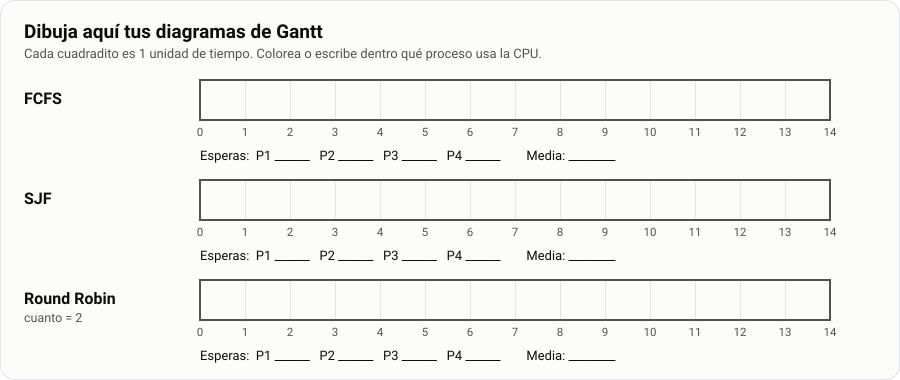

# Examen · Temas 02 a 05

| Nombre y apellidos | Fecha | Nota |
|---|---|---|
| &nbsp; | &nbsp; | &nbsp; |

**Lee esto antes de empezar:**

- Tienes **2 horas como máximo**.
- El examen tiene **3 partes** y vale **10 puntos**:

| Parte | Qué es | Puntos | Tiempo orientativo |
|---|---|---|---|
| **A** | 20 preguntas tipo test | 4 | 30 minutos |
| **B** | 6 preguntas cortas, para escribir un poco | 3 | 45 minutos |
| **C** | 2 ejercicios un poco más difíciles | 3 | 35 minutos |
| | Repasar antes de entregar | | 10 minutos |

- Empieza por la parte que mejor sepas. No te quedes atascado en una pregunta: sigue y vuelve luego.
- Escribe con letra clara y **con tus palabras**.

---

## Parte A · Tipo test (4 puntos)

Cada pregunta tiene **una sola respuesta correcta** y vale **0,2 puntos**. **Las respuestas mal no
restan**: contesta todas. Escribe la letra en la tabla.

| 1 | 2 | 3 | 4 | 5 | 6 | 7 | 8 | 9 | 10 |
|---|---|---|---|---|---|---|---|---|---|
| &nbsp; | | | | | | | | | |

| 11 | 12 | 13 | 14 | 15 | 16 | 17 | 18 | 19 | 20 |
|---|---|---|---|---|---|---|---|---|---|
| &nbsp; | | | | | | | | | |

**1. ¿Qué es un sistema operativo?**\
a) Un programa para navegar por internet\
b) El programa que gestiona el hardware y hace de intermediario entre el usuario y el ordenador\
c) Una pieza del hardware, como la CPU\
d) Un antivirus

**2. ¿Cuál de estas cosas NO es una función del sistema operativo?**\
a) Gestionar la memoria\
b) Gestionar los procesos\
c) Editar fotos\
d) Gestionar los dispositivos

**3. ¿Cómo se llama la parte del sistema operativo que manda directamente en el hardware?**\
a) El núcleo (*kernel*)\
b) El escritorio\
c) La BIOS\
d) El terminal

**4. Al crear la máquina virtual de Mint en VirtualBox, ¿qué opción hay que DESMARCAR?**\
a) Habilitar EFI\
b) Red NAT\
c) Disco de 25 GB\
d) Instalación desatendida

**5. ¿Qué ventaja tiene GPT frente a MBR?**\
a) Es más antiguo y por eso más compatible\
b) Sólo funciona con BIOS\
c) Permite hasta 128 particiones y discos enormes\
d) No necesita particiones

**6. ¿Qué formato tiene la partición EFI?**\
a) ext4\
b) FAT32\
c) NTFS\
d) swap

**7. ¿Para qué sirve la partición swap?**\
a) Como memoria de reserva cuando la RAM se llena\
b) Para guardar los documentos del usuario\
c) Para guardar el arranque\
d) Para instalar los programas

**8. ¿En qué punto de montaje va la partición con los datos de los usuarios?**\
a) `/`\
b) `/boot/efi`\
c) `/usr`\
d) `/home`

**9. ¿Qué diferencia hay entre un programa y un proceso?**\
a) Ninguna: son lo mismo\
b) El proceso está en el disco y el programa en la RAM\
c) El programa es un fichero en el disco; el proceso es ese programa funcionando en la RAM\
d) Un proceso es un trozo de un hilo

**10. Un proceso está esperando a que el usuario pulse una tecla. ¿En qué estado está?**\
a) En ejecución\
b) Bloqueado\
c) Listo\
d) Terminado

**11. ¿Qué algoritmo de planificación da la CPU primero al proceso más corto?**\
a) SJF\
b) FCFS\
c) Round Robin\
d) Por orden alfabético

**12. ¿Qué comando pide al proceso con PID 1500 que termine «por las buenas»?**\
a) `kill -9 1500`\
b) `stop 1500`\
c) `ps 1500`\
d) `kill 1500`

**13. Estás en `/home/alumno/docs` y escribes `cd ..`. ¿Dónde acabas?**\
a) `/`\
b) `/home/alumno`\
c) `/home`\
d) `/home/alumno/docs`

**14. ¿Cuál de estas rutas es absoluta?**\
a) `docs/notas.txt`\
b) `../notas.txt`\
c) `notas.txt`\
d) `/home/alumno/notas.txt`

**15. ¿Qué hace `echo "hola" >> saludo.txt`?**\
a) Cambia todo lo que hay en `saludo.txt` por «hola»\
b) Añade «hola» al final de `saludo.txt`\
c) Borra `saludo.txt`\
d) Enseña `saludo.txt` en la pantalla

**16. ¿Qué comando sirve para cambiar el nombre de un fichero?**\
a) `cp`\
b) `rn`\
c) `mv`\
d) `ren`

**17. ¿Qué opción necesita `cp` para copiar una carpeta entera?**\
a) `-r`\
b) `-i`\
c) `-l`\
d) `-h`

**18. ¿En qué carpeta están los ficheros de configuración del sistema?**\
a) `/home`\
b) `/tmp`\
c) `/bin`\
d) `/etc`

**19. ¿Qué es `/root`?**\
a) La raíz del sistema\
b) La carpeta de los programas\
c) La carpeta personal del administrador\
d) La carpeta donde aparecen los pendrives

**20. ¿Qué fichero guarda la lista de usuarios del sistema?**\
a) `/etc/passwd`\
b) `/etc/hostname`\
c) `/etc/fstab`\
d) `/proc/cpuinfo`

---

## Parte B · Preguntas cortas (3 puntos)

Cada pregunta vale **0,5 puntos**. Contesta en **2 a 4 líneas**.

**B1.** Escribe las **6 funciones** del sistema operativo. Elige **dos** y pon un ejemplo de tu día a
día de cada una.

<div style="height:8em;background:repeating-linear-gradient(to bottom,transparent 0,transparent 1.95em,#c9ccd1 1.95em,#c9ccd1 2em);margin:.4em 0 1.6em"></div>

**B2.** ¿Qué es una **máquina virtual**? ¿Y una **sesión *live***? Di para qué sirve cada una.

<div style="height:8em;background:repeating-linear-gradient(to bottom,transparent 0,transparent 1.95em,#c9ccd1 1.95em,#c9ccd1 2em);margin:.4em 0 1.6em"></div>

**B3.** Completa la tabla con las 4 particiones de tu Linux Mint. Después explica en una línea **por
qué `/home` va en una partición aparte**.

| Partición | Tamaño | Formato | Punto de montaje | Para qué sirve |
|---|---|---|---|---|
| 1 | 512 MB | | | |
| 2 | 15 GB | | | |
| 3 | 2 GB | | | |
| 4 | el resto | | | |

<div style="height:4em;background:repeating-linear-gradient(to bottom,transparent 0,transparent 1.95em,#c9ccd1 1.95em,#c9ccd1 2em);margin:.4em 0 1.6em"></div>

**B4.** Escribe los **5 estados** de un proceso. Un proceso que está en ejecución pide leer un
fichero del disco: **¿a qué estado pasa?** Y cuando llega el dato, **¿a cuál pasa?**

<div style="height:8em;background:repeating-linear-gradient(to bottom,transparent 0,transparent 1.95em,#c9ccd1 1.95em,#c9ccd1 2em);margin:.4em 0 1.6em"></div>

**B5.** Estás en `/home/alumno/fotos` y quieres ver el fichero `/home/alumno/docs/a.txt` con `cat`.
Escribe el comando **con ruta absoluta** y **con ruta relativa**. ¿Qué diferencia hay entre las dos
rutas?

<div style="height:8em;background:repeating-linear-gradient(to bottom,transparent 0,transparent 1.95em,#c9ccd1 1.95em,#c9ccd1 2em);margin:.4em 0 1.6em"></div>

**B6.** Explica en una línea qué guarda cada carpeta: `/etc`, `/home`, `/dev`, `/tmp` y `/var/log`.
¿Es lo mismo `/` que `/root`?

<div style="height:12em;background:repeating-linear-gradient(to bottom,transparent 0,transparent 1.95em,#c9ccd1 1.95em,#c9ccd1 2em);margin:.4em 0 1.6em"></div>

---

## Parte C · Ejercicios (3 puntos)

### C1. Reparte la CPU (1,5 puntos)

Cuatro procesos llegan **a la vez, en el instante 0**, en este orden:

| Proceso | Tiempo de CPU que necesita |
|---|---|
| P1 | 6 |
| P2 | 3 |
| P3 | 1 |
| P4 | 4 |

a) Dibuja el diagrama de Gantt con **FCFS** y calcula la espera de cada proceso y la media.
**(0,4 puntos)**\
b) Lo mismo con **SJF**. **(0,4 puntos)**\
c) Lo mismo con **Round Robin, cuanto = 2**. **(0,5 puntos)**\
d) ¿Qué algoritmo da la menor espera media? ¿Por qué Windows y Linux usan algo parecido a Round Robin
aunque no sea el que menos espera? **(0,2 puntos)**

> **Recuerda.** Espera de un proceso = **cuándo termina − lo que necesitaba**. En Round Robin, el
> proceso que no acaba en su turno vuelve **al final de la cola**.



**d)**

<div style="height:6em;background:repeating-linear-gradient(to bottom,transparent 0,transparent 1.95em,#c9ccd1 1.95em,#c9ccd1 2em);margin:.4em 0 1.6em"></div>

### C2. Sigue los comandos (1,5 puntos)

Estás en tu carpeta personal, `/home/alumno`, y escribes estos comandos **en este orden**. Ningún
comando da error.

```bash
1   cd
2   mkdir -p examen/fotos examen/textos
3   cd examen/textos
4   echo "uno" > a.txt
5   echo "dos" >> a.txt
6   echo "tres" > b.txt
7   cp a.txt ../fotos/c.txt
8   mv b.txt ../d.txt
9   cd ..
10  rm fotos/c.txt
```

a) Dibuja cómo queda la carpeta `examen` al final: qué carpetas y qué ficheros hay, y dónde está cada
uno. **(0,5 puntos)**

<div style="height:11em;border:1px solid #c9ccd1;border-radius:8px;margin:.4em 0 1.6em"></div>

b) ¿Qué escribe `pwd` después del comando 10? **(0,25 puntos)**\
c) ¿Qué escribe `cat textos/a.txt` después del comando 10? **(0,25 puntos)**\
d) ¿Qué habría en `a.txt` si en el comando 5 hubieras escrito `>` en lugar de `>>`? **(0,25 puntos)**\
e) Escribe **un solo comando** que borre la carpeta `examen` con todo lo que tiene dentro.
**(0,25 puntos)**

<div style="height:10em;background:repeating-linear-gradient(to bottom,transparent 0,transparent 1.95em,#c9ccd1 1.95em,#c9ccd1 2em);margin:.4em 0 1.6em"></div>

**Antes de entregar, comprueba:**

- [ ] Tienes las 20 letras escritas en la tabla del test.
- [ ] Has contestado las 6 preguntas cortas.
- [ ] En C1 cada Gantt tiene los números de tiempo, las esperas y la media.
- [ ] Tu nombre está arriba.
