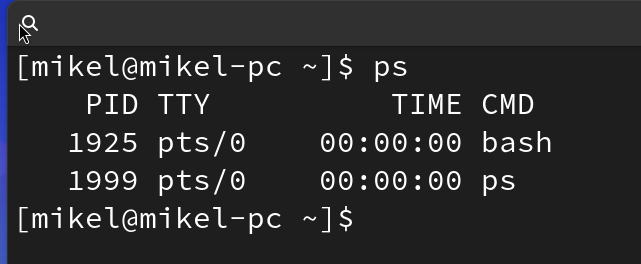
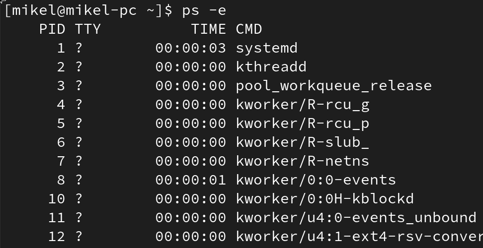
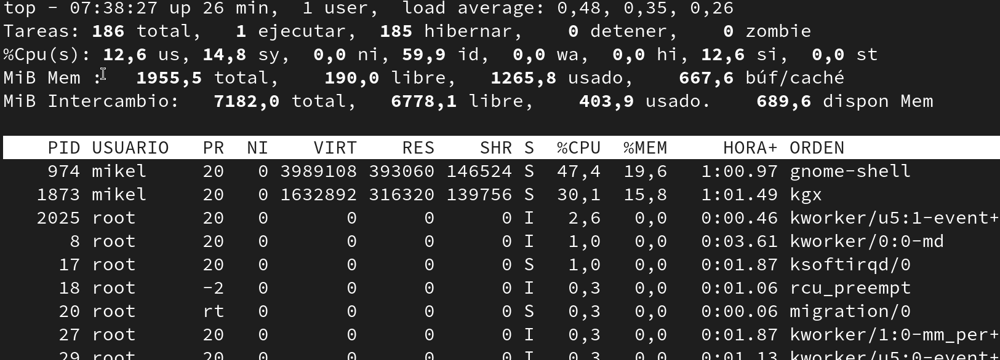

# Procesos, hilos y planificación de la CPU

> **Dónde estamos.** Semana 4 · 1.er trimestre · Bloque 1 (Conceptos).
> Aún no hay máquinas virtuales: se trabaja sobre el equipo del aula, en Windows y, si hay
> Linux disponible, también en Linux.

> **Analogía.** Un **programa** es una receta escrita en un libro. Un **proceso** es esa receta
> cocinándose ahora mismo en una hornilla concreta, con sus ingredientes y su punto de cocción.
> La misma receta puede estar cocinándose en tres hornillas a la vez: tres procesos distintos
> del mismo programa. El **sistema operativo es el jefe de cocina**: decide qué hornilla usa el
> fuego y durante cuánto tiempo, porque el fuego (la CPU) es uno solo.

## Índice

- [1. Programa, proceso e hilo](#1-programa-proceso-e-hilo)
- [2. Estados de un proceso](#2-estados-de-un-proceso)
- [3. Cambio de contexto](#3-cambio-de-contexto)
- [4. Algoritmos de planificación](#4-algoritmos-de-planificación)
- [5. Prioridades](#5-prioridades)
- [6. Concurrencia e interbloqueo](#6-concurrencia-e-interbloqueo)
- [7. Ver procesos en Linux](#7-ver-procesos-en-linux)
- [8. Gestionar procesos en Linux](#8-gestionar-procesos-en-linux)
- [9. Procesos en Windows](#9-procesos-en-windows)
- [10. Tabla de equivalencias](#10-tabla-de-equivalencias)
- [Ejercicios](#ejercicios)
- [Entregable](#entregable)

---

## 1. Programa, proceso e hilo

| Concepto | Qué es | Dónde vive |
|---|---|---|
| **Programa** | Un fichero ejecutable, código guardado | En el disco |
| **Proceso** | Una ejecución de ese programa, con su memoria propia | En la RAM |
| **Hilo** | Una línea de ejecución dentro de un proceso | Comparte la memoria del proceso |

Un proceso tiene, como mínimo:

- Un **PID** (*Process ID*): su número identificador, único en el sistema.
- Un **PPID**: el PID del proceso que lo creó (su «padre»).
- Un **espacio de memoria propio**, aislado de los demás procesos.
- Un **usuario propietario**, que determina qué puede hacer.
- Un **estado**.

> **Por qué los hilos.** Crear un proceso es caro: hay que reservarle memoria y copiar cosas.
> Un hilo es mucho más barato, porque comparte la memoria del proceso al que pertenece. Por eso
> un navegador usa muchos hilos: uno dibuja, otro descarga, otro ejecuta JavaScript.
> El precio de compartir memoria es que, si dos hilos escriben lo mismo a la vez, el resultado
> es impredecible.

Ábrelo tú mismo: abre tres ventanas del navegador y mira cuántos procesos aparecen. No es uno.

---

## 2. Estados de un proceso

```
                  ┌──────────────┐
      admitido    │              │   fin
   ─────────────► │    LISTO     │ ◄────────────┐
                  │  (preparado) │              │
                  └──────┬───────┘              │
        el planificador  │  ▲  se acaba su      │
        lo elige         ▼  │  turno            │
                  ┌──────────────┐              │
                  │ EN EJECUCIÓN │ ─────────────┘
                  └──────┬───────┘
      pide E/S           │  ▲  llega el dato
      (disco, teclado)   ▼  │
                  ┌──────────────┐
                  │   BLOQUEADO  │
                  │   (espera)   │
                  └──────────────┘
```

| Estado | Qué significa |
|---|---|
| **Nuevo** | Se está creando |
| **Listo** | Podría ejecutarse ya, pero la CPU está ocupada con otro |
| **En ejecución** | Está usando la CPU **ahora mismo** |
| **Bloqueado** | Espera algo externo: un dato del disco, una tecla, la red |
| **Terminado** | Ha acabado y sólo queda recoger su código de salida |

> **Detalle clave:** en un ordenador con un único núcleo, **sólo un proceso está en ejecución en
> cada instante**. Los cientos de procesos que ves en el administrador de tareas están casi todos
> «listos» o «bloqueados». La sensación de que todo va a la vez es un efecto óptico: el sistema
> cambia de proceso miles de veces por segundo.

**Proceso zombi**: ha terminado, pero su padre todavía no ha recogido su código de salida, así
que sigue ocupando una entrada en la tabla de procesos. No consume CPU ni memoria: sólo un
número. **Proceso huérfano**: su padre ha muerto antes que él; el sistema lo adopta (en Linux
pasa a colgar de `systemd`, PID 1).

---

## 3. Cambio de contexto

Cuando el sistema decide cambiar de proceso tiene que:

1. **Guardar** el estado del proceso actual: registros de la CPU, contador de programa, pila.
2. **Cargar** el estado del siguiente proceso.
3. Darle el control.

Ese estado guardado se llama **contexto**, y el trabajo de cambiarlo es **tiempo perdido**: la
CPU está ocupada en administrarse a sí misma en lugar de en calcular.

> **Analogía.** Estás resolviendo un problema de matemáticas y suena el teléfono. Antes de
> cogerlo apuntas dónde ibas; al colgar, releer las notas y retomar el hilo te cuesta un rato.
> Ese rato es el cambio de contexto. Cuantas más llamadas, menos matemáticas.
>
> Por eso los cuantos de tiempo (apartado 4) no pueden ser diminutos: si el turno dura menos que
> el cambio de contexto, el ordenador se pasa el día apuntando dónde iba.

**Actividad de aula: «somos la CPU».** Un alumno hace de CPU; los demás son procesos con una
tarea escrita (sumar una columna de números). La CPU sólo puede atender a uno y cada 20 segundos
tiene que cambiar. Se cronometra cuánto tarda en terminar todo el grupo con turnos de 20 s, de
5 s y de 60 s. Se comenta el resultado.

---

## 4. Algoritmos de planificación

El **planificador** decide qué proceso listo pasa a ejecución. Los tres clásicos:

### FCFS — *First Come, First Served*

Por orden de llegada, sin interrupciones. Simple y justo… salvo si el primero es larguísimo.

### SJF — *Shortest Job First*

Primero el que menos tiempo necesita. Consigue el mejor tiempo medio de espera, pero tiene dos
problemas: hay que **saber de antemano** cuánto va a durar cada proceso (imposible en la
práctica), y los procesos largos pueden no ejecutarse nunca si van entrando cortos (**inanición**).

### Round Robin

Cada proceso recibe un **cuanto** de tiempo fijo; si no termina, vuelve al final de la cola.
Es el que usan los sistemas interactivos, porque garantiza que ningún proceso espera
indefinidamente.

### Ejemplo resuelto

Cuatro procesos que llegan todos en el instante 0:

| Proceso | Ráfaga de CPU |
|---|---|
| P1 | 8 |
| P2 | 4 |
| P3 | 9 |
| P4 | 5 |

**FCFS** (orden P1, P2, P3, P4):

```
0        8      12          21       26
|---P1---|--P2--|----P3-----|---P4---|
```

| Proceso | Espera | Retorno |
|---|---|---|
| P1 | 0 | 8 |
| P2 | 8 | 12 |
| P3 | 12 | 21 |
| P4 | 21 | 26 |

Tiempo medio de espera = (0+8+12+21)/4 = **10,25**

**SJF** (orden P2, P4, P1, P3):

```
0    4      9        17          26
|-P2-|--P4--|---P1---|----P3-----|
```

| Proceso | Espera | Retorno |
|---|---|---|
| P2 | 0 | 4 |
| P4 | 4 | 9 |
| P1 | 9 | 17 |
| P3 | 17 | 26 |

Tiempo medio de espera = (0+4+9+17)/4 = **7,5**

**Round Robin con cuanto = 4**: dibújalo tú. Es el [ejercicio 2](#ejercicios).

---

## 5. Prioridades

No todos los procesos valen lo mismo. En Linux la prioridad se expresa con el valor **`nice`**:

| Valor | Significado |
|---|---|
| **-20** | Máxima prioridad |
| **0** | Normal (por defecto) |
| **+19** | Mínima prioridad |

> El nombre viene de «amable»: cuanto más alto el número, **más amable** es el proceso cediendo
> la CPU a los demás.

```bash
nice -n 10 comando          # lanzarlo con prioridad baja
sudo renice -n -5 -p 1234   # cambiar la prioridad de un proceso ya lanzado
```

Sólo root puede **subir** la prioridad (valores negativos). Bajarla la puede bajar cualquiera:
si no fuera así, todo el mundo se pondría a -20 y volveríamos al punto de partida.

---

## 6. Concurrencia e interbloqueo

Dos procesos que compiten por los mismos recursos pueden quedar bloqueados para siempre.

> **Analogía del interbloqueo.** Dos coches se encuentran en un puente de un solo carril, uno
> por cada extremo. Ninguno puede pasar hasta que el otro dé marcha atrás, y ninguno da marcha
> atrás. El puente no se libera solo.

Hacen falta cuatro condiciones a la vez (**condiciones de Coffman**):

1. **Exclusión mutua**: el recurso no se puede compartir.
2. **Retención y espera**: quien tiene un recurso pide otro sin soltar el que tiene.
3. **Sin expropiación**: no se le puede quitar el recurso por la fuerza.
4. **Espera circular**: A espera a B, B espera a C, C espera a A.

Rompiendo cualquiera de las cuatro, el interbloqueo no puede ocurrir. A este nivel basta con
saber identificarlas.

---

## 7. Ver procesos en Linux

### `ps` — *Process Status*

```bash
ps
```



Sin opciones muestra **sólo los procesos de tu terminal**. Casi nunca es lo que quieres.

```bash
ps -e
```



Todos los procesos del sistema, en formato corto.

```bash
ps aux
```


El más usado. Columnas importantes:

| Columna | Qué es |
|---|---|
| `USER` | Usuario propietario |
| `PID` | Identificador del proceso |
| `%CPU` | Porcentaje de CPU |
| `%MEM` | Porcentaje de RAM |
| `VSZ` / `RSS` | Memoria virtual / memoria física real |
| `STAT` | Estado: `R` ejecutando, `S` durmiendo, `D` espera de disco, `Z` zombi, `T` detenido |
| `COMMAND` | La orden con la que se lanzó |

Combinaciones útiles:

```bash
ps aux | grep firefox                    # buscar un proceso por nombre
ps -ef --forest                          # árbol de procesos padre-hijo
ps aux --sort=-%mem | head -n 11         # los 10 que más memoria consumen
ps -u alumno                             # procesos de un usuario
pgrep -l firefox                         # sólo el PID y el nombre
```

### `top` — *Table of Processes*

```bash
top
```



Se actualiza solo. Teclas dentro de `top`:

| Tecla | Qué hace |
|---|---|
| `M` | Ordenar por memoria |
| `P` | Ordenar por CPU |
| `k` | Matar un proceso (pide el PID) |
| `u` | Filtrar por usuario |
| `1` | Ver cada núcleo por separado |
| `q` | Salir |

### `htop` y `btop`

```bash
sudo pacman -S htop btop     # Arch
sudo apt install htop btop   # Ubuntu
htop
```


Interactivos, con colores, con ratón y con árbol de procesos (`F5`). `btop` es la versión más
moderna y añade gráficas de disco y red.

---

## 8. Gestionar procesos en Linux

### Terminar un proceso

```bash
kill 1234              # pedir que termine (señal TERM, la educada)
kill -9 1234           # forzar (señal KILL, la brusca)
killall firefox        # por nombre exacto del programa
pkill -f "python mi_script.py"   # por coincidencia en la línea de comandos
```

> ⚠️ **Corrección respecto a los apuntes del curso anterior.** Allí ponía `killid id`. Ese
> comando no existe: es `kill PID`.

**Diferencia entre `kill` y `kill -9`:**

| Señal | Número | Qué hace |
|---|---|---|
| `SIGTERM` | 15 | «Termina cuando puedas». El programa cierra sus ficheros y guarda |
| `SIGKILL` | 9 | El núcleo lo mata en seco. **No se puede ignorar** y no da tiempo a guardar |
| `SIGSTOP` | 19 | Lo congela |
| `SIGCONT` | 18 | Lo reanuda |

> **Empieza siempre por `kill` a secas.** `kill -9` es como desenchufar el ordenador: funciona
> siempre, y puede dejar ficheros a medio escribir. Sólo si el proceso ignora la señal educada.

### Procesos en segundo plano

```bash
comando &         # lanzar en segundo plano
Ctrl + Z          # detener el proceso en primer plano
jobs              # listar los trabajos de este terminal
bg                # reanudarlo en segundo plano
fg                # traerlo a primer plano
nohup comando &   # que siga vivo aunque cierres el terminal
```

---

## 9. Procesos en Windows

### Administrador de tareas

`Ctrl` + `Shift` + `Esc`. Pestañas:

- **Procesos**: agrupados por aplicación, con CPU, memoria, disco y red.
- **Rendimiento**: gráficas globales.
- **Detalles**: la vista técnica, con el PID. Es la que hay que usar en clase.
- **Servicios**: procesos del sistema.

Clic derecho sobre un proceso → **Establecer prioridad** (equivalente a `nice`) y
**Finalizar tarea** (equivalente a `kill`).

### Por línea de comandos

**CMD:**

```cmd
tasklist                                   :: listar procesos
tasklist /FI "IMAGENAME eq notepad.exe"    :: filtrar
taskkill /PID 1234                         :: terminar por PID
taskkill /IM notepad.exe /F                :: terminar por nombre, forzando
```

**PowerShell:**

```powershell
Get-Process                                        # listar
Get-Process | Sort-Object CPU -Descending | Select-Object -First 10
Get-Process notepad                                # buscar por nombre
Stop-Process -Id 1234                              # terminar
Stop-Process -Name notepad -Force                  # forzar
Get-Process | Where-Object {$_.WS -gt 200MB}       # los que usan más de 200 MB
```

### Demostración en clase

1. Abre el Administrador de tareas en la pestaña **Detalles** y ordena por memoria.
2. Abre un editor de imágenes y carga una imagen grande (varios megapíxeles).
3. Observa cómo sube la memoria del proceso.
4. Aplica un filtro pesado (desenfoque, escalado) y observa el pico de CPU.
5. Anota los valores antes y después. Eso es el entregable.

---

## 10. Tabla de equivalencias

| Acción | Linux | Windows (CMD) | Windows (PowerShell) |
|---|---|---|---|
| Listar procesos | `ps aux` | `tasklist` | `Get-Process` |
| Ver en tiempo real | `top` / `htop` | Administrador de tareas | `Get-Process` en bucle |
| Buscar por nombre | `pgrep -l nombre` | `tasklist /FI "..."` | `Get-Process nombre` |
| Terminar (educado) | `kill PID` | `taskkill /PID n` | `Stop-Process -Id n` |
| Terminar (forzado) | `kill -9 PID` | `taskkill /PID n /F` | `Stop-Process -Id n -Force` |
| Cambiar prioridad | `renice` | `wmic` / interfaz gráfica | `$p.PriorityClass = ...` |
| Ver el árbol | `ps -ef --forest` | — | — |
| Identificador | PID | PID | Id |

---

## Ejercicios

1. Abre `htop` y responde: ¿cuántos procesos hay en total? ¿Cuántos están en ejecución
   (estado `R`)? ¿Por qué la diferencia es tan grande?
2. Dibuja el diagrama de Gantt de **Round Robin con cuanto = 4** para los procesos del
   [ejemplo del apartado 4](#ejemplo-resuelto) y calcula el tiempo medio de espera. Compáralo
   con FCFS y con SJF. ¿Cuál es mejor? ¿Y si los procesos fueran interactivos?
3. Con estos procesos y sus tiempos de llegada, resuelve FCFS y SJF no expropiativo:

   | Proceso | Llegada | Ráfaga |
   |---|---|---|
   | A | 0 | 6 |
   | B | 2 | 3 |
   | C | 4 | 8 |
   | D | 5 | 2 |

4. Lanza `sleep 300 &` tres veces. Localiza los tres PID con `ps` y termínalos de tres formas
   distintas: por PID, por nombre y con `pkill`.
5. Lanza `yes > /dev/null &`. Mira el consumo de CPU con `htop`. Bájale la prioridad con
   `renice` y observa si cambia algo. Termínalo.
6. Encuentra el proceso que más memoria consume en tu equipo con **un solo comando** en Linux
   y con **un solo comando** en PowerShell.
7. Explica qué es un proceso zombi y por qué no se puede «matar» con `kill -9`.

---

## Entregable

**Tarea Moodle: «Diagramas de planificación resueltos»**
Calificación de 0 a 10 · Se aprueba con 5.

1. Ejercicios 2, 3 y 7 resueltos, con los diagramas de Gantt dibujados y los tiempos calculados.
2. **Informe de proceso anómalo**: captura del administrador de tareas o de `htop` con el proceso
   más pesado de tu equipo, indicando PID, usuario, consumo de CPU y memoria, y una explicación
   de qué es ese proceso y si es normal que consuma eso.
3. Medidas antes y después de la demostración del apartado 9.
4. La [tabla de equivalencias](#10-tabla-de-equivalencias) rellenada de memoria y luego
   comprobada.

*Instrumento de evaluación: corrección de ejercicios y observación de la práctica.*
