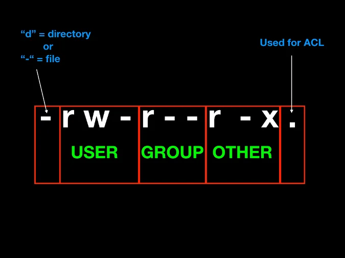
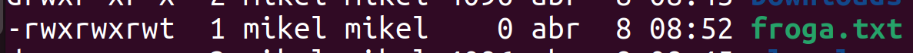
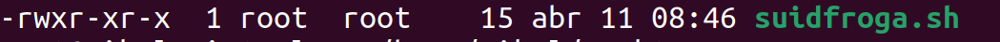
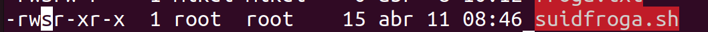
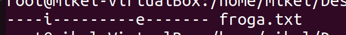
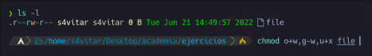
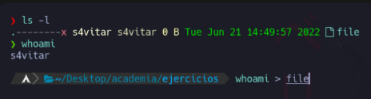
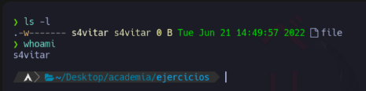

# Permisos en Linux: notación octal y simbólica. Root y sudo

> **Dónde estamos.** Semana 22 · 2.º trimestre · Bloque 3 (Configuración) · **CM6**.
> La semana pasada aplicaste permisos NTFS con la herencia cortada. Esta semana aplicas
> **la misma matriz de permisos** sobre la máquina de Linux. Al final tienes que poder explicar
> en qué se parecen los dos modelos y en qué no.

> **Analogía.** Los permisos de Linux son como las llaves de un edificio de oficinas: hay una
> llave para el titular del despacho, otra para el equipo que trabaja allí y otra para el resto
> del edificio. Cada llave abre, escribe o entra. Windows, en cambio, usa una lista en
> recepción: «esta persona sí, esta no, esta sólo por la mañana». El modelo de Linux es más
> rígido pero mucho más rápido de leer de un vistazo.

## Índice

- [1. Ver los permisos](#1-ver-los-permisos)
- [2. Las tres categorías](#2-las-tres-categorías)
- [3. Notación simbólica: `chmod`](#3-notación-simbólica-chmod)
- [4. Notación octal](#4-notación-octal)
- [5. Los permisos en directorios no significan lo mismo](#5-los-permisos-en-directorios-no-significan-lo-mismo)
- [6. Propietario y grupo: `chown` y `chgrp`](#6-propietario-y-grupo-chown-y-chgrp)
- [7. `umask`: los permisos por defecto](#7-umask-los-permisos-por-defecto)
- [8. Permisos especiales: SUID, SGID y sticky bit](#8-permisos-especiales-suid-sgid-y-sticky-bit)
- [9. Listas de control de acceso (ACL)](#9-listas-de-control-de-acceso-acl)
- [10. Atributos extendidos: `lsattr` y `chattr`](#10-atributos-extendidos-lsattr-y-chattr)
- [11. Root, `su` y `sudo`](#11-root-su-y-sudo)
- [12. Comparación con NTFS](#12-comparación-con-ntfs)
- [Ejercicios](#ejercicios)
- [Práctica de la semana](#práctica-de-la-semana)
- [Entregable](#entregable)

---

## 1. Ver los permisos

```bash
ls -l          # permisos de los ficheros del directorio
ls -la         # incluye los ocultos (los que empiezan por punto)
ls -ld carpeta # permisos DE la carpeta, no de su contenido
```


Cada línea se lee así:

```
-rwxr-xr--  1  alumno  profesores  4096  9 sep 10:24  informe.txt
│└┬┘└┬┘└┬┘     └──┬─┘  └────┬───┘
│ │  │  │         │         └── grupo propietario
│ │  │  │         └──────────── usuario propietario
│ │  │  └────────────────────── permisos de OTROS
│ │  └───────────────────────── permisos del GRUPO
│ └──────────────────────────── permisos del PROPIETARIO
└────────────────────────────── tipo: - fichero · d directorio · l enlace simbólico
```

Los tres permisos básicos:

| Letra | Nombre | En un fichero | En un directorio |
|---|---|---|---|
| `r` | *read* | Leer su contenido | Listar los nombres que contiene |
| `w` | *write* | Modificar su contenido | Crear, borrar y renombrar dentro |
| `x` | *execute* | Ejecutarlo como programa | **Entrar** en él (`cd`) y atravesarlo |

---

## 2. Las tres categorías



| Categoría | Letra | Quién es |
|---|---|---|
| Propietario | `u` (*user*) | Quien creó el fichero, por defecto |
| Grupo | `g` (*group*) | El grupo al que pertenece el fichero |
| Otros | `o` (*other*) | Todos los demás |
| Todos | `a` (*all*) | Los tres anteriores a la vez |

> ⚠️ **Sólo se aplica una categoría, y se comprueban en ese orden.** Si eres el propietario, se
> te aplican los permisos de propietario **y punto**: no se miran los del grupo aunque sean más
> permisivos. Por eso un fichero con permisos `r--rwxrwx` del que **tú eres propietario** no lo
> puedes escribir, aunque tu grupo sí pueda. Esto sorprende a todo el mundo la primera vez
> (y es el [ejercicio 4](#ejercicio-4)).

---

## 3. Notación simbólica: `chmod`

```bash
chmod [categoría][operador][permisos] fichero
```

| Operador | Qué hace |
|---|---|
| `+` | Añade el permiso |
| `-` | Lo quita |
| `=` | Deja exactamente ése y quita los demás |

Ejemplos:

```bash
chmod u+x prueba.txt      # dar ejecución al propietario
chmod go+wx prueba.txt    # dar escritura y ejecución a grupo y otros
chmod o-r prueba.txt      # quitar lectura a otros
chmod a+r prueba.txt      # dar lectura a todos
chmod g=rx prueba.txt     # el grupo queda exactamente con r y x
chmod -R g+w carpeta/     # recursivo: la carpeta y todo su contenido
```

> ⚠️ **Cuidado con `-R`.** `chmod -R 777 carpeta` es el «arreglo» que se encuentra en internet
> para cualquier problema de permisos. También es la forma más rápida de dejar un servidor
> abierto de par en par. En esta asignatura, un `777` sin justificación en el entregable
> resta nota.

---

## 4. Notación octal

Cada permiso vale un número; se suman:

| Permiso | Valor |
|---|---|
| `r` (lectura) | **4** |
| `w` (escritura) | **2** |
| `x` (ejecución) | **1** |

| Octal | Binario | Simbólico | Significado |
|---|---|---|---|
| 0 | 000 | `---` | ningún permiso |
| 1 | 001 | `--x` | ejecución |
| 2 | 010 | `-w-` | escritura |
| 3 | 011 | `-wx` | escritura y ejecución |
| 4 | 100 | `r--` | lectura |
| 5 | 101 | `r-x` | lectura y ejecución |
| 6 | 110 | `rw-` | lectura y escritura |
| 7 | 111 | `rwx` | todos |

Se escriben tres dígitos: propietario, grupo, otros.

```bash
chmod 000 prueba.txt   # ---------  nadie puede nada
chmod 644 prueba.txt   # rw-r--r--  el típico de un documento
chmod 755 prueba.txt   # rwxr-xr-x  el típico de un programa o una carpeta
chmod 700 privado/     # rwx------  sólo yo
chmod 777 prueba.txt   # rwxrwxrwx  todos todo (casi nunca es lo correcto)
```

**Truco para convertir rápido.** Divide en grupos de tres y suma:

```
rwxr-xr--
rwx = 4+2+1 = 7
r-x = 4+0+1 = 5
r-- = 4+0+0 = 4
        → 754
```

---

## 5. Los permisos en directorios no significan lo mismo

Es lo que más se pregunta en el examen porque es lo menos intuitivo.

| Quiero... | Necesito en el directorio |
|---|---|
| Ver los nombres de los ficheros (`ls`) | `r` |
| Entrar (`cd`) o acceder a un fichero de dentro | `x` |
| Crear, borrar o renombrar dentro | `w` **y** `x` |
| Ver los detalles (`ls -l`) | `r` **y** `x` |

Consecuencias que hay que probar en la máquina:

- Un directorio con `r--`: puedes hacer `ls` y ver los nombres, pero no puedes entrar ni leer
  ningún fichero de dentro. Verás los nombres y nada más.
- Un directorio con `--x`: no puedes listar, pero **sí** puedes acceder a un fichero de dentro
  si sabes su nombre exacto. Es la base de las carpetas «ocultas por oscuridad».
- **Para borrar un fichero no necesitas permiso sobre el fichero, sino sobre el directorio que
  lo contiene.** Puedes borrar un fichero de otro usuario, que no puedes ni leer, si tienes `w`
  en la carpeta. Es el motivo de que exista el *sticky bit* (apartado 8).

---

## 6. Propietario y grupo: `chown` y `chgrp`

```bash
sudo chown alumno informe.txt              # cambiar el propietario
sudo chgrp profesores informe.txt          # cambiar el grupo
sudo chown alumno:profesores informe.txt   # los dos de una vez
sudo chown -R alumno:profesores carpeta/   # recursivo
```

> Sólo root puede regalar un fichero a otro usuario. Si no fuera así, cualquiera podría poner
> un fichero enorme a nombre de otro y saltarse las cuotas de disco.

---

## 7. `umask`: los permisos por defecto

Cuando creas un fichero, ¿de dónde salen sus permisos? De la `umask`: una máscara que **resta**
permisos al valor máximo.

```bash
umask          # ver la actual (normalmente 022)
umask -S       # verla en simbólico
```

| Elemento | Valor de partida | umask | Resultado |
|---|---|---|---|
| Ficheros | 666 (`rw-rw-rw-`) | 022 | **644** (`rw-r--r--`) |
| Directorios | 777 (`rwxrwxrwx`) | 022 | **755** (`rwxr-xr-x`) |

> Los ficheros parten de 666 y no de 777 a propósito: un fichero recién creado no debería ser
> ejecutable nunca. Si lo fuera por defecto, cualquier cosa que descargaras se podría ejecutar.

Cámbiala para la sesión actual y compruébalo:

```bash
umask 077
touch secreto.txt
ls -l secreto.txt     # -rw------- : sólo tú
```

Para que sea permanente va en `~/.bashrc` o en `/etc/profile` — el mismo mecanismo de la
semana 29.

---

## 8. Permisos especiales: SUID, SGID y sticky bit

### 8.1 Sticky bit (`t`)

En un directorio con sticky bit, **cada uno sólo puede borrar lo suyo**, aunque todos tengan
permiso de escritura sobre la carpeta.

```bash
chmod +t /tmp/compartida
chmod 1777 /tmp/compartida     # equivalente en octal
ls -ld /tmp/compartida         # drwxrwxrwt
```



> El caso real es `/tmp`: todo el mundo escribe ahí, pero nadie puede borrar los ficheros de
> otro. Compruébalo: `ls -ld /tmp`.

### 8.2 SGID (`s` en el grupo)

En un **directorio**, hace que todo lo que se cree dentro herede el grupo del directorio en
lugar del grupo del usuario que lo crea.

```bash
sudo chgrp ventas /datos/ventas
sudo chmod g+s /datos/ventas
sudo chmod 2770 /datos/ventas   # equivalente en octal
```

> **Éste es el permiso que hace que funcione una carpeta departamental compartida.** Sin SGID,
> cada fichero que cree un usuario llevará su grupo personal y sus compañeros no podrán tocarlo.
> Es la pieza que se te va a pedir en la práctica de esta semana y en el reto final.

En un fichero ejecutable, SGID hace que se ejecute con los permisos del **grupo** propietario.

### 8.3 SUID (`s` en el propietario)

En un ejecutable, hace que se ejecute con los permisos del **propietario del fichero**, no del
usuario que lo lanza.

```bash
chmod u+s programa
chmod 4755 programa
```




El ejemplo real es `passwd`:

```bash
ls -l /usr/bin/passwd     # -rwsr-xr-x ... root root
```

Un usuario normal necesita escribir en `/etc/shadow`, que sólo root puede tocar. `passwd` es
propiedad de root y tiene SUID, así que se ejecuta con permisos de root durante ese instante.

> ⚠️ **SUID sobre un script no funciona** en Linux por seguridad: el núcleo lo ignora. Y SUID
> sobre un binario propio es un agujero clásico: si el programa permite ejecutar cualquier cosa,
> has creado una escalada de privilegios. No pongas SUID sin saber muy bien qué estás haciendo.

Para practicar, crea `pruebasuid.sh` como root:

```bash
#!/bin/bash
echo "Usuario real:"
id -un
echo "UID efectivo:"
echo $EUID
```

```bash
sudo chmod 4755 pruebasuid.sh
```

### 8.4 Cómo se escriben en octal

Se añade **un cuarto dígito por delante**:

| Bit | Valor |
|---|---|
| SUID | **4** |
| SGID | **2** |
| Sticky | **1** |

```bash
chmod 4755 fichero    # SUID  → rwsr-xr-x
chmod 2775 carpeta    # SGID  → rwxrwsr-x
chmod 1777 carpeta    # sticky → rwxrwxrwt
chmod 6755 fichero    # SUID+SGID (4+2)
```

### 8.5 Mayúscula o minúscula: el detalle que decide el examen

Ésta es una corrección importante respecto a los apuntes del curso anterior.

| Se ve | Significa |
|---|---|
| `s` minúscula | El bit especial **y** el permiso de ejecución están puestos |
| `S` mayúscula | El bit especial está puesto pero **falta** la ejecución |
| `t` minúscula | Sticky **y** ejecución en «otros» |
| `T` mayúscula | Sticky pero **sin** ejecución en «otros» |

Ejemplos resueltos:

| Simbólico | Base octal | Especial | Resultado |
|---|---|---|---|
| `r-srwx---` | 5 7 0 → **570** | SUID = 4 | **4570** |
| `r--rws---` | 4 7 0 → **470** | SGID = 2 | **2470** |
| `r--rwx--t` | 4 7 1 → **471** | sticky = 1 | **1471** |
| `r--rwx--T` | 4 7 0 → **470** | sticky = 1 | **1470** |
| `r--rws--T` | 4 6 0 → **460** | SGID+sticky = 3 | **3460** |

> En `r-srwx---` el propietario tiene `r-s`: la `s` minúscula ocupa el sitio de la `x`, así que
> hay lectura **y** ejecución → 4+1 = 5. En `r--rws---` la `s` está en el grupo sobre una `x` que
> sí existía → grupo = 7. Cuenta primero los permisos normales y **después** añade el cuarto
> dígito.

---

## 9. Listas de control de acceso (ACL)

El modelo de tres categorías se queda corto cuando necesitas dar acceso a **una persona
concreta** que no es el propietario ni está en el grupo. Para eso están las ACL, que es lo más
parecido a lo que hace NTFS.

```bash
getfacl informe.txt                          # ver las ACL
setfacl -m u:patxi:rw informe.txt            # dar rw a un usuario concreto
setfacl -m g:direccion:r informe.txt         # dar r a un grupo concreto
setfacl -x u:patxi informe.txt               # quitar esa entrada
setfacl -b informe.txt                       # quitar todas las ACL
setfacl -d -m g:ventas:rwx /datos/ventas     # ACL por defecto: la heredan los ficheros nuevos
```

Cuando un fichero tiene ACL, `ls -l` muestra un **`+`** al final de los permisos:

```
-rw-rw----+ 1 alumno ventas 0 9 sep 10:30 informe.txt
```

> **`setfacl -d` es la herencia de Linux.** Es el equivalente conceptual a la herencia de
> permisos de NTFS que viste la semana pasada, y la comparación entre ambas es parte del
> entregable.

---

## 10. Atributos extendidos: `lsattr` y `chattr`

Los atributos son una capa **por encima** de los permisos, propia del sistema de archivos
(ext4). Un fichero puede tener `rwx` para todos y aun así ser intocable.

```bash
lsattr fichero          # ver atributos
sudo chattr +i fichero  # poner el atributo i
sudo chattr -i fichero  # quitarlo
```

| Atributo | Qué hace |
|---|---|
| `i` (*immutable*) | No se puede modificar, borrar ni renombrar. **Ni siquiera root**, hasta que se quita el atributo |
| `a` (*append only*) | Sólo se puede añadir al final. Ideal para ficheros de registro |
| `s` (*secure deletion*) | Al borrarlo, sus bloques se sobrescriben con ceros |
| `u` (*undeletable*) | Al borrarlo, el contenido se conserva para poder recuperarlo |
| `c` (*compressed*) | Se guarda comprimido |
| `e` (*extent format*) | **Sólo informativo**: indica que el fichero usa extents. Aparece en casi todos los ficheros de ext4 y **no se puede quitar** |

Prueba obligatoria:

```bash
touch prueba.txt
sudo chattr +i prueba.txt
lsattr prueba.txt
rm prueba.txt              # falla
sudo rm prueba.txt         # falla también, aunque seas root
sudo chattr -i prueba.txt
rm prueba.txt              # ahora sí
```



> ⚠️ **Corrección respecto a los apuntes del curso anterior.** Allí ponía que el atributo `e`
> sobrescribe con ceros al borrar. No es cierto: eso lo hace `s`. `e` sólo indica el formato
> interno de almacenamiento y aparece por defecto en ext4. Compruébalo con `lsattr` sobre
> cualquier fichero tuyo.
>
> Ten en cuenta además que `s`, `u` y `c` **no están implementados en el ext4 estándar** de
> Linux: se pueden poner, pero el sistema de archivos no los aplica. Los que funcionan de
> verdad y hay que saberse son **`i`** y **`a`**.

---

## 11. Root, `su` y `sudo`

| Comando | Qué hace |
|---|---|
| `su` | Cambia a root pidiendo **la contraseña de root** |
| `su - alumno` | Cambia a otro usuario **cargando su entorno** (el `-` es importante) |
| `sudo comando` | Ejecuta un solo comando como root pidiendo **tu propia** contraseña |
| `sudo -i` | Abre una sesión interactiva de root |
| `sudo -u patxi comando` | Ejecuta el comando como otro usuario |

Configuración, siempre con `visudo`:

```bash
sudo EDITOR=nano visudo
```

```
%wheel ALL=(ALL:ALL) ALL
```

Se lee: *los miembros del grupo `wheel`, desde cualquier equipo, pueden ejecutar cualquier
comando como cualquier usuario y cualquier grupo*.

Permisos más finos (esto es lo que se hace en una empresa):

```
# Sólo un comando concreto, sin contraseña
patxi ALL=(root) NOPASSWD: /usr/bin/systemctl restart apache2

# Un grupo que sólo puede gestionar usuarios
%rrhh ALL=(root) /usr/sbin/useradd, /usr/sbin/usermod
```

```bash
sudo -l        # ver qué me permite sudo a mí
```

> ⚠️ **Usa siempre `visudo`, nunca `nano /etc/sudoers` a secas.** `visudo` valida la sintaxis
> antes de guardar. Un error ahí deja el sistema sin `sudo` para nadie y hay que arrancar desde
> la ISO para arreglarlo.
>
> ⚠️ **`NOPASSWD: ALL` para todo el grupo `wheel` no es aceptable** en el entregable. Significa
> que cualquiera que se siente delante de una sesión abierta es administrador sin más.

---

## 12. Comparación con NTFS

Rellénala tú; es parte del entregable de esta semana.

| Aspecto | NTFS (semana 21) | Linux |
|---|---|---|
| Unidad básica de permiso | | |
| ¿A cuántas personas o grupos se puede dar permiso distinto? | | |
| ¿Existe «denegar» explícito? | | |
| ¿Cómo se hereda de la carpeta padre? | | |
| ¿Cómo se corta la herencia? | | |
| Herramienta gráfica | | |
| Herramienta de consola | | |
| Cambiar el propietario | | |
| ¿Qué gana si hay conflicto? | | |

> Pista para pensar: NTFS **sí** tiene «denegar» explícito y gana sobre «permitir». Linux
> **no** tiene denegar: la ausencia de permiso es la denegación. Y en Linux se comprueba una
> sola categoría (la primera que coincide), mientras que NTFS acumula todas las entradas de la
> lista. Son dos filosofías distintas y las dos son defendibles.

---

## Ejercicios

### Ejercicio 1

Relaciona cada valor octal con su notación simbólica:

| Octal | | Simbólico |
|---|---|---|
| 462 | | `rwx--x--x` |
| 123 | | `--x-w--wx` |
| 711 | | `--x-----x` |
| 333 | | `-wx-wx-wx` |
| 161 | | `r-xrw-rwx` |
| 765 | | `rwxrw-r-x` |
| 567 | | `--xrw--w-` |
| 101 | | `r--rw--w-` |
| 162 | | `--xrw---x` |

### Ejercicio 2

¿Cuáles son los permisos de este fichero en notación octal?



### Ejercicio 3

Pasa a notación octal:

- `r--r-xrw-`
- `--xr-xr--`
- `r--------`
- `--------x`
- `rwsr-xr-x`
- `rwxr-sr-x`
- `r--rw---T`

### Ejercicio 4

¿Qué ocurrirá al ejecutar el siguiente comando?



1. La salida de `whoami` se guardará en el fichero, porque siendo el propietario los permisos no
   me afectan.
2. La salida de `whoami` **no** se podrá guardar, porque aunque sea el propietario, el permiso
   asignado al fichero prevalece.

*Justifica la respuesta con lo que dice el [apartado 2](#2-las-tres-categorías).*

### Ejercicio 5

¿Cómo conseguirías cambiar los permisos del fichero «file» para que queden como se ve?
Da la solución **en simbólico y en octal**.


### Ejercicio 6

¿Qué permisos en octal hay que asignar para que el fichero quede como se indica?


### Ejercicio 7

¿Podré borrar este fichero, con los permisos que tiene configurados?



1. Sí
2. No

*Pista: la pregunta no es sobre los permisos del fichero. Vuelve al
[apartado 5](#5-los-permisos-en-directorios-no-significan-lo-mismo).*

### Ejercicio 8 (nuevo)

En la máquina virtual, reproduce y explica:

```bash
mkdir ~/pruebas && cd ~/pruebas
mkdir solo-lectura && touch solo-lectura/dato.txt
chmod 444 solo-lectura
ls solo-lectura          # ¿funciona?
cd solo-lectura          # ¿funciona?
cat solo-lectura/dato.txt # ¿funciona?
chmod 111 solo-lectura
ls solo-lectura          # ¿y ahora?
cat solo-lectura/dato.txt # ¿y ahora?
```

Anota qué funciona y qué no en cada caso, y **explica por qué** con la tabla del apartado 5.

---

## Práctica de la semana

Sobre la máquina virtual de Linux, aplica **la misma matriz de permisos de la semana 21**
(la de NTFS), pero al estilo Linux. La empresa tiene tres departamentos: **dirección**, **ventas**
y **técnicos**.

1. Crea los grupos y añade a los usuarios que creaste en la semana 20.
2. Crea la estructura:

```
/datos
├── direccion     → sólo el grupo direccion, nadie más entra
├── ventas        → el grupo ventas trabaja aquí; direccion puede leer
├── tecnicos      → el grupo tecnicos trabaja aquí; direccion puede leer
└── comun         → todos escriben, pero cada uno sólo borra lo suyo
```

3. Requisitos concretos:
   - `/datos/direccion` **no** debe ser accesible ni siquiera de lectura para los demás.
   - `/datos/ventas` y `/datos/tecnicos` deben tener **SGID** para que los ficheros nuevos
     hereden el grupo del departamento.
   - `/datos/comun` debe tener **sticky bit**.
   - Un usuario externo llamado `auditor`, que no pertenece a ningún departamento, debe poder
     **leer** `/datos/ventas`. Como no está en el grupo, hay que usar **ACL**.
4. Configura `sudo` para que el grupo `tecnicos` pueda reiniciar servicios **sin ser
   administradores de todo**.
5. **Comprueba cada requisito iniciando sesión con cada usuario** (`su - usuario`) e intentando
   lo que debe y lo que no debe poder hacer. Una configuración no comprobada no cuenta.

Comandos de verificación:

```bash
ls -ld /datos/*
getfacl /datos/ventas
sudo -l -U auditor
```

---

## Entregable

**Tarea Moodle: «Matriz de permisos Linux + configuración de sudo documentada»**
Calificación de 0 a 10 · Se aprueba con 5.

1. Ejercicios 1 a 8 resueltos, con la justificación de los ejercicios 4, 7 y 8.
2. **Matriz de permisos** en tabla: para cada carpeta, propietario, grupo, permisos en octal
   **y** en simbólico, y bits especiales, con una frase de justificación por fila.
3. Los comandos exactos que has usado, en bloque de código.
4. Capturas de `ls -ld /datos/*` y `getfacl /datos/ventas`.
5. **Pruebas de acceso**: por cada usuario, una captura de algo que sí puede hacer y algo que
   no puede, con el mensaje de error incluido.
6. Configuración de `sudo` con la línea que has añadido a `/etc/sudoers` explicada campo a campo.
7. La [tabla de comparación con NTFS](#12-comparación-con-ntfs) rellenada.

*Instrumento de evaluación: prueba práctica de permisos en Linux y de escalada de privilegios
con `sudo`.*
